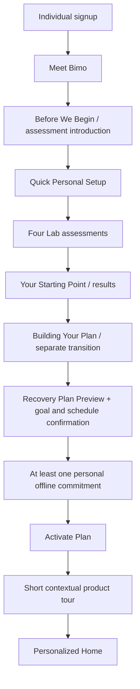

# DeepSprout

## Authoritative Product, Experience, Workflow and Technical Specification

**Version:** 4.0 — final owner-decision reconciliation
**Date:** 15 October 2026 (Asia/Amman)
**Status:** Authoritative **target** specification; §29 separately records evidence-limited current implementation.
**Audience:** Product owner, designers, Codex/Claude Code, engineers, testers and reviewers.
**Delivery:** Phase-1 connected static HTML/CSS/JavaScript demo; eventual Angular + ASP.NET Core/C# + EF Core + SQL Server, with technically validated optional browser extension.

> **Authority:** This file is the one maintained master. The owner's final approvals in the 15 October consolidation request outrank the attached blueprint's earlier open-question labels, which outrank consistent v3.1 requirements and older examples. `docs/product-specification.md` redirects here; dated audits describe observed code, not a second target contract. Historical examples, current demo defaults and design recommendations do not become approved numeric policy. No application implementation is asserted by this specification.

### Requirement labels

| Label | Meaning |
|---|---|
| **Approved** | Owner-confirmed requirement, including the final approvals in this task |
| **Agreed direction** | Product boundary approved; exact parameter or implementation still configurable |
| **Interim default** | Configurable Phase-1 value specified for demonstration, not immutable production policy |
| **Recommendation** | Consistent proposed detail awaiting owner acceptance if it materially fixes policy |
| **Open** | Genuinely unresolved policy/measurement/commercial question, listed in §26.2 |
| **Current observation** | Code/audit evidence with stated verification limit, never proof of target completion |

### Change history

| Version | Date | Record |
|---|---|---|
| 4.0 | 15 October 2026 | Reconciled v3.1 and the later owner-approved D01–D48 decisions; replaced conflicting Garden, Group ownership, Initiative/Program, capacity, attendance, staffing, survey and Lab contracts; added detailed page, workflow, permission, acceptance and evidence-limited current-state coverage. |
| 3.1 | 15 October 2026 | Earlier master with implementation audit layer and then-current Garden/Admin decisions; superseded here. |
| 3.0 | 13 October 2026 | Original conversation specification; superseded here. |

## Contents

1. [Vision, positioning, users and boundaries](#1-vision-positioning-users-and-product-boundaries)
2. [Terminology, identity and workspaces](#2-fundamental-concepts-authorization-and-workspaces)
3. [Public site, login and registration](#3-public-website-authentication-and-registration)
4. [Individual onboarding and assessments](#4-individual-onboarding-bimo-personal-setup-assessments-and-activation)
5. [Recovery Plan](#5-recovery-plan-28-day-cycles-weeks-adjustments-evidence-and-consequences)
6. [Digital Shield](#6-digital-shield-exactly-two-core-capabilities)
7. [Activities and Offline Routine](#7-activities-definitive-catalog-progression-daily-load-and-routine)
8. [Individual Home](#8-individual-home-page-ordered-section-by-section-specification)
9. [Personal and Group Gardens](#9-personal-garden-and-group-garden)
10. [Insights](#10-insights-credible-sources-metrics-charts-and-recommendations)
11. [Explore](#11-explore-discovery-availability-registration-and-location)
12. [Community](#12-community-retained-scope-and-separation-from-recovery)
13. [Coach, Program and assignments](#13-coach--mentor-program-and-shared-assignment-engine)
14. [Invited Student](#14-invited-student-and-full-individual-continuity)
15. [Institution and Initiative](#15-institution-representative-and-initiative-operations)
16. [Outdoor Provider and Waiting List](#16-outdoor-provider-bookings-waiting-list-and-camp-completion)
17. [Supervisor](#17-supervisor-scoped-operations-attendance-excuses-and-insights)
18. [Partnerships](#18-partnerships-and-cross-owner-links)
19. [Platform Admin](#19-one-platform-admin-governance-publishing-and-migration)
20. [Subscriptions and commercial boundaries](#20-subscription-plans-entitlements-and-commercial-decisions)
21. [Pages and cross-workspace effects](#21-information-architecture-page-states-and-visible-cross-workspace-effects)
22. [Technical architecture](#22-phase-1-demonstration-and-eventual-technical-architecture)
23. [Permissions and lifecycle](#23-permissions-privacy-lifecycle-and-integrity-invariants)
24. [Safety, accessibility and measurement](#24-safety-accessibility-privacy-measurement-and-operational-quality)
25. [End-to-end acceptance](#25-end-to-end-demonstration-and-acceptance)
26. [Decision register and open choices](#26-decision-register-authoritative-interim-and-open)
27. [Design and copy guidance](#27-design-system-guidance-and-ui-copy-appendix)
28. [Follow-on engineering artifacts](#28-required-follow-on-uml-and-engineering-artifacts)
29. [Current implementation versus target](#29-current-implementation-versus-agreed-target-15-october-2026)
30. [Implementation roadmap](#30-implementation-dependency-roadmap-and-handoff)

---

# 1. Vision, positioning, users and product boundaries

## 1.1 The actual problem

DeepSprout's personal-product core helps people, especially young people, reduce **unwanted or compulsive short-form content scrolling** (Instagram Reels, YouTube Shorts, TikTok-style feeds), regain agency over attention and time, and reconnect with meaningful activities in ordinary life. The user may be interested in reducing scrolling *only*; studying, reading and becoming maximally productive are **not mandatory goals**.

DeepSprout is **not** a general Habit Tracker, **not** a standalone Focus Tracker, **not** an LMS/Trello clone, **not** a generic booking portal, **not** an endless social-media feed, and **not** a medical diagnosis or treatment tool. It can use focused work, practice, and personally chosen offline routines as *means* to support the larger goal. A lower dependency on DeepSprout itself is a desirable possible outcome.

**Product definition (consolidated):**

> DeepSprout is a digital wellbeing platform that helps young people reduce unintentional short-form content consumption and reclaim control over their attention. It combines individualized recovery journeys and browser-level protection with meaningful practice, offline routines, guided group programs, institutional youth initiatives, and organized real-world experiences.

**Important nuance:** Institutional initiatives are **not required to address Reels**. Institutions may run youth-awareness initiatives on procrastination, smoking prevention, media literacy, wellbeing or other appropriate topics. DeepSprout's **personal Recovery Engine remains centered on short-form scrolling and attention management**; an unrelated awareness initiative does not magically produce a better Reels recovery score.

## 1.2 Intended audience

- **Individual:** a person seeking a personal recovery journey, practice, browser protection, community and experiences.
- **Mentor:** a professional or facilitator running guided programs and groups focused on relevant goals.
- **Invited Student/Participant:** a group member who joins without traditional registration through an authenticated invitation flow; may later become an Individual.
- **Institution Representative:** a person acting on behalf of a verified institution, youth center, NGO, university, potentially public body or ministry. The institution itself is a governed entity, not a human login.
- **Outdoor Provider Representative:** a person authorized by an independent trip/camp/experience organization.
- **Supervisor:** an authorized person assigned to manage specific events, sessions, camps or participant cohorts, not a role users grant themselves.
- **Platform Admin:** a trusted internal operator with explicit, audited platform-management access.
- **Participants in initiatives, sessions and outdoor experiences:** may be existing Individual users, eligible invited users, or other supported verified identities according to admission rules.

The previous blueprint targeted approximately **ages 16–26**. This is a product audience rather than an automatic eligibility rule for every initiative or event. Any age restrictions, including safeguards for ages 16–17, must be defined for the relevant feature and jurisdiction.

## 1.3 Permanent architectural/product principles

1. **One identity, multiple authorized workspaces.** An Individual may also be a Mentor or a staff member of an organization; do not duplicate their user records.
2. **State-changing workflows, not page counting.** Phase 1 must visibly connect roles through consistent demo records; the later ASP.NET Core service owns production validation, permissions, transitions, rewards and booking consistency.
3. **Evidence is labeled.** Browser-tracked time, self-reported offline action, an assessment score and supervisor-confirmed attendance are not interchangeable.
4. **An event is not a campaign.** Distinguish organizational container, staged program, scheduled session, external experience and personal exercise.
5. **Private by default.** Students' personal assessments, browser histories and sensitive responses are not automatically visible to Mentors or Institutions.
6. **Motivating but not manipulative.** No fabricated recovery percentage, arbitrary gamified posting, punishing app absence, or requirement to spend more time online.
7. **All cycles must connect cleanly.** Shared Identity, Permissions, Activities/Evidence, Garden Rewards, Reporting, Notifications and Auditing; domain ownership stays explicit.
8. **Technical limitations are part of the specification.** A Chrome extension cannot silently track all mobile-app Reels or make blocking impossible across devices.
9. **Meaningful offline opportunities.** Explore supports online and in-person youth initiatives and independently organized physical experiences, not only opportunities in the user's home governorate.
10. **No false claims of implementation.** Screenshots, UI mockups, diagrams and example numbers are illustrative until functionality is developed and tested.

---

# 2. Fundamental concepts, authorization and workspaces

## 2.1 Canonical terminology

| Term | What it means | What it is not |
|---|---|---|
| **Account / Identity** | Authenticated, recoverable person, shared across contexts | One database user per role |
| **Global role** | Server-issued platform-wide capability such as Admin | All organizational permissions |
| **Organization** | Institution with approved representatives and governed workspace | A user's personal profile |
| **Outdoor Provider** | Independent authorized operator of physical experiences | Automatically an Institution campaign organizer |
| **Group** | Operational cohort with exactly one Initiative **or** independent Coach Program parent | A separate Program for an Institution internal group |
| **Program** | Independently Coach-owned, versioned group pathway with assignments/reviews | The Institution's structured Initiative or a single event |
| **Initiative / Campaign** | Institution-owned project, optionally structured with internal groups/tasks, sessions, identified forms, competitions and linked external resources | An independently Coach-owned Program or a single session |
| **Session / Workshop** | A scheduled online, in-person or hybrid meeting, potentially tied to an initiative | A mandatory in-person event |
| **Outdoor Experience** | Provider-operated organized trip, outing or other real-world activity | A user's self-reported offline walk |
| **Camp / Bootcamp** | Multi-session experience, with participants, schedule, supervisor and completion policy | Always a residential paid camp |
| **Supervisor Cohort** | Participants within an assigned event/camp under an authorized supervisor | An open general-purpose tasks group |
| **Activity** | Approved personal or program practice with execution/evidence rules | Every user-made to-do |
| **Participation Evidence** | Source-linked, provenance-labeled record of performance or attendance | Automatically a health improvement |
| **Garden Growth** | Visual state earned through qualifying activity/completion | The measurement of recovery itself |
| **Current data status** | Neutral availability/coverage label and any separately approved evidence-backed appearance | A quiet-day decline or inferred relapse |
| **Entitlement** | Paid/free capability and usage limit attached to an account or organization | User role or permission to access any resource |

## 2.2 Identity and security model — agreed direction

- **Unified login:** email/password for conventional accounts, with verified recovery; authenticated existing identities can switch between authorized workspaces.
- **Public Register top-level choices — exactly two:** `Join as Individual` and `Join as a Partner`.
- **Partner second step — three choices:** `Mentor / Coach`, `Institution Representative`, `Outdoor Provider`.
- **No public `Register as Admin`; no self-issued `Supervisor` role; no generic `Invited Student` register card.**
- A representative applies for an organization/provider entity or accepts an authorized invitation to join an existing entity.
- An independent Coach applies for professional capability under the configured verification policy. An Institution-invited Coach gains only the accepted Initiative grant without a separate Platform Admin approval.
- An appointed Supervisor sees the Supervisor Workspace only for assigned resources.
- Invited students may use email OTP (passwordless verification) plus invitation token and obtain authenticated, persistent limited access.
- Server authentication and resource authorization are required at **every sensitive API endpoint**. Angular route guards are only a UI convenience.
- `Join as Partner` is a registration **path**, not a global security role; a single person may later hold several memberships/capabilities.

## 2.3 Workspaces and navigation

| Workspace | Primary navigation destinations |
|---|---|
| Individual | Home, Recovery Plan, Activities, Digital Shield, Garden, Lab, Insights, Explore, Community, profile/settings |
| Mentor | Dashboard, My Groups, My Students, Program Builder/Programs, Assignments, Reviews, Reports, Group Garden, notifications/settings |
| Invited Student | My Dashboard, My Tasks, My Group, **Group Garden only**, assigned Protected Work, My Progress, account/upgrade |
| Institution | Dashboard, Initiatives/Builder, Applications & Students, Groups & Staff, Sessions, Activities overview, Attendance & Excuses, identified Forms/Surveys, Competitions, Partnerships, Reports, Settings |
| Outdoor Provider | Overview, My Experiences, Camp Builder/Sessions, Registrations, Waiting List, Supervisors/Staff, Attendance, Evaluations, Reports, Profile |
| Supervisor | Dashboard, assigned Initiatives/Provider Experiences, Applications, Students & Groups or Provider Cohorts, Coaches, Schedule, Attendance, Notes & Excuses, Evaluations, Group Garden where authorized, Insights/Reports |
| Admin | Overview, accounts/approvals, organizations/providers, mentors/groups, initiatives, experiences, activity and assessment catalog, reward/rule policies, CMS/content, community moderation, reports, audit, configuration |

An authorized user may have a **Workspace Switcher**. A switching UI never itself grants access; entitlements must be returned and validated by the API.

---

# 3. Public website, authentication and registration

## 3.1 Public pages

- Public landing/marketing page explaining the core problem, differentiators, product journey, use cases and clear entry CTA.
- `How It Works` / `Features`, `For Individuals`, `For Mentors`, `For Organizations`, `For Outdoor Providers`, `Pricing`, a responsible `Science / References` explanation, and FAQ/help as routes or sections as appropriate.
- Real `Privacy`, `Terms`, `Contact`, `Help`, account recovery and supported-device/extension information.
- Unified Login; two-level Register; invitation preview and OTP join routes.
- Footer with relevant working links and valid social accounts only; preserve the creator's attribution and © 2026 as previously requested, linking to the creator's website **once a real URL is supplied**. Avoid fabricated links, generic inspirational quote panels and a visible `About` footer column if that earlier design choice remains active.

## 3.2 Register screen — exact decision and visual behavior

**Headline:** `Choose how you'd like to get started.`

**Option 1:** `Join as Individual` — `Personal journey, activities, community and experiences.`

**Option 2:** `Join as a Partner` — `Lead programs, represent an institution or organize experiences.`

- Both options are presented as large, elegant selection cards. The selected card has clear visual emphasis and accessible keyboard state.
- **Individual selected:** warm ivory/cream with sage botanical elements and a subtle, evolving organic/neural network motif suggesting personal growth.
- **Partner selected:** same global palette/typography but background motifs shift to interconnected people, organizations, sessions and experiences.
- Background transition is coordinated, gentle and premium; do not suddenly replace the entire identity or create visual chaos. Honor `prefers-reduced-motion`.
- Individual continues to normal account creation. Partner continues to a **secondary path-selection screen** with Mentor / Institution Representative / Outdoor Provider; then authenticated person details and relevant application/invitation flow.
- Register options are **entry intentions**, not an irrevocable lifetime classification.
- The auth page uses the established cream/green/dark-heading identity, rounded, refined form/card, no unnecessary full marketing navbar above the card; footer stays professional.

## 3.3 Unified Login and routing

After authentication, API returns identity, onboarding state, workspace memberships/permissions and allowed default destination. The user can then open or switch to authorized workspaces. Admin access is privately provisioned; the login form need not show Admin as a public choice. The clearly labeled `Continue as Admin (Demo)` shortcut is acceptable in the static demonstration. It is not authentication and must never be represented or shipped as production authorization. Normal logout, recovery, OTP expiry and login errors must exist.

---

# 4. Individual onboarding: Bimo, personal setup, assessments and activation

## 4.1 End-to-end first-run sequence — latest direction supersedes old New-User Home proposal

Do **not** route a brand-new Individual directly to a marketing-like Active Home before these agreed first-run steps, unless the user is resuming an unfinished first run. Preserve return state at every meaningful stage; do not restart completed assessments after a browser close.

## 4.2 Bimo introduction — TWO short illustrated screens (recommended precise treatment)

Bimo uses **approved original mascot assets**. Do not generate a new lookalike or include Bimo in every card. Use separately layered still artwork and subtle camera/CSS movement, not mandatory Rive animations.

**Screen 01 — Meet Bimo:** Main Bimo art on a light cream botanical scene, waving, clear heading and one primary action. Exact previously accepted draft copy:

> **Hey, I'm Bimo!**
> I'll be your friend along the way. Let's discover your starting point and build a plan that fits you.

CTA: **Let's Begin**. Secondary: **Skip Introduction**. No giant explanation of every feature here.

**Screen 02 — Before We Begin:** Bimo shifts to smaller side illustration; four assessment motifs/cards appear in the same cohesive background.

> **Let's find your starting point.**
> We'll begin with a few questions and four short assessments.
> Your answers and results are private by default. DeepSprout will use them to help build a plan around your goals.
> There are no perfect answers. Just be yourself!
> You can take a break and continue later.

Show an **honest time estimate**, provisionally **15–20 minutes** until actual test durations are validated; show how progress is saved and where privacy details can be read. CTA: **Start Assessments**. `Skip Introduction` skips only the explanatory screens, **not** the four tests. Optionally replay from Help. Screen one should never repeat on every login.

**Privacy qualification:** Do not promise raw answers are sent to an external AI. Results are private by default; the assessment/recommendation system uses them under the product's disclosed rules. If AI is integrated, its inputs, provider and consent boundaries must be documented separately.

## 4.3 Quick Personal Setup — useful questions only

Collect with quick choices, not long essays:

| Question | Functional reason and resulting use |
|---|---|
| Main goal? | Determines plan objective and relevant intervention candidates. Examples: reduce short-video scrolling, use phone more intentionally, create time for offline interests, support a specific focus objective. |
| Which services are most distracting? | Helps build a user-selected browser site list. Must not assume mobile app blocking is available. |
| When do you usually scroll more than intended? | Can **suggest** an intervention time; only a **self-report**, not automated inference. Include `varies / not sure`. |
| Approximate time spent scrolling? | Optional self-reported baseline; do not treat as objective usage measurement. |
| Where do you browse (computer Chrome or phone)? | Establish technical feature availability and honest Shield instructions. |
| What do you enjoy offline? | Selects relevant personal alternatives, not a clinical psychological diagnosis. |
| Time/available days for activities? | Prevents overload; supports a realistic weekly schedule. |
| Preferred protection intensity/notification tolerance? | Suggests reasonable Shield defaults, but user controls activation and limit. |
| **One small personal offline commitment** | Required before first plan activation under the latest discussed direction; e.g. walk five minutes, sketch, read two pages, practice music. The platform does not judge how impressive it is. |

A question about *why* the user scrolls (boredom, stress, avoidance) can exist as an **optional** multiple-choice input, never a repeated interrogation each time they open Instagram. Its lack does not block a functional plan. Personalization inputs are stored separately from performance scores; liking walking does not improve an attention-test result.

## 4.4 Four baseline assessments — unchanged set

| Assessment | Core interaction | Appropriate recorded outputs |
|---|---|---|
| **Digital Habits** | Short, honest questions about short-video use, stopping, habits and context | Clearly labeled self-reports and chosen goals; instrument version |
| **Sustained Attention** | Timed visual response task | Task accuracy, omissions/commissions, reaction times if measured correctly, attempt validity |
| **Inhibitory Control** | Respond to selected signals and withhold response to others | Response-control task metrics, errors, timing and version |
| **Depth Challenge** | Short reading passage with comprehension questions | Accuracy/reading-comprehension task outcomes; passage difficulty/version |

- Four assessments, not four diagnoses; no fake brain-health percentage.
- Assessment introduction, individual progress, pause/resume, failure/retry, timeouts, saved partial progress and Results are required states.
- Preserve item/content version, timestamps, relevant attempt metadata, scoring logic version and comparability constraints.
- Do not treat goals/preferences as test-score components.
- Estimate total duration using actual tasks before presenting a fixed claim.
- **Official periodic reassessment is free and opens in a weekly eligibility window.** Reuse the existing Digital Habits + one rotating cognitive/task assessment direction pending protocol validation; do not require all four every week. Weekly Review is not a fifth test. Practice/rehearsal does not count as official reassessment; versions and valid comparison rules apply.

## 4.5 Results → separate plan-building presentation → activation

**Result scene:** `Your Starting Point` shows four distinct categories, valid task results and concise caveats. A clean, coordinated animation assembles the results; do not imply a medical diagnosis or common 0–100 brain score.

**Plan-building scene:** a distinct, short illustrated transition: understanding goals → matching approved activity candidates → proposing a four-week roadmap → ready for review. Phase 1 should calculate from real demo inputs where feasible and label fixed demonstration behavior; the later service owns production computation. Bimo may appear contextually in one meaningful frame.

**Plan Preview:** user sees goal, proposed 28-day cycle, overall four-week direction, the *first detailed week*, recommended practice cadence, one chosen personal offline routine, and possible Shield support. The user can change permitted preferences and timing, see a recomputed preview if needed, then **Activate My Plan**. Do not start irreversible commitments merely because a preview was generated.

**Product Tour:** short contextual overlays showing Home (next action), Recovery Plan (planning), Activities (execution), Digital Shield (protection), Garden (visual achievements), Insights (measurement), Lab (assessments) and Explore (initiatives/experiences). Tour should be skippable, replayable from Help and not a mandatory ten-step wizard.

**Returning users:** use onboarding state to resume the exact relevant location: Bimo not seen, intro, quick setup, unfinished assessment, Results, plan preview, or active Home. Never treat partial progress as a completed baseline.

---

# 5. Recovery Plan: 28-day cycles, weeks, adjustments, evidence and consequences

## 5.1 What a plan is — and is not

**Recovery Journey** is a continuous personal history; **Recovery Cycle** is a bounded planning interval; **Week** is the current plan's detailed scheduling unit; **Daily Action** is a scheduled commitment, not an entire independent plan. The page is not a universal habit tracker or an overloaded generic calendar.

**Recommended/strongly favored:** first default cycle = **28 calendar days, four weeks**. The owner repeatedly explored and positively received this structure, but exact global duration/policy is not a clinically proven recovery period and should be marked as a configurable product default rather than a promise of recovery in 28 days. Completing 28 days does not reset the Garden or guarantee recovery.

The system initially builds a high-level roadmap for all four weeks, **but details only Week 1**. At each weekly boundary, validated evidence and the light Weekly Review generate the next detailed week. This adaptive scheduling model was expressly liked. Do not fabricate 28 fixed daily exercises on Day 0.

## 5.2 Suggested page tabs and exact responsibilities

The earlier mockup contained `Overview / Schedule / Adjust / History`. The more recent, clearer proposal is **`Overview / This Week / Adjust / History`**. User has welcomed the functionality but exact tab labels remain UI decisions.

### A. Overview

- Title `Your Personal Roadmap`, current goal/target, `Active Cycle`, cycle number, current week and day.
- One clear four-week roadmap, **W1 → W2 → W3 → W4** in English LTR. Week status: completed, current, upcoming, paused/closed where applicable.
- A compact description of this week's relevant focus, not generic fixed Prepare/Protect/Reconnect labels forced on everyone.
- Current week's key commitments: eligible core practice, small personal routine, and any opted-in browser protection settings; separated by evidence type.
- One prominent CTA to `Open This Week` / `Start Next Activity`, taking the user directly to Activities when execution is needed.
- Progress bar, if shown, must identify what it measures (e.g. elapsed days or due practices completed), **not a fictitious recovery percentage**.
- Weekly Review due/overdue or cycle-end banner when applicable.

### B. This Week (formerly Schedule)

- Day-by-day weekly list/calendar: required practice when assigned; personal offline routine; optional practices; review; days with nothing required.
- Each item displays title, estimated time, progress state, source, verification level, due window, and Start/Details/Reschedule action as appropriate.
- `Start` routes into **Activities** or the relevant supported Shield operation; do not implement a second activity player inside Recovery Plan.
- `Reschedule` is permitted for eligible future/unstarted personal activities according to business rules. No retroactive changing of attempt results.
- This is not a Google Calendar replacement, generic project planner, or endless to-do board.

### C. Adjust

Adjust is always **available to request**, but the engine distinguishes:

| Change category | Example | Rule |
|---|---|---|
| Small preference | Swap walking for drawing; available day | Update eligible future commitments without resetting cycle |
| Scheduling | Move tomorrow's unstarted reading exercise | Respect due windows/conflicts; append revision/audit |
| Practice load | Fewer core exercises or less intense level | Check engine limits; show change before confirming |
| Main-goal change | Change the main target or intervention strategy | Re-evaluate suitable plan components and generate new future-only preview; preserve history |
| Protected session | Change strict block mid-active timer | Respect opted-in locked-session rules and browser capabilities; do not promise impossible enforcement |
| Mentor assignment | Change a mentor-issued task | Participant **cannot** modify mentor's underlying assignment; request change from authorized Mentor |

A quick preference update does **not** create an entirely new 28-day cycle. Significant change produces a version/revision of **future** plan content; recorded history, assessment data, previously earned rewards and evidence do not disappear. Users cannot mark missed verified activities as completed merely by editing a schedule.

### D. History

- GitHub-style heatmap of **qualified scheduled activity completion**, not a graph of brain recovery or days signed in.
- Distinguish `No scheduled activity`, `Not due yet`, `Completed`, `Partial`, `Missed`, `No reliable data` with legend/tooltips and accessible non-color alternatives.
- Recent cycle history, summaries of 28-day cycles, weekly reviews, plan adjustments, current/stored goals and comparison links to Insights.
- Streak, if displayed, must have a strict definition involving **scheduled eligible days**, not every calendar login. Planned rest days do not constitute failure.
- Quick summary metrics may show planned/due/completed practices and number of reviews; avoid duplicating the entire Insights dashboard.

## 5.3 Commitments → Evidence → Adaptation (agreed core logic)

1. **Commitments:** a user-selected goal, optional Shield action, allocated core practices, a small offline routine, and schedule.
2. **Evidence:** system-validated in-app attempts, browser-provided supported events, explicit user self-reports, and third-party attendance/reviews, each with provenance.
3. **Adaptation:** server-side rules inspect suitable evidence; they propose continuation, reduced load, alternative content, progression or revised timing.

Do not conclude that the user opened Instagram for emotional reasons or spent time watching Reels from lack of site login. No forced manual diary after each social-media session.

## 5.4 Daily activity load and progression

- **Recommended starting load:** one core Meaningful Practice on roughly **3–4 scheduled days per week**, plus one chosen offline micro-routine; optional extra practice at most within a reasonable daily limit. These exact numbers remain **calibration parameters**, not formally adopted quantitative requirements.
- The owner mentioned **up to three activities in a day** as an illustration, **not three mandatory practices every day**.
- Plans adapt practice type/level to goal, demonstrated task results, available days and user preference. Do not assign reading by default to a person whose sole objective is reducing Reels unless they want it.
- Days with zero required in-app exercises are valid; DeepSprout should actively support time away from the app.
- Extras and repeated content do not generate limitless growth.

## 5.5 Weekly Review — simple decision point, NOT a Stillness activity

Triggered around the week's end or upon return when a scheduled review is pending:

- Show verified, reported and missing data distinctly; due vs completed practices; latest supported-browser summary where available.
- Ask **one or a few simple questions**, e.g., `How manageable did this plan feel?`, optionally `Did this week's activity choices fit you?`.
- Explain next week's recommendation and which inputs support it.
- Offer **Accept Next Week**, **Keep Current Pace** where safe, or **Adjust**. User decides important changes; never silently increase difficulty.
- Save plan revision/version plus reason and applicable dates. Preserve prior records.
- If review is skipped, maintain a **conservative continuation** rather than blocking the whole experience or automatically raising workload.

## 5.6 Missed days, long absence and cycle ending — agreed behavioral policy

| Real case | Required handling |
|---|---|
| One missed scheduled exercise | Mark the historical window missed/expired as appropriate; do not infer excessive Reels consumption |
| Several missed exercises | Gentle notice and rescheduling/load adjustment suggestion; don't pile up a backlog |
| User absent ~one week | On return show short summary and choice to resume/adapt; don't automatically reset Garden |
| Cycle ends while absent | Do not label it successfully recovered; offer cycle review then next cycle/maintenance |
| Shield validly operated in browser during website absence | Retain supported, verified records without requiring the site to be open |
| No measurements for several days | Treat as **unknown**, not success, relapse, zero usage or reason to kill plant |
| Genuine observed or honestly reported setback | Show an honest, source-labeled trend and supportive plan choices; Garden appearance changes only under a separately approved evidence-backed rule |
| User completes entire cycle | Review outcomes, then select another cycle, adjusted approach or lighter maintenance mode |

**Important:** elapsed calendar time, plan adherence, scrolling-goal progress and assessment performance are **four different notions**. Neither days since signup nor activity count directly equals recovery.

## 5.7 Suggested state machine and termination

`Draft → Preview → Active → ReviewDue → (Adjusted Active / Active) → CycleEnded → Reviewed → (NextCycle / Maintenance)`.

Allow `Paused`, `Cancelled` and `Archived` where product rules justify them; define permitted transitions in C# and validate them server-side. Plan changes should target future obligations only. Maintain `RecoveryJourney`, `RecoveryCycle`, revision history, weekly schedules/assignments, weekly reviews, eligible assessment attempts and evidence identifiers.

## 5.8 Reassessment and Lab relationship

- Four baseline tests on initial Individual onboarding; formal reassessments later on defined, methodologically justified eligibility windows.
- Official reassessment eligibility opens **weekly**, independently of the 28-day personal-plan direction. The current Digital Habits plus one rotating task sequence is the implementation direction; exact window length, variants and comparability remain open. Do not force all four tests each week.
- **Free** access to necessary official reassessments and core historical comparisons was recommended and repeatedly maintained; do **not** put the user's basic right to see progress behind Plus.
- Previous results remain stored, versioned and comparable only when instrument/scoring conditions allow. Practice effects can bias cognitive task scores. Inform users.

---

# 6. Digital Shield: exactly two core capabilities

**Latest explicit decision:** The public Shield feature set should contain **TWO** independently understandable capabilities, not the previous nine partly overlapping intervention names.

## 6.1 Manual Website Protection

**User flow:** open Shield → see extension connection status → choose supported websites/domains → choose countdown duration → inspect lock conditions → `Start Protection` → extension applies blocking rules inside the supported browser → countdown displays active/ending/expired status → resume normal access when the timer expires.

- User selects e.g., Instagram, TikTok, YouTube or eligible URLs; selection/configuration alone does not earn unlimited rewards.
- Blocking is **browser-scoped** and only as strong as actual extension capabilities. Do not claim that the user cannot uninstall the extension, change browser or use another device.
- Whether Instagram Reels can be blocked separately from non-Reels functions must be validated; never pretend reliable Reels-only detection if only full-site domain data is available.
- A locked session, if offered, should state limits honestly and not be silently overridden by the **other** intervention's `Continue` button.
- Distinguish `Configured`, `Extension Connected`, `Protection Active`, `Failed`, `Expired`, `Disconnected`.

## 6.2 Shared Website Usage Reminder

**User flow:** choose a group of supported websites → choose aggregate threshold, e.g., 30/60/120 minutes or custom permitted duration → the extension estimates **active supported-browser usage** over a defined daily period → show a prompt when threshold is crossed:

> **You've reached your chosen limit.**
> **Continue Anyway** / **Back to DeepSprout**

- Time from selected sites is summed as a group, not tracked as separate guaranteed limits unless configured differently.
- Default threshold (including the user's original **two-hour example**) is **not finalized**. The user chooses the value; do not require 2 hours for everyone.
- Recommendation: one threshold reminder per daily period, avoiding an immediate repetitive popup after `Continue`.
- This **soft** warning does not defeat an already active strict block.
- Count only what can be measured with permitted tab/window/activity/idle APIs and handle offline/partial-event uncertainty. Domain-level tracked time is **not equivalent** to time spent on Reels alone.
- `Back to DeepSprout` should navigate to the relevant dashboard/goal or next eligible activity; it need not award anything merely for clicking.

## 6.3 What was removed from the current Shield catalog

**Not separate features/Activities in current scope:** Scheduled Protection, generic Daily Usage Limit marketed separately from the one shared reminder, Intentional Pause as a third user-facing feature, If–Then Plan as standalone, Return to Goal as standalone, Notification Cleanup, Morning Reset, Evening Reset, Quiet Break, Pause & Notice. The legitimate `Continue / Return` prompt is already part of **Usage Reminder**, not a separate activity. They appeared in early blueprints but were **explicitly rejected as redundant** in later discussion.

## 6.4 Supported extension and graduation demonstration

- Downloadable **ZIP source bundle** may be provided for test/demo. To use `Load unpacked` in Chrome, **extract** it and load the extension folder containing `manifest.json` from `chrome://extensions` with Developer Mode enabled. A ZIP cannot simply be treated as a store-installed extension.
- Extension enforces site blocking and produces reliable available browsing events **locally**; ASP.NET Core stores selected settings, authenticated sync and accepted evidence/usage records under consent and security controls.
- Design distinct pages/states for `Not Installed`, `Unpacked Extension Installation Guide`, `Connected`, `Blocking Active`, `Reached Limit`, `Disconnected`, `Sync Pending`, `Rule Failure`.
- Do not claim complete Android/iOS app coverage or bypass-proof enforcement. Restrict measurements to supported browser and permissions.
- Security: limit permissions, authenticate sync, validate events, handle clock skew, do not treat arbitrary client traffic as tamper-proof evidence; avoid collecting full browsing histories when unnecessary.

---

# 7. Activities: definitive catalog, progression, daily load and routine

## 7.1 Separation of concerns

- **Recovery Plan owns scheduling**, eligible recommendations and review.
- **Activities owns content, attempts, execution, completion and self-reported routine**.
- **Shield owns manual blocking and shared site-time reminder**; it is not a row of nine Activities.
- **Explore owns institution initiatives and organized offline/online opportunities**; these are not interchangeable with personal activities.
- **Lab owns four formal tests**, not daily training mini-games.
- **Insights owns analysis**; **Garden owns earned appearance**.

## 7.2 Four Meaningful Practice types — current adopted taxonomy

| Canonical type | User experience | Important completion conditions |
|---|---|---|
| **Depth Practice** | Read an approved short passage; answer questions about ideas, details and understanding. | Versioned passage, comparable difficulty tier, scored question attempt when applicable. |
| **Listening & Recall** | Listen to a short original/licensed audio clip; answer questions on the main point, details and relations. | Track audio attempt, permitted replays, question outcome, accessibility mode. |
| **Practical Micro-Challenge** | Perform a small concrete cognitive, organizational or creative task with a clear prompt and outcome. | Challenge-specific evidence; no arbitrary repeating for unlimited rewards. |
| **Protected Work** | Choose a meaningful real task, begin an optional supported browser protection/work session, and log appropriately. | Do not infer that work quality was excellent just from timer elapsed; distinguish support from verification. |

**Embedded steps rather than separate menu cards:** `Comprehension & Recall`, `Explain in Your Own Words` can occur within Depth/Listening. **Longer Learning Path** is an organizational sequence of exercises and was discussed as a later extension, **not a fifth required activity card**. Standalone Focus Timer and generic cognitive mini-games are excluded from the core training lineup.

## 7.3 Gradual exercise difficulty

- One-minute reading at entry, then perhaps 3, 5, 7 minutes is a **candidate example**, not a mandated daily or linear schedule.
- Duration is not difficulty on its own: content complexity, vocabulary, number/type of questions and demonstrated comprehension must be considered.
- Use **independent level per activity type**: reading advancement does not auto-raise Listening level.
- Proposed eligibility combines valid distinct completions, suitable scores where measurable, version/difficulty history, signs of struggle and user preference. **Two-day streak alone does not unlock a higher level**.
- When eligible, show a prompt `Ready to try a longer one?` with `Try Next Level` / `Stay Here`; safe step-down is allowed without destroying history.
- Numeric thresholds (number of attempts, passing performance, durations and load) are **to calibrate**, version and test, not clinical metrics or falsely agreed fixed values.
- A meaningful practice is distinct from official Lab reassessment; frequent practice cannot claim improved brain health.

## 7.4 Offline Life — light personal checklist, not full Habit Tracker

**Latest direction:** every Individual chooses **at least one small personal offline routine** while activating the first plan. User decides its meaning and intensity, e.g., 5-minute walk, drawing, hobby, reading a physical book, time with friends/family. The product should not judge the content's prestige. User may later add, edit, pause or schedule additional checklist items.

| Item idea | Treatment |
|---|---|
| Offline Walk | Personal self-reported activity; may be eligible mission under separate policy |
| Creative Activity | Drawing/making something; optional attachment only when genuinely needed |
| Physical Reading | Reading a real book if personally relevant |
| Offline Hobby | User-defined interest/activity |
| Social Activity | Meaningful offline interaction, without intrusive evidence demands |
| Personal Recovery Goal | Explicit personal goal/commitment, not automatically a scheduled task |
| Personal To-Do | Ordinary life task; **no automatic XP or Garden reward** |

**UI:** `My Offline Routine` within Activities. Allow Done/Skipped, optional times/days, reasonable editable recurrence. A checklist tick is **self-report**, not externally verified evidence. Apply a reward cap and repeat rules if a specific routine qualifies; never grant infinite growth from creating or completing arbitrary self-authored tasks.

## 7.5 Community behavior related to activities

`Share Achievement` is an **optional social post action** after a real achievement, not a rewarded practice. Sharing/likes/comments do **not** grant Garden Growth. `Joint Goal` and `Progress Check-In` belong to **Community's** collaborative goal workflow; `Accountability Partner` was previously discussed as a later refinement, **not a compulsory partner system**.

## 7.6 Removed Stillness & Reflection catalog

The user **explicitly chose to remove the entire user-facing `Stillness & Reflection` activity family**: Just Be / Quiet Break, Pause & Notice, Activity Reflection as standalone, Setback Review as a standalone task, Ink Room and similar prompts. **Weekly Review remains essential within Recovery Plan**, not within training catalog. Optional simple feedback within a practice can exist when legitimately necessary without resurrecting a separate Stillness category.

## 7.7 Activities page — functional organization

Recommended tabs: `For You`, `Explore Activities`, `Assigned`, `History`, plus a clearly visible `My Offline Routine` area. **Do not confuse the `Explore Activities` tab with the global `Explore` page for institutional opportunities.** A less ambiguous label could be `Browse Practices` (final label TBD).

- **For You:** current eligible core practice and optional one, source from the plan, next activity CTA.
- **Browse Practices:** approved training types with duration/type/difficulty filters; eligible on-demand access.
- **Assigned:** Mentor or program assignments, if the current identity belongs to an active group; deadlines/status/review path.
- **Offline Routine:** user-created simple daily hobby checklist; its records are visibly self-reported.
- **History:** attempts, completions, pending reviews, revised submissions and associated sources; not a substitute for Insights.

**Example daily combination:** one assigned Meaningful Practice + one personal offline commitment + optional additional practice. Do not schedule all four practices every day. Core activities assigned by a free Recovery Plan remain free even when optional extra-practice limits are reached.

## 7.8 Attempt and completion policies

Every activity definition is versioned and has: category, goal tags, estimated time, difficulty, prerequisite eligibility, content/media version, response/completion method, evidence tier, reward rules, repetition limits, and publication status. Store attempt lifecycle `Started`, `Paused/Interrupted`, `Submitted`, `Pending Review` when relevant, `Completed/Approved`, `Needs Revision`, `Cancelled/Expired` as appropriate. Never derive verified completion solely from a client-supplied boolean.

- **System-scored:** only if the exercise has real scoring logic and input validation.
- **Browser-observed:** only events within supported extension boundaries.
- **Self-reported:** offline checklist/mission; distinguish from independently confirmed events.
- **Mentor/Supervisor-reviewed:** authorized confirmation of participation/assignment completion.
- **Reward eligible:** only after policy validation; unique source identity/idempotency.

---

# 8. Individual Home page: ordered section-by-section specification

**Home is a personalized action hub styled as a rich modern homepage; not a second full dashboard, and not a generic marketing landing page.** The owner explicitly favored distinct, visually unified sections rather than one overloaded grid.

| Order | Section | Content and action |
|---|---|---|
| 1 | **Navbar** | Brand, Home, Recovery Plan, Activities, Digital Shield, Garden, Lab, Insights, Explore, Community; profile, notifications, and optional workspace selector. Responsive grouping if crowded. |
| 2 | **Hero** | Elegant branded welcome; goal context and **one state-aware primary action**, plus a clear secondary `Explore Activities`/Activities CTA. Avoid redundant filler. |
| 3 | **Your Goal** | Dedicated section with goal/target and appropriately labeled recent direction; opens Plan or Insights. |
| 4 | **Your Garden** | Dedicated visual preview of the **four practice-type trees in the fixed Personal Garden scene** and latest meaningful growth; opens Garden. |
| 5 | **Offline Ideas to Try** | Small, relevant personal activities matching preferences; links to personal routine/practice details, with organized bookings clearly separate in Explore. |
| 6 | **Outdoor Experiences** | Real organized trips/camps/available experiences; dates, location/online mode, organizer, booking availability where verified; opens Explore detail. |
| 7 | **Join an Initiative** | Youth initiatives (not all Reels-themed), with topic, Institution and participation status; opens regular Explore Initiative detail. |
| 8 | **Hear from Your Community** | Small curated/eligible selection of positive, useful actual community posts; no endless scrolling on Home. |
| 9 | **How It Works** | `Small steps. Real change.` four concise stages; prominent for first-time users, collapsible/less prominent later. |
| 10 | **Final CTA** | `Ready to grow a better you?` + `Continue your journey` / `View insights`, with state-correct routing. |
| 11 | **Footer** | Product/support/privacy/terms/contact/real official socials and creator attribution. |

**Suggested four How It Works stages, as discussed:**

1. **Set your goal** — Choose what you want to improve.
2. **Follow your plan** — Take small, personalized steps.
3. **Explore offline** — Practice focus in real life.
4. **See your growth** — Notice the progress you've made.

**State-aware Hero primary CTA:** no active plan → `Build My Recovery Plan`; practice due → `Continue Today's Activity`; review due → `Review Your Week`; returning after absence → `Resume Your Journey`; no immediate obligation → `Explore Activities`. A visible Activities shortcut remains desirable but should not override the genuinely most relevant next action.

**Home data rules:** do not show unavailable browser measurements as zeros or fabricated improvements; no fake live events/participants/likes; no invented testimonials. Garden preview should not reproduce the full Garden page. Keep layout elegantly cohesive with light ivory, pastel sage greens, appropriate typography, rounded cards and restrained shadows. The project has repeatedly rejected overly random, unrealistic, cluttered and repetitive visual layouts.

---

# 9. Personal Garden and Group Garden

## 9.1 Approved visual and ownership contract

The **Personal Garden** is one fixed, large, clean white/ivory scene. It contains **exactly four distinct, comparatively small trees**, mapped one-to-one to Depth Practice, Listening & Recall, Practical Micro-Challenge, and Protected Work. There is **no central fifth journey tree**. Each existing type tree can progress through versioned, source-backed stages; a completion never plants another tree. The scene does not expand into beds, zones, paths, biomes, or a collection inventory. Home's preview must depict this same model. Bimo may celebrate an earned change, but manual watering grants nothing.

A qualifying Offline Routine record may unlock a **small flower**; actual eligible session attendance may unlock a **rabbit**; verified eligible camp completion may unlock a **birdhouse**. Decorations are bounded policy effects, not one object per check-in. Initiative Completion and independent Coach Program Completion share one achievement classification for history and reporting. Neither adds a Personal Garden tree or decoration. Display `Completed` in My Initiatives or program history and `Insights → Offline & Experiences`; show a source-backed collective milestone in the Institution Initiative Group Garden where applicable. Joining, booking, clicking, posting, a paid purchase, or an accepted absence excuse never grants an attendance reward.

A **Group Garden** is a distinct collective view, never a region of the Personal Garden. In Phase 1 there is exactly one Group Garden per **Institution Initiative** (contributions from all accepted participating students, aggregated across internal Coach groups) and one per **independent Coach group** owned by its Program. No Institution internal group gets its own scene; no Outdoor Provider camp/cohort gets a Group Garden. The view uses bounded, genuine collective milestones, not one object per student. An Invited Student sees only their authorized Group Garden until upgrading to a full Individual account. Upgrade preserves membership, work and earned history. An Individual may access an authorized Group Garden as a separate destination.

## 9.2 Reward source and neutral data-status rules

| Source event | Personal effect | Collective effect and evidence |
|---|---|---|
| Valid approved Meaningful Practice attempt or reviewed assignment | Progress only the corresponding practice-type tree under policy | Count once toward the owning Initiative or independent Coach group when eligible; preserve assignment/review IDs |
| Eligible self-reported Offline Routine | Bounded small flower | Only if a published collective policy explicitly allows this self-report source |
| Confirmed eligible session attendance | Bounded rabbit | Count factual attendance with session/registration/Supervisor and method references |
| Verified eligible camp completion | Bounded birdhouse | Provider report; no Provider Group Garden |
| Initiative or Coach Program completion | `Completed` history/Insights, **no Personal Garden object** | Appropriate source-backed Initiative collective milestone; independent group policy may recognize its own completion |
| Mere registration, accepted excuse, login, likes, arbitrary to-do, repeated approval | None | None |

Reward evaluation consumes a unique source event ID, source version, subject, beneficiary and policy version; an event can grant each eligible effect at most once. Reversal/correction must keep the original evidence and an attributed compensating decision rather than silently deleting history. Reward thresholds, repeated decoration ceilings, tree species and exact layout remain open policy values. **No recent data is neutral.** Earned growth persists; do not dim, wilt or destroy a tree solely because days passed without app activity. A genuinely known and relevant adverse event, if ever displayed, needs a separately approved rule and must not be confused with missing observation.

## 9.3 Garden page and states

`My Garden` shows the fixed visual, keyboard-accessible descriptions of each tree and decoration, a compact next eligible milestone only when a real rule exists, recent earned events with date/source, and a separate link to authorized Group Garden(s). Empty state shows the four tree positions and explains how to begin without pretending rewards were earned. Missing source data reads `No recent data`; revoked or corrected evidence has a transparent history. Rendering and animation respect reduced motion. The Group Garden shows owner, initiative/program/group name, collective milestone history, source counts and authorized contributor summary without exposing personal Lab, Shield or Recovery records.

**Current code, not target:** `Client/src/pages/member/garden/garden.js` renders a prominent journey tree plus trees per achievement; `Client/src/js/data/account.js` also grants generic growth for weekly review and attendance and computes vitality decay after quiet days. Partner `group-garden` pages use separate local data. These are implementation gaps, not alternative Garden decisions.

---

# 10. Insights: credible sources, metrics, charts and recommendations

## 10.1 Fundamental separation

**Garden celebrates earned events; Insights measures and explains distinct records.** The illustrative previous Insights design included `Focus Score 68`, `Depth Score 61`, `2.1h Average Scrolling Time`, `Consistency 76%` and smooth charts across days. These must **not** be presented as real values or objective neurocognitive improvement unless precise validated sources/definitions support them.

Do **not** plot unrelated percentages, assessment task scores, hours of browser use and completion rate on one common 0–100 axis as if comparable. Avoid a generic `brain recovery %` or unsourced daily focus score. Formal Lab assessments do not generate daily improvements unless an eligible retest took place.

## 10.2 Five distinct domains

| Domain | What is displayed | Data provenance and limitation |
|---|---|---|
| **Digital Usage** | Tracked usage on selected sites, supported-browser time trends, configured threshold comparisons | Chrome-extension observed/derived; **not** phone app time or certain Reels-only time |
| **Recovery Plan Adherence** | Due scheduled practices, completed, missed/excluded, reviews and plan adjustments | Plan scheduler + eligible activity records; not a diagnosis of behavioral recovery |
| **Meaningful Practice** | Valid attempts, reading/listening levels, question outcomes, Protected Work records | Activities Engine; progression may be different for each skill |
| **Lab Assessments** | Baseline and eligible comparison attempts for four instruments | Versioned, non-diagnostic, comparable only with valid matched versions/protocols |
| **Offline & Experiences** | Self-reported personal routine days, confirmed session/workshop/event/camp participation, initiative completions | Clearly separate self-report, registration, attendance and verified completion |

If no extension data exists, show **`No browser usage data available`**, not `0 minutes` or a zero-height bar. Manual phone Screen Time summaries may be accepted as **self-reported**, but must not be silently combined with extension-observed usage.

## 10.3 Credible metrics and formulas

**Scheduled Practice Completion Rate** (example):

`100 × eligible completed scheduled practices ÷ eligible scheduled practices due`

Document numerator/denominator, time window, exclusions and treatment of rescheduled/rest days. The presence of a calendar day with no scheduled practice does not create a missed task.

**Tracked Browser Usage Average** (example):

`sum(valid observed active minutes in chosen browser/site set) ÷ number of covered eligible days`

Data coverage and tracking scope must be indicated. A disconnected extension means an incomplete observation period, **not** proof of zero use.

**Assessment comparisons:** side-by-side attempt date, task variant, version and result. Do not show a growth percentage if only one baseline exists. Practice effects and test comparability must be explained.

**Offline:** `self-reported routine completions` and `supervisor-confirmed attendance` should remain separate labels, not a universal accuracy-weighted fake wellbeing score.

## 10.4 Insights page specification

1. **Compact identity-rich hero:** `Understand Your Progress`; Bimo illustration optional but smaller than in the old half-page banner; clear data period and source-coverage controls.
2. **At-a-glance cards:** no more than a few credible metrics; currently tracked goal, due practice completion and offline routine, each with period/source.
3. **Digital Usage:** dedicated well-labeled chart for supported site activity and goal threshold; separate reported phone-use summary if present.
4. **Practice & Plan:** adherence and training level progress. Link to detailed Recovery Plan History rather than duplicating the entire heatmap.
5. **Assessment Changes:** the four tests, latest result and eligible comparisons, linking back to Lab.
6. **Offline & Experiences:** routine participation, session and camp records; registration, attendance and completion statuses distinguished.
7. **Recommendations:** a **small** number of reasoned, actionable next steps with source explanations and real CTA (`Open Activity`, `Review Plan`).

Example truthful recommendation: `Your recent valid Depth Practice attempts meet the configured requirements for the next reading level. Try Level 2?` Not `Your brain has healed by 31%`.

## 10.5 Source-quality and account states

- New user: baseline only, comparisons pending.
- One week's evidence: a single-period summary; no fabricated month-over-month change.
- Disconnected extension: last known valid timestamp, gap warning.
- Reassessment unavailable/invalid: no comparison line.
- Changed goal or site set: reset/annotate comparison context; avoid conflating different denominators.
- Completed camp: count under structured experiences; its Garden decoration is a separate outcome.
- Privacy controls determine who can see reports; Mentor and Institution do not automatically see personal browsing or Lab results.

## 10.6 AI involvement

ASP.NET Core/C# rules and real data definitions remain authoritative for scoring, policy, reward eligibility and recommendation gating. AI **may** help phrase personalized explanations or carefully constrained ideas; no AI provider, price, input set, prompt policy or integration has been finally adopted. Do not send unneeded sensitive raw results to a model; record explanation source and enforce consent/privacy rules.

---

# 11. Explore: discovery, availability, registration and location

**Global Explore** is a dedicated destination for **institutional initiatives, sessions/workshops, competitions and organized trips/camps**, not the tab for browsing personal exercises within Activities.

## 11.1 Explore page and filters

- Page title, search bar and featured published opportunities.
- Content group filters: `All`, `Initiatives`, `Sessions & Workshops`, `Outdoor Experiences / Camps`, optionally `Competitions` or general events; render on one clear discovery interface.
- Filter by participation method `Online`, `In-person`, `Hybrid`; topic, relevant age eligibility, date, city/governorate, registration status, organizer/provider and availability where supported.
- **Preferred city is a discovery preference**, not a security gate. A person in Zarqa may join an online Jordan-wide initiative from an Amman organization or book an eligible in-person experience in Amman.
- Organization headquarters, initiative coverage, session venue, provider headquarters and user's search-location preference are **separate data fields**.
- Online initiatives can have geographically limited eligibility for legitimate reasons, but the backend checks explicit audience rules, not arbitrary physical proximity. Do not collect precise GPS by default.
- Clearly identify real verified listings versus mock/demo data; hide expired booking CTAs but keep appropriate historical details if allowed.

## 11.2 User's opportunity details and paths

| Opportunity | Detail page contains | User action |
|---|---|---|
| Initiative | Objectives, topic, institution, audience, overall timeline, list of optional/required components | `Join Initiative` only if enrollment required, then choose sessions/surveys/programs individually |
| Online Session | Speaker/facilitator, date/time/timezone, capacity/mode, registration form, meeting-link access rules | Register and receive confirmation; external meeting link at permitted time |
| In-person Workshop | Exact venue/address, date, capacity, age/safety terms, optional form | Register, confirm; QR check-in if adopted |
| Hybrid Session | Two participation modes and potentially separate capacity pools | Select mode, complete appropriate registration questions |
| Competition | Rules, eligibility, submission period, judging criteria, published outcome | Submit entry if eligible; follow review/judging lifecycle |
| Outdoor Experience | Operator, venue, schedule, safety/contact information, seats, supervisor as permitted | Register or join Waitlist |
| Camp | Provider, multi-session timetable, group/supervisor rules, registration and completion policy | Reserve place, attend sessions, receive verified completion if eligible |

`My Registrations` surfaces the participant's owned commitments and states (`Pending`, `Confirmed`, `Waitlisted`, `Checked-in`, `Completed`, `Cancelled`), while `My Initiatives` surfaces initiative enrollments and components. Joining an Initiative **does not book every constituent event**. Attendance **does not always equal completion**.

## 11.3 Integration with personal journey

- Home may feature one suitable Initiative and a few Outdoor Experiences, but links to **Explore** where actual registration occurs.
- Recovery Engine may **suggest** a relevant optional opportunity; it must never require purchase of a trip or participation in an unrelated topic to finish a personal Recovery Cycle.
- Completion evidence flows to shared Participation/Reward systems when eligible. A camp decoration in Garden does **not** imply a lower Reels time or improved Lab score.

---

# 12. Community: retained scope and separation from recovery

**Status:** Community exists conceptually and in previous visual discussions; detailed final redesign is **explicitly postponed for a separate conversation**. Preserve the features already explored; do not pretend its exact last mockup or ranking algorithm is final.

**Purpose:** meaningful, finite support and intentional sharing, **not** a new infinitely scrolling Reels feed or a source of XP from engagement.

## 12.1 Known Community components

- Public-to-members Community landing/hero conveying `A community that grows with you`, relevant supportive illustrations, navigation and `New Post` when eligible.
- Feed of short human posts (progress, wins, tips/resources, questions, challenges), with filters, search, reasonable images, author identity and moderation controls.
- Engagement mechanisms: reactions, comments, save/bookmark, reporting of abusive content; rate limits and content-moderation workflow.
- Sidebar / summary concepts previously shown: community participation totals, **This Week's Challenge**, trending topics, top contributors, perhaps an eligible challenge registration.
- Optional `Share Achievement` from an earned event; **opt-in**, with user control over data shared. Sharing itself yields **no Garden reward**.
- `Joint Goals` between peers/small groups and progress check-ins on real shared objectives; do not turn into general task/project management. `Accountability Partner` was mentioned but not separately finalized.
- No fake/staged real-looking users in production; no dark-pattern infinite scroll or endless notifications.

## 12.2 Current status

Page sections, actual social feature policy, whether contributor ranks/weekly challenges survive, moderation levels and final visual layout **remain to be finalized**. The prior Community screenshots are design reference, not fully adopted functional requirements. No added social metric should silently contaminate Recovery or Lab scores.

---

# 13. Coach / Mentor, Program and shared assignment engine

**Coach** is the canonical role name; existing routes and code may say `mentor`. An independent Coach applies through `Join as Partner → Coach/Mentor` under the configured professional verification policy and owns invite-only Programs. An Institution-invited Coach accepts an email invitation to a named Initiative after existing-account login or new identity verification; this needs **no separate Platform Admin approval**. One person retains one identity across Individual and Coach access. Independent Programs are not public Explore listings. A Program can be an approved linked component of an Institution Initiative without transfer of Coach ownership, memberships, submissions or reviews.

## 13.1 Program, Group and assignment ownership

An operational Group has exactly one parent: **Initiative OR independent Coach Program**, never both. An Institution's structured training mode is its Initiative with internal groups; do not create a redundant Program record for the same institutional cohort. Independent Coach Programs own their groups. Use one assignment/submission/review engine in both contexts, with resource grants and original owner IDs. A linked independent Program retains its own groups and task records; the Initiative may receive only agreed aggregate/report projections and cannot duplicate rewards.

The Coach sees only assigned groups/students. The Institution Representative and active Initiative Supervisor can see all initiative groups/students, create/rename groups, allocate and transfer accepted students, and allocate already authorized Coaches. Only the Representative revokes a Coach or Supervisor's Initiative appointment. Transfer/replacement changes future responsibility and access, retains prior authored reviews/submissions/rewards, records handover and notifies affected people. One accepted student occupies one initiative seat regardless of group transfer. Group count, ratio and default size have **no approved numeric cap**.

## 13.2 Coach page contracts

All routes in this table are **current static hash routes** under `Client/workspaces.html#/mentor/`; content and actions are **target requirements**, not a claim that each exists today. Every page must show scoped empty, pending, revoked and error states, source timestamps and accessible mobile controls.

| Page / route | Sections, fields and actions | Read/write, scope and visible effect |
|---|---|---|
| Dashboard `dashboard` | Own groups/programs, due reviews, upcoming due dates, reports due, notices; open queues | Derived from assigned records only; no institution-wide or private wellness totals |
| My Groups `groups`, `groups/:id` | Search/status, roster, membership/invitation/program/activity tabs; create/edit/archive owned independent group; view assigned institutional group | Group/membership IDs and transfer history; institutional Coach cannot add unrelated students or revoke staff |
| My Students `students`, `students/:id` | Assigned roster, task states, limited relevant attendance, submission/review chronology; filter/group search | Only currently assigned scope plus minimum historical handover; no unrelated Lab, Shield, personal plan or other Coach roster |
| Programs `programs`, `programs/new`, `programs/:id`, `programs/:id/edit` | Independent builder: title, objective, audience/eligibility, dates/stages, activity versions, due/review policy, consent, invitation rules; draft/preview/publish/pause/complete/archive | Versioned independent Program owned by Coach. Institution internal structured initiative uses its own Initiative, not a copy |
| Assignments `assignments` | Select approved practice/catalog item; title/instructions/version, group or selected students, required flag, start/due window, review method; create, future edit/reschedule, cancel with reason | Shared Assignment IDs flow to limited Student `My Tasks` and full Individual `Activities → Assigned`; reschedule notice and audit |
| Reviews `reviews`, `reviews/:id` | Submitted evidence/attachment, version, previous attempts; Approve, Needs Revision or Reject with reason; separate student-facing feedback and Supervisor-only note | One review decision/version; prior submissions remain; approved eligible evidence processed once |
| Reports `reports` | Period/group filters, actual assignment/submission/approval/overdue counts, qualitative observations, draft/submit/history/export | Source-backed Coach Report → Supervisor Insights and Representative authorized drilldown |
| Group Garden `group-garden` | Collective source summary, milestones, provenance | Initiative Coach views single Initiative Garden; independent Coach group uses own Program Garden; no manual growth |
| Notifications/Profile/Account `notifications`, `profile`, `account` | Invites, due reviews, moved students, report deadlines; contact/preferences; workspace grants | Revoked appointment removes future scope without erasing authorship |

An independent group's Invitations tab records recipient email, token expiry/use limit, status, resend/revoke, consent and join rule. Wrong email cannot claim the grant. New invited students verify identity; existing users reuse theirs. A published Program or assignment change that affects already submitted work creates a new version or future obligation; it never rewrites the submitted version.

## 13.3 Submission and review lifecycle

`Assigned → In Progress → Submitted → Approved | Needs Revision | Rejected`; Needs Revision permits resubmission while preserving each attempt and decision. `Overdue` is derived from due time and status; `Cancelled`/`Expired` are separate controlled outcomes. A system-scored activity may approve under a published validation rule; a Coach reviews when required. Student-visible feedback and Supervisor-only internal notes are distinct fields with distinct readers. Coach reports contain interpretation, while counts come from actual records. No arbitrary academic grade or mental-health judgment is inferred from task completion.

---

# 14. Invited Student and full Individual continuity

An independent Coach invites a person to a specific group/Program. The invite preview gives group, Coach, purpose and applicable policy without revealing other students. Existing user: sign in, verify matching email, accept. New person: enter minimum identity/consent fields, verify email via OTP or equivalent, accept. Expired, revoked, overused, wrong-email or ineligible invites do not grant membership. In Phase 1 the token/OTP and delivery may be locally simulated and labeled; production requires secure verification. No second identity is created for a person already registered.

Before full Individual upgrade, the limited Student workspace includes only the authorized Group Garden, not a Personal Garden, personal Lab, Shield or Recovery Plan. Upgrade adds access/consents and offers the personal four-assessment journey under the **same identity**, preserving group membership, assignments, submissions, reviews, program history and earned evidence.

All routes below are current `Client/workspaces.html#/student/…` hash routes; listed behavior is the target contract.

| Page / route | Sections, fields, controls and states | Data and effect |
|---|---|---|
| Dashboard `dashboard` | Group/program summary, next due task, feedback, notice/action cards; pending admission or no-task state | Assigned work only; link to task detail and Group Garden |
| My Tasks `tasks`, `tasks/:id` | Due/status filters, approved activity instructions/version, required evidence, start/resume, submit/resubmit, review history and reason | Assignment and Submission IDs shared with Coach; invalid/late/cancelled states explained |
| My Group `group` | Coach, permitted member context, program schedule, group milestones | No peer private work; membership changes update scope |
| Group Garden `garden` | Collective Program-group or Initiative scene as authorized, source/milestone summary | No Personal Garden until upgrade; no manual reward |
| Protected Work `protected-work/:assignmentId` | Assigned intention, timer controls, self-report/evidence and stop state | Local timer is not browser blocking or automatic Coach approval |
| Progress `progress` | Own task timeline, revisions and program completion badge | No invented Lab/Recovery score |
| Account/Upgrade `account` | Verified email, membership/access, consent, upgrade CTA, notification preferences | Upgrade preserves identity and work; revoked membership removes future view, history retained under policy |

An Institution participant may be an existing full Individual who applies from regular Explore, or an invited eligible person. Their Initiative status, assigned tasks, bookings, attendance and completion appear under the same personal identity and regular Individual pages. Joining an Initiative does not force the personal four assessments merely to participate in institutional work unless an approved participation policy separately requires it.

---

# 15. Institution Representative and Initiative operations

An Institution is a verified entity with an authorized human Representative. `Join as Partner → Institution Representative` collects person and organization identity, official contact, type, address/coverage, representative authority and appropriate verification evidence. Platform Admin may request information, approve or reject the **entity and representative authority**. Once approved, the Representative can create and publish Initiatives without per-Initiative Admin approval. Admin retains later moderation, unpublishing, suspension and authorized removal. Suspended resources stop new admissions but preserve historical participation/audit evidence.

An **Initiative** is Institution-owned. Its operating mode may be `awareness/content` or `structured` with students, internal groups, Supervisors, Coaches, assignments, sessions and reports. It may include awareness content, identified surveys/quizzes, competitions, sessions, an approved independently owned Coach Program link or a Provider Experience partnership. Internal structured work remains part of the Initiative; it does not create a redundant Program. Publication can precede Supervisor invitation acceptance. A session requiring attendance cannot record attendance until an active authorized Supervisor is assigned; show `Needs Supervisor` on session and Representative Dashboard, disable confirmation and restore warning whenever the appointment lapses. Content-only/survey-only Initiatives need no Supervisor merely to publish or deliver content.

## 15.1 Representative page contracts

All current routes here use `Client/workspaces.html#/organization/…`; the columns specify the **target**, while §29 identifies current deviations. Each page must show loading/error/no-results/permission states when relevant, with data source, time and audit where a mutation occurs.

| Page / route | Hierarchy, fields, actions and states | Data ownership and downstream effect |
|---|---|---|
| Dashboard `dashboard` | Institution identity/verified badge, selected Initiative, Create Initiative; cards for draft/published, accepted seats (of 135), active Supervisors (of 3), applications, groups/Coaches, sessions, reviewed tasks; Needs Attention for no Supervisor, pending excuse, full seats, overdue report; upcoming and recent activity | Source-derived counts for own Institution only; alert opens precise queue |
| Initiatives `initiatives`, `initiatives/:id` | Search/status/date filters; row title/topic/mode/price/start/end/students/staff/components; detail tabs Overview, Applications, Groups/Staff, Agenda, Activities, Forms, Competitions, Partnerships, Attendance/Excuses, Reports, History | Draft/Preview/Publish/Close Registration/Complete/Cancel/Archive/duplicate with controlled versions; Published reaches **regular Individual Explore**, draft does not; cancellation notifies affected members |
| Builder `initiatives/new`, `initiatives/:id/edit` | Six stages in §15.2; Back/Next/Save Draft/Preview/Publish; field errors and publish blockers | Writes one Institution-owned Initiative; public version and source ID stable |
| Applications & Students `participants` | Search/filter by Initiative, Pending, Accepted, Waitlisted/Offered, Suspended, Rejected, Removed, Blocked, Withdrawn; detail shows consent, allowed responses, eligibility, decision log, group/Coach, permitted task/attendance summary | Representative Approve/Reject/Remove/Suspend/Restore/Block with reason, assign/transfer group, export permitted fields; same Application ID as Supervisor queue and student's My Initiatives |
| Team & Groups `team` plus Initiative detail | Supervisor/Coach invitation email, scope, status/expiry, resend/cancel/revoke; active 3-Supervisor limit per Initiative; group roster, unassigned pool, assigned Coach, progress | Invite existing/new verified identity without separate Admin approval; Rep may revoke staff. Rep or Supervisor may create/rename groups, assign/transfer accepted students and allocate active Coaches. History retained |
| Sessions & Workshops `sessions`, `sessions/:id` | List/calendar, initiative, title/agenda/host, online/in-person/hybrid mode, date/time/timezone, venue or protected link, mode-specific seats, registration, Supervisor, check-in window, completion rule | Draft/publish/reschedule/cancel with reason and notice; session booking separate from Initiative seat; active Supervisor gate for attendance, QR/manual/online methods in §17 |
| Forms & Surveys `forms`, `forms/new`, `forms/:id`, `forms/:id/edit`, `forms/:id/responses` | Type, title/purpose/audience/consent, version, open/close, question type/options/required/validation, duplicate rule; preview, publish revision, close, authorized identified responses/aggregate | Registration, identified survey, quiz, feedback or competition form; **no anonymous Phase-1 survey**; response pinned to version and restricted to authorized viewers |
| Competitions `competitions`, `competitions/:id` | Initiative, rules, audience, opening/deadline, entry text/file policy, judging criteria and permitted judges; entry/review/result states | Draft/publish/close, judge with audit, publish results; student sees own status and allowed results, no automatic personal Garden farming |
| Partners/Coaches `partners` | Separate Internal Coaches and External Partnerships; counterparty/resource/purpose/data scope/status/date, request/accept/decline/link/end | An independent Coach Program or Provider Experience retains its owner, seats, members and records; Institution gets only agreed projections |
| Reports `reports` | Initiative/date/group filters, admission funnel, seats/waitlist, attendance and excuses, assignment status, Coach reports, Supervisor Insights/summaries, form/competition results, source/denominator | Derived from original records; drilldown/export permitted fields; no private Lab/Shield/Recovery |
| Settings/Account `settings`, `account` | Verified identity, contact, notice/consent defaults, representative authority and own account | Contact edits allowed; material identity changes require re-verification; cannot edit platform reward or price catalog |

## 15.2 Six-stage Initiative Builder

Draft saves at each stage. Review shows the same card and detail that the regular Individual will see. A blocker identifies the field and how to fix it. Normal publication checks verified Institution and Representative, valid dates/eligibility/consent, at least one ready public component where appropriate, lawful ownership and capacity; **it does not demand Supervisor acceptance before publication**.

| Stage | Field-level contract and validation | Result |
|---|---|---|
| 1. Basic Info | Required title, topic, objective, short summary, start/end and timezone; optional full description and accessible cover/alt. Owner auto-resolves to verified Institution. End after start; no unsupported medical claim | Versioned Initiative Draft and public identity |
| 2. Audience, coverage and cost | Audience/age and consent, country/jurisdiction, coverage distinct from institution headquarters, online/in-person/hybrid modes; **capacity 1–135 accepted students per Initiative**; application dates and eligibility; Free or Paid, with positive disclosed price/currency if Paid | Public terms. Phase-1 payment is **simulated**; no claim of charge, refund or payment integration |
| 3. Content and sessions | Add awareness content, session, identified survey/quiz, competition, internal structured assignments, approved independent Coach Program link or Provider Experience link. Session fields: title, agenda, date/time/timezone, mode, venue/link, mode capacity, registration window, attendance and completion policy | Components retain separate lifecycle. External link requires counterpart agreement; online/hybrid attendance method selected by participation mode |
| 4. Team and groups | Supervisor/Coach email invites with Initiative scope, active/pending state; up to three **active** Supervisors per Initiative; preliminary groups and allocation of authorized Coaches; responsible session appointment | Pending invites do not impersonate or grant access. Missing active Supervisor makes attendance unavailable, with `Needs Supervisor` alert; it is not a general publish blocker |
| 5. Rules, forms, consent and completion | Initiative application/admission, waitlist, withdrawal/discipline notice, versioned identified forms, session booking distinct from admission, absence/makeup/excuse policy, completion criteria and safety/privacy text | Published rules constrain actions; completion cannot be inferred from mere check-in or accepted excuse |
| 6. Review and Publish | Complete summary, public preview, missing-field and staffing warnings, Save Draft, Publish/Update with reason and affected-person notice | Published resource appears in regular Explore; post-publication changes to date, cost, capacity, venue or eligibility are versioned and communicated |

## 15.3 Student admission, capacity and discipline

An eligible person applies once from regular Explore or authorized invitation, submits required consent/form, and sees `Pending` in My Initiatives. Representative and active Initiative Supervisor see **the same Application record**. Either can execute the **single final Approve** after rechecking identity, eligibility, Initiative state and accepted-seat count. Concurrent duplicate approval yields one accepted membership and one seat. **At most 135 accepted students per Initiative**; pending and queued people do not consume seats. Each Initiative separately has its own limit. Supervisors cannot Reject, Remove, Suspend, Restore or Block. Those actions belong only to the Representative, with reason and notice; a student can Withdraw. Only Platform Admin can issue a platform-wide ban.

`Pending → Accepted | Rejected | Queued | Withdrawn`; `Accepted → Suspended | Removed | Withdrawn | Completed`; `Suspended → Accepted (Restore) | Removed`; `Queued → Offered → Accepted | Declined | Expired`. Blocked is an Initiative-specific reapplication prohibition. A suspended student's historical work remains. **Interim configurable default:** suspension retains the seat until the relevant policy or authorized action changes it. Do not silently free and reoffer the seat. An offered seat counts as held for capacity while valid; expired offers release it. Registration for a component Session or Provider Experience is a separate record and seat pool.

## 15.4 Forms, reporting and structured mode

Phase-1 forms are **identified**. Definition and response versions, required fields, format validation, consent, visibility, retention and source-based reporting apply to registration forms, surveys, quizzes, feedback and competition entries. No Anonymous Survey UI option or anonymous claim. Sensitive answers and attachments have narrow readers; a Coach sees only operational consequences needed for assigned work.

In structured mode, group assignment/task/review records use the shared engine in §13. Reporting flows `Coach Reports → Supervisor Insights/Summary → Representative Reports`, with Representative access to permitted original reports. Admission, session booking, factual attendance, excuse decision and completion remain separate. Counts have explicit time window, denominator and source; Initiative participation does not alter personal Lab scores or Recovery Plan metrics.

---

# 16. Outdoor Provider, bookings, Waiting List and camp completion

An approved Outdoor Provider owns its Experience/Camp, inventory, bookings, safety information, staff, attendance, completion and reports, whether or not a verified Institution links that resource. The Provider applies through Partner registration and Platform Admin governance. An Experience is not an Individual's self-reported offline routine. A Camp contains multiple scheduled sessions with its own declared completion policy. No Provider camp/cohort Group Garden exists in Phase 1; qualifying camp completion may unlock the Personal Garden birdhouse.

All current routes are `Client/workspaces.html#/provider/…`; target functions follow. Each page has source-backed counts, scoped access, accessible empty/full/expired/cancelled/error states and audited mutations.

| Page / route | Layout, fields and actions | Data and cross-workspace result |
|---|---|---|
| Overview `overview` | Provider identity/verification, published/draft resources, upcoming sessions, confirmed/held/queued seats, missing staff, safety/notice alerts | Derived from own Experience, Booking, Offer, Appointment and Attendance records |
| Experiences and Builder `experiences`, `experiences/new`, `experiences/:id`, `experiences/:id/edit` | Six-step draft/preview/publish; title, kind, description, venue/address/city, start/end/timezone, audience/age/consent, capacity, booking window, Free/Paid disclosure, cancellation/safety terms, sessions, completion rule, staff, optional agreed Initiative link | Published listing appears in **regular Explore**; draft/suspended/cancelled cannot book. Provider remains owner |
| Calendar `calendar` | Session timetable, capacity, Supervisor duty, venue/link and check-in window; filter/date view | Schedule changes notify registered people; history/version retained |
| Registrations `registrations` | Booking search/status/experience filters, eligible identity, form/consent summary, confirmed count, cancellation/no-show, booking detail and code | Approve/cancel/correct within policy; one shared booking ID appears on Individual My Registrations |
| Waiting List `waitlist` | Queue rank, Offered hold and expiry, Accepted/Declined/Expired history, current confirmed+held seats; issue/reoffer/cancel controls | Full lifecycle in §16.1; participant receives visible offer/status notice |
| Supervisors & Staff `supervisors` | Invited/accepted/expired/revoked appointments, named sessions/cohorts, email resend/cancel/revoke, assignment gaps | Provider-assigned Supervisor sees only assigned Provider resource/session scope; no Institution authority inferred |
| Attendance `attendance` | Confirmed roster, QR code/typed code/manual exception/online mode, Present/Late/Absent/Not Recorded, actor/time/correction | Appointment-checked attendance source; check-in distinct from completion; Individual history/report updates |
| Evaluations `evaluations` | Declared camp/session criteria, outcome, evidence and correction log | Authorized completion record, not Lab/cognitive improvement; birdhouse only if qualifying |
| Reports `reports` | Date/resource filters, bookings/capacity/queue, factual attendance, completion, Supervisor reports, incident-safe aggregate, export | Source-backed Provider view; Institution linked report receives only agreed data |
| Partnerships `partnerships` | Counterparty Initiative, request/accept/decline/link/end, shared scope | Link original Experience; never copy bookings or hand over capacity |
| Profile/Account `profile`, `account` | Verified details, contact/safety info, notices and own access | Material ownership changes require review; no platform-wide rights |

## 16.1 Waiting List state machine and capacity

At full capacity, an eligible participant may enter `Queued` without a confirmed seat. Cancellation or authorized capacity increase releases availability. The next eligible entry receives `Offered` and a held seat. They may `Accept` into one confirmed Booking, `Decline`, or let the offer `Expire`; decline/expiry releases and reoffers to the next eligible entry. Validate identity, eligibility, resource state, booking cutoff, offer deadline and **confirmed plus active held seats ≤ capacity** at every transition. Repeated accept/QR actions are idempotent or explicitly rejected without duplicate seat/evidence. Cancelling a confirmed booking updates user and Provider screens and can trigger reoffer.

**Interim configurable demo default:** 24-hour offer expiry, visibly labeled as a default rather than a final commercial policy. Provide a test/demo clock or advance-time control that exercises expiry/reoffer immediately. Queue ordering exceptions, cancellation cutoff and delivery method remain open. The Phase-1 static demo must show every transition and notification across relevant pages, while true cross-device concurrency and scheduled expiry require the later backend.

## 16.2 Booking, safety and completion

Experience detail in Explore discloses organizer, dates, venue, mode, capacity, eligibility, safety/contact and cancellation policy. The participant submits consent and necessary form fields, sees Confirmed/Queued/Offered/Cancelled and a real rendered booking QR for confirmed in-person sessions. The QR/typed code identifies a specific booking/session, not the person's global login. An active assigned Supervisor validates it or uses a reasoned manual exception; online participation uses roster verification. Session attendance and Camp completion are separate records. A completed camp can be recognized in Individual history and, when eligible under the policy, unlock a bounded birdhouse. Sensitive safety information is visible only to authorized operational staff, with retention and correction policy. Paid status is simulated in Phase 1.

## 16.3 Experience/Camp Builder and correction contract

The current `provider/experiences/new` route uses a six-stage local builder; the target keeps draft recovery and final public preview. Stage 1 records required title, kind, objective/description and Provider owner. Stage 2 records audience/age/consent, location/venue and accessibility/safety/contact details. Stage 3 records start/end/timezone, booking open/close, positive seat capacity and Free/Paid disclosure with price/currency if applicable. Stage 4 adds scheduled Camp sessions with mode, check-in window, assigned Supervisor and declared completion rule. Stage 5 records cancellation/refund **disclosure** (Phase-1 refunds are simulated), participant form/version, waitlist enablement and provider staff responsibilities. Stage 6 validates, previews and publishes. Invalid dates, missing safety/consent, unapproved owner, full/closed booking or unresolved linked-partner consent block only the affected action with a clear reason. A post-publication change to venue, time, price or eligibility creates an attributed revision and notice; cancellation disables future booking, releases or closes offers under policy, and retains valid past attendance and completion.

---

# 17. Supervisor: scoped operations, attendance, excuses and Insights

An Institution Representative invites a Supervisor by email into a named Initiative. Existing person signs in; new person registers and verifies identity; both accept the invitation. Wrong-email, expired, cancelled or revoked invitation grants nothing. There is no separate Platform Admin approval for Institution-invited Supervisors and no public Supervisor signup. An **active Initiative Supervisor** can see all groups/students within that Initiative and approve eligible applications, manage groups and allocate active Coaches. A separately Provider-appointed Supervisor is limited to assigned Experience/session/cohort scope. Neither is Platform Admin. One person can hold multiple explicit grants and must act under the selected scope. At most **three active Supervisors per Institution Initiative**; pending invites are tracked separately.

Current static routes are `Client/workspaces.html#/supervisor/…`; some current pages are Provider-centric and must gain the Institution mode below. Every mutation checks active appointment and resource scope, produces actor/time/reason audit, and updates other readers of the same record.

| Page / route | Layout, fields, actions | Boundary and effect |
|---|---|---|
| Dashboard `dashboard` | Assigned Initiative(s)/Provider resources, status, accepted/queued counts, pending approvals, groups, today's sessions/check-in, Coach reports, excuses, `Needs Supervisor` and other alerts | Source-based cards/open queues; expired/revoked grant shows access-ended, no stale roster |
| Applications (Initiative view) | Shared Pending Application queue, eligibility, capacity, applied date; Approve, Flag/Escalate | One final approval shared with Representative; no Reject/Remove/Suspend/Restore/Block |
| Students & Groups / `cohorts`, `cohorts/:id`, `participants` | Initiative-wide roster/group counts, unallocated pool, Coaches, task/attendance summary; create/rename group, assign/transfer student, allocate active Coach. Provider mode shows only appointed cohorts | No staff invitation/revocation or unrelated private Individual data; preserve transfer history |
| Coaches (Initiative view) | Authorized Coaches, group allocations, due reviews/reports, request staff from Representative | Allocate only already active Coach; Representative alone revokes Initiative staff |
| Schedule/Experiences `schedule`, `experiences`, `experiences/:id` | Date, mode, venue/link, scoped duty, confirmed roster, check-in window, completion rules | Open session/check-in, flag operational issue; cannot change organizer-wide publication/price |
| Attendance `attendance` | Session selector, confirmed roster, QR scan and typed/pasted booking-code verification, manual fallback reason, online roster verification, factual Present/Late/Absent/Not Recorded, correction history | Active authorized Supervisor only; no attendance if `Needs Supervisor`; idempotent check-in, completion separate |
| Notes & Excuses (Initiative view) | Specific missed session, student's reason and restricted attachment, factual attendance, own note/recommendation, pending/final status | Recommend Accept/Reject or request information; Representative decides final; Coach gets only necessary consequence |
| Evaluations `evaluations` | Provider or declared session completion criteria and evidence, authorized decisions/notes | No general academic grade or personal cognitive conclusion |
| Reports/Insights `reports` | Overview cards/alerts; tabs Attendance, Groups, Assignment Trends, Coach Reports, Student Participation, Excuses & Notes; date/group/Coach/session filters; source/denominator; own summary draft/submit/history | Counts computed from records; Coach Reports → Supervisor Insights/Summary → Representative Reports. Rep can drill into permitted originals |
| Group Garden `group-garden` | Initiative-wide collective scene, or authorized independent Coach Program view if a separate role grants it | No Provider cohort Garden, no personal private Garden or manual growth |
| Account `account` | Identity, notification settings, appointment scopes/expiry | Revocation stops writes and roster access; keeps authored history |

## 17.1 Attendance and excuse protocol

**In person:** Individual displays a rendered QR for a confirmed session booking; Supervisor scans and validates booking, session, window, active appointment and unused check-in. Phase-1 demo also permits typed/pasted booking-code verification so a live camera is not required. Manual check-in is an exception for a confirmed roster member and requires reason, actor and timestamp. **Online:** Supervisor confirms from the participant roster and records `online-verified`; opening a meeting link alone is insufficient. **Hybrid:** apply the method for the participant's selected mode. QR confirms registration/check-in, not cognitive gain or automatic activity/program completion. A replay or duplicate confirmation must not create duplicate attendance or reward.

Factual attendance values are `Present`, `Absent`, `Late`, and `Not Recorded`/pending verification. An Excuse is a **separate decision record**. Student selects a missed session, supplies short explanation and optional restricted attachment. Supervisor records context, note and recommendation. Representative accepts or rejects with reason and notifies the student. UI may display `Excused Absence`, but the underlying factual status stays `Absent`. An accepted excuse never creates attendance or a rabbit. Any makeup/waiver effect on Initiative completion must follow an explicit published policy, not a hidden default. Reports count factual attendance and excuse outcomes separately. Authorized corrections keep before/after/actor/time/reason and reassess dependent rewards transparently.

---

# 18. Partnerships and cross-owner links

A partnership links independently owned resources only after counterpart acceptance and permitted data-sharing terms. An Institution may link a Provider Experience or approved independent Coach Program as an Initiative component; it retains Initiative ownership and public context, while Provider retains seats/booking/safety and Coach retains Program membership/tasks/reviews. The same underlying student event and reward source ID is reused in both reporting contexts. Unlinking stops future presentation/allowed access under policy, not historical authorship or participation. Partner request/detail surfaces counterparty, resource, purpose, start/end, disclosure scope, Pending/Accepted/Declined/Ended status and reason/audit; pending links do not appear as active public components. Cross-tenant reads and writes are denied unless the grant explicitly covers them. Linked Provider registrations are not broadly visible to Institution staff; only permitted participant-specific status or aggregate data is shared.

---

# 19. One Platform Admin: governance, publishing and migration

There is **one conceptual Platform Admin workspace** with privately provisioned, audited platform authority. It verifies Institutions and their Representatives, Provider entities and independent Coaches under applicable policies; oversees resources, may unpublish/suspend/remove under governance, manages shared catalogs/policies/CMS/moderation, source-based reports, system notices and entitlement configuration. Institution-invited Coach/Supervisor acceptance does **not** require another Admin approval. Approved Institution Representatives publish ordinary Initiatives without per-Initiative review. Admin actions stop future public eligibility as appropriate and preserve history, audit and affected-person notices.

The current static app has **two implementations**: legacy `Client/admin.html#/…` and partner `Client/workspaces.html#/admin/…`, with separate browser stores. The partner Admin is the **migration destination**, as recorded in v3.1, because its entity approval and partner resource oversight are necessary; the legacy Admin remains until each unique function has a verified replacement. This describes a destination, not two product Admin roles. `Continue as Admin (Demo)` is permitted and visibly labeled in the static demo; local flags are not production security.

| Unified destination / current route | Sections, fields, actions and required integration |
|---|---|
| Overview: legacy `dashboard`, partner `overview` | Source-labeled platform and partner counts, verification/attention queue, recent audit, no fabricated combined totals; action cards to correct queue |
| Users & access: legacy `users`, partner `users` | Person identity, scoped roles/grants/status and reasoned suspend/reactivate/ban under policy; privacy-safe member preview; no second person record per role |
| Applications: partner `mentor-applications/:id`, `organizations/:id`, `providers/:id` | Evidence, entity and Representative authority, More Info/Approve/Reject/Suspend with reason/history; publication access only after approval |
| Resource governance: partner `programs`, `initiatives`, `experiences` | Owner/status/detail/source, unpublish/suspend/remove with reason and affected-person notification; no routine takeover of bookings or task authorship |
| Activity/catalog: legacy `activities`, partner `activity-catalog` | Versioned approved practices/guides, clear target publication to regular Activities and shared Coach assignments; preserve legacy live guide delivery |
| Lab, Recovery, Shield, Garden: legacy `assessments`, `plans`, `shield`, `garden`; partner `assessments`, `policies` | Preserve controlled assessment editor, Plan Simulator/templates, Shield presets, Garden rules; mark current metadata/previews as **not governing** live personal engines until validated versioned publisher exists |
| Content Studio: legacy `content`, partner `cms` | Allowlisted visual editing, preview/draft/publish/rollback with explicit target; preserve legacy landing reach and partner discovery reach; extend to agreed member targets deliberately |
| Community moderation: legacy `community`, partner `moderation` | Report/source/post, review/Hide/Dismiss/Remove and reason/appeal policy; preserve real member-feed effect |
| Reports: partner `reports`; legacy Dashboard analytics | Source/time/population, allowed drilldown/CSV, partner/member distinction; legacy `#/reports` currently redirects to Subscriptions, so no dead link or false Reports claim |
| Subscriptions & entitlements: legacy `subscriptions`, partner `entitlements` | Clearly illustrative pricing/payment tables and proposed tiers, no checkout/revenue claim or active unapproved entitlement |
| System, Audit, Settings: legacy `settings`, `audit`; partner `system`, `audit`, `account` | Offer demo default, notices, staff/governance policy, audit with actor/time/reason, scoped reset/seed; browser log is not tamper resistant |
| Legacy training `groups` | Preserve unique trainer/member operation for model reconciliation; do not silently conflate with Coach/Initiative Group records |

Migration acceptance is capability-by-capability: old action, owner, data source, recipient page, version/history and access rule are mapped to one new destination; test from clean fixture; then retire the duplicate route. Preserve published Individual activities, four landing content regions, member preview, plan templates/simulator, Shield presets/categories, Garden rule table, legacy groups, Subscriptions & Revenue, and Community moderation. Preserve partner approvals, status oversight, reports/CSV, partner CMS, audit and system settings. Production adds real authentication/authorization, durable audit, transactional operations and secured privacy boundaries.

---

# 20. Subscription plans, entitlements and commercial decisions

**Pricing integrity notice:** The conversation established **tier concepts and differentiation**, but **no actual JD/USD monthly/annual amounts were finalized**. This document deliberately does **not** fabricate subscription prices, trial lengths, quota numbers, payment processing providers, billing taxes or institution contracts. The definitive public price list is **to decide**.

**Critical separation:** a **Role/Workspace** determines what an actor may do; a **Subscription/Entitlement** determines which included capability/limit applies. A paying user does not become Admin, and a Provider staff member does not gain unrelated Institution records.

## 20.1 Proposed subscription architecture

| Audience | Proposed tiers | Price status |
|---|---|---|
| Individuals | **Free / Plus** | **Not set** |
| Mentors | **Starter / Pro** | **Not set** |
| Institutions | **Standard / Enterprise** | **Not set; public body/ministry may require negotiated agreement** |
| Outdoor Providers | **Standard / Pro** | **Not set** |
| Supervisor | No separately purchased supervisor tier; authorization comes from an assignment | N/A |
| Invited Student | Limited invited access; no personal premium purchase required to receive permitted group work | N/A |
| Admin | Internal platform privilege only | N/A |

These tier names were proposed in the product discussion and positively explored, **but they are not a signed price/feature catalog**. Separate subscriptions may be attached to an Individual billing account or entity-level payer. A user may hold multiple roles without purchasing duplicate personal identity records.

## 20.2 Individual Free vs Plus — desired policy

| Capability | Free | Plus proposal |
|---|---|---|
| Initial four assessments and Starting Profile | Included | Included |
| Scheduled official reassessments and essential result history | Included | Included |
| Consecutive 28-day Recovery Cycles and Weekly Reviews | Included continuously | Included continuously |
| Core practices assigned by free Recovery Plan | Included | Included |
| Basic supported Shield blocking and reminder functions | Included | Included; possible non-essential customization only |
| Personal Garden and earned non-paywalled rewards | Included | Same earned rewards; cosmetic customization may be extended |
| Basic Insights | Included | More flexible comparison, export and detailed explanation |
| Additional optional practice beyond plan | Fair usage limits to decide | Higher usage limits to decide |
| Plan customization | Essential adjustments included | Additional non-essential scheduling/customization |
| AI explanations | Basic/no dependency on AI | Optional enhanced interpretations if transparent and safely implemented |
| Initiative/Event participation | Eligible regardless of Plus | No automatic booking priority just for paying |

The basic recovery path, vital reassessment and qualified earned growth should **not** be locked behind Plus. Premium status does **not** make an identical activity generate more Garden growth. If plan expires, keep existing personal data, historical results, garden growth and basic access; only premium extras are restricted.

## 20.3 Mentor Starter vs Pro

Both support actual Mentor workflows: groups, programs, assignments/reviews, Group Garden, invited students and basic reports. Pro may raise group/student/active-program quotas, add more templates and advanced reporting/export; the **actual counts remain undecided**. Students invited by a paying Mentor do not need to pay themselves simply to carry out assigned activities.

## 20.4 Institution Standard vs Enterprise

Both cover verified organization workspace, initiative building, sessions, forms/surveys, eligible competitions, team, participation and fundamental reporting. Enterprise may expand simultaneous initiatives, team seats, multi-branch policies and aggregate reporting/export. Ministry/government support may require quote-based contractual arrangements, not a fabricated fixed consumer price.

## 20.5 Outdoor Provider Standard vs Pro

Both cover creation/management of experiences, registration, capacity, Waiting List, QR attendance, supervisor/cohort basics and reporting. Pro may increase concurrent experiences, sessions, active staff/supervisors, advanced reports/export. **Event ticket payments, booking fees, commissions, transport or lodging payments are not automatically part of these tiers.**

## 20.6 Entitlement implementation contract

A server-side `EntitlementService` computes effective access given identity, role, entity membership, plan and actual usage limits. This is independent of resource authorization. Keep plan definitions and prices versioned; track active subscriptions, limits, billing accounts and usage counters. If billing is integrated later, add payment provider, webhooks and retry/idempotency controls. Avoid sprinkling hardcoded `isPlus` checks across controllers.

**Open commercial decisions:** currencies, price amounts, billing period, trial, renewals, cancellation/refunds, subscription owner, other unapproved tier quotas, promotional access, quota-change effect, payment integrations and institutional contracts. The **135 accepted students and three active Supervisors per Institution Initiative** are approved operational caps.

---

# 21. Information architecture, page states and visible cross-workspace effects

The current client is a static multipage site. Root entry URLs such as `Client/explore.html`, `lab.html`, `garden.html`, `training.html`, `login.html`, `register.html`, `admin.html`, `partners.html`, `join.html` and `workspaces.html` remain stable; many redirect to files under `Client/src/pages/`. Partner workspaces use hash routes under `workspaces.html#/`. A semantic destination in this spec need not become one HTML file. A later Angular URL map is not fixed by these paths.

## 21.1 Individual and public page contracts

These are target page requirements; current implementation categories are in §29. All read the **same person's** authorized records. Buttons must lead to a real state change or an honestly labeled demo action.

| Page / current entry | Sections, fields, actions and page states | Sources, permission and external effect |
|---|---|---|
| Public Home `index.html`, Landing `landing.html` | Product story, entry CTAs, feature/partner routes, legal/support links; responsive accessible motion | Public published content only; no fake live totals or placeholder links presented as working |
| Register `register.html`; Partner `partners.html` / `#/auth/register` | Individual/Partner selection, Partner subtype, verified person/entity application, consent, validation, pending/rejected states | One identity; no public Admin/Supervisor role grant; Platform Admin reviews entity/independent Coach as applicable |
| Login `login.html`, Invitation `join.html?token=…`, workspace switcher `#/auth/workspaces` | Credentials or demo identity, invitation preview/email match/OTP, accept/decline, expiry/recovery, allowed workspaces | Role grant only after valid scoped invitation and verification; no duplicate identity |
| Bimo/Setup `onboarding.html` | Two short intro scenes (precise treatment recommended), goal/site/time/context/offline preference and first commitment; Skip Introduction only | Personal setup/private; four baseline tasks still required for plan activation |
| Lab `lab.html`, `src/pages/member/lab/assessment.html?test=…` | Four baseline statuses/instructions, saved partial state, official weekly window, selected Digital Habits + rotating cognitive/task reassessment, practice label, version/history/coverage | Private versioned Attempt records; weekly eligibility distinct from 28-day plan cycle; no false comparison |
| Starting Point `src/pages/member/onboarding/starting-point.html` | Four actual results and limitations, plan-building transition, Preview, goal/schedule/commitment, Activate | Creates/updates one personal Plan visible in Home/Recovery; short skippable orientation follows |
| Home `index.html` / `src/pages/member/dashboard/dashboard.html` | Next action, personal goal, plan/week, four-tree Garden preview, offline ideas, relevant Explore opportunities, Initiative status, Community and how-it-works, final CTA | Links to actual owned records; no invented testimonial, metrics or partner-only listing |
| Recovery `recovery-plan.html`, Weekly Review `weekly-review.html` | Overview/This Week/Adjust/History, 28-day personal-cycle direction, due practices, evidence, future-only revisions, review choice | Plan and evidence private; missing days neutral; links to assigned/personal Activities without merging work scopes |
| Activities `training.html`, Offline Routine within it | Four practice families, approved definitions/difficulty, due/Assigned filters, attempt instructions/evidence, Coach review state, user-chosen routine add/edit/pause/check | Personal Attempt/Assignment/Submission records; one qualifying source effect, no arbitrary to-do farming |
| Digital Shield `shield.html` | Manual Website Protection and shared Website Usage Reminder, supported browser/site scope, threshold/prompt Continue Anyway/Back, disconnected/unsupported states | Real extension eventually required for blocking/telemetry; current local preview must not claim to block or measure phone apps |
| Personal Garden `garden.html` | Four practice-type trees, bounded flower/rabbit/birdhouse, source history, neutral no-data, authorized Group Garden link | Versioned Reward projections; no central fifth tree, no Group region inside scene |
| Insights `insights.html` | Digital Usage, Plan Adherence, Meaningful Practice, Lab, Offline & Experiences; timeframe/source/denominator and contextual next step | Only valid source-backed comparisons; Initiative/Program Completed badge in history, no inferred recovery gain |
| Explore `explore.html` | Search, kind/mode/date/availability/location filters, published Initiative/Session/Competition/Provider detail, separate Apply/Book/Waitlist CTAs, no-results/full/cancelled states | Same original published resource IDs as owners; drafts hidden; applicant/booking status in My Initiatives/My Registrations |
| Community `community.html` | Finite post/feed filters, create/reply/react/save/report, moderated states, optional opt-in achievement share | Moderation affects live feed; no reward for posts/likes or private disclosure without choice |
| Profile `profile.html`, Pricing `pricing.html` | Identity/workspace grants, private settings, registration/program history, notifications, reset/demo labels; proposed plan catalog and price disclosure | Profile cannot issue own partner role; prices illustrative until approved, payment simulated |

Current partner Participant routes `#/participant/discover`, `initiatives`, `initiatives/:id`, `sessions/:id`, `forms/:id`, `competitions/:id`, `experiences/:id`, `bookings/:id`, `registrations`, `programs/:id`, `cohorts/:token`, `account` are a separate **current** local participant implementation. They cannot substitute for the regular Individual destinations above. The regular Individual must see the same published resources and own application/booking/attendance/assignment/evidence state on reload.

## 21.2 Page-state and responsive contract

Every page specifies at least initial/empty, populated, pending/loading if asynchronous, permission denied, validation error, stale/revoked, cancelled/archived and recoverable failure where relevant. Capacity-bearing pages add Full, Queued, Offered with countdown, Expired and re-offer states. Form/version pages show Draft, Published, Closed and historical response version; invitations show Pending, Accepted, Declined, Expired, Cancelled and Revoked. Reports state source coverage and unavailable denominators. Mobile navigation preserves actions, table alternatives, keyboard and screen-reader labels, focus restoration after dialogs, reduced-motion setting, high contrast and explicit time zone. No data absence is rendered as zero success/failure.

## 21.3 Cross-workspace event-to-screen map

| Source write | Authorized readers and visible destination | Reversal/error behavior |
|---|---|---|
| Admin approves Institution and Representative | Representative workspace enabled; Admin queue/audit updated | Rejection/request-info stays pending; no publication right |
| Representative publishes Initiative | Regular Individual Explore/Home card and Initiative detail; Admin oversight | Draft hidden; unpublish/cancel disables new actions and notifies existing participants |
| Rep invites Coach/Supervisor | Recipient invitation/verification and staff list | Wrong email remains pending; expiry/revoke removes access, not prior authorship |
| Individual applies; Rep **or** Supervisor Approves | One Application in both queues; own My Initiatives status; accepted seat/group pool | Duplicate approval idempotent; cap/rejection/withdrawal synchronized |
| Coach assigns/reviews | Student My Tasks and full Individual Activities → Assigned, progress, Coach queue, Supervisor Insights, Rep reports | Revision preserves attempts; cancelled/moved task does not erase history |
| Supervisor records factual attendance; Rep decides excuse | Participant My Sessions/Insights, owner roster, Supervisor Insights, Rep Reports, possible rabbit | Excuse never rewrites Absent; correction re-evaluates reward with audit |
| Provider publishes/books/offers/completes | Regular Explore/My Registrations, Provider inventory, appointed Supervisor roster, eligible birdhouse | Expired offer cannot confirm; cancellation releases/reoffers, preserves history |
| Qualifying source event | Personal or correct Group Garden, Insights and source history | Duplicate source ID rejected; invalidation recorded and projected consistently |
| Admin catalog/CMS/moderation action | Explicit permitted target pages, version and publication history | Preview/draft has no public effect; rollback versioned and audited |

## 21.4 Journey ledger: writers, readers, guards and reversals

The operational journeys below complement the page tables. A read always requires the resource scope in §23. Screens must show the resulting status after reload, not only a toast. A failed guarded command leaves the original record unchanged and explains the next valid action.

| Journey | Writer and authoritative record | Readers and guard | Failure or reversal |
|---|---|---|---|
| **A. Institution onboarding** | Applicant writes person/entity claim and evidence; Admin writes verification and Representative grant | Applicant status, Admin queue, then Representative workspace; verified identity and authority required | More Info/Reject stays non-operational; suspension disables publication, preserves audit |
| **B. Initiative creation** | Representative writes Draft/revisions then Published Initiative and component references | Regular Explore/Home and Admin oversight; verified Institution/Rep, dates, capacity, eligibility and consent checked | Draft invisible; close/cancel/unpublish blocks new actions and notifies existing participants |
| **C. Staff invitation** | Representative writes invitation; verified matching recipient accepts an Initiative-scoped grant | Recipient/workspace, Representative staff list, Supervisor/Coach operations; email/expiry/status and 3-active-Supervisor cap checked | Wrong email stays Pending; cancel/expire/revoke stops future access, preserves authored work |
| **D. Student enrollment** | Individual writes one Application; Rep **or** active Supervisor approves one accepted Membership | Same Rep/Supervisor queue, student's My Initiatives, group allocation; eligibility/135-seat cap checked | Rep reasoned Reject/Remove/Suspend/Restore/Block or student Withdraw; seat and notice follow policy |
| **E. Coach tasks** | Assigned Coach writes Assignment, Student writes versioned Submission, Coach writes Review/report | Student To-do/Activities → Assigned, Coach queue, Supervisor Insights, Rep reports; group/assignment grant checked | Revision and cancellation preserve attempts/authors; transfer changes responsible Coach with handover |
| **F. Attendance** | Active Supervisor writes method-specific factual Attendance for confirmed Session Registration | Student My Sessions/Insights, owner roster/reports, reward evaluator; booking/window/grant/code checked | Duplicate/replay is idempotent; correction records before/after/reason and re-evaluates reward |
| **G. Excuse** | Student writes Excuse; Supervisor writes recommendation; Rep writes final decision | Student notice, operational queue/reports; specific missed session and restricted attachment scope checked | More Info/Reject retains factual Absent; accepted decision never grants presence/rabbit |
| **H. Group Garden** | Reward evaluator writes unique eligible source effect and collective milestone | One Initiative-wide Garden or independent Coach-group Garden; group/initiative membership checked | Source correction is attributed; duplicate effect refused; no Provider scene |
| **I. Provider queue** | Provider writes Experience; Individual writes Booking/Queue response; system/Provider issues Offer; Supervisor writes attendance/completion | Regular Explore/My Registrations, Provider inventory/report; eligibility, held+confirmed cap, offer deadline and appointment checked | Cancel/Decline/Expire releases/reoffers; history and notices remain; camp reward only after qualified completion |
| **J. Admin governance** | Admin writes entity/resource status, versioned catalog/CMS/moderation and audit | Explicit public/member/partner recipients; Admin grant and target allowlist checked | Unpublish/suspend/rollback changes future visibility, retains valid records and alerts affected people |
| **K. Personal journey** | Individual writes Setup, four versioned baseline Attempts, Plan activation, Practice/Review; official weekly recheck later | Own Home/Recovery/Lab/Insights/Garden; identity, valid tasks/versions/window and source rules checked | Partial first run resumes; invalid comparison stays unavailable; plan changes future only |
| **L. Cross-workspace identity** | Verified existing person accepts Coach/Supervisor/Student grant; Student upgrade adds Individual capability | Authorized switcher and same person's history; email/token/consent and active grant checked | Duplicate identity prevented; revoke scope leaves retained original records, no unrelated private access |

---

# 22. Phase-1 demonstration and eventual technical architecture

## 22.1 Current and target delivery boundary

**Phase 1:** static HTML/CSS/JavaScript, local assets, browser-side demo records, no build/backend dependency. It must still demonstrate coherent cross-workspace IDs, publication, admission, bookings, invitations, attendance, reports and rewards from a resettable fixture. Label simulated login/OTP/email, payment, QR verification, staff authorization, capacity races and notices truthfully. Rendering a page or passing a local store unit test is not proof that the regular Individual receives the change. Payment is explicitly simulated; there is no processor, charge, refund or banking integration.

**Eventual architecture:** Angular client and a modular ASP.NET Core Web API in C#, Entity Framework Core and SQL Server. The server owns authentication, resource authorization, validation, state transitions, idempotency, transactional seat holds, offer-expiry jobs, versioned policies/forms/catalog, durable audit, notifications, privacy/retention and reporting projections. An optional separately installed Chrome-compatible extension is subject to technical feasibility and disclosure; it cannot silently control mobile apps or claim Reels-specific time without evidence. `Server/` currently contains only a README. There is no Angular workspace or backend in this checkout.

## 22.2 Domain ownership and constraints

| Aggregate / record | Owner and constraints | Key readers |
|---|---|---|
| Person/Identity, verified email, workspace Grant | One person, multiple scoped grants; invitation acceptance checks identity/email/expiry | Own account, authorized staff, Admin |
| Institution, Representative authority, Initiative | Verified Institution; Initiative belongs to exactly one Institution; mode awareness or structured | Rep/Admin, public projection when published |
| Independent Coach Program, operational Group | Program belongs to Coach; Group parent is exactly one **Initiative XOR Program** | Coach, scoped staff/students; linked Initiatives only permitted projection |
| Application, Initiative Membership, Group Membership | One person/Initiative application and accepted seat; group transfer history; ≤135 accepted seats per Initiative | Person, Rep, active Initiative Supervisor, assigned Coach limited |
| Staff Invitation/Appointment | Initiative Coach/Supervisor or Provider assignment; ≤3 active Initiative Supervisors; time/status scope | Recipient, owner and relevant operations |
| Session Registration, Booking, Seat Offer, Attendance, Excuse, Completion | Separate records and statuses; unique person/resource claims; held+confirmed ≤ applicable capacity; method/reason/audit | Participant and resource-authorized operators |
| Assignment, Attempt, Submission, Review, Coach/Supervisor Report | Shared engine, original author/content version, distinct student/internal notes; no historical overwrite | Student, assigned Coach, Supervisor, Rep under scope |
| Form Definition/Response, Competition Entry | Pinned published version, identified responses in Phase 1, restricted files/answers | Respondent and authorized owner/reviewer |
| Experience/Camp, Partnership | Provider retains operational ownership; link requires both parties' agreement | Provider, authorized Institute aggregate, participant |
| Practice Evidence, Reward Ledger, Garden Projection | One qualifying source event/policy effect, four Personal trees and approved decorations, correct Group owner | Person/group member, authorized operator summary |
| Assessment Attempt, Plan/Review, Shield telemetry | Personal private sources with versions, supported-browser limits and comparable protocols | Individual, narrow explicit grant only |
| Notification and Audit Event | Recipient, resource, event ID, actor/time/reason, delivery/status | Recipient, authorized owner/Admin |

Relational uniqueness, foreign keys, status constraints and transaction boundaries must enforce these invariants in the final backend. Model cancellations and corrections as attributed transitions, not silent deletion. Data migration from multiple current browser keys needs a documented ID map and reset/seed strategy; do not create another unsynchronized listing copy.

## 22.3 Service/API contract to derive

Derive an OpenAPI contract for identity and invitation acceptance; Institution/Coach/Provider applications and Admin decision; Initiative/Program/Experience publish and revisions; application/approval/discipline; Group allocation; assignment/submission/review; session and experience registration/waitlist/offer; QR/typed/manual/online attendance; excuse recommendation/final decision; completion; Garden projection; source-based reporting; notice/audit. Every mutation requires actor/resource scope, expected version or idempotency key where races occur, allowed transition, explicit validation errors and original record ID in the response. Route names in a future API are **not yet fixed**. A browser-only guard is a demo convenience, never proof of server permission.

---

# 23. Permissions, privacy, lifecycle and integrity invariants

## 23.1 Resource permission matrix

`✓` means the role may act **within an active grant to that exact resource**. `—` means denied by default. A person holding two roles selects/audits the capacity used. Platform Admin governance is distinct from routine resource operation.

| Action | Representative | Initiative Supervisor | Assigned Coach | Student/Individual | Provider | Provider Supervisor | Platform Admin |
|---|---|---|---|---|---|---|---|
| Publish owned Institution Initiative | ✓ | — | — | — | — | — | Govern/unpublish only |
| Invite/revoke Initiative staff | ✓ | — | — | — | — | — | Govern account only |
| Approve pending Initiative application | ✓ | ✓ | — | — | — | — | — |
| Reject/remove/suspend/restore/block within Initiative | ✓ | — | — | Withdraw self | — | — | Platform ban separately |
| Create/manage Initiative groups, allocate accepted students/active Coaches | ✓ | ✓ | Assigned roster read | Own group read | — | — | Govern only |
| Author/review assigned educational tasks | Summary read | Summary/report read | ✓ | Own submit/revise | — | — | Catalog governance only |
| Confirm session attendance | Oversight/correction under policy | ✓ with active appointment | — | Show own booking QR | Provider oversight | ✓ for assigned Provider session | Govern only |
| Recommend / decide absence excuse | Final decision | Recommend | Consequence only | Submit own | — | Relevant Provider policy | Govern only |
| Provider booking/inventory/experience operations | Link/aggregate only | — | — | Own book/cancel | ✓ | Assigned operations only | Govern only |
| View private Lab/Shield/Recovery | — | — | — | Own | — | — | Denied by default; exceptional audited legal grant only |
| Publish Admin catalog/CMS, ban platform account | — | — | — | — | — | — | ✓ with explicit Admin capability |

An Institution Supervisor sees all operational groups/students in their assigned Initiative; a Coach sees only assigned groups/students; a Provider Supervisor sees only assigned Provider resources. Application approval is a single operation on one record. Only the Representative removes Initiative staff. No Invitation email string, role label in browser storage or direct URL grants authorization.

## 23.2 Distinct facts and controlled states

- `Initiative membership` differs from `Session registration`, `Provider booking`, `Attendance`, `Excuse decision`, `Completion`, `Approved assignment` and `Garden reward`.
- Attendance factual values are Present, Absent, Late and Not Recorded. `Excused Absence` is a display composition of `Absent + accepted excuse`, never a factual presence value.
- In-person check-in uses Supervisor-validated booking QR primarily; typed/pasted booking code or reasoned manual exception is a valid fallback. Online uses `online-verified`; Hybrid follows selected mode. QR confirms check-in, not completion, learning or cognitive improvement.
- Waitlist has `Queued → Offered → Accepted | Declined | Expired`, plus cancellation/reoffer and capacity validation. Phase-1 demo offers a controllable clock; final backend enforces transactions and scheduled expiry.
- A suspension retains a student's seat under the **interim configurable default**; historical submissions, attendance and reviews persist. Resource closure or staff revocation removes future authority but preserves attributed history.
- A published form, catalog activity, Program/Initiative rule or assessment cannot silently rewrite records made under its earlier version. Corrections are new events with reason and authorized actor.
- Rewards have unique source and policy references. One review/attendance/completion cannot be awarded twice through two linked workspaces. Missing data is neutral; no false `0 minutes`, decline, or medical improvement claim.

## 23.3 Notifications, errors and audit

Create user-visible notices for invitation sent/accepted/expired/revoked; application decision and withdrawal; seat offered/countdown/declined/expired/reoffered; assignment due/rescheduled/reviewed/revision; session change/cancellation/check-in/correction; excuse recommendation/final decision; Program/Initiative/Experience close or governance suspension. Phase 1 may show local notice previews/copyable invitation links and must label absent email/SMS. Every notice points to the actual authorized record and removes invalid action CTAs after state change.

Failures must leave original records unchanged or produce a traceable compensating transition: stale version, full seat, expired offer, wrong identity, missing Supervisor, revoked appointment, invalid QR, duplicate approval, form closed, unsupported payment, offline/local-storage failure, unauthorized URL. Show a specific recoverable message without leaking another tenant's data. Audit actor, selected grant, resource, old/new status, source IDs, time, reason, policy/version and notification outcome. Browser-local logs are inspectable demo records, not tamper-resistant production evidence.

---

# 24. Safety, accessibility, privacy, measurement and operational quality

## 24.1 Privacy and young people

- Individual assessment answers and private Results, Recovery, extension usage and personal routine are **private by default**.
- Mentor sees **program-relevant** member participation and review material only. Institution sees only its authorized enrollment/attendance and privacy-aware aggregates. Provider sees data needed to safely run its events; Supervisor sees assigned participant operations. Do not grant all of them a universal `UserDetails` endpoint.
- Ages 16–17 require age-appropriate consent/notice and stronger safeguards under applicable local law. Do not collect location, behavior, health and guardianship information merely because it is convenient.
- If an offline event has legally/policy required parent/guardian consent, publish this before booking and handle the consent documentation securely; do not infer laws for all events.
- Forms may include optional accessibility accommodations; sensitive answers need narrow scopes, retention controls and explicit purposes. **Phase-1 surveys are identified** and require meaningful consent; no anonymous claim or option.
- Institute data retention periods, export/delete requests, consent withdrawal and secured audit; the precise legal regime and operational details need jurisdiction-specific legal review.

## 24.2 Real-world experience safety and liability

- Approved Provider status does not automatically guarantee event safety; publish operator responsibility, contact, venue/time, eligibility and cancellation/incident rules.
- Supervisor check-in and event criteria document what has been verified and who did it. QR represents a booking identity, not necessarily completion of a physically demanding activity.
- No unregulated medical treatments, smoking-cessation diagnosis, or clinical evaluation from a general awareness initiative.
- In-person location visibility to participants should be purposeful; do not broadcast private contact details unnecessarily.
- Provider/Institution is responsible for applicable real-world supervision, permits, emergency planning and relevant participant consent; DeepSprout needs clear policy and safe reporting mechanism.

## 24.3 Ethical recovery and gamification

- Never equate missed site login with relapse; no permanent Garden destruction for a few bad days.
- Treat missing recent data as neutral. Any future evidence-backed Garden appearance change requires an explicit approved rule and explanation. Avoid emotional manipulation or excessive notification loops.
- Keep the four earned practice-type trees and approved decorations stable across planning cycles and purchases.
- Do not incentivize spending money, spamming the Community feed or performing arbitrarily many tasks to boost rewards.
- Do not make sensitive self-reports punitive enough to encourage fabricated data.

## 24.4 Accessibility and internationalization

- Keyboard navigation, semantic headings/forms, visible focus, ARIA-compliant modal/dialog controls, accessible tabs, RTL-ready Arabic and English LTR direction.
- For visual assessments, support adequate contrast, understandable instructions, alternatives when feasible and clear limitations of tasks.
- For Listening & Recall, content needs original/licensed audio; transcripts/captions should be available for accessibility, while noting altered test mode for comparability.
- Motion-rich welcome transitions require `prefers-reduced-motion` and no essential information embedded only in animation.
- Garden should provide a text equivalent for tree growth, decorations, collective milestones and neutral no-data status; charts need descriptions, accessible legends and non-color status labels.
- Forms with conditional fields require accessible validation, save/resume behavior when necessary and privacy notices.

## 24.5 Measurement and scientific integrity

- Sustained Attention, Inhibitory Control and Depth Challenge are **tasks**, not medical diagnoses.
- Report task-specific metrics, source coverage and valid comparison periods; account for practice effects.
- Browser extension is scoped to **selected supported sites in the browser**; domain usage is not necessarily Reels consumption and is not phone-app total usage.
- Show `Unavailable`, `No data`, `Self-reported`, `System-observed`, `Supervisor-confirmed` clearly where useful.
- Informational awareness campaigns may be broad, but may not alter a user's personal recovery assessment except under a legitimate applicable goal/evidence design.

## 24.6 Operational requirements

- Standard API error contracts with correlation IDs; input validation and reasonable rate limits.
- Secure password storage, OTP hashing/rate limits, hashed invite credentials, robust token/session revocation.
- EF Core migrations, transactional consistency, background job retry/idempotency, structured logging and fault alerts.
- Auth and consent audit logs; roles/tenant tests; no private sensitive values in application logs.
- Rate limiting and moderation for Community posts and forms; spam controls for invitation/OTP endpoints.
- Monitoring of extension compatibility and stale connection status.
- Backups/restore testing and cleanup/retention jobs.
- Scalable queries: filtering, pagination, aggregates, time-range/source coverage and appropriate indexes.

---

# 25. End-to-end demonstration and acceptance

For every script record fixture, exact route/control, action, expected and actual state, **Pass / Fail / Partial / Not Tested**, code/evidence and affected roles. Start from a clean resettable browser fixture; reload between key actions. A static demo must make each cross-workspace effect visible even though security/email/payment are simulated. A local partner-store test or route render alone never makes a cross-workspace scenario Pass.

| Demo | Steps and precise acceptance |
|---|---|
| **A. Personal Individual** | Register → Bimo → all four baseline tasks → Your Starting Point → plan preview/activation → short skippable orientation → Home/Recovery → valid practice and offline routine → four-tree Garden/Insights → weekly eligibility for Digital Habits + one rotating task. No false score/usage or quiet-day decay; one event gives at most one authorized reward. |
| **B. Institution to Individual** | Admin approves entity/Representative → Rep completes six builder stages and publishes unique structured Initiative → it appears in **regular** `explore.html` (draft hidden) → Individual applies → Rep and Supervisor see same application → Supervisor approves once → group/Coach allocated → separate session booking → in-person QR or typed code/manual exception, or online roster verification → factual attendance/report/rabbit if eligible → another student submits excuse → Supervisor recommends → Rep decides → `Absent + accepted excuse` visible, no rabbit. Test 135th/136th and 3rd/4th active Supervisor per Initiative. |
| **C. Coach to collective Garden** | Rep invites Coach without central reapproval → active group assignment → Coach creates approved practice assignment/due/review → limited Student My Tasks and full Individual Activities → Assigned show same task semantics → submit → Needs Revision → resubmit → Approve → one corresponding type-tree effect when eligible and one Initiative-level Group Garden contribution → Coach periodic report → source-derived Supervisor Insights → Rep report and original drilldown. Other Coach roster/private Lab denied. |
| **D. Provider, queue and camp** | Approved Provider publishes small-capacity Camp → regular Explore listing/booking → fill seats → next person Queued → cancellation creates Offered hold → Accept yields one confirmed seat, or Decline/clock-driven Expire reoffers → real rendered QR with typed-code fallback validates in-person check-in → separate completion criteria → Provider report and bounded birdhouse. No Provider Group Garden or payment claim. |
| **E. Independent Coach and Student upgrade** | Independent approved Coach creates invite-only Program/group → valid email/OTP demo invite → Student enters limited workspace without personal Lab, sees Group Garden only → completes task → upgrades **same identity** → four-assessment personal journey and preserved program history/tasks/reviews; Program absent from public Explore unless linked Initiative presents it under permitted terms. |
| **F. Admin and collaboration** | Admin verifies Institution/Representative → Rep publishes without per-Initiative approval → asks Provider to link its owned Experience → Provider accepts and original booking owner remains Provider → public Explore shows linked component → Admin suspends/unpublishes resource → future CTA disabled, existing history/notices retained → Content Studio approved version reaches stated member target. Legacy and workspace Admin capabilities tracked until one destination verified. |

## 25.1 Required negative/regression families

| ID | Expected result |
|---|---|
| JOIN-01 / STAFF-02 | Wrong-email, expired, cancelled or revoked invitation never grants scope; existing identity reused; institution-invited Coach/Supervisor needs no separate Admin approval |
| ADMIT-03 / ADMIT-04 | Concurrent Rep/Supervisor Approve yields one membership/seat; Supervisor Reject/Remove/Suspend/Restore/Block denied |
| CAP-05 / SUP-06 | 136th accepted student or fourth active Supervisor **in one Initiative** denied or queued appropriately; pending/queued not counted as confirmed; revoked appointment cannot confirm attendance |
| GROUP-07 / COACH-08 | Transfer/replacement preserves old reviews and authorship; Coach cannot see another roster or private Lab/Shield/Recovery |
| TASK-09 / EXC-10 | Assignment appears in actual student destination; duplicate approval gives one reward; Rep alone finalizes excuse; accepted absence stays Absent with no attendance rabbit |
| ATT-11 / EXP-12 / REG-13 | QR replay idempotent; manual fallback reasoned; online-verified method; draft hidden and new publication on regular Explore; application/registration/withdrawal same IDs in owner and person views |
| WAIT-14 | Queued→Offered→Accepted/Declined/Expired→reoffer, with demo clock, no expired acceptance or overbooking |
| GARD-15 / GRP-16 | Exactly four Personal trees, flower/rabbit/birdhouse only from eligible sources, no fifth completion tree, neutral inactivity; one Initiative Garden and independent Coach-group Garden, no Provider Garden; limited Student Group Garden only |
| LAB-17 / PRIV-18 | Four baselines reach active plan; weekly official window and rotating set; partner staff cannot read unrelated personal data |
| ADMIN-19 / ADMN-20 | Ordinary Initiative publish bypasses per-item Admin approval; unique legacy/workspace Admin features mapped to working destination; no dead Reports route |
| STATE-21 / NOFAKE-22 | Cancel/close/revoke preserves history and notifies; seeded metrics labeled; no fake sent email, completed payment, production auth or concurrency guarantee |

Final backend test family additionally requires authenticated API authorization, signed/non-replayable QR, transactional seat/offer races, secure document handling, durable audit and notification delivery. These are future architecture acceptance tests, not Phase-1 browser security claims.

---

# 26. Decision register: authoritative, interim and open

This ledger reconciles **D01–D48** from the attached 15 October blueprint with the owner's later explicit approvals in the consolidation request. `Approved` means product direction; `Interim` is a configurable demonstration default, not immutable commercial policy. The blueprint's outdated “open” labels for D10, D13, D19, D28 and D38 are closed here. Recommendations remain recommendations where no approval exists.

| ID | Final status and enforceable decision |
|---|---|
| D01 | **Approved:** complete connected graduation demo, not merely routed screens. |
| D02 | **Approved:** Phase 1 static/browser-local implementation may simulate external services honestly. |
| D03 | **Agreed direction:** coherent shared identity/publication/participation records; implementation design must avoid another divergent bridge. |
| D04 | **Approved:** four baselines → Starting Point → Plan activation → short skippable orientation → Home. |
| D05 | **Approved:** official Lab reassessment opens weekly; window duration and protocol detail remain open. |
| D06 | **Approved:** no-data/inactivity neutral, no punitive Garden deterioration. |
| D07 | **Approved:** one fixed ivory Personal Garden, exactly four practice-type trees, no central fifth. |
| D08 | **Approved:** Depth, Listening & Recall, Practical Micro-Challenge, Protected Work each owns one tree; thresholds/species open. |
| D09 | **Approved:** eligible routine flower, session-attendance rabbit, camp-completion birdhouse; bounded instances. |
| D10 | **Approved in this request:** Initiative and Coach Program Completion share one history/reporting classification; neither adds Personal Garden object; Initiative collective milestone where applicable. |
| D11 | **Approved direction:** unique automatic source-backed reward; Coach has no grow button; no farming. |
| D12 | **Approved:** Invited Student sees only authorized Group Garden before same-identity upgrade. |
| D13 | **Approved in this request:** one Group Garden per Institution Initiative across internal groups; one per independent Coach group; no Provider Group Garden; separate from Personal scene. |
| D14 | **Approved:** one conceptual Platform Admin; preserve both current implementations' unique capabilities during migration. |
| D15 | **Approved:** Institution/Coach/Provider/Supervisor grants are scoped, never system Admin rights. |
| D16 | **Approved:** clearly labeled Admin demo shortcut permitted only as simulation; no production-security claim. |
| D17 | **Approved:** Admin verifies Institution/Representative; approved Rep publishes Initiatives without per-Initiative approval; Admin retains later governance. |
| D18 | **Approved:** Rep owns Institution Initiative; Provider owns its Experience; Supervisor operates assigned scope. |
| D19 | **Approved in this request:** Initiative and independent Coach Program distinct; Institution structured mode uses Initiative, each Group has exactly one parent, one shared task engine, links preserve owner/history. |
| D20 | **Approved basics:** six-step Initiative Builder includes content, audience, dates, cost, capacity, modes, staffing, components, policy, preview; field implementation specified in §15.2. |
| D21 | **Approved:** Institution Supervisor email invite → existing/new verified identity → accept, no separate Admin approval. |
| D22 | **Approved:** same for institution-invited Coach; independent Coach onboarding separate. |
| D23 | **Approved:** wrong-email invite remains pending; resend/cancel/expire/revoke; no impersonation or duplicate identity. |
| D24 | **Approved:** independent Coach Program invite-only, not directly public Explore; approved linkage possible. |
| D25 | **Approved:** Rep or active Supervisor Approves same Application once; one accepted seat. |
| D26 | **Approved:** Rep alone Rejects/Removes/Suspends/Restores/Blocks within Initiative; student Withdraws; only Admin platform-bans. |
| D27 | **Approved:** full waiting-list offer/accept/decline/expire/reoffer lifecycle in Phase-1 demo. |
| D28 | **Approved in this request:** max 135 accepted students and three active Supervisors **per Institution Initiative**; pending/waitlisted do not consume student seats. |
| D29 | **Approved:** Rep and Initiative Supervisor see all Initiative groups/students, allocate and transfer students and active Coaches. |
| D30 | **Approved:** only Rep revokes Initiative Coach/Supervisor staff. |
| D31 | **Approved:** Coach sees assigned students, schedules approved tasks, reviews and reports. |
| D32 | **Approved:** assignment/review states and immutable submission history, including revision/rejection. |
| D33 | **Approved:** separate student feedback/internal Supervisor notes; periodic reports and authorship-preserving handover. |
| D34 | **Approved:** source-computed Supervisor Insights with Coach reports → Supervisor summary → Representative reports. |
| D35 | **Approved:** student excuse → Supervisor recommendation → Rep final decision and notice, restricted material. |
| D36 | **Approved:** factual Present/Absent/Late/Not Recorded separate from excuse; accepted absence never becomes Present or rabbit. |
| D37 | **Approved in this request:** QR primary for in-person only; typed/pasted code/manual reasoned fallback, online-verified roster, Hybrid by mode; check-in distinct from completion. |
| D38 | **Approved in this request:** Initiative may publish and enroll before Supervisor accepts; attendance requires active authorized Supervisor; `Needs Supervisor` alert/disabled confirmation; content/survey-only no Supervisor gate. |
| D39 | **Approved:** Initiative join, session registration, attendance, completion and reward separate; geography/mode explicit. |
| D40 | **Approved:** Provider retains independent booking/safety ownership under optional Institution link. |
| D41 | **Approved:** no anonymous Phase-1 surveys; versioned identified responses with consent/access restrictions. |
| D42 | **Approved direction:** Lab history/eligibility findable from navigation; exact UI treatment is design detail. |
| D43 | **Approved:** four baseline tasks; weekly recheck does not require all four each week. Existing Digital Habits + rotating task is current implementation direction; protocol/version comparability remain open. |
| D44 | **Carried forward:** full personal product, two Shield functions, four practices, Recovery, Community, Admin, Provider and partner cycles retained. |
| D45 | **Approved:** one person identity, multiple scoped workspaces and memberships. |
| D46 | **Approved:** Initiative/camp participation never fabricates Lab, Shield or Recovery improvement. |
| D47 | **Approved:** real Institution/Representative proof in final system; demo review simulated and labeled. |
| D48 | **Approved:** comprehensive page/permission documentation before iterative technical implementation; this task is documentation only. |

**Other approved interim operating defaults:** suspended Initiative student retains seat until authorized policy/action changes it; 24-hour waitlist offer expiry is configurable and test-clock-driven. These are defaults, not final immutable policies. Actual Institution Initiative prices/currencies are disclosed if Paid, with **simulated Phase-1 payment**. No Coach group count or Coach-to-student ratio is inferred.

## 26.1 Superseded assumptions

One central journey tree, one tree per earned event, per-internal-Coach Institution Garden, Provider cohort Garden, Garden object for Initiative/Program completion, punitive quiet-day vitality, anonymous Phase-1 survey, mandatory prepublication Supervisor acceptance, routine Representative check-in replacing Supervisor, QR-only/online QR requirement, per-Institution aggregate 135/3 cap, central reapproval of invited staff, per-Initiative Admin publication approval, partner-only Explore, duplicate person IDs, duplicate task/reward engines and real-payment/auth/security claims in browser-local code are **not target requirements**. Historical screenshots and audit snapshots may record these as past/current behavior only.

## 26.2 Genuinely open product/policy choices

1. Exact Lab weekly window length, instrument variants, scoring/comparability and missed-window handling; preserve the observed Digital Habits + rotating task direction for now, but its every-third-cycle four-test behavior is not owner-approved.
2. Exact Garden tree species, type-growth thresholds, decorative repeat ceilings and collective milestone thresholds/visual arrangement; no punitive no-data rule.
3. Exact personal Recovery cycle default/extension (28-day direction is strong), practice daily load, activity levels and medically responsible measurement protocol.
4. Independent Coach verification evidence, Institution/Provider vetting documentation, age/guardian consent, retention, appeal and incident policies for production.
5. Waiting-list order/priority exceptions, cancellation cutoff and external delivery method; the 24-hour expiry is an **interim configurable** default.
6. Whether an accepted excuse waives a mandatory session, triggers a makeup or affects final completion; publish per Initiative before enrollment.
7. Actual prices, taxes, currencies, provider/contract terms, subscriptions, entitlements and payment/refund operations; Phase-1 status is simulated.
8. Detailed competition rubric/appeals, identified-form response limits/conditional branching, Community moderation/ranking/Joint Goals and the exact approved CMS target regions.
9. Optional Chrome extension feasibility, supported browser/site counting and reminder defaults; AI vendor/use/consent if ever introduced.

These questions do **not** reopen D10/D13/D19/D28/D37/D38 or justify reducing the approved product scope. Design recommendations and example numbers from v3.0/v3.1 or the blueprint are not owner-approved thresholds.

---

# 27. Design-system guidance and UI copy appendix

## 27.1 Art direction already established

- **Theme:** premium, refined, calm **ivory/cream and pastel sage green**, dark forest/navy headings, clean warm white surfaces, restrained organic leaves and subtle network texture.
- **Typography:** deliberate readable hierarchy, consistent font family/weights, generous whitespace, strong alignment, not mixed type styles in random cards.
- **UI:** quietly rounded cards, proportional widths, controlled shadow/borders, excellent desktop/mobile layouts, consistent header/footer/iconography.
- **Illustration:** preserve **original Bimo mascot design and project artwork**. Do not use generic sprout/robot lookalikes in final assets; avoid overly photorealistic mascot styles.
- **Motion:** coordinated, meaningful scene-to-scene transitions using image layers/CSS, lightweight neural/organic motif when appropriate. Avoid decorative motion in every card, excessive glowing effects or distracting parallax. Respect reduced-motion users.
- **Auth backgrounds:** Individual (personal growing plant/neural root network) and Partner (interconnected people/institutions/activities), shared brand, smooth transition.
- **Home:** premium full page with polished hero, separate intentional content sections, credible imagery only when real and relevant.
- **Recovery Plan:** precise information density, calm segmented tabs, coherent week direction and obvious action links to Activities; not a plain giant table.
- **Garden:** fixed white/ivory scene with exactly four distinct, small practice-type trees, no central fifth; visual quietness is the defining design requirement.
- **Insights:** data clarity and honest legend/coverage take priority over decorative scores; Bimo landscape banner can be shortened.
- **Admin:** functional sidebar, editing controls within audited CMS; not a clone of the Individual top navbar.

## 27.2 Copy that emerged from the discussion

**Register:**

> Choose how you'd like to get started.
> Join as Individual — Personal journey, activities, community and experiences.
> Join as a Partner — Lead programs, represent an institution or organize experiences.

**Bimo — Screen 1:**

> Hey, I'm Bimo!
> I'll be your friend along the way. Let's discover your starting point and build a plan that fits you.

**Assessment intro — Screen 2:**

> Let's find your starting point.
> We'll begin with a few questions and four short assessments.
> Your answers and results are private by default. DeepSprout will use them to help build a plan around your goals.
> There are no perfect answers. Just be yourself!

**Suggested results and plan scenes:** `Your Starting Point` → `Building Your Plan` → `Activate My Plan`.

**Home How It Works:**

> Small steps. Real change.
> A simple path to help you build healthier digital habits and a richer, real-world life.

Stages `Set your goal` → `Follow your plan` → `Explore offline` → `See your growth`.

**Home final CTA (owner's concept):**

> Ready to grow a better you?
> Keep building healthier habits and more meaningful moments, one step at a time.
> Continue your journey → / View insights

**Digital Shield reminder:**

> You've reached your chosen limit.
> Continue Anyway / Back to DeepSprout

**Garden:** `My Garden` with a simple subtitle such as `Your progress grows here.` The phrase describes earned visual progress, not medically measured recovery.

**Insights:** `Understand Your Progress` / `See the bigger picture of your progress.` Any explanatory text should specify data source and time period.

**Explore:** `Explore Beyond the Screen` for initiatives, sessions, events and camps, with no claim that all are nearby or in-person.

These are accepted/discussed **drafts**, not immutable literal strings. Final copyediting should simplify English, preserve meaning and not overpromise functionality.

---

# 28. Required follow-on UML and engineering artifacts

This specification is the **upstream product contract**. Before intensive implementation or UI generation, derive separate consistent artifacts:

| Artifact | Exact question it answers |
|---|---|
| **Feature Decision Register** | What is agreed vs still open, and who approves changes? |
| **Persona & Workspace Access Matrix** | Which verified identity/role may see and change each resource? |
| **Information Architecture / Sitemap** | Every page, destination, route and its navigation relationship |
| **User Flow / Journey Diagrams** | What happens screen-by-screen for first-time/returning/partner users? |
| **Activity Catalog Specification** | For each practice: content, duration, attempts, evidence, progression, reward and error cases |
| **Recovery Engine Rule Book** | How goals/tests/time availability affect weekly schedule and revision? |
| **Garden Reward & Data-status Rule Book** | Which eligible sources progress the four practice-type trees and bounded flower/rabbit/birdhouse; how does no-data stay neutral; how are Group milestones capped? |
| **Assessment Protocols** | Four instruments: task mechanics, validation, scoring, comparability and privacy notices |
| **Extension Feasibility Contract** | Technically verified Chrome blocking/supported-site tracking behavior, failure states and installation |
| **Use Case UML** | Primary actors, authorized use cases, include/extend relationships where justified |
| **Activity / State UML** | Approval, Initiative, Experience Booking, Seat Offer, Program, Submission, Plan and Reward state machines |
| **Sequence UML** | New user→plan; invitation→OTP→member; booking race; check-in→reward→report; partner linking; review→new week |
| **Class/Domain UML** | Aggregates, entities, value objects, domain events and ownership boundaries |
| **ERD & Database Constraints** | Normalized schema, keys, cardinalities, uniqueness and concurrency strategies |
| **API Contract (OpenAPI)** | Paths, request/response DTOs, errors, authorization and idempotency guarantees |
| **Frontend Design System** | Components, typography, palettes, Bimo scenes, animations, responsive states and page templates |
| **Role-specific UX Specifications** | Individual, Mentor, Student, Institution, Provider, Supervisor and Admin page/state contracts |
| **Test & Demo Plan** | Integration/security/concurrency cases proving real ASP.NET Core and SQL Server behavior |
| **Commercial Specification** | Actual prices, quotas, billing terms and entitlement tables once decided |

## 28.1 Engineering implementation dependency order — not feature removal

1. Identity, scopes, authorization, audit foundation, versioning conventions.
2. Individual first-run, Lab, Recovery, Activities, Shield interface contract, simple Garden and Insights.
3. Mentor program/group invitations, secure Invited Student membership and group rewards.
4. Institution applications, Initiative Builder, sessions, forms/surveys and participation reports.
5. Provider applications, experiences, booking/capacity, Waiting List, attendance/camps.
6. Supervisor Initiative-wide grants and separate Provider-scoped assignments, attendance, excuses, evaluations and authorized Initiative/Coach Group Gardens.
7. Partnership linking and controlled cross-organization reports.
8. Full Admin governance/CMS, commercial entitlements and cross-cutting notifications/testing/refinement.

The plan describes dependencies; **all agreed end-to-end cycles remain within the target system**. Parallel Angular/UI work is sensible after shared contracts are fixed, but do not design a visually polished page that depends on a nonexistent backend state.

## 28.2 Final coherence check

A valid DeepSprout implementation must allow a user to reduce their short-form scrolling with nothing more than an honest baseline, an adjustable Recovery Plan, optional browser protection, a small chosen offline routine and relevant practice. It must also allow real Mentors, Institutions and Outdoor Providers to operate separate, permissioned programs, awareness initiatives and experiences with secure participant flows and meaningful operational reporting. Supervisor-led cohorts must remain tied to concrete experiences. Across all cases, evidence and rewards must be auditable. The Personal Garden remains one fixed scene with exactly four practice-type trees and bounded decorations; Group Gardens remain separate, source-backed views under §9.

> **North star:** A cohesive digital wellbeing platform with powerful backend workflows and a calm, low-friction user experience — not many disconnected pages, not a general-purpose habit tracker, and not a collection of exaggerated AI or recovery claims.

---

# 29. Current implementation versus agreed target (15 October 2026)

**Evidence levels:** `IMPLEMENTED AND VERIFIED` means a relevant command/browser result was actually exercised in a cited audit; `IMPLEMENTED BUT NOT FULLY VERIFIED` means current source contains the path but this consolidation did not run every UI state; `WORKS INSIDE PARTNER ECOSYSTEM ONLY` means current `deepsprout-ecosystem-demo-v1` data is connected among partner routes; `SIMULATED` means local interaction without real external/auth/financial service; `BROKEN CROSS-WORKSPACE` means the agreed regular Individual destination does not share the state; `NOT IMPLEMENTED` means no supporting path found; `TARGET REQUIREMENT` is the contract in §§1–28. Prior tests are not promoted to current full-system verification.

## 29.1 Source and audit boundary

This documentation pass inspected current `Client/src/js/data/account.js`, `src/js/utils/storage.js`, member Garden/Lab/Explore and onboarding sources, `src/workspaces/store.js`, initiative builder, role pages and commands, Admin sources, README files and the pre-existing [cross-workspace functional audit](docs/cycles/README.md). The prior audit dated 15 October 2026 ran ten local partner domain cases and one browser publication boundary test: a newly published Initiative appeared in partner discovery but **not** normal `explore.html`. Those results are historical evidence of that tested working tree. This pass did not run every browser control or claim a fresh six-demo pass; active uncommitted application files remain untouched. Any current code observation below is qualified by its inspection or prior audit source.

| Area | Observed current state and evidence | Target gap/status |
|---|---|---|
| Technology | Static HTML/CSS/JS in `Client/`, local browser data; `Server/` README only, no Angular project. `Client/serve.py` serves the site. | **SIMULATED** phase-1 base; final Angular/ASP.NET Core/EF Core/SQL Server **NOT IMPLEMENTED** |
| Partner local command workflows | The dated [cycle audit](docs/cycles/README.md) reports ten passing `partner-store.test.mjs` cases for local group/invite/review, Initiative/session/form, booking/offer, appointment/attendance, approval and ownership commands. | **IMPLEMENTED AND VERIFIED in that local audit only**; browser end-to-end and regular Individual effects remain unverified or broken as noted below |
| Identity | `storage.js` uses `deepsprout-user-v1`; `account.js` uses `deepsprout-account-changes-v1:<choice>` and JSON seeds; partner `store.js` uses `deepsprout-ecosystem-demo-v1`; legacy Admin has another store. Partner invitation/role flows operate locally. | **BROKEN CROSS-WORKSPACE** one-person identity and permissions; real auth/OTP **NOT IMPLEMENTED** |
| First run | Four assessment tasks, onboarding and Starting Point pages exist. Current `assessment.js` also writes to `DeepSproutAccount`, but Starting Point still reads `DeepSprout` from the older store. Earlier audit found three first-run handoff failures; the added bridge has **not** been retested end-to-end here. | **IMPLEMENTED BUT NOT FULLY VERIFIED** and likely mixed-store risk; four baselines→active plan→orientation requires a fresh browser proof. Orientation **NOT IMPLEMENTED** in earlier audit |
| Lab | `account.js:checkInWindow()` opens around the **end of a plan cycle**, using `windowDays`; `checkInTasks()` uses Digital Habits + a rotating task, with every `fullEveryCycles` cycle doing four. `lab.js` describes cycle-end windows. | **IMPLEMENTED BUT CONFLICTING:** weekly official eligibility **TARGET REQUIREMENT**; preserve rotation direction, validate protocol/comparability |
| Recovery/Activities/Shield | Personal plan, weekly review, four practice-card timers and routine exist locally. Shield page has local preferences/timer, no extension blocking or shared usage threshold; legacy Admin activity guides reach regular Activities but do not become scored practices. | **SIMULATED/PARTIAL** personal product; two Shield capabilities and full practice content **TARGET REQUIREMENT** |
| Personal Garden | `garden.js` constructs a journey tree plus trees per earned achievement; `account.js:garden()` computes quiet-day dimming, generic steps from practice/routine/review/attendance and a companion from weekly review. Home preview uses older art. | **IMPLEMENTED BUT CONFLICTING:** exact four type trees, three decorations, source rules, neutral no-data and matching preview **TARGET REQUIREMENT** |
| Institution/Coach/Student/Provider/Supervisor | `workspaces.html` has substantial hash-route pages, local commands, builder drafts, reports, partner Participant view and shared partner store. Ten partner-domain cases passed in prior audit, but not all visible controls were clicked. Existing Initiative builder lacks the approved Free/Paid and Supervisor gate and uses a broader capacity field; staff and admission authority differ. | **WORKS INSIDE PARTNER ECOSYSTEM ONLY / IMPLEMENTED BUT NOT FULLY VERIFIED**; new approved role and state rules **TARGET REQUIREMENT** |
| Publication and registrations | Partner `organization.initiative`/Provider publication is visible to partner Participant discovery. Regular `account.js` loads `Client/src/data/listings.json` and own registrations. Prior fresh-browser test saw unique new Initiative absent from regular Explore. | **BROKEN CROSS-WORKSPACE** for regular Individual, reverse rosters and shared participation; this is the critical demo seam |
| Coach assignments/upgrades | Partner Student task/review flow shares partner store; `student/account` upgrade links toward regular onboarding. Earlier audit found no shared identity/assignment history on regular Individual pages. | **WORKS INSIDE PARTNER ECOSYSTEM ONLY**, upgrade and full Individual `Activities → Assigned` **BROKEN CROSS-WORKSPACE** |
| Supervisor attendance/excuses | Partner commands include local session attendance and Provider appointments/check-in; current `organization.session.attend` changes a registration locally. No inspected full Institution active-Supervisor gate, real QR rendering/typed verification across regular Individual, or separate Rep-final excuse flow. | **SIMULATED/PARTIAL** local operation; approved D37/D38 and excuse protocol **TARGET REQUIREMENT** |
| Provider Waiting List | Partner Provider page and commands implement local queue/offers, simulated expiry and a configured **minutes** setting. Local capacity tests in prior audit passed; regular Individual booking is separate. | **WORKS INSIDE PARTNER ECOSYSTEM ONLY**; 24-hour configurable default, demo clock and regular Individual status propagation **TARGET REQUIREMENT**; cross-device guarantee future backend |
| Forms/surveys | Partner forms can be local and versioned; audit found an anonymous-response path. | **IMPLEMENTED BUT CONFLICTING:** no anonymous Phase-1 survey, identified response privacy and regular Individual flow **TARGET REQUIREMENT** |
| Admin | Legacy `admin.html` uniquely delivers landing content, Individual activity guides and member Community moderation. Partner Admin uniquely handles entity review, partner resource suspension, reports/CSV and partner CMS. Two local stores. Recent legacy `reports` route redirects to Subscriptions, per Admin IA audit. | **PARTIAL** one conceptual Admin; capability-by-capability migration in §19; no real platform authorization/payment |
| Payments/notices/audit | Demo pricing and local notice/audit records; no payment collection, external email/SMS, tamper-resistant audit or production security. | **SIMULATED** with explicit labels; final guarantees **NOT IMPLEMENTED** |

The local Admin/member IA audit at [Client/docs/architecture/admin-member-ia-audit.md](Client/docs/architecture/admin-member-ia-audit.md) records later legacy Admin work, including Activity/Community bridges and illustrative pricing. The [cycle reports](docs/cycles/README.md) preserve route and field inventories from their audit date. They are evidence, not alternate product policy; old references to an unresolved Group Garden or per-Institution caps have been superseded by §26.

## 29.2 Current data sources and migration implications

The regular Individual and partner Participant are different products in current browser storage. `listings.json` is a seeded regular Explore source, not the live publication output of the Institution/Provider builders. Admin has two more sources. The first implementation slice should define stable person/resource/application/booking IDs, authoritative owner records, published projections and migration/reset behavior, then connect one new Initiative publication and application end to end before broad feature rewrites. Existing working partner commands and useful member pages should be reused. Browser-local guards are demonstrative, not security; production requires authenticated server checks and transactions.

---

# 30. Implementation dependency roadmap and handoff

This is **future work**, not authorization to modify application files in the documentation task. Each slice ends with a real regular-Individual-to-owner browser walkthrough from a clean fixture, relevant negative states and recorded evidence. Keep all agreed role and personal features in scope.

1. **Smallest first technical slice:** define one browser-demo identity/resource/publication/application contract over the current member and partner data seams, with stable IDs and reset/seed behavior. Reuse the existing partner Institution builder/commands. Publish one unique Initiative into regular `explore.html`; apply as a regular Individual; show the **same Application ID** and state in Representative/Supervisor and My Initiatives. Draft remains hidden. Exercise cancellation and reload. Do not create another independent listing copy.
2. Add approved admission/capacity/staff grants: 135 accepted and three active Supervisors per Initiative, one Rep-or-Supervisor approval, reasoned Rep discipline, invitation identity, active Supervisor attendance gate and alert.
3. Connect shared assignment engine and same-identity Invited Student upgrade; preserve review history, separate feedback/notes and Coach→Supervisor Insights→Rep reports.
4. Implement attendance/QR rendering and typed/manual/online verification, separate excuses/completion, source-linked Personal/Group Garden effects and neutral no-data behavior.
5. Connect Provider publication, booking and full clock-driven Waiting List to regular Individual; retain Provider ownership, Camp completion and birdhouse.
6. Unify Admin capabilities by measured parity, preserve legacy Individual effects, harden page states, notices and six demos; repair four-baseline→plan activation and weekly Lab as their own verified personal slice.
7. Design and implement the eventual Angular client and ASP.NET Core/C#/EF Core/SQL Server services with secure identity, permissions, transactional capacity, durable audits, real notification delivery and validated extension integration. Real payments wait for commercial decisions.

Before each technical slice, compare its target acceptance with current code and decide remaining open policy parameters explicitly. Do not backdate a local simulation as a verified production guarantee. Maintain source, UI and test evidence, including affected roles and regular Individual impact.

---

**End of DeepSprout authoritative master specification, v4.0 — 15 October 2026.**
