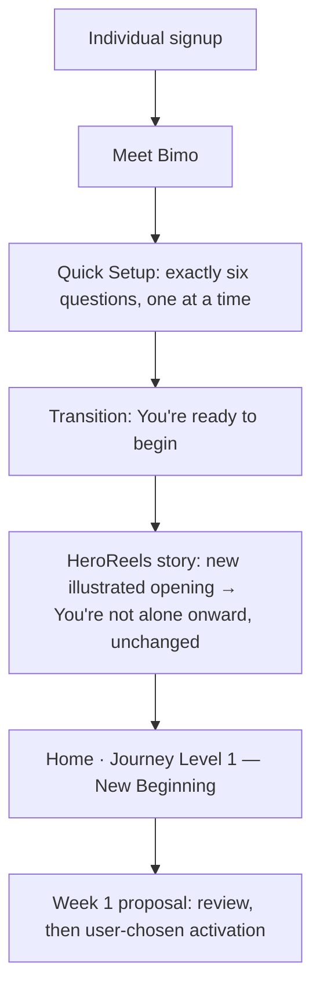

# DeepSprout

## Authoritative Product, Experience, Workflow and Technical Specification

**Version:** 4.1 — 4 November 2026 P0 scope reconciliation
**Date:** 4 November 2026 (Asia/Amman)
**Status:** Authoritative **target** specification; implementation is not claimed. §29 preserves a dated 15 October implementation snapshot.
**Audience:** Product owner, designers, Codex/Claude Code, engineers, testers and reviewers.
**Delivery:** Existing ASP.NET Core MVC solution serves Razor views and static demonstration assets. The target uses ASP.NET Core MVC, Identity, C#, EF Core and SQL Server for authenticated, durable product workflows. Existing browser-local interactions are not proof of those workflows.

> **Current implementation:** Read the [3 November 2026 page and cycle guide](docs/current-product-guide.md) for the working checkout, and the [4 November P0 target and deprecation map](docs/architecture/p0-target-v4.1.md) before implementing changes. §29 and §30 contain dated implementation and roadmap material. The one-main-plant Garden direction is a separately scoped design task; the current four-tree scene is not changed by this documentation update.

> **Authority:** The owner's 4 November 2026 P0 decisions supersede conflicting v4.0 clauses and the proposed 3 November 87-table Atlas. **Database (8 November 2026):** the owner approved the [58-table v5 lean design](docs/architecture/database/README.md) as the target database; its v5-lean-2 revision applies Onboarding 2.0 and these v4.1 decisions. The older 129-table EF model is history only. The maintained [v4.1 target map](docs/architecture/p0-target-v4.1.md) states those decisions and marks unresolved implementation choices. Earlier D01–D48 entries remain a decision history only where superseded by v4.1. Dated audits describe observed code, not current permission to keep deprecated roles. No application or database implementation is asserted by this specification.

### Requirement labels

| Label | Meaning |
|---|---|
| **Approved** | Owner-confirmed requirement, including the final approvals in this task |
| **Agreed direction** | Product boundary approved; exact parameter or implementation still configurable |
| **Interim default** | Configurable Phase-1 value specified for demonstration, not immutable production policy |
| **Recommendation** | Consistent proposed detail awaiting owner acceptance if it materially fixes policy |
| **Open** | Genuinely unresolved policy/measurement/commercial question, listed in §26.2 |
| **Current observation** | Code/audit evidence with stated verification limit, never proof of target completion |

### Change history

| Version | Date | Record |
|---|---|---|
| 4.1 | 4 November 2026 | Institution-only partner registration and outdoor ownership; invitation-only Initiative Coach/Supervisor; no Supervisor self-request; one Platform Admin; Identity-first ASP.NET Core architecture. Supersedes the conflicting v4.0 independent Coach/Provider and Atlas assumptions. |
| 4.0 documentation note | 3 November 2026 | Linked the current implementation guide, recorded the database milestone and corrected the planned server type to ASP.NET Core MVC. No new product policy or Garden implementation is asserted. |
| 4.0 | 15 October 2026 | Reconciled v3.1 and the later owner-approved D01–D48 decisions; replaced conflicting Garden, Group ownership, Initiative/Program, capacity, attendance, staffing, survey and Lab contracts; added detailed page, workflow, permission, acceptance and evidence-limited current-state coverage. |
| 3.1 | 15 October 2026 | Earlier master with implementation audit layer and then-current Garden/Admin decisions; superseded here. |
| 3.0 | 13 October 2026 | Original conversation specification; superseded here. |

## Contents

1. [Vision, positioning, users and boundaries](#1-vision-positioning-users-and-product-boundaries)
2. [Terminology, identity and workspaces](#2-fundamental-concepts-authorization-and-workspaces)
3. [Public site, login and registration](#3-public-website-authentication-and-registration)
4. [Individual onboarding and assessments](#4-individual-onboarding-bimo-personal-setup-assessments-and-activation)
5. [Recovery Plan](#5-recovery-plan-28-day-cycles-weeks-adjustments-evidence-and-consequences)
6. [Digital Shield](#6-digital-shield-exactly-two-core-capabilities)
7. [Activities and Offline Routine](#7-activities-definitive-catalog-progression-daily-load-and-routine)
8. [Individual Home](#8-individual-home-page-ordered-section-by-section-specification)
9. [Personal and Group Gardens](#9-personal-garden-and-group-garden)
10. [Insights](#10-insights-credible-sources-metrics-charts-and-recommendations)
11. [Explore](#11-explore-discovery-availability-registration-and-location)
12. [Community](#12-community-retained-scope-and-separation-from-recovery)
13. [Institution Coach and assignments](#13-institution-invited-coach-and-shared-assignment-engine)
14. [Invited Student](#14-invited-student-and-full-individual-continuity)
15. [Institution and Initiative](#15-institution-representative-and-initiative-operations)
16. [Institution Outdoor Activities and Waiting List](#16-institution-outdoor-activities-bookings-waiting-list-and-camp-completion)
17. [Supervisor](#17-supervisor-scoped-operations-attendance-excuses-and-insights)
18. [Cross-resource links](#18-cross-resource-links)
19. [Platform Admin](#19-one-platform-admin-governance-publishing-and-migration)
20. [Subscriptions and commercial boundaries](#20-subscription-plans-entitlements-and-commercial-decisions)
21. [Pages and cross-workspace effects](#21-information-architecture-page-states-and-visible-cross-workspace-effects)
22. [Technical architecture](#22-phase-1-demonstration-and-eventual-technical-architecture)
23. [Permissions and lifecycle](#23-permissions-privacy-lifecycle-and-integrity-invariants)
24. [Safety, accessibility and measurement](#24-safety-accessibility-privacy-measurement-and-operational-quality)
25. [End-to-end acceptance](#25-end-to-end-demonstration-and-acceptance)
26. [Decision register and open choices](#26-decision-register-authoritative-interim-and-open)
27. [Design and copy guidance](#27-design-system-guidance-and-ui-copy-appendix)
28. [Follow-on engineering artifacts](#28-required-follow-on-uml-and-engineering-artifacts)
29. [Current implementation versus target](#29-current-implementation-versus-agreed-target-15-october-2026)
30. [Implementation roadmap](#30-implementation-dependency-roadmap-and-handoff)

---

# 1. Vision, positioning, users and product boundaries

## 1.1 The actual problem

DeepSprout's personal-product core helps people, especially young people, reduce **unwanted or compulsive short-form content scrolling** (Instagram Reels, YouTube Shorts, TikTok-style feeds), regain agency over attention and time, and reconnect with meaningful activities in ordinary life. The user may be interested in reducing scrolling *only*; studying, reading and becoming maximally productive are **not mandatory goals**.

DeepSprout is **not** a general Habit Tracker, **not** a standalone Focus Tracker, **not** an LMS/Trello clone, **not** a generic booking portal, **not** an endless social-media feed, and **not** a medical diagnosis or treatment tool. It can use focused work, practice, and personally chosen offline routines as *means* to support the larger goal. A lower dependency on DeepSprout itself is a desirable possible outcome.

**Product definition (consolidated):**

> DeepSprout is a digital wellbeing platform that helps young people reduce unintentional short-form content consumption and reclaim control over their attention. It combines individualized recovery journeys and browser-level protection with meaningful practice, offline routines, guided group programs, institutional youth initiatives, and organized real-world experiences.

**Important nuance:** Institutional initiatives are **not required to address Reels**. Institutions may run youth-awareness initiatives on procrastination, smoking prevention, media literacy, wellbeing or other appropriate topics. DeepSprout's **personal Recovery Engine remains centered on short-form scrolling and attention management**; an unrelated awareness initiative does not magically produce a better Reels recovery score.

## 1.2 Intended audience

- **Individual:** a person seeking a personal recovery journey, practice, browser protection, community and experiences.
- **Coach:** a facilitator invited by an Institution to work with assigned Initiative groups and students.
- **Invited Student/Participant:** a group member who joins without traditional registration through an authenticated invitation flow; may later become an Individual.
- **Institution Representative:** a person acting on behalf of a verified institution, youth center, NGO, university, potentially public body or ministry. The institution itself is a governed entity, not a human login.
- **Supervisor:** an authorized person assigned to manage specific events, sessions, camps or participant cohorts, not a role users grant themselves.
- **Platform Admin:** a trusted internal operator with explicit, audited platform-management access.
- **Participants in initiatives, sessions and outdoor experiences:** may be existing Individual users, eligible invited users, or other supported verified identities according to admission rules.

The previous blueprint targeted approximately **ages 16–26**. This is a product audience rather than an automatic eligibility rule for every initiative or event. Any age restrictions, including safeguards for ages 16–17, must be defined for the relevant feature and jurisdiction.

## 1.3 Permanent architectural/product principles

1. **One identity, multiple authorized workspaces.** An Individual may also be an Institution-invited Coach or staff member; do not duplicate human identities or credential authority.
2. **State-changing workflows, not page counting.** Phase 1 must visibly connect roles through consistent demo records; the later ASP.NET Core service owns production validation, permissions, transitions, rewards and booking consistency.
3. **Evidence is labeled.** Browser-tracked time, self-reported offline action, an assessment score and supervisor-confirmed attendance are not interchangeable.
4. **An event is not a campaign.** Distinguish organizational container, staged program, scheduled session, external experience and personal exercise.
5. **Private by default.** Students' personal assessments, browser histories and sensitive responses are not automatically visible to Mentors or Institutions.
6. **Motivating but not manipulative.** No fabricated recovery percentage, arbitrary gamified posting, punishing app absence, or requirement to spend more time online.
7. **All cycles must connect cleanly.** Shared Identity, Permissions, Activities/Evidence, Garden Rewards, Reporting, Notifications and Auditing; domain ownership stays explicit.
8. **Technical limitations are part of the specification.** A Chrome extension cannot silently track all mobile-app Reels or make blocking impossible across devices.
9. **Meaningful offline opportunities.** Explore supports online and in-person youth initiatives and Institution-organized outdoor trips and camps, not only opportunities in the user's home governorate.
10. **No false claims of implementation.** Screenshots, UI mockups, diagrams and example numbers are illustrative until functionality is developed and tested.

---

# 2. Fundamental concepts, authorization and workspaces

## 2.1 Canonical terminology

| Term | What it means | What it is not |
|---|---|---|
| **Account / Identity** | Authenticated, recoverable person, shared across contexts | One database user per role |
| **Global role** | Server-issued platform-wide capability such as Admin | All organizational permissions |
| **Organization** | Institution with approved representatives and governed workspace | A user's personal profile |
| **Institution Representative** | Human authorized to create and manage an Institution profile and its resources | An Institution login account |
| **Group** | Operational cohort owned by one Institution Initiative | An independent Coach Program |
| **Initiative / Campaign** | Institution-owned project with optional internal groups/tasks, sessions, identified forms and competitions | An independently Coach-owned Program or a single session |
| **Session / Workshop** | A scheduled online, in-person or hybrid meeting, potentially tied to an initiative | A mandatory in-person event |
| **Institution Outdoor Activity** | Institution-owned organized trip, camp, outing or other real-world activity | A user's self-reported offline walk or a Provider-owned resource |
| **Camp / Bootcamp** | Multi-session experience, with participants, schedule, supervisor and completion policy | Always a residential paid camp |
| **Supervisor Cohort** | Participants within an assigned event/camp under an authorized supervisor | An open general-purpose tasks group |
| **Activity** | Approved personal or program practice with execution/evidence rules | Every user-made to-do |
| **Participation Evidence** | Source-linked, provenance-labeled record of performance or attendance | Automatically a health improvement |
| **Garden Growth** | Visual state earned through qualifying activity/completion | The measurement of recovery itself |
| **Current data status** | Neutral availability/coverage label and any separately approved evidence-backed appearance | A quiet-day decline or inferred relapse |
| **Entitlement** | Paid/free capability and usage limit attached to an account or organization | User role or permission to access any resource |

## 2.2 Identity and security model — agreed direction

- **Unified login:** email/password for conventional accounts, with verified recovery; authenticated existing identities can switch between authorized workspaces.
- **Public Register top-level choices — exactly two:** `Join as Individual` and `Join as a Partner`.
- **Partner path:** goes directly to Institution Representative registration; no Coach or Outdoor Provider choice.
- **No public `Register as Admin`; no self-issued `Supervisor` role; no generic `Invited Student` register card.**
- A human Representative creates an Institution profile and proves authority; the Institution does not sign in.
- Coach and Supervisor gain only scoped Institution appointments after accepting email-bound invitations; neither has a public self-registration path or needs a second Platform Admin approval.
- An appointed Supervisor sees the Supervisor Workspace only for assigned resources.
- Students may have limited authenticated Initiative access after verified identity and approved admission; invitation links cannot bypass it.
- Use ASP.NET Core Identity for standard credential, recovery, confirmation and lockout workflows. Evaluate any custom OTP requirement separately.
- Server authentication and resource authorization are required for **every sensitive MVC action and request**. Client route guards are only a UI convenience.
- `Join as Partner` is a registration **path**, not a global security role; a single person may later hold several memberships/capabilities.

## 2.3 Workspaces and navigation

| Workspace | Primary navigation destinations |
|---|---|
| Individual | Home, Recovery Plan, Activities, Digital Shield, Garden, Lab, Insights, Explore, Community, profile/settings |
| Coach | Dashboard, assigned Initiative Groups and Students, Assignments, Reviews, Reports, Initiative Group Garden, notifications/settings |
| Invited Student | My Dashboard, My Tasks, My Group, **Group Garden only**, assigned Protected Work, My Progress, account/upgrade |
| Institution | Dashboard, Institution Profile, Initiatives, Outdoor Activities/Trips/Camps, Bookings & Waiting List, Groups & Staff, Sessions, Attendance, Safety/Incidents, Completion/Reports |
| Supervisor | Dashboard, assigned Initiative and explicitly appointed Institution Activity/Session, Applications, Students & Groups, Schedule, Attendance, Notes & Excuses, Reports |
| Admin | Overview, accounts, Institution/Representative verification, Initiative and Institution Outdoor Activity governance, catalog, CMS/content, moderation, reports, audit, configuration |

An authorized user may have a **Workspace Switcher**. A switching UI never itself grants access; effective permissions and entitlements must be checked by the MVC application for every relevant request.

---

# 3. Public website, authentication and registration

## 3.1 Public pages

- Public landing/marketing page explaining the core problem, differentiators, product journey, use cases and clear entry CTA.
- `How It Works` / `Features`, `For Individuals`, `For Institutions`, `Pricing`, a responsible `Science / References` explanation, and FAQ/help as routes or sections as appropriate.
- Real `Privacy`, `Terms`, `Contact`, `Help`, account recovery and supported-device/extension information.
- Unified Login; two-choice Register with direct Institution Representative partner path; invitation preview and join routes for scoped staff.
- Footer with relevant working links and valid social accounts only; preserve the creator's attribution and © 2026 as previously requested, linking to the creator's website **once a real URL is supplied**. Avoid fabricated links, generic inspirational quote panels and a visible `About` footer column if that earlier design choice remains active.

## 3.2 Register screen — exact decision and visual behavior

**Headline:** `Choose how you'd like to get started.`

**Option 1:** `Join as Individual` — `Personal journey, activities, community and experiences.`

**Option 2:** `Join as a Partner` — `Represent an institution and organize initiatives and outdoor activities.`

- Both options are presented as large, elegant selection cards. The selected card has clear visual emphasis and accessible keyboard state.
- **Individual selected:** warm ivory/cream with sage botanical elements and a subtle, evolving organic/neural network motif suggesting personal growth.
- **Partner selected:** same global palette/typography but background motifs shift to interconnected people, organizations, sessions and experiences.
- Background transition is coordinated, gentle and premium; do not suddenly replace the entire identity or create visual chaos. Honor `prefers-reduced-motion`.
- Individual continues to normal account creation. Partner continues directly to Institution Representative person and profile details, then the verification flow. Coach and Supervisor arrive through scoped invitations.
- Register options are **entry intentions**, not an irrevocable lifetime classification.
- The auth page uses the established cream/green/dark-heading identity, rounded, refined form/card, no unnecessary full marketing navbar above the card; footer stays professional.

## 3.3 Unified Login and routing

After authentication, the MVC application resolves identity, onboarding state, workspace memberships/permissions and allowed default destination. The user can then open or switch to authorized workspaces. Admin access is privately provisioned; the login form need not show Admin as a public choice. The clearly labeled `Continue as Admin (Demo)` shortcut is acceptable in the static demonstration. It is not authentication and must never be represented or shipped as production authorization. Normal logout, recovery, OTP expiry and login errors must exist.

---

# 4. Individual onboarding: Bimo, six questions, the story and Journey Level 1

> **Onboarding 2.0 (November 2026) supersedes the earlier first-run sequence** (Meet Bimo → Before We Begin → eight-question setup → four mandatory assessments → Starting Point → plan). The four Lab assessments remain available as **optional** activities and historical records; they never block onboarding, Home or plan activation.

## 4.1 End-to-end first-run sequence

- Implemented at `onboarding.html` (`Views/Member/Onboarding.cshtml`, `src/pages/member/onboarding/quick-setup.{js,css}`) and `hero-reels-lab.html?flow=onboarding` (`Views/Labs/HeroReels.cshtml`).
- The story can be skipped at any time (**Skip to Home**); its own final invitation also leads to Home.
- Completed users are never sent through the questions again: `onboarding.html` shows a short *Welcome back* state (story, Home, change answers). `onboarding.html?step=setup` re-opens the six questions with answers prefilled.
- Unfinished setup resumes after a refresh on the same question with the same answers (saved after every change).

## 4.2 Meet Bimo — one short welcome screen

Original approved Bimo art only (`assets/hero-v2/bimo-awake.png`) on a warm ivory canvas with soft botanical accents and a subtle entrance. Copy: **Hi, I'm Bimo.** — *I'll help you make a little more room for what matters. Six short questions, a short story, and you're in.* One primary CTA **Let's Begin**; secondary **Skip the introduction** (skips this screen only). No marketing clutter. This screen is separate from the HeroReels story.

## 4.3 Quick Setup — exactly six questions

One question per screen, Back and Continue, a slim animated progress bar at the top labelled `Question X of 6`. The bar shows **completed** questions (0/6 on the first question) and reaches exactly 100% only after Question 6.

| # | Question | Type | Options | Stored as |
|---|---|---|---|---|
| 1 | What would you like to change? | single | Spend less time on Reels and Shorts · Use my phone more intentionally · Make more time for real-life activities · Improve focus on things that matter to me | `goal` (`reduce-scrolling`, `intentional-phone`, `offline-time`, `focus-objective`) |
| 2 | Which apps pull you in the most? | multiple | Instagram · TikTok · YouTube / Shorts · Facebook · Other | `setup.distracting` |
| 3 | Roughly how much time do you spend scrolling each day? | single | Less than 1 hour · 1–2 hours · 2–4 hours · More than 4 hours · I'm not sure | `setup.baselineMinutes` — a **self-reported estimate**, never a measurement |
| 4 | When does scrolling usually take over? | single | Before bed · In the morning · During study or work · When I'm bored · It varies / I'm not sure | `setup.peakTime` |
| 5 | What would you love to make more time for? | multiple | Walking / sports · Reading / learning · Drawing / creativity · Friends / family · Personal hobbies · Other | `setup.makeTimeFor` (+ compatible `offlineInterests`) |
| 6 | How much time feels realistic for a small daily activity? | single | 5 · 10 · 15 · 20 minutes | `setup.dailyMinutes` |

The answers are saved with the existing `setup.save` journal event (`setup.version = 2`, the raw answers kept under `setup.answers`); answers from the earlier eight-question setup are merged, not deleted. Keyboard (native radio/checkbox semantics, arrow keys), visible focus, mobile layout and `prefers-reduced-motion` are supported.

## 4.3a The questions-to-story transition

After Question 6 the bar fills to 100%, the question leaves, and a minimal scene appears on the same ivory canvas: **You're ready to begin.** *But first, let's take a look at how easily our attention can drift — and how we can find our way back.* One CTA: **Explore the Story**. On click the copy rises out, the same hand-drawn sun rises over the horizon, and the page changes (cross-document view transition where supported) into the story, which opens on the same ivory sky with that sun rising — no white flash, no duplicated header.

## 4.3b The HeroReels story — new first half

The first half (Bimo meditating, balanced stones, notifications, reels escalation, black hole) is replaced by an original hand-drawn sequence (`src/js/reels/dawn*.js`, `src/styles/reels/dawn.css`): an original faceless character in a sage sweater resting under a tree at sunrise → one Reel, then another → attention threads pulled from the sun, a flower and the tree toward the Reels → a choreographed storm of Reels around the person → night falls, the Reels fade to a few traces → one luminous thread that becomes the line *You're not alone* begins with. **Everything from "You're not alone" onward is unchanged**; a small adapter outside it (`thread-bridge.js`) carries the thread across the seam.

## 4.3c Home · Journey Level 1 — New Beginning

New users arrive at their real Individual Home at **Journey Level 1 — New Beginning**: a motivational starting point, **not** a measurement of recovery, intelligence, attention or mental health. *Assessment status: Not established yet* applies only when no optional result exists. No usage data, cognitive scores or improvement percentages are invented. Home shows a **preliminary Week 1 proposal** built only from the six answers (goal, chosen activities rotated through the week, the daily minutes, the tricky moment, the named apps with Shield's browser-only limit, and the self-reported estimate labelled as such). Nothing is active: **Review & activate Week 1** opens the plan preview, where the person changes anything and explicitly activates the plan. Levels above 1 are never awarded automatically by onboarding.

## 4.3d Optional assessments and activation

- Plan activation no longer requires the four baselines; any already recorded are linked, none are invented (`account.js` `plan.activate`).
- The plan preview opens directly when no baselines exist; the Quick Setup proposal pre-selects one offline commitment that the person can change before activating.
- Lab assessments stay available and keep their full history, protocol versions and any historical window identifiers. The former weekly scheduler creates no new official windows pending a separately approved reassessment policy.

## 4.4 Four baseline assessments — unchanged set, optional since Onboarding 2.0

| Assessment | Core interaction | Appropriate recorded outputs |
|---|---|---|
| **Digital Habits** | Short, honest questions about short-video use, stopping, habits and context | Clearly labeled self-reports and chosen goals; instrument version |
| **Sustained Attention** | Timed visual response task | Task accuracy, omissions/commissions, reaction times if measured correctly, attempt validity |
| **Inhibitory Control** | Respond to selected signals and withhold response to others | Response-control task metrics, errors, timing and version |
| **Depth Challenge** | Short reading passage with comprehension questions | Accuracy/reading-comprehension task outcomes; passage difficulty/version |

- Four assessments, not four diagnoses; no fake brain-health percentage.
- Assessment introduction, individual progress, pause/resume, failure/retry, timeouts, saved partial progress and Results are required states.
- Preserve item/content version, timestamps, relevant attempt metadata, scoring logic version and comparability constraints.
- Do not treat goals/preferences as test-score components.
- Estimate total duration using actual tasks before presenting a fixed claim.
- **No periodic reassessment is currently scheduled.** The previous weekly eligibility rule is superseded. A future official protocol requires a separate product and measurement review. Weekly Review is not a fifth test. Practice/rehearsal does not count as an official assessment; versions and valid comparison rules apply.

## 4.5 Results → separate plan-building presentation → activation

> This results path applies only to people who choose optional Lab assessments. Without them, the Week 1 preview opens directly from Home (Journey Level 1), and activation remains an explicit choice.

**Result scene:** `Your Starting Point` shows four distinct categories, valid task results and concise caveats. A clean, coordinated animation assembles the results; do not imply a medical diagnosis or common 0–100 brain score.

**Plan-building scene:** a distinct, short illustrated transition: understanding goals → matching approved activity candidates → proposing a four-week roadmap → ready for review. Phase 1 should calculate from real demo inputs where feasible and label fixed demonstration behavior; the later service owns production computation. Bimo may appear contextually in one meaningful frame.

**Plan Preview:** user sees goal, proposed 28-day cycle, overall four-week direction, the *first detailed week*, recommended practice cadence, one chosen personal offline routine, and possible Shield support. The user can change permitted preferences and timing, see a recomputed preview if needed, then **Activate My Plan**. Do not start irreversible commitments merely because a preview was generated.

**Product Tour:** short contextual overlays showing Home (next action), Recovery Plan (planning), Activities (execution), Digital Shield (protection), Garden (visual achievements), Insights (measurement), Lab (assessments) and Explore (initiatives/experiences). Tour should be skippable, replayable from Help and not a mandatory ten-step wizard.

**Returning users:** use onboarding state to resume Bimo, an unfinished quick-setup question, the story or Home. Completed users are not required to answer the new questions again. Optional Lab attempts resume within Lab; partial attempts are never shown as completed results. Existing plans and progress remain intact.

---

# 5. Recovery Plan: 28-day cycles, weeks, adjustments, evidence and consequences

## 5.1 What a plan is — and is not

**Recovery Journey** is a continuous personal history; **Recovery Cycle** is a bounded planning interval; **Week** is the current plan's detailed scheduling unit; **Daily Action** is a scheduled commitment, not an entire independent plan. The page is not a universal habit tracker or an overloaded generic calendar.

**Recommended/strongly favored:** first default cycle = **28 calendar days, four weeks**. The owner repeatedly explored and positively received this structure, but exact global duration/policy is not a clinically proven recovery period and should be marked as a configurable product default rather than a promise of recovery in 28 days. Completing 28 days does not reset the Garden or guarantee recovery.

The system initially builds a high-level roadmap for all four weeks, **but details only Week 1**. At each weekly boundary, validated evidence and the light Weekly Review generate the next detailed week. This adaptive scheduling model was expressly liked. Do not fabricate 28 fixed daily exercises on Day 0.

## 5.2 Suggested page tabs and exact responsibilities

The earlier mockup contained `Overview / Schedule / Adjust / History`. The more recent, clearer proposal is **`Overview / This Week / Adjust / History`**. User has welcomed the functionality but exact tab labels remain UI decisions.

### A. Overview

- Title `Your Personal Roadmap`, current goal/target, `Active Cycle`, cycle number, current week and day.
- One clear four-week roadmap, **W1 → W2 → W3 → W4** in English LTR. Week status: completed, current, upcoming, paused/closed where applicable.
- A compact description of this week's relevant focus, not generic fixed Prepare/Protect/Reconnect labels forced on everyone.
- Current week's key commitments: eligible core practice, small personal routine, and any opted-in browser protection settings; separated by evidence type.
- One prominent CTA to `Open This Week` / `Start Next Activity`, taking the user directly to Activities when execution is needed.
- Progress bar, if shown, must identify what it measures (e.g. elapsed days or due practices completed), **not a fictitious recovery percentage**.
- Weekly Review due/overdue or cycle-end banner when applicable.

### B. This Week (formerly Schedule)

- Day-by-day weekly list/calendar: required practice when assigned; personal offline routine; optional practices; review; days with nothing required.
- Each item displays title, estimated time, progress state, source, verification level, due window, and Start/Details/Reschedule action as appropriate.
- `Start` routes into **Activities** or the relevant supported Shield operation; do not implement a second activity player inside Recovery Plan.
- `Reschedule` is permitted for eligible future/unstarted personal activities according to business rules. No retroactive changing of attempt results.
- This is not a Google Calendar replacement, generic project planner, or endless to-do board.

### C. Adjust

Adjust is always **available to request**, but the engine distinguishes:

| Change category | Example | Rule |
|---|---|---|
| Small preference | Swap walking for drawing; available day | Update eligible future commitments without resetting cycle |
| Scheduling | Move tomorrow's unstarted reading exercise | Respect due windows/conflicts; append revision/audit |
| Practice load | Fewer core exercises or less intense level | Check engine limits; show change before confirming |
| Main-goal change | Change the main target or intervention strategy | Re-evaluate suitable plan components and generate new future-only preview; preserve history |
| Protected session | Change strict block mid-active timer | Respect opted-in locked-session rules and browser capabilities; do not promise impossible enforcement |
| Mentor assignment | Change a mentor-issued task | Participant **cannot** modify mentor's underlying assignment; request change from authorized Mentor |

A quick preference update does **not** create an entirely new 28-day cycle. Significant change produces a version/revision of **future** plan content; recorded history, assessment data, previously earned rewards and evidence do not disappear. Users cannot mark missed verified activities as completed merely by editing a schedule.

### D. History

- GitHub-style heatmap of **qualified scheduled activity completion**, not a graph of brain recovery or days signed in.
- Distinguish `No scheduled activity`, `Not due yet`, `Completed`, `Partial`, `Missed`, `No reliable data` with legend/tooltips and accessible non-color alternatives.
- Recent cycle history, summaries of 28-day cycles, weekly reviews, plan adjustments, current/stored goals and comparison links to Insights.
- Streak, if displayed, must have a strict definition involving **scheduled eligible days**, not every calendar login. Planned rest days do not constitute failure.
- Quick summary metrics may show planned/due/completed practices and number of reviews; avoid duplicating the entire Insights dashboard.

## 5.3 Commitments → Evidence → Adaptation (agreed core logic)

1. **Commitments:** a user-selected goal, optional Shield action, allocated core practices, a small offline routine, and schedule.
2. **Evidence:** system-validated in-app attempts, browser-provided supported events, explicit user self-reports, and third-party attendance/reviews, each with provenance.
3. **Adaptation:** server-side rules inspect suitable evidence; they propose continuation, reduced load, alternative content, progression or revised timing.

Do not conclude that the user opened Instagram for emotional reasons or spent time watching Reels from lack of site login. No forced manual diary after each social-media session.

## 5.4 Daily activity load and progression

- **Recommended starting load:** one core Meaningful Practice on roughly **3–4 scheduled days per week**, plus one chosen offline micro-routine; optional extra practice at most within a reasonable daily limit. These exact numbers remain **calibration parameters**, not formally adopted quantitative requirements.
- The owner mentioned **up to three activities in a day** as an illustration, **not three mandatory practices every day**.
- Plans adapt practice type/level to goal, demonstrated task results, available days and user preference. Do not assign reading by default to a person whose sole objective is reducing Reels unless they want it.
- Days with zero required in-app exercises are valid; DeepSprout should actively support time away from the app.
- Extras and repeated content do not generate limitless growth.

## 5.5 Weekly Review — simple decision point, NOT a Stillness activity

Triggered around the week's end or upon return when a scheduled review is pending:

- Show verified, reported and missing data distinctly; due vs completed practices; latest supported-browser summary where available.
- Ask **one or a few simple questions**, e.g., `How manageable did this plan feel?`, optionally `Did this week's activity choices fit you?`.
- Explain next week's recommendation and which inputs support it.
- Offer **Accept Next Week**, **Keep Current Pace** where safe, or **Adjust**. User decides important changes; never silently increase difficulty.
- Save plan revision/version plus reason and applicable dates. Preserve prior records.
- If review is skipped, maintain a **conservative continuation** rather than blocking the whole experience or automatically raising workload.

## 5.6 Missed days, long absence and cycle ending — agreed behavioral policy

| Real case | Required handling |
|---|---|
| One missed scheduled exercise | Mark the historical window missed/expired as appropriate; do not infer excessive Reels consumption |
| Several missed exercises | Gentle notice and rescheduling/load adjustment suggestion; don't pile up a backlog |
| User absent ~one week | On return show short summary and choice to resume/adapt; don't automatically reset Garden |
| Cycle ends while absent | Do not label it successfully recovered; offer cycle review then next cycle/maintenance |
| Shield validly operated in browser during website absence | Retain supported, verified records without requiring the site to be open |
| No measurements for several days | Treat as **unknown**, not success, relapse, zero usage or reason to kill plant |
| Genuine observed or honestly reported setback | Show an honest, source-labeled trend and supportive plan choices; Garden appearance changes only under a separately approved evidence-backed rule |
| User completes entire cycle | Review outcomes, then select another cycle, adjusted approach or lighter maintenance mode |

**Important:** elapsed calendar time, plan adherence, scrolling-goal progress and assessment performance are **four different notions**. Neither days since signup nor activity count directly equals recovery.

## 5.7 Suggested state machine and termination

`Draft → Preview → Active → ReviewDue → (Adjusted Active / Active) → CycleEnded → Reviewed → (NextCycle / Maintenance)`.

Allow `Paused`, `Cancelled` and `Archived` where product rules justify them; define permitted transitions in C# and validate them server-side. Plan changes should target future obligations only. Maintain `RecoveryJourney`, `RecoveryCycle`, revision history, weekly schedules/assignments, weekly reviews, eligible assessment attempts and evidence identifiers.

## 5.8 Reassessment and Lab relationship

- No Lab test is required on initial Individual onboarding or for Recovery Plan activation. Existing results, attempts and versions remain intact.
- No official reassessment cadence is active. Any future window, variants and comparability rules need separate approval; the former weekly pair is historical behavior.
- **Free** access to necessary official reassessments and core historical comparisons was recommended and repeatedly maintained; do **not** put the user's basic right to see progress behind Plus.
- Previous results remain stored, versioned and comparable only when instrument/scoring conditions allow. Practice effects can bias cognitive task scores. Inform users.

---

# 6. Digital Shield: exactly two core capabilities

**Latest explicit decision:** The public Shield feature set should contain **TWO** independently understandable capabilities, not the previous nine partly overlapping intervention names.

## 6.1 Manual Website Protection

**User flow:** open Shield → see extension connection status → choose supported websites/domains → choose countdown duration → inspect lock conditions → `Start Protection` → extension applies blocking rules inside the supported browser → countdown displays active/ending/expired status → resume normal access when the timer expires.

- User selects e.g., Instagram, TikTok, YouTube or eligible URLs; selection/configuration alone does not earn unlimited rewards.
- Blocking is **browser-scoped** and only as strong as actual extension capabilities. Do not claim that the user cannot uninstall the extension, change browser or use another device.
- Whether Instagram Reels can be blocked separately from non-Reels functions must be validated; never pretend reliable Reels-only detection if only full-site domain data is available.
- A locked session, if offered, should state limits honestly and not be silently overridden by the **other** intervention's `Continue` button.
- Distinguish `Configured`, `Extension Connected`, `Protection Active`, `Failed`, `Expired`, `Disconnected`.

## 6.2 Shared Website Usage Reminder

**User flow:** choose a group of supported websites → choose aggregate threshold, e.g., 30/60/120 minutes or custom permitted duration → the extension estimates **active supported-browser usage** over a defined daily period → show a prompt when threshold is crossed:

> **You've reached your chosen limit.**
> **Continue Anyway** / **Back to DeepSprout**

- Time from selected sites is summed as a group, not tracked as separate guaranteed limits unless configured differently.
- Default threshold (including the user's original **two-hour example**) is **not finalized**. The user chooses the value; do not require 2 hours for everyone.
- Recommendation: one threshold reminder per daily period, avoiding an immediate repetitive popup after `Continue`.
- This **soft** warning does not defeat an already active strict block.
- Count only what can be measured with permitted tab/window/activity/idle APIs and handle offline/partial-event uncertainty. Domain-level tracked time is **not equivalent** to time spent on Reels alone.
- `Back to DeepSprout` should navigate to the relevant dashboard/goal or next eligible activity; it need not award anything merely for clicking.

## 6.3 What was removed from the current Shield catalog

**Not separate features/Activities in current scope:** Scheduled Protection, generic Daily Usage Limit marketed separately from the one shared reminder, Intentional Pause as a third user-facing feature, If–Then Plan as standalone, Return to Goal as standalone, Notification Cleanup, Morning Reset, Evening Reset, Quiet Break, Pause & Notice. The legitimate `Continue / Return` prompt is already part of **Usage Reminder**, not a separate activity. They appeared in early blueprints but were **explicitly rejected as redundant** in later discussion.

## 6.4 Supported extension and graduation demonstration

- Downloadable **ZIP source bundle** may be provided for test/demo. To use `Load unpacked` in Chrome, **extract** it and load the extension folder containing `manifest.json` from `chrome://extensions` with Developer Mode enabled. A ZIP cannot simply be treated as a store-installed extension.
- Extension enforces site blocking and produces reliable available browsing events **locally**; ASP.NET Core stores selected settings, authenticated sync and accepted evidence/usage records under consent and security controls.
- Design distinct pages/states for `Not Installed`, `Unpacked Extension Installation Guide`, `Connected`, `Blocking Active`, `Reached Limit`, `Disconnected`, `Sync Pending`, `Rule Failure`.
- Do not claim complete Android/iOS app coverage or bypass-proof enforcement. Restrict measurements to supported browser and permissions.
- Security: limit permissions, authenticate sync, validate events, handle clock skew, do not treat arbitrary client traffic as tamper-proof evidence; avoid collecting full browsing histories when unnecessary.

---

# 7. Activities: definitive catalog, progression, daily load and routine

## 7.1 Separation of concerns

- **Recovery Plan owns scheduling**, eligible recommendations and review.
- **Activities owns content, attempts, execution, completion and self-reported routine**.
- **Shield owns manual blocking and shared site-time reminder**; it is not a row of nine Activities.
- **Explore owns institution initiatives and organized offline/online opportunities**; these are not interchangeable with personal activities.
- **Lab owns four formal tests**, not daily training mini-games.
- **Insights owns analysis**; **Garden owns earned appearance**.

## 7.2 Four Meaningful Practice types — current adopted taxonomy

| Canonical type | User experience | Important completion conditions |
|---|---|---|
| **Depth Practice** | Read an approved short passage; answer questions about ideas, details and understanding. | Versioned passage, comparable difficulty tier, scored question attempt when applicable. |
| **Listening & Recall** | Listen to a short original/licensed audio clip; answer questions on the main point, details and relations. | Track audio attempt, permitted replays, question outcome, accessibility mode. |
| **Practical Micro-Challenge** | Perform a small concrete cognitive, organizational or creative task with a clear prompt and outcome. | Challenge-specific evidence; no arbitrary repeating for unlimited rewards. |
| **Protected Work** | Choose a meaningful real task, begin an optional supported browser protection/work session, and log appropriately. | Do not infer that work quality was excellent just from timer elapsed; distinguish support from verification. |

**Embedded steps rather than separate menu cards:** `Comprehension & Recall`, `Explain in Your Own Words` can occur within Depth/Listening. **Longer Learning Path** is an organizational sequence of exercises and was discussed as a later extension, **not a fifth required activity card**. Standalone Focus Timer and generic cognitive mini-games are excluded from the core training lineup.

## 7.3 Gradual exercise difficulty

- One-minute reading at entry, then perhaps 3, 5, 7 minutes is a **candidate example**, not a mandated daily or linear schedule.
- Duration is not difficulty on its own: content complexity, vocabulary, number/type of questions and demonstrated comprehension must be considered.
- Use **independent level per activity type**: reading advancement does not auto-raise Listening level.
- Proposed eligibility combines valid distinct completions, suitable scores where measurable, version/difficulty history, signs of struggle and user preference. **Two-day streak alone does not unlock a higher level**.
- When eligible, show a prompt `Ready to try a longer one?` with `Try Next Level` / `Stay Here`; safe step-down is allowed without destroying history.
- Numeric thresholds (number of attempts, passing performance, durations and load) are **to calibrate**, version and test, not clinical metrics or falsely agreed fixed values.
- A meaningful practice is distinct from official Lab reassessment; frequent practice cannot claim improved brain health.

## 7.4 Offline Life — light personal checklist, not full Habit Tracker

**Latest direction:** every Individual chooses **at least one small personal offline routine** while activating the first plan. User decides its meaning and intensity, e.g., 5-minute walk, drawing, hobby, reading a physical book, time with friends/family. The product should not judge the content's prestige. User may later add, edit, pause or schedule additional checklist items.

| Item idea | Treatment |
|---|---|
| Offline Walk | Personal self-reported activity; may be eligible mission under separate policy |
| Creative Activity | Drawing/making something; optional attachment only when genuinely needed |
| Physical Reading | Reading a real book if personally relevant |
| Offline Hobby | User-defined interest/activity |
| Social Activity | Meaningful offline interaction, without intrusive evidence demands |
| Personal Recovery Goal | Explicit personal goal/commitment, not automatically a scheduled task |
| Personal To-Do | Ordinary life task; **no automatic XP or Garden reward** |

**UI:** `My Offline Routine` within Activities. Allow Done/Skipped, optional times/days, reasonable editable recurrence. A checklist tick is **self-report**, not externally verified evidence. Apply a reward cap and repeat rules if a specific routine qualifies; never grant infinite growth from creating or completing arbitrary self-authored tasks.

## 7.5 Community behavior related to activities

`Share Achievement` is an **optional social post action** after a real achievement, not a rewarded practice. Sharing/likes/comments do **not** grant Garden Growth. `Joint Goal` and `Progress Check-In` belong to **Community's** collaborative goal workflow; `Accountability Partner` was previously discussed as a later refinement, **not a compulsory partner system**.

## 7.6 Removed Stillness & Reflection catalog

The user **explicitly chose to remove the entire user-facing `Stillness & Reflection` activity family**: Just Be / Quiet Break, Pause & Notice, Activity Reflection as standalone, Setback Review as a standalone task, Ink Room and similar prompts. **Weekly Review remains essential within Recovery Plan**, not within training catalog. Optional simple feedback within a practice can exist when legitimately necessary without resurrecting a separate Stillness category.

## 7.7 Activities page — functional organization

Recommended tabs: `For You`, `Explore Activities`, `Assigned`, `History`, plus a clearly visible `My Offline Routine` area. **Do not confuse the `Explore Activities` tab with the global `Explore` page for institutional opportunities.** A less ambiguous label could be `Browse Practices` (final label TBD).

- **For You:** current eligible core practice and optional one, source from the plan, next activity CTA.
- **Browse Practices:** approved training types with duration/type/difficulty filters; eligible on-demand access.
- **Assigned:** Initiative Coach assignments for a student in an admitted group; deadlines/status/review path.
- **Offline Routine:** user-created simple daily hobby checklist; its records are visibly self-reported.
- **History:** attempts, completions, pending reviews, revised submissions and associated sources; not a substitute for Insights.

**Example daily combination:** one assigned Meaningful Practice + one personal offline commitment + optional additional practice. Do not schedule all four practices every day. Core activities assigned by a free Recovery Plan remain free even when optional extra-practice limits are reached.

## 7.8 Attempt and completion policies

Every activity definition is versioned and has: category, goal tags, estimated time, difficulty, prerequisite eligibility, content/media version, response/completion method, evidence tier, reward rules, repetition limits, and publication status. Store attempt lifecycle `Started`, `Paused/Interrupted`, `Submitted`, `Pending Review` when relevant, `Completed/Approved`, `Needs Revision`, `Cancelled/Expired` as appropriate. Never derive verified completion solely from a client-supplied boolean.

- **System-scored:** only if the exercise has real scoring logic and input validation.
- **Browser-observed:** only events within supported extension boundaries.
- **Self-reported:** offline checklist/mission; distinguish from independently confirmed events.
- **Mentor/Supervisor-reviewed:** authorized confirmation of participation/assignment completion.
- **Reward eligible:** only after policy validation; unique source identity/idempotency.

---

# 8. Individual Home page: ordered section-by-section specification

**Home is a personalized action hub styled as a rich modern homepage; not a second full dashboard, and not a generic marketing landing page.** The owner explicitly favored distinct, visually unified sections rather than one overloaded grid.

| Order | Section | Content and action |
|---|---|---|
| 1 | **Navbar** | Brand, Home, Recovery Plan, Activities, Digital Shield, Garden, Lab, Insights, Explore, Community; profile, notifications, and optional workspace selector. Responsive grouping if crowded. |
| 2 | **Hero** | Elegant branded welcome; goal context and **one state-aware primary action**, plus a clear secondary `Explore Activities`/Activities CTA. Avoid redundant filler. |
| 3 | **Your Goal** | Dedicated section with goal/target and appropriately labeled recent direction; opens Plan or Insights. |
| 4 | **Your Garden** | Dedicated visual preview of the **four practice-type trees in the fixed Personal Garden scene** and latest meaningful growth; opens Garden. |
| 5 | **Offline Ideas to Try** | Small, relevant personal activities matching preferences; links to personal routine/practice details, with organized bookings clearly separate in Explore. |
| 6 | **Outdoor Experiences** | Real organized trips/camps/available experiences; dates, location/online mode, organizer, booking availability where verified; opens Explore detail. |
| 7 | **Join an Initiative** | Youth initiatives (not all Reels-themed), with topic, Institution and participation status; opens regular Explore Initiative detail. |
| 8 | **Hear from Your Community** | Small curated/eligible selection of positive, useful actual community posts; no endless scrolling on Home. |
| 9 | **How It Works** | `Small steps. Real change.` four concise stages; prominent for first-time users, collapsible/less prominent later. |
| 10 | **Final CTA** | `Ready to grow a better you?` + `Continue your journey` / `View insights`, with state-correct routing. |
| 11 | **Footer** | Product/support/privacy/terms/contact/real official socials and creator attribution. |

**Suggested four How It Works stages, as discussed:**

1. **Set your goal** — Choose what you want to improve.
2. **Follow your plan** — Take small, personalized steps.
3. **Explore offline** — Practice focus in real life.
4. **See your growth** — Notice the progress you've made.

**State-aware Hero primary CTA:** no active plan → `Build My Recovery Plan`; practice due → `Continue Today's Activity`; review due → `Review Your Week`; returning after absence → `Resume Your Journey`; no immediate obligation → `Explore Activities`. A visible Activities shortcut remains desirable but should not override the genuinely most relevant next action.

**Home data rules:** do not show unavailable browser measurements as zeros or fabricated improvements; no fake live events/participants/likes; no invented testimonials. Garden preview should not reproduce the full Garden page. Keep layout elegantly cohesive with light ivory, pastel sage greens, appropriate typography, rounded cards and restrained shadows. The project has repeatedly rejected overly random, unrealistic, cluttered and repetitive visual layouts.

---

# 9. Personal Garden and Group Garden

## 9.1 Approved visual and ownership contract

The **Personal Garden** is one fixed, large, clean white/ivory scene. It contains **exactly four distinct, comparatively small trees**, mapped one-to-one to Depth Practice, Listening & Recall, Practical Micro-Challenge, and Protected Work. There is **no central fifth journey tree**. Each existing type tree can progress through versioned, source-backed stages; a completion never plants another tree. The scene does not expand into beds, zones, paths, biomes, or a collection inventory. Home's preview must depict this same model. Bimo may celebrate an earned change, but manual watering grants nothing.

A qualifying Offline Routine record may unlock a **small flower**; actual eligible session attendance may unlock a **rabbit**; verified eligible Institution camp completion may unlock a **birdhouse**. Decorations are bounded policy effects, not one object per check-in. Initiative Completion is recorded in history/reporting and may yield an Initiative collective milestone; it does not add a Personal Garden tree or decoration. Joining, booking, clicking, posting, a paid purchase, or an accepted absence excuse never grants an attendance reward.

A **Group Garden** is a distinct collective view, never a region of the Personal Garden. There is exactly one Group Garden per **Institution Initiative**, aggregated across its internal Coach groups. No internal group or standalone Outdoor Activity gets its own scene. The view uses bounded, genuine collective milestones, not one object per student. An Invited Student sees only their authorized Initiative Group Garden until upgrading to a full Individual account. Upgrade preserves membership, work and earned history.

## 9.2 Reward source and neutral data-status rules

| Source event | Personal effect | Collective effect and evidence |
|---|---|---|
| Valid approved Meaningful Practice attempt or reviewed assignment | Progress only the corresponding practice-type tree under policy | Count once toward the owning Initiative when eligible; preserve assignment/review IDs |
| Eligible self-reported Offline Routine | Bounded small flower | Only if a published collective policy explicitly allows this self-report source |
| Confirmed eligible session attendance | Bounded rabbit | Count factual attendance with session/registration/Supervisor and method references |
| Verified eligible Institution camp completion | Bounded birdhouse | Institution report; no standalone Activity Group Garden |
| Initiative completion | `Completed` history/Insights, **no Personal Garden object** | Appropriate source-backed Initiative collective milestone |
| Mere registration, accepted excuse, login, likes, arbitrary to-do, repeated approval | None | None |

Reward evaluation consumes a unique source event ID, source version, subject, beneficiary and policy version; an event can grant each eligible effect at most once. Reversal/correction must keep the original evidence and an attributed compensating decision rather than silently deleting history. Reward thresholds, repeated decoration ceilings, tree species and exact layout remain open policy values. **No recent data is neutral.** Earned growth persists; do not dim, wilt or destroy a tree solely because days passed without app activity. A genuinely known and relevant adverse event, if ever displayed, needs a separately approved rule and must not be confused with missing observation.

## 9.3 Garden page and states

`My Garden` shows the fixed visual, keyboard-accessible descriptions of each tree and decoration, a compact next eligible milestone only when a real rule exists, recent earned events with date/source, and a separate link to authorized Group Garden(s). Empty state shows the four tree positions and explains how to begin without pretending rewards were earned. Missing source data reads `No recent data`; revoked or corrected evidence has a transparent history. Rendering and animation respect reduced motion. The Group Garden shows owner, initiative/program/group name, collective milestone history, source counts and authorized contributor summary without exposing personal Lab, Shield or Recovery records.

**Current code, not target:** `src/DeepSprout.Web/wwwroot/src/pages/member/garden/garden.js` renders a prominent journey tree plus trees per achievement; `src/DeepSprout.Web/wwwroot/src/js/data/account.js` also grants generic growth for weekly review and attendance and computes vitality decay after quiet days. Partner `group-garden` pages use separate local data. These are implementation gaps, not alternative Garden decisions.

---

# 10. Insights: credible sources, metrics, charts and recommendations

## 10.1 Fundamental separation

**Garden celebrates earned events; Insights measures and explains distinct records.** The illustrative previous Insights design included `Focus Score 68`, `Depth Score 61`, `2.1h Average Scrolling Time`, `Consistency 76%` and smooth charts across days. These must **not** be presented as real values or objective neurocognitive improvement unless precise validated sources/definitions support them.

Do **not** plot unrelated percentages, assessment task scores, hours of browser use and completion rate on one common 0–100 axis as if comparable. Avoid a generic `brain recovery %` or unsourced daily focus score. Formal Lab assessments do not generate daily improvements unless an eligible retest took place.

## 10.2 Five distinct domains

| Domain | What is displayed | Data provenance and limitation |
|---|---|---|
| **Digital Usage** | Tracked usage on selected sites, supported-browser time trends, configured threshold comparisons | Chrome-extension observed/derived; **not** phone app time or certain Reels-only time |
| **Recovery Plan Adherence** | Due scheduled practices, completed, missed/excluded, reviews and plan adjustments | Plan scheduler + eligible activity records; not a diagnosis of behavioral recovery |
| **Meaningful Practice** | Valid attempts, reading/listening levels, question outcomes, Protected Work records | Activities Engine; progression may be different for each skill |
| **Lab Assessments** | Baseline and eligible comparison attempts for four instruments | Versioned, non-diagnostic, comparable only with valid matched versions/protocols |
| **Offline & Experiences** | Self-reported personal routine days, confirmed session/workshop/event/camp participation, initiative completions | Clearly separate self-report, registration, attendance and verified completion |

If no extension data exists, show **`No browser usage data available`**, not `0 minutes` or a zero-height bar. Manual phone Screen Time summaries may be accepted as **self-reported**, but must not be silently combined with extension-observed usage.

## 10.3 Credible metrics and formulas

**Scheduled Practice Completion Rate** (example):

`100 × eligible completed scheduled practices ÷ eligible scheduled practices due`

Document numerator/denominator, time window, exclusions and treatment of rescheduled/rest days. The presence of a calendar day with no scheduled practice does not create a missed task.

**Tracked Browser Usage Average** (example):

`sum(valid observed active minutes in chosen browser/site set) ÷ number of covered eligible days`

Data coverage and tracking scope must be indicated. A disconnected extension means an incomplete observation period, **not** proof of zero use.

**Assessment comparisons:** side-by-side attempt date, task variant, version and result. Do not show a growth percentage if only one baseline exists. Practice effects and test comparability must be explained.

**Offline:** `self-reported routine completions` and `supervisor-confirmed attendance` should remain separate labels, not a universal accuracy-weighted fake wellbeing score.

## 10.4 Insights page specification

1. **Compact identity-rich hero:** `Understand Your Progress`; Bimo illustration optional but smaller than in the old half-page banner; clear data period and source-coverage controls.
2. **At-a-glance cards:** no more than a few credible metrics; currently tracked goal, due practice completion and offline routine, each with period/source.
3. **Digital Usage:** dedicated well-labeled chart for supported site activity and goal threshold; separate reported phone-use summary if present.
4. **Practice & Plan:** adherence and training level progress. Link to detailed Recovery Plan History rather than duplicating the entire heatmap.
5. **Assessment Changes:** the four tests, latest result and eligible comparisons, linking back to Lab.
6. **Offline & Experiences:** routine participation, session and camp records; registration, attendance and completion statuses distinguished.
7. **Recommendations:** a **small** number of reasoned, actionable next steps with source explanations and real CTA (`Open Activity`, `Review Plan`).

Example truthful recommendation: `Your recent valid Depth Practice attempts meet the configured requirements for the next reading level. Try Level 2?` Not `Your brain has healed by 31%`.

## 10.5 Source-quality and account states

- New user: no Lab result unless one is chosen; comparisons pending.
- One week's evidence: a single-period summary; no fabricated month-over-month change.
- Disconnected extension: last known valid timestamp, gap warning.
- Reassessment unavailable/invalid: no comparison line.
- Changed goal or site set: reset/annotate comparison context; avoid conflating different denominators.
- Completed camp: count under structured experiences; its Garden decoration is a separate outcome.
- Privacy controls determine who can see reports; Mentor and Institution do not automatically see personal browsing or Lab results.

## 10.6 AI involvement

ASP.NET Core/C# rules and real data definitions remain authoritative for scoring, policy, reward eligibility and recommendation gating. AI **may** help phrase personalized explanations or carefully constrained ideas; no AI provider, price, input set, prompt policy or integration has been finally adopted. Do not send unneeded sensitive raw results to a model; record explanation source and enforce consent/privacy rules.

---

# 11. Explore: discovery, availability, registration and location

**Global Explore** is a dedicated destination for **institutional initiatives, sessions/workshops, competitions and organized trips/camps**, not the tab for browsing personal exercises within Activities.

## 11.1 Explore page and filters

- Page title, search bar and featured published opportunities.
- Content group filters: `All`, `Initiatives`, `Sessions & Workshops`, `Outdoor Experiences / Camps`, optionally `Competitions` or general events; render on one clear discovery interface.
- Filter by participation method `Online`, `In-person`, `Hybrid`; topic, relevant age eligibility, date, city/governorate, registration status, Institution organizer and availability where supported.
- **Preferred city is a discovery preference**, not a security gate. A person in Zarqa may join an online Jordan-wide initiative from an Amman organization or book an eligible in-person experience in Amman.
- Institution headquarters, Initiative coverage, Activity/session venue and user's search-location preference are **separate data fields**.
- Online initiatives can have geographically limited eligibility for legitimate reasons, but the backend checks explicit audience rules, not arbitrary physical proximity. Do not collect precise GPS by default.
- Clearly identify real verified listings versus mock/demo data; hide expired booking CTAs but keep appropriate historical details if allowed.

## 11.2 User's opportunity details and paths

| Opportunity | Detail page contains | User action |
|---|---|---|
| Initiative | Objectives, topic, institution, audience, overall timeline, list of optional/required components | `Join Initiative` only if enrollment required, then choose sessions/surveys/programs individually |
| Online Session | Speaker/facilitator, date/time/timezone, capacity/mode, registration form, meeting-link access rules | Register and receive confirmation; external meeting link at permitted time |
| In-person Workshop | Exact venue/address, date, capacity, age/safety terms, optional form | Register, confirm; QR check-in if adopted |
| Hybrid Session | Two participation modes and potentially separate capacity pools | Select mode, complete appropriate registration questions |
| Competition | Rules, eligibility, submission period, judging criteria, published outcome | Submit entry if eligible; follow review/judging lifecycle |
| Outdoor Experience | Operator, venue, schedule, safety/contact information, seats, supervisor as permitted | Register or join Waitlist |
| Camp | Verified Institution organizer, multi-session timetable, supervisor rules, registration and completion policy | Reserve place, attend sessions, receive verified completion if eligible |

`My Registrations` surfaces the participant's owned commitments and states (`Pending`, `Confirmed`, `Waitlisted`, `Checked-in`, `Completed`, `Cancelled`), while `My Initiatives` surfaces initiative enrollments and components. Joining an Initiative **does not book every constituent event**. Attendance **does not always equal completion**.

## 11.3 Integration with personal journey

- Home may feature one suitable Initiative and a few Outdoor Experiences, but links to **Explore** where actual registration occurs.
- Recovery Engine may **suggest** a relevant optional opportunity; it must never require purchase of a trip or participation in an unrelated topic to finish a personal Recovery Cycle.
- Completion evidence flows to shared Participation/Reward systems when eligible. A camp decoration in Garden does **not** imply a lower Reels time or improved Lab score.

---

# 12. Community: retained scope and separation from recovery

**Status:** Community exists conceptually and in previous visual discussions; detailed final redesign is **explicitly postponed for a separate conversation**. Preserve the features already explored; do not pretend its exact last mockup or ranking algorithm is final.

**Purpose:** meaningful, finite support and intentional sharing, **not** a new infinitely scrolling Reels feed or a source of XP from engagement.

## 12.1 Known Community components

- Public-to-members Community landing/hero conveying `A community that grows with you`, relevant supportive illustrations, navigation and `New Post` when eligible.
- Feed of short human posts (progress, wins, tips/resources, questions, challenges), with filters, search, reasonable images, author identity and moderation controls.
- Engagement mechanisms: reactions, comments, save/bookmark, reporting of abusive content; rate limits and content-moderation workflow.
- Sidebar / summary concepts previously shown: community participation totals, **This Week's Challenge**, trending topics, top contributors, perhaps an eligible challenge registration.
- Optional `Share Achievement` from an earned event; **opt-in**, with user control over data shared. Sharing itself yields **no Garden reward**.
- `Joint Goals` between peers/small groups and progress check-ins on real shared objectives; do not turn into general task/project management. `Accountability Partner` was mentioned but not separately finalized.
- No fake/staged real-looking users in production; no dark-pattern infinite scroll or endless notifications.

## 12.2 Current status

Page sections, actual social feature policy, whether contributor ranks/weekly challenges survive, moderation levels and final visual layout **remain to be finalized**. The prior Community screenshots are design reference, not fully adopted functional requirements. No added social metric should silently contaminate Recovery or Lab scores.

---

# 13. Institution-invited Coach and shared assignment engine

**Coach** is the canonical role name; older demo routes may say `mentor`. A Coach enters through an email-bound invitation from an authorized Institution Representative to a named Initiative. There is no independent Coach registration, verification application, Program, Program Builder, directly owned group, direct Coach-to-student invitation, or Coach subscription tier. An invited Coach needs no second Platform Admin approval. One human account may also have Individual access.

## 13.1 Initiative groups and assignment ownership

Every operational Group belongs to exactly one Institution Initiative. The Representative and active Initiative Supervisor can manage groups, accepted students, and allocation of active invited Coaches. A Coach sees only assigned groups/students and their permitted tasks, reviews and reports. Transfers change future access and responsibility while preserving submissions, authored decisions, notifications and history. One accepted student occupies one Initiative seat regardless of group transfer. No Coach group count or student ratio is approved.

Use one versioned assignment/submission/review engine for Initiative groups. `Assigned → In Progress → Submitted → Approved | Needs Revision | Rejected` preserves each attempt and decision. Student feedback and restricted Supervisor notes have different readers. Due dates and overdue state do not overwrite evidence. The single Group Garden belongs to the Initiative, not to a Coach group.

## 13.2 Coach workspace

Dashboard, Assigned Groups, Assigned Students, Assignments, Reviews, Reports, Initiative Group Garden, Notifications and Account are scoped to active Initiative appointments. Show pending, empty, revoked and error states. Reports derive counts from original records; no unrelated personal Lab, Shield or Recovery data is disclosed. Old `mentor/programs/*`, independent group and direct student-invite routes require a reviewed redirect/deprecation and historical data mapping; their current demo existence is not authorization.

# 14. Invited Student and full Individual continuity

An eligible Student joins an Institution Initiative through its application and admission flow. A shared link or invitation may identify the opportunity but cannot create an independent Coach Program membership, bypass verified identity/consent, or exceed **135 accepted students per Initiative**. Existing people reuse their human account. A limited invited workspace may show authorized Initiative groups, tasks, feedback, schedule and the Initiative Group Garden. Activating the full Individual workspace preserves those records under the same identity and then offers the personal journey; it does not retroactively infer Lab, Shield or Recovery outcomes.

The Student sees only their own application, assignments, submissions, reviews, bookings, attendance and completion, plus permitted group context. Revocation or withdrawal ends future access according to published policy and retains attributable history. Admission, session registration, booking, attendance and completion remain distinct facts.

# 15. Institution Representative and Initiative operations

An Institution is a business profile created and represented by an authorized human, not a login account. Public Partner registration leads directly to Institution Representative registration. Collect specific typed organization and representative fields, official contact, address/coverage, authority and necessary verification evidence. One Platform Admin verifies the Institution/Representative. The verified Institution is the public organizer on Initiatives and Institution Outdoor Activities; private representative and verification details stay private. Normal publication does not need routine second Admin approval.

An Institution owns Initiatives and Outdoor Activities. Its workspace includes Dashboard, Institution Profile, Initiatives, Outdoor Activities / Trips / Camps, New Outdoor Activity, Bookings & Waiting List, Groups & Staff, Sessions, Attendance, Safety / Incidents, Completion / Reports and Account. An activity may be standalone or linked to an Initiative as an implementation recommendation; a linked activity must retain one booking and completion source.

## 15.1 Initiative builder and operation

The Representative creates, previews, publishes, revises, completes or cancels its Initiative with typed title, objective, audience, dates/time zone, coverage, mode, consent, admission, capacity, content, sessions, forms, competitions, staff, group and completion rules. The existing six-stage builder is a demo starting point, not permission to retain independent Program or Provider links. Published eligible Initiatives appear in regular Individual Explore with `Organized by <Institution Name>`. Drafts do not. Publication can precede Supervisor invitation acceptance; an attendance-bearing session requires an active authorized Supervisor before check-in.

## 15.2 Staff invitation and student admission

An authorized Representative selects an Initiative, `Coach` or `Supervisor`, and an invited email; may send email or copy a secure link. Acceptance requires sign-in or human registration, control of the matching verified email, valid unexpired single-use invitation, Institution ownership and Initiative eligibility. A pending invitation grants no access. The Representative may cancel pending and revoke active appointments with actor, time, reason and history. No `Requested` Supervisor state, self-request route or additional Admin approval exists. At most **three active Supervisors per Initiative**, protected transactionally.

An eligible Student applies once; Representative or active Initiative Supervisor may approve the same application after capacity and eligibility checks. The Representative alone rejects, removes, suspends, restores or blocks within its Initiative; the Student may withdraw. At most **135 accepted students per Initiative**, including safe concurrent decisions. Pending/queued applicants do not occupy accepted seats. The interim suspension-seat rule and waitlist offer expiry remain configurable, not permanent policies. Shared links cannot skip admission.

## 15.3 Forms and reporting

Retain identified, versioned forms/surveys and restricted responses. Coach reports feed source-computed Supervisor summaries and Representative reports. Show application, attendance, excuse, task and completion facts separately. No unrelated Individual Lab, Shield, Recovery or private safety details are exposed to staff.

# 16. Institution Outdoor Activities, bookings, Waiting List and camp completion

The verified Institution owns organized trips, camps and other Outdoor Activities. There is no independent Outdoor Provider registration, profile, dashboard, permission grant, pricing tier or public organizer. The Representative creates and operates activities within the Institution workspace. An activity may be standalone or linked to one of its Initiatives after design review; either way, preserve one source identity for booking and completion. A qualified camp completion may unlock one bounded Personal Garden birdhouse. There is no Provider or standalone camp Group Garden.

> **Browser-demo implementation (6 November 2026):** the partner workspaces now implement this ownership model — Create New offers Initiative (Online / Hybrid / Face-to-Face) or Outdoor Activity; a seven-stage Outdoor Activity builder; Institution-owned bookings, waiting list, seat offers, Supervisor appointments and completion; Supervisor-only field attendance; Initiative-linked activities as components; Admin suspension/restore; and a non-destructive migration of legacy Provider records. Details, verification and open items: [four-cycle redesign log](docs/implementation/partner-workspaces-v41-redesign.md). Production enforcement remains server work.

## 16.1 Activity fields and publication

Use typed title, kind, description, dates/time zone, venue, eligibility/consent, capacity, registration window, actual Institution organizer, safety/contact, any approved price disclosure, supervisor/attendance and completion policy. A published activity appears in regular Explore as `Organized by <Institution Name>`. Do not expose representative evidence. Version material changes and notify affected people; preserve old booking, attendance and incident history. Public booking is disabled for draft, suspended, cancelled or closed resources under policy.

## 16.2 Waiting List and booking

An eligible person books one capacity-limited activity or enters `Queued`. An available held seat may produce `Offered`; the person may `Accept`, `Decline` or let it `Expire`. Protect confirmed plus active held seats against capacity under concurrency; reoffer after valid decline/expiry/cancellation. Validate identity, consent, eligibility, resource state and deadline for every transition. The **24-hour offer expiry is an interim configurable demo default**. The same booking/offer status appears in authorized Institution and Individual views.

## 16.3 Attendance, safety and completion

An authorized appointed Supervisor validates an in-person booking QR or typed code; a reasoned manual fallback and online roster verification follow session mode. Check-in, factual attendance, excuse and completion are separate records. Replay or duplicate rewards fail. Sensitive incident details are restricted and audited; necessary safety function survives migration from old `provider/*` entities. Paid status remains disclosure or simulation until commercial terms and payment integration are approved.

# 17. Supervisor: scoped operations, attendance, excuses and Insights

An authorized Institution Representative directly invites a Supervisor to an Initiative; an explicit Institution Outdoor Activity/Session appointment may be designed when standalone activity staffing requires it. The human accepts with a matching verified email. There is no public signup, self-request, `Requested` appointment state, or second Platform Admin approval. A pending invitation has no operational authority. At most three active Supervisors serve one Initiative.

An active Initiative Supervisor can review the Initiative's authorized groups/students, approve an eligible application once, allocate already active Coaches, oversee sessions, confirm attendance, recommend on excuses and produce source-based reports. The Representative alone revokes Initiative staff and makes final excuse and disciplinary decisions. An Activity/Session Supervisor sees only the explicitly appointed resource and its necessary booking/attendance/safety information. Revoked appointments end future access through existing sessions without erasing authored history.

## 17.1 Attendance and excuse protocol

For in-person check-in, validate confirmed booking, session, time window, unused code and active appointment; a typed code or reasoned manual fallback is allowed. Online uses authorized roster verification; hybrid uses the participant's mode. Factual `Present`, `Absent`, `Late`, `Not Recorded` remains separate from a restricted excuse request and Representative decision. An accepted excuse never changes `Absent` to `Present` or creates a rabbit. Corrections retain before/after, actor, time and reason. Completion follows published criteria, not mere check-in.

# 18. Cross-resource links

An Institution Outdoor Activity may be associated with an Initiative as a recommended design choice. It stays owned by the same Institution and keeps one booking, completion and reward source. The former independent Provider/Coach cross-owner partnership is out of target scope; reassess `partnership.PartnershipLink` and old partnership routes after source, data and retention review. Do not create a speculative replacement lifecycle.

# 19. One Platform Admin: governance and migration

There is one privately provisioned, audited Platform Admin authority. Admin verifies Institution/Representative applications and governs published Institution Initiatives and Outdoor Activities, shared content/catalog, privacy-safe reports and system policies. There is no independent Coach or Provider application queue, no global grant/revoke delegate chain, and no routine per-resource Admin reapproval for a verified Institution's publication. `iam.GlobalGrant` requires a specific review before retention.

The existing local Admin surfaces and old Coach/Provider queues are implementation evidence. Migration must map each old route, owner, original record, reader, audit history and recipient to an authorized destination, then retire privileged obsolete access. Admin does not become the operational owner of bookings or task authorship. Current browser-local demo shortcuts are not production authentication.

# 20. Subscription plans, entitlements and commercial decisions

Individual Free/Plus and Institution commercial options remain proposals with no approved price list, quotas or live checkout. Coach-specific and Outdoor Provider-specific subscription tiers are removed from the target. A Supervisor appointment is a scoped authorization, not a purchased plan. The core personal Recovery path and earned Garden outcomes must not be gated by premium status. Paid Outdoor Activity price, cancellation and refund disclosures require approved policy; a demo simulation must be labeled. Entitlements never grant role or resource authority.

---

# 21. Information architecture, page states and visible cross-workspace effects

The current solution serves Razor views from `src/DeepSprout.Web/Views` with runtime assets in `src/DeepSprout.Web/wwwroot`; many historical `.html` URLs and partner hash routes remain in the demo. These current route names are migration inventory, not required final names. A semantic destination in this spec need not become one physical view.

## 21.1 Individual and public page contracts

These are target page requirements; current implementation categories are in §29. All read the **same person's** authorized records. Buttons must lead to a real state change or an honestly labeled demo action.

| Page / current entry | Sections, fields, actions and page states | Sources, permission and external effect |
|---|---|---|
| Public Home `index.html`, Landing `landing.html` | Product story, entry CTAs, feature/partner routes, legal/support links; responsive accessible motion | Public published content only; no fake live totals or placeholder links presented as working |
| Register `register.html`; Partner `partners.html` / `#/auth/register` | Individual/Partner selection, direct Institution Representative profile/verification path, consent, validation, pending/rejected states | One human identity; no public Admin/Coach/Supervisor/Provider role grant; Platform Admin reviews Institution/Representative |
| Login `login.html`, Invitation `join.html?token=…`, workspace switcher `#/auth/workspaces` | Credentials or demo identity, invitation preview/email match/OTP, accept/decline, expiry/recovery, allowed workspaces | Role grant only after valid scoped invitation and verification; no duplicate identity |
| Bimo/Setup `onboarding.html` | Meet Bimo, exactly six one-at-a-time questions, save/resume, then HeroReels story | Browser-local personal setup; no Lab task is required |
| Lab `lab.html`, `src/pages/member/lab/assessment.html?test=…` | Optional assessments, saved partial state, practice label, version/history/coverage | Private versioned Attempt records; historical windows retained; no new weekly eligibility assumed |
| Starting Point `src/pages/member/onboarding/starting-point.html` | Optional results when present, preliminary Week 1 preview, goal/schedule/commitment, explicit Activate | Creates one personal Plan visible in Home/Recovery without any required assessment |
| Home `index.html` / `src/pages/member/dashboard/dashboard.html` | Next action, personal goal, plan/week, four-tree Garden preview, offline ideas, relevant Explore opportunities, Initiative status, Community and how-it-works, final CTA | Links to actual owned records; no invented testimonial, metrics or partner-only listing |
| Recovery `recovery-plan.html`, Weekly Review `weekly-review.html` | Overview/This Week/Adjust/History, 28-day personal-cycle direction, due practices, evidence, future-only revisions, review choice | Plan and evidence private; missing days neutral; links to assigned/personal Activities without merging work scopes |
| Activities `training.html`, Offline Routine within it | Four practice families, approved definitions/difficulty, due/Assigned filters, attempt instructions/evidence, Coach review state, user-chosen routine add/edit/pause/check | Personal Attempt/Assignment/Submission records; one qualifying source effect, no arbitrary to-do farming |
| Digital Shield `shield.html` | Manual Website Protection and shared Website Usage Reminder, supported browser/site scope, threshold/prompt Continue Anyway/Back, disconnected/unsupported states | Real extension eventually required for blocking/telemetry; current local preview must not claim to block or measure phone apps |
| Personal Garden `garden.html` | Four practice-type trees, bounded flower/rabbit/birdhouse, source history, neutral no-data, authorized Group Garden link | Versioned Reward projections; no central fifth tree, no Group region inside scene |
| Insights `insights.html` | Digital Usage, Plan Adherence, Meaningful Practice, Lab, Offline & Experiences; timeframe/source/denominator and contextual next step | Only valid source-backed comparisons; Initiative Completed badge in history, no inferred recovery gain |
| Explore `explore.html` | Search, kind/mode/date/availability/location filters, published Initiative/Session/Competition/Institution Outdoor Activity detail, `Organized by <Institution Name>`, separate Apply/Book/Waitlist CTAs, no-results/full/cancelled states | Same original published resource IDs as Institution; drafts hidden; applicant/booking status in My Initiatives/My Registrations |
| Community `community.html` | Finite post/feed filters, create/reply/react/save/report, moderated states, optional opt-in achievement share | Moderation affects live feed; no reward for posts/likes or private disclosure without choice |
| Profile `profile.html`, Pricing `pricing.html` | Identity/workspace grants, private settings, registration/program history, notifications, reset/demo labels; proposed plan catalog and price disclosure | Profile cannot issue own partner role; prices illustrative until approved, payment simulated |

Current partner Participant routes `#/participant/discover`, `initiatives`, `initiatives/:id`, `sessions/:id`, `forms/:id`, `competitions/:id`, `experiences/:id`, `bookings/:id`, `registrations`, `programs/:id`, `cohorts/:token`, `account` are a separate **current** local participant implementation. They cannot substitute for the regular Individual destinations above. The regular Individual must see the same published resources and own application/booking/attendance/assignment/evidence state on reload.

## 21.2 Page-state and responsive contract

Every page specifies at least initial/empty, populated, pending/loading if asynchronous, permission denied, validation error, stale/revoked, cancelled/archived and recoverable failure where relevant. Capacity-bearing pages add Full, Queued, Offered with countdown, Expired and re-offer states. Form/version pages show Draft, Published, Closed and historical response version; invitations show Pending, Accepted, Declined, Expired, Cancelled and Revoked. Reports state source coverage and unavailable denominators. Mobile navigation preserves actions, table alternatives, keyboard and screen-reader labels, focus restoration after dialogs, reduced-motion setting, high contrast and explicit time zone. No data absence is rendered as zero success/failure.

## 21.3 Cross-workspace event-to-screen map

| Source write | Authorized readers and visible destination | Reversal/error behavior |
|---|---|---|
| Admin approves Institution and Representative | Representative workspace enabled; Admin queue/audit updated | Rejection/request-info stays pending; no publication right |
| Representative publishes Initiative | Regular Individual Explore/Home card and Initiative detail; Admin oversight | Draft hidden; unpublish/cancel disables new actions and notifies existing participants |
| Rep invites Coach/Supervisor | Recipient invitation/verification and staff list | Wrong email remains pending; expiry/revoke removes access, not prior authorship |
| Individual applies; Rep **or** Supervisor Approves | One Application in both queues; own My Initiatives status; accepted seat/group pool | Duplicate approval idempotent; cap/rejection/withdrawal synchronized |
| Coach assigns/reviews | Student My Tasks and full Individual Activities → Assigned, progress, Coach queue, Supervisor Insights, Rep reports | Revision preserves attempts; cancelled/moved task does not erase history |
| Supervisor records factual attendance; Rep decides excuse | Participant My Sessions/Insights, owner roster, Supervisor Insights, Rep Reports, possible rabbit | Excuse never rewrites Absent; correction re-evaluates reward with audit |
| Institution publishes/books/offers/completes Outdoor Activity | Regular Explore/My Registrations, Institution inventory, appointed Supervisor roster, eligible birdhouse | Expired offer cannot confirm; cancellation releases/reoffers, preserves history |
| Qualifying source event | Personal or correct Group Garden, Insights and source history | Duplicate source ID rejected; invalidation recorded and projected consistently |
| Admin catalog/CMS/moderation action | Explicit permitted target pages, version and publication history | Preview/draft has no public effect; rollback versioned and audited |

## 21.4 Journey ledger: writers, readers, guards and reversals

The operational journeys below complement the page tables. A read always requires the resource scope in §23. Screens must show the resulting status after reload, not only a toast. A failed guarded command leaves the original record unchanged and explains the next valid action.

| Journey | Writer and authoritative record | Readers and guard | Failure or reversal |
|---|---|---|---|
| **A. Institution onboarding** | Applicant writes person/entity claim and evidence; Admin writes verification and Representative grant | Applicant status, Admin queue, then Representative workspace; verified identity and authority required | More Info/Reject stays non-operational; suspension disables publication, preserves audit |
| **B. Initiative creation** | Representative writes Draft/revisions then Published Initiative and component references | Regular Explore/Home and Admin oversight; verified Institution/Rep, dates, capacity, eligibility and consent checked | Draft invisible; close/cancel/unpublish blocks new actions and notifies existing participants |
| **C. Staff invitation** | Representative writes invitation; verified matching recipient accepts an Initiative-scoped grant | Recipient/workspace, Representative staff list, Supervisor/Coach operations; email/expiry/status and 3-active-Supervisor cap checked | Wrong email stays Pending; cancel/expire/revoke stops future access, preserves authored work |
| **D. Student enrollment** | Individual writes one Application; Rep **or** active Supervisor approves one accepted Membership | Same Rep/Supervisor queue, student's My Initiatives, group allocation; eligibility/135-seat cap checked | Rep reasoned Reject/Remove/Suspend/Restore/Block or student Withdraw; seat and notice follow policy |
| **E. Coach tasks** | Assigned Coach writes Assignment, Student writes versioned Submission, Coach writes Review/report | Student To-do/Activities → Assigned, Coach queue, Supervisor Insights, Rep reports; group/assignment grant checked | Revision and cancellation preserve attempts/authors; transfer changes responsible Coach with handover |
| **F. Attendance** | Active Supervisor writes method-specific factual Attendance for confirmed Session Registration | Student My Sessions/Insights, owner roster/reports, reward evaluator; booking/window/grant/code checked | Duplicate/replay is idempotent; correction records before/after/reason and re-evaluates reward |
| **G. Excuse** | Student writes Excuse; Supervisor writes recommendation; Rep writes final decision | Student notice, operational queue/reports; specific missed session and restricted attachment scope checked | More Info/Reject retains factual Absent; accepted decision never grants presence/rabbit |
| **H. Group Garden** | Reward evaluator writes unique eligible source effect and collective milestone | One Initiative-wide Garden; Initiative membership checked | Source correction is attributed; duplicate effect refused; no Activity scene |
| **I. Institution Activity queue** | Representative writes Activity; Individual writes Booking/Queue response; system/Institution issues Offer; Supervisor writes attendance/completion | Regular Explore/My Registrations, Institution inventory/report; eligibility, held+confirmed cap, offer deadline and appointment checked | Cancel/Decline/Expire releases/reoffers; history and notices remain; camp reward only after qualified completion |
| **J. Admin governance** | Admin writes entity/resource status, versioned catalog/CMS/moderation and audit | Explicit public/member/partner recipients; Admin grant and target allowlist checked | Unpublish/suspend/rollback changes future visibility, retains valid records and alerts affected people |
| **K. Personal journey** | Individual writes six-answer Setup, a preliminary plan, explicit activation and Practice/Review; optional versioned Lab attempts remain separate | Own Home at Level 1, Recovery/Lab/Insights/Garden; identity and source rules checked without an assessment gate | Partial first run resumes; historical attempts remain; invalid comparison stays unavailable; plan changes future only |
| **L. Cross-workspace identity** | Verified existing person accepts Coach/Supervisor/Student grant; Student upgrade adds Individual capability | Authorized switcher and same person's history; email/token/consent and active grant checked | Duplicate identity prevented; revoke scope leaves retained original records, no unrelated private access |

---

# 22. Phase-1 demonstration and eventual technical architecture

## 22.1 Current and target delivery boundary

**Current demo:** ASP.NET Core MVC serves Razor views and static HTML/CSS/JavaScript assets with browser-side records. It must still demonstrate coherent cross-workspace IDs, publication, admission, bookings, invitations, attendance, reports and rewards from a resettable fixture. Label simulated login/email, payment, QR verification, staff authorization, capacity races and notices truthfully. Rendering a page or passing a local store unit test is not proof that the regular Individual receives the change. Payment is explicitly simulated; there is no processor, charge, refund or banking integration.

**Target architecture:** ASP.NET Core MVC, ASP.NET Core Identity, C#, EF Core and SQL Server. Identity handles standard credentials, verification, recovery and lockout. The server owns resource authorization, validation, state transitions, idempotency, transactional seat holds, offer-expiry jobs, versioned policies/forms/catalog, durable audit, notifications, privacy/retention and reporting projections. EF Core maps and migrates necessary persistent entities; SQL Server enforces essential relationships, constraints, indexes and transactions. Custom `iam.PasswordCredential`, `iam.OtpChallenge` and `iam.GlobalGrant` proposals require review against actual requirements before implementation. The optional Chrome extension has a local demonstration with documented limits. The existing `src/DeepSprout.Web` MVC host does not yet prove server-backed product commands or Identity integration.

## 22.2 Domain ownership and constraints

| Aggregate / record | Owner and constraints | Key readers |
|---|---|---|
| Person/Identity, verified email, workspace Grant | One person, multiple scoped grants; invitation acceptance checks identity/email/expiry | Own account, authorized staff, Admin |
| Institution, Representative authority, Initiative | Verified Institution; Initiative belongs to exactly one Institution; mode awareness or structured | Rep/Admin, public projection when published |
| Operational Group | Group belongs to exactly one Institution Initiative; Coach assignment requires active scoped appointment | Coach, scoped staff/students |
| Application, Initiative Membership, Group Membership | One person/Initiative application and accepted seat; group transfer history; ≤135 accepted seats per Initiative | Person, Rep, active Initiative Supervisor, assigned Coach limited |
| Staff Invitation/Appointment | Institution Initiative Coach/Supervisor or explicit Institution Activity/Session Supervisor scope; no `Requested`; ≤3 active Initiative Supervisors | Recipient, Representative and relevant operations |
| Session Registration, Booking, Seat Offer, Attendance, Excuse, Completion | Separate records and statuses; unique person/resource claims; held+confirmed ≤ applicable capacity; method/reason/audit | Participant and resource-authorized operators |
| Assignment, Attempt, Submission, Review, Coach/Supervisor Report | Shared engine, original author/content version, distinct student/internal notes; no historical overwrite | Student, assigned Coach, Supervisor, Rep under scope |
| Form Definition/Response, Competition Entry | Pinned published version, identified responses in Phase 1, restricted files/answers | Respondent and authorized owner/reviewer |
| Institution Outdoor Activity/Camp | Institution owns activity, booking, safety and completion; optional Initiative link uses one source identity | Representative, assigned Supervisor, participant |
| Practice Evidence, Reward Ledger, Garden Projection | One qualifying source event/policy effect, four Personal trees and approved decorations, correct Group owner | Person/group member, authorized operator summary |
| Assessment Attempt, Plan/Review, Shield telemetry | Personal private sources with versions, supported-browser limits and comparable protocols | Individual, narrow explicit grant only |
| Notification and Audit Event | Recipient, resource, event ID, actor/time/reason, delivery/status | Recipient, authorized owner/Admin |

Relational uniqueness, foreign keys, status constraints and transaction boundaries must enforce these invariants in the final backend. Model cancellations and corrections as attributed transitions, not silent deletion. Data migration from multiple current browser keys needs a documented ID map and reset/seed strategy; do not create another unsynchronized listing copy.

## 22.3 MVC request and workflow contract to derive

Define MVC routes, controllers/actions, view models or form contracts, validation and response behavior for Identity and scoped invitation acceptance; Institution/Representative application and Admin decision; Initiative/Institution Outdoor Activity publication and revision; student application/approval/discipline; Group allocation; assignment/submission/review; session/activity registration/waitlist/offer; QR/typed/manual/online attendance; excuse recommendation/final decision; completion; Garden projection; source-based reporting; notice/audit. Every mutation requires actor/resource scope, anti-forgery protection, expected version or idempotency key where races occur, allowed transition, explicit validation errors and original record ID in the result. MVC route and view names are not yet fixed. A browser-only guard is a demo convenience, never proof of server permission.

---

# 23. Permissions, privacy, lifecycle and integrity invariants

## 23.1 Resource permission matrix

The maintained [v4.1 resource permission matrix](docs/architecture/permissions-matrix-v4.1.md) lists the target actions and scopes. One human may hold several appointments, but each request must use an active grant to that exact Institution resource. A Representative owns Institution operations; an Initiative Supervisor sees its authorized groups/students; a Coach sees assigned groups/students; an Activity/Session Supervisor sees only the explicit appointment. The sole Platform Admin governs, but does not become booking or task owner. Pending invitations, direct URLs and browser role labels grant nothing. Server checks apply to existing sessions after suspension or revocation.

## 23.2 Distinct facts and controlled states

- `Initiative membership` differs from `Session registration`, `Institution Outdoor Activity booking`, `Attendance`, `Excuse decision`, `Completion`, `Approved assignment` and `Garden reward`.
- Attendance factual values are Present, Absent, Late and Not Recorded. `Excused Absence` is a display composition of `Absent + accepted excuse`, never a factual presence value.
- In-person check-in uses Supervisor-validated booking QR primarily; typed/pasted booking code or reasoned manual exception is a valid fallback. Online uses `online-verified`; Hybrid follows selected mode. QR confirms check-in, not completion, learning or cognitive improvement.
- Waitlist has `Queued → Offered → Accepted | Declined | Expired`, plus cancellation/reoffer and capacity validation. Phase-1 demo offers a controllable clock; final backend enforces transactions and scheduled expiry.
- A suspension retains a student's seat under the **interim configurable default**; historical submissions, attendance and reviews persist. Resource closure or staff revocation removes future authority but preserves attributed history.
- A published form, catalog activity, Initiative rule or assessment cannot silently rewrite records made under its earlier version. Corrections are new events with reason and authorized actor.
- Rewards have unique source and policy references. One review/attendance/completion cannot be awarded twice through two linked workspaces. Missing data is neutral; no false `0 minutes`, decline, or medical improvement claim.

## 23.3 Notifications, errors and audit

Create user-visible notices for invitation sent/accepted/expired/revoked; application decision and withdrawal; seat offered/countdown/declined/expired/reoffered; assignment due/rescheduled/reviewed/revision; session change/cancellation/check-in/correction; excuse recommendation/final decision; Initiative/Institution Outdoor Activity close or governance suspension. A demo may show local notice previews/copyable links and must label absent email/SMS. Every notice points to the actual authorized record and removes invalid action CTAs after state change.

Failures must leave original records unchanged or produce a traceable compensating transition: stale version, full seat, expired offer, wrong identity, missing Supervisor, revoked appointment, invalid QR, duplicate approval, form closed, unsupported payment, offline/local-storage failure, unauthorized URL. Show a specific recoverable message without leaking another tenant's data. Audit actor, selected grant, resource, old/new status, source IDs, time, reason, policy/version and notification outcome. Browser-local logs are inspectable demo records, not tamper-resistant production evidence.

---

# 24. Safety, accessibility, privacy, measurement and operational quality

## 24.1 Privacy and young people

- Individual assessment answers and private Results, Recovery, extension usage and personal routine are **private by default**.
- Coach sees **assigned Initiative** participation and review material only. Institution sees its authorized enrollment/attendance and privacy-aware aggregates; an appointed Activity Supervisor sees the minimum information needed for assigned duties. Do not grant staff a universal `UserDetails` endpoint.
- Ages 16–17 require age-appropriate consent/notice and stronger safeguards under applicable local law. Do not collect location, behavior, health and guardianship information merely because it is convenient.
- If an offline event has legally/policy required parent/guardian consent, publish this before booking and handle the consent documentation securely; do not infer laws for all events.
- Forms may include optional accessibility accommodations; sensitive answers need narrow scopes, retention controls and explicit purposes. **Phase-1 surveys are identified** and require meaningful consent; no anonymous claim or option.
- Institute data retention periods, export/delete requests, consent withdrawal and secured audit; the precise legal regime and operational details need jurisdiction-specific legal review.

## 24.2 Real-world experience safety and liability

- Verified Institution status does not automatically guarantee event safety; publish organizer responsibility, contact, venue/time, eligibility and cancellation/incident rules.
- Supervisor check-in and event criteria document what has been verified and who did it. QR represents a booking identity, not necessarily completion of a physically demanding activity.
- No unregulated medical treatments, smoking-cessation diagnosis, or clinical evaluation from a general awareness initiative.
- In-person location visibility to participants should be purposeful; do not broadcast private contact details unnecessarily.
- The Institution is responsible for applicable real-world supervision, permits, emergency planning and relevant participant consent; DeepSprout needs clear policy and a safe reporting mechanism.

## 24.3 Ethical recovery and gamification

- Never equate missed site login with relapse; no permanent Garden destruction for a few bad days.
- Treat missing recent data as neutral. Any future evidence-backed Garden appearance change requires an explicit approved rule and explanation. Avoid emotional manipulation or excessive notification loops.
- Keep the four earned practice-type trees and approved decorations stable across planning cycles and purchases.
- Do not incentivize spending money, spamming the Community feed or performing arbitrarily many tasks to boost rewards.
- Do not make sensitive self-reports punitive enough to encourage fabricated data.

## 24.4 Accessibility and internationalization

- Keyboard navigation, semantic headings/forms, visible focus, ARIA-compliant modal/dialog controls, accessible tabs, RTL-ready Arabic and English LTR direction.
- For visual assessments, support adequate contrast, understandable instructions, alternatives when feasible and clear limitations of tasks.
- For Listening & Recall, content needs original/licensed audio; transcripts/captions should be available for accessibility, while noting altered test mode for comparability.
- Motion-rich welcome transitions require `prefers-reduced-motion` and no essential information embedded only in animation.
- Garden should provide a text equivalent for tree growth, decorations, collective milestones and neutral no-data status; charts need descriptions, accessible legends and non-color status labels.
- Forms with conditional fields require accessible validation, save/resume behavior when necessary and privacy notices.

## 24.5 Measurement and scientific integrity

- Sustained Attention, Inhibitory Control and Depth Challenge are **tasks**, not medical diagnoses.
- Report task-specific metrics, source coverage and valid comparison periods; account for practice effects.
- Browser extension is scoped to **selected supported sites in the browser**; domain usage is not necessarily Reels consumption and is not phone-app total usage.
- Show `Unavailable`, `No data`, `Self-reported`, `System-observed`, `Supervisor-confirmed` clearly where useful.
- Informational awareness campaigns may be broad, but may not alter a user's personal recovery assessment except under a legitimate applicable goal/evidence design.

## 24.6 Operational requirements

- Consistent MVC validation and error responses with correlation IDs; input validation and reasonable rate limits.
- Secure password storage, OTP hashing/rate limits, hashed invite credentials, robust token/session revocation.
- EF Core migrations, transactional consistency, background job retry/idempotency, structured logging and fault alerts.
- Auth and consent audit logs; roles/tenant tests; no private sensitive values in application logs.
- Rate limiting and moderation for Community posts and forms; spam controls for invitation/OTP endpoints.
- Monitoring of extension compatibility and stale connection status.
- Backups/restore testing and cleanup/retention jobs.
- Scalable queries: filtering, pagination, aggregates, time-range/source coverage and appropriate indexes.

---

# 25. End-to-end demonstration and acceptance

For every script record fixture, exact route/control, action, expected and actual state, **Pass / Fail / Partial / Not Tested**, code/evidence and affected roles. Start from a clean resettable browser fixture; reload between key actions. A static demo must make each cross-workspace effect visible even though security/email/payment are simulated. A local partner-store test or route render alone never makes a cross-workspace scenario Pass.

| Demo | Steps and precise acceptance |
|---|---|
| **A. Personal Individual** | Register → Bimo → six setup questions → HeroReels story (watch or skip) → Home at Level 1 with a preliminary Week 1 proposal → explicit plan preview/activation → valid practice and offline routine → Garden/Insights. Lab tasks remain optional and no weekly official reassessment is scheduled. No false score/usage or quiet-day decay; one event gives at most one authorized reward. |
| **B. Institution to Individual** | Admin approves entity/Representative → Rep completes six builder stages and publishes unique structured Initiative → it appears in **regular** `explore.html` (draft hidden) → Individual applies → Rep and Supervisor see same application → Supervisor approves once → group/Coach allocated → separate session booking → in-person QR or typed code/manual exception, or online roster verification → factual attendance/report/rabbit if eligible → another student submits excuse → Supervisor recommends → Rep decides → `Absent + accepted excuse` visible, no rabbit. Test 135th/136th and 3rd/4th active Supervisor per Initiative. |
| **C. Coach to collective Garden** | Rep invites Coach without central reapproval → active group assignment → Coach creates approved practice assignment/due/review → limited Student My Tasks and full Individual Activities → Assigned show same task semantics → submit → Needs Revision → resubmit → Approve → one corresponding type-tree effect when eligible and one Initiative-level Group Garden contribution → Coach periodic report → source-derived Supervisor Insights → Rep report and original drilldown. Other Coach roster/private Lab denied. |
| **D. Institution Activity, queue and camp** | Verified Institution publishes a small-capacity standalone or Initiative-linked Camp → regular Explore shows the actual Institution organizer → bookings fill seats → next person Queued → cancellation creates Offered hold → Accept confirms one seat, or Decline/clock-driven Expire reoffers → appointed Supervisor validates check-in → separate completion criteria → Institution report and bounded birdhouse. No duplicate booking/reward or payment claim. |
| **E. Institution invitation and Student continuity** | Representative sends a scoped Coach/Supervisor email invitation → matching verified human accepts without Admin reapproval → no Supervisor self-request or pending-grant access → Student follows Initiative admission/135-seat cap → limited group work and Group Garden → full Individual upgrade under the **same identity** preserves tasks/reviews/history. Independent Program and direct Coach enrollment are denied. |
| **F. Admin and governance** | Sole Admin verifies Institution/Representative → Rep publishes Initiative and Outdoor Activity without routine per-item approval → both show the same organizer in regular Explore → Admin suspends/unpublishes resource → future CTA disabled, existing history/notices retained → approved content version reaches its stated member target. Old Admin capabilities are mapped before deprecated queues/routes retire. |

## 25.1 Required negative/regression families

| ID | Expected result |
|---|---|
| JOIN-01 / STAFF-02 | Wrong-email, expired, cancelled or revoked invitation never grants scope; existing identity reused; institution-invited Coach/Supervisor needs no separate Admin approval |
| ADMIT-03 / ADMIT-04 | Concurrent Rep/Supervisor Approve yields one membership/seat; Supervisor Reject/Remove/Suspend/Restore/Block denied |
| CAP-05 / SUP-06 | 136th accepted student or fourth active Supervisor **in one Initiative** denied or queued appropriately; pending/queued not counted as confirmed; revoked appointment cannot confirm attendance |
| GROUP-07 / COACH-08 | Transfer/replacement preserves old reviews and authorship; Coach cannot see another roster or private Lab/Shield/Recovery |
| TASK-09 / EXC-10 | Assignment appears in actual student destination; duplicate approval gives one reward; Rep alone finalizes excuse; accepted absence stays Absent with no attendance rabbit |
| ATT-11 / EXP-12 / REG-13 | QR replay idempotent; manual fallback reasoned; online-verified method; draft hidden and new publication on regular Explore; application/registration/withdrawal same IDs in owner and person views |
| WAIT-14 | Queued→Offered→Accepted/Declined/Expired→reoffer, with demo clock, no expired acceptance or overbooking |
| GARD-15 / GRP-16 | Eligible sources only, no extra completion tree, neutral inactivity; one Initiative Group Garden, no Coach-only/Provider/standalone camp scene; limited Student sees authorized Initiative Garden only. The separately scoped one-main-plant Personal Garden direction remains pending. |
| LAB-17 / PRIV-18 | Plan activates without Lab results; optional attempts and historical versions remain private; partner staff cannot read unrelated personal data |
| ADMIN-19 / ADMN-20 | Ordinary Initiative publish bypasses per-item Admin approval; unique legacy/workspace Admin features mapped to working destination; no dead Reports route |
| STATE-21 / NOFAKE-22 | Cancel/close/revoke preserves history and notifies; seeded metrics labeled; no fake sent email, completed payment, production auth or concurrency guarantee |

Final server test family additionally requires authenticated MVC action authorization, signed/non-replayable QR, transactional seat/offer races, secure document handling, durable audit and notification delivery. These are future architecture acceptance tests, not Phase-1 browser security claims.

---

# 26. Decision register: authoritative, interim and open

This ledger records **D01–D48** from 15 October. The 4 November v4.1 decisions supersede conflicting entries, including D10, D13, D15, D18, D19, D22, D24, D40 and D44. Onboarding 2.0 supersedes D04, D05 and D43: six answers, HeroReels, Home at Level 1, optional Lab and no automatic weekly reassessment are current. The [v4.1 target map](docs/architecture/p0-target-v4.1.md) is the current authority for role scope. `Interim` remains a configurable demonstration default, not immutable commercial policy.

| ID | Final status and enforceable decision |
|---|---|
| D01 | **Approved:** complete connected graduation demo, not merely routed screens. |
| D02 | **Approved:** Phase 1 static/browser-local implementation may simulate external services honestly. |
| D03 | **Agreed direction:** coherent shared identity/publication/participation records; implementation design must avoid another divergent bridge. |
| D04 | **Superseded by Onboarding 2.0:** historical four-baseline → activation sequence. Current route is six questions → HeroReels → Home at Level 1, with separate explicit plan activation. |
| D05 | **Superseded by Onboarding 2.0:** historical weekly Lab eligibility. No new official window is scheduled. |
| D06 | **Approved:** no-data/inactivity neutral, no punitive Garden deterioration. |
| D07 | **Approved:** one fixed ivory Personal Garden, exactly four practice-type trees, no central fifth. |
| D08 | **Approved:** Depth, Listening & Recall, Practical Micro-Challenge, Protected Work each owns one tree; thresholds/species open. |
| D09 | **Approved:** eligible routine flower, session-attendance rabbit, camp-completion birdhouse; bounded instances. |
| D10 | **v4.1:** Initiative completion is a history/reporting fact, with no extra Personal Garden object; independent Coach Program completion is superseded. |
| D11 | **Approved direction:** unique automatic source-backed reward; Coach has no grow button; no farming. |
| D12 | **Approved:** Invited Student sees only authorized Group Garden before same-identity upgrade. |
| D13 | **v4.1:** one Group Garden per Institution Initiative across internal groups; no independent Coach or Provider Garden. |
| D14 | **Approved:** one conceptual Platform Admin; preserve both current implementations' unique capabilities during migration. |
| D15 | **v4.1:** Institution membership and invited Coach/Supervisor appointments are scoped, never Platform Admin rights; independent Provider grants are superseded. |
| D16 | **Approved:** clearly labeled Admin demo shortcut permitted only as simulation; no production-security claim. |
| D17 | **Approved:** Admin verifies Institution/Representative; approved Rep publishes Initiatives without per-Initiative approval; Admin retains later governance. |
| D18 | **v4.1:** Institution owns Initiative and Outdoor Activity; Supervisor operates explicitly assigned scope. |
| D19 | **v4.1:** every Group belongs to an Institution Initiative; one shared task engine; independent Coach Program is superseded. |
| D20 | **Approved basics:** six-step Initiative Builder includes content, audience, dates, cost, capacity, modes, staffing, components, policy, preview; field implementation specified in §15.2. |
| D21 | **Approved:** Institution Supervisor email invite → existing/new verified identity → accept, no separate Admin approval. |
| D22 | **v4.1:** Institution-invited Coach needs no Admin reapproval; independent Coach onboarding is removed. |
| D23 | **Approved:** wrong-email invite remains pending; resend/cancel/expire/revoke; no impersonation or duplicate identity. |
| D24 | **Superseded by v4.1:** no independent Coach Program or direct Coach-to-student invitation. |
| D25 | **Approved:** Rep or active Supervisor Approves same Application once; one accepted seat. |
| D26 | **Approved:** Rep alone Rejects/Removes/Suspends/Restores/Blocks within Initiative; student Withdraws; only Admin platform-bans. |
| D27 | **Approved:** full waiting-list offer/accept/decline/expire/reoffer lifecycle in Phase-1 demo. |
| D28 | **Approved in this request:** max 135 accepted students and three active Supervisors **per Institution Initiative**; pending/waitlisted do not consume student seats. |
| D29 | **Approved:** Rep and Initiative Supervisor see all Initiative groups/students, allocate and transfer students and active Coaches. |
| D30 | **Approved:** only Rep revokes Initiative Coach/Supervisor staff. |
| D31 | **Approved:** Coach sees assigned students, schedules approved tasks, reviews and reports. |
| D32 | **Approved:** assignment/review states and immutable submission history, including revision/rejection. |
| D33 | **Approved:** separate student feedback/internal Supervisor notes; periodic reports and authorship-preserving handover. |
| D34 | **Approved:** source-computed Supervisor Insights with Coach reports → Supervisor summary → Representative reports. |
| D35 | **Approved:** student excuse → Supervisor recommendation → Rep final decision and notice, restricted material. |
| D36 | **Approved:** factual Present/Absent/Late/Not Recorded separate from excuse; accepted absence never becomes Present or rabbit. |
| D37 | **Approved in this request:** QR primary for in-person only; typed/pasted code/manual reasoned fallback, online-verified roster, Hybrid by mode; check-in distinct from completion. |
| D38 | **Approved in this request:** Initiative may publish and enroll before Supervisor accepts; attendance requires active authorized Supervisor; `Needs Supervisor` alert/disabled confirmation; content/survey-only no Supervisor gate. |
| D39 | **Approved:** Initiative join, session registration, attendance, completion and reward separate; geography/mode explicit. |
| D40 | **v4.1:** Institution owns Outdoor Activity bookings and safety; optional Initiative link is an implementation design choice. |
| D41 | **Approved:** no anonymous Phase-1 surveys; versioned identified responses with consent/access restrictions. |
| D42 | **Approved direction:** Lab history/eligibility findable from navigation; exact UI treatment is design detail. |
| D43 | **Superseded by Onboarding 2.0:** historical four-baseline and weekly rotating-task direction. Results and versions are retained; future reassessment needs separate approval. |
| D44 | **v4.1:** full personal product, two Shield functions, four practices, Recovery, Community and one Admin remain; Institution operates outdoor activities, with no independent Provider cycle. |
| D45 | **Approved:** one person identity, multiple scoped workspaces and memberships. |
| D46 | **Approved:** Initiative/camp participation never fabricates Lab, Shield or Recovery improvement. |
| D47 | **Approved:** real Institution/Representative proof in final system; demo review simulated and labeled. |
| D48 | **Approved:** comprehensive page/permission documentation before iterative technical implementation; this task is documentation only. |

**Other approved interim operating defaults:** suspended Initiative student retains seat until authorized policy/action changes it; 24-hour waitlist offer expiry is configurable and test-clock-driven. These are defaults, not final immutable policies. Actual Institution Initiative prices/currencies are disclosed if Paid, with **simulated Phase-1 payment**. No Coach group count or Coach-to-student ratio is inferred.

## 26.1 Superseded assumptions

One central journey tree, one tree per earned event, per-internal-Coach Institution Garden, Provider cohort Garden, Garden object for Initiative/Program completion, punitive quiet-day vitality, anonymous Phase-1 survey, mandatory prepublication Supervisor acceptance, routine Representative check-in replacing Supervisor, QR-only/online QR requirement, per-Institution aggregate 135/3 cap, central reapproval of invited staff, per-Initiative Admin publication approval, partner-only Explore, duplicate person IDs, duplicate task/reward engines and real-payment/auth/security claims in browser-local code are **not target requirements**. Historical screenshots and audit snapshots may record these as past/current behavior only.

## 26.2 Genuinely open product/policy choices

1. Exact Lab weekly window length, instrument variants, scoring/comparability and missed-window handling; preserve the observed Digital Habits + rotating task direction for now, but its every-third-cycle four-test behavior is not owner-approved.
2. Exact Garden tree species, type-growth thresholds, decorative repeat ceilings and collective milestone thresholds/visual arrangement; no punitive no-data rule.
3. Exact personal Recovery cycle default/extension (28-day direction is strong), practice daily load, activity levels and medically responsible measurement protocol.
4. Typed Institution/Representative verification fields and evidence, Representative replacement, age/guardian consent, retention, appeal and Institution Activity incident policies for production.
5. Waiting-list order/priority exceptions, cancellation cutoff and external delivery method; the 24-hour expiry is an **interim configurable** default.
6. Whether an accepted excuse waives a mandatory session, triggers a makeup or affects final completion; publish per Initiative before enrollment.
7. Actual prices, taxes, currencies, Institution Activity/contract terms, subscriptions, entitlements and payment/refund operations; demo status is simulated.
8. Detailed competition rubric/appeals, identified-form response limits/conditional branching, Community moderation/ranking/Joint Goals and the exact approved CMS target regions.
9. Optional Chrome extension feasibility, supported browser/site counting and reminder defaults; AI vendor/use/consent if ever introduced.

These questions do **not** reopen D10/D13/D19/D28/D37/D38 or justify reducing the approved product scope. Design recommendations and example numbers from v3.0/v3.1 or the blueprint are not owner-approved thresholds.

---

# 27. Design-system guidance and UI copy appendix

## 27.1 Art direction already established

- **Theme:** premium, refined, calm **ivory/cream and pastel sage green**, dark forest/navy headings, clean warm white surfaces, restrained organic leaves and subtle network texture.
- **Typography:** deliberate readable hierarchy, consistent font family/weights, generous whitespace, strong alignment, not mixed type styles in random cards.
- **UI:** quietly rounded cards, proportional widths, controlled shadow/borders, excellent desktop/mobile layouts, consistent header/footer/iconography.
- **Illustration:** preserve **original Bimo mascot design and project artwork**. Do not use generic sprout/robot lookalikes in final assets; avoid overly photorealistic mascot styles.
- **Motion:** coordinated, meaningful scene-to-scene transitions using image layers/CSS, lightweight neural/organic motif when appropriate. Avoid decorative motion in every card, excessive glowing effects or distracting parallax. Respect reduced-motion users.
- **Auth backgrounds:** Individual (personal growing plant/neural root network) and Partner (interconnected people/institutions/activities), shared brand, smooth transition.
- **Home:** premium full page with polished hero, separate intentional content sections, credible imagery only when real and relevant.
- **Recovery Plan:** precise information density, calm segmented tabs, coherent week direction and obvious action links to Activities; not a plain giant table.
- **Garden:** fixed white/ivory scene with exactly four distinct, small practice-type trees, no central fifth; visual quietness is the defining design requirement.
- **Insights:** data clarity and honest legend/coverage take priority over decorative scores; Bimo landscape banner can be shortened.
- **Admin:** functional sidebar, editing controls within audited CMS; not a clone of the Individual top navbar.

## 27.2 Copy that emerged from the discussion

**Register:**

> Choose how you'd like to get started.
> Join as Individual — Personal journey, activities, community and experiences.
> Join as a Partner — Lead programs, represent an institution or organize experiences.

**Bimo — Screen 1:**

> Hey, I'm Bimo!
> I'll be your friend along the way. Let's discover your starting point and build a plan that fits you.

**Historical assessment intro — superseded by six-question Quick Setup:**

> Let's find your starting point.
> We'll begin with a few questions and four short assessments.
> Your answers and results are private by default. DeepSprout will use them to help build a plan around your goals.
> There are no perfect answers. Just be yourself!

**Current first run:** Meet Bimo → six questions → HeroReels (watch or skip) → Home at Level 1. The Week 1 preview and explicit activation follow from Home; the following historical results copy applies only to optional Lab results.

**Suggested results and plan scenes:** `Your Starting Point` → `Building Your Plan` → `Activate My Plan`.

**Home How It Works:**

> Small steps. Real change.
> A simple path to help you build healthier digital habits and a richer, real-world life.

Stages `Set your goal` → `Follow your plan` → `Explore offline` → `See your growth`.

**Home final CTA (owner's concept):**

> Ready to grow a better you?
> Keep building healthier habits and more meaningful moments, one step at a time.
> Continue your journey → / View insights

**Digital Shield reminder:**

> You've reached your chosen limit.
> Continue Anyway / Back to DeepSprout

**Garden:** `My Garden` with a simple subtitle such as `Your progress grows here.` The phrase describes earned visual progress, not medically measured recovery.

**Insights:** `Understand Your Progress` / `See the bigger picture of your progress.` Any explanatory text should specify data source and time period.

**Explore:** `Explore Beyond the Screen` for initiatives, sessions, events and camps, with no claim that all are nearby or in-person.

These are accepted/discussed **drafts**, not immutable literal strings. Final copyediting should simplify English, preserve meaning and not overpromise functionality.

---

# 28. Required follow-on UML and engineering artifacts

This specification is the **upstream product contract**. Before intensive implementation or UI generation, derive separate consistent artifacts:

| Artifact | Exact question it answers |
|---|---|
| **Feature Decision Register** | What is agreed vs still open, and who approves changes? |
| **Persona & Workspace Access Matrix** | Which verified identity/role may see and change each resource? |
| **Information Architecture / Sitemap** | Every page, destination, route and its navigation relationship |
| **User Flow / Journey Diagrams** | What happens screen-by-screen for first-time/returning/partner users? |
| **Activity Catalog Specification** | For each practice: content, duration, attempts, evidence, progression, reward and error cases |
| **Recovery Engine Rule Book** | How goals/tests/time availability affect weekly schedule and revision? |
| **Garden Reward & Data-status Rule Book** | Which eligible sources progress the four practice-type trees and bounded flower/rabbit/birdhouse; how does no-data stay neutral; how are Group milestones capped? |
| **Assessment Protocols** | Four instruments: task mechanics, validation, scoring, comparability and privacy notices |
| **Extension Feasibility Contract** | Technically verified Chrome blocking/supported-site tracking behavior, failure states and installation |
| **Use Case UML** | Primary actors, authorized use cases, include/extend relationships where justified |
| **Activity / State UML** | Approval, Initiative, Experience Booking, Seat Offer, Program, Submission, Plan and Reward state machines |
| **Sequence UML** | New user→plan; invitation→OTP→member; booking race; check-in→reward→report; partner linking; review→new week |
| **Class/Domain UML** | Aggregates, entities, value objects, domain events and ownership boundaries |
| **ERD & Database Constraints** | Normalized schema, keys, cardinalities, uniqueness and concurrency strategies |
| **MVC Route and View Contract** | Controller actions, routes, view/form models, validation errors, authorization, anti-forgery and idempotency guarantees |
| **Frontend Design System** | Components, typography, palettes, Bimo scenes, animations, responsive states and page templates |
| **Role-specific UX Specifications** | Individual, invited Student, Institution Representative, Initiative Coach, scoped Supervisor and one Admin page/state contracts |
| **Test & Demo Plan** | Integration/security/concurrency cases proving real ASP.NET Core and SQL Server behavior |
| **Commercial Specification** | Actual prices, quotas, billing terms and entitlement tables once decided |

## 28.1 Engineering implementation dependency order — not feature removal

1. Identity, scopes, authorization, audit foundation, versioning conventions.
2. Individual first-run, Lab, Recovery, Activities, Shield interface contract, simple Garden and Insights.
3. Institution-scoped Coach/Supervisor invitations, secure Initiative Student admission and group rewards.
4. Institution applications, Initiative Builder, sessions, forms/surveys and participation reports.
5. Institution Outdoor Activity publication, booking/capacity, Waiting List, safety, attendance and camp completion.
6. Supervisor Initiative-wide grants and explicit Institution Activity/Session appointments, attendance, excuses, evaluations and authorized Initiative Group Gardens.
7. Optional Initiative-to-Activity linking with one booking/completion source and controlled Institution reports.
8. Full Admin governance/CMS, commercial entitlements and cross-cutting notifications/testing/refinement.

The plan describes dependencies; **all agreed end-to-end cycles remain within the target system**. Parallel Angular/UI work is sensible after shared contracts are fixed, but do not design a visually polished page that depends on a nonexistent backend state.

## 28.2 Final coherence check

A valid DeepSprout implementation must allow a user to reduce their short-form scrolling with an honest baseline, an adjustable Recovery Plan, optional browser protection, a small chosen offline routine and relevant practice. It must also allow verified Institutions to operate Initiatives and Outdoor Activities, with invited Coaches and Supervisors serving only authorized scopes and secure participant flows. Across all cases, evidence and rewards must be auditable. The current four-tree Personal Garden and the separately scoped one-main-plant design direction must be reconciled in a Garden task; one Group Garden belongs to each Initiative.

> **North star:** A cohesive digital wellbeing platform with powerful backend workflows and a calm, low-friction user experience — not many disconnected pages, not a general-purpose habit tracker, and not a collection of exaggerated AI or recovery claims.

---

# 29. Current implementation versus agreed target (15 October 2026)

> **Historical snapshot:** The observations and target-gap labels in this section were recorded for the 15 October pass. They predate the 4 November v4.1 Institution-only scope and some subsequent MVC/database work. Use the [current guide](docs/current-product-guide.md) for the 3 November source inventory and the [P0 target map](docs/architecture/p0-target-v4.1.md) for current requirements. Do not treat independent Coach/Provider rows below as active targets.

> **Historical snapshot:** The observations and gaps in this section describe the 15 October working tree. Later client and database work changed several of them. Use the [current guide](docs/current-product-guide.md) for the 3 November inventory; do not read the table below as today's implementation status.

**Evidence levels:** `IMPLEMENTED AND VERIFIED` means a relevant command/browser result was actually exercised in a cited audit; `IMPLEMENTED BUT NOT FULLY VERIFIED` means current source contains the path but this consolidation did not run every UI state; `WORKS INSIDE PARTNER ECOSYSTEM ONLY` means current `deepsprout-ecosystem-demo-v1` data is connected among partner routes; `SIMULATED` means local interaction without real external/auth/financial service; `BROKEN CROSS-WORKSPACE` means the agreed regular Individual destination does not share the state; `NOT IMPLEMENTED` means no supporting path found; `TARGET REQUIREMENT` is the contract in §§1–28. Prior tests are not promoted to current full-system verification.

## 29.1 Source and audit boundary

This documentation pass inspected current `src/DeepSprout.Web/wwwroot/src/js/data/account.js`, `src/js/utils/storage.js`, member Garden/Lab/Explore and onboarding sources, `src/workspaces/store.js`, initiative builder, role pages and commands, Admin sources, README files and the pre-existing cross-workspace functional audit (15 October; removed 8 November 2026, in Git history). The prior audit dated 15 October 2026 ran ten local partner domain cases and one browser publication boundary test: a newly published Initiative appeared in partner discovery but **not** normal `explore.html`. Those results are historical evidence of that tested working tree. This pass did not run every browser control or claim a fresh six-demo pass; active uncommitted application files remain untouched. Any current code observation below is qualified by its inspection or prior audit source.

| Area | Observed current state and evidence | Target gap/status |
|---|---|---|
| Technology | Static HTML/CSS/JS in `Client/`, local browser data; `Server/` README only, no Angular project. `Client/serve.py` serves the site. | **SIMULATED** phase-1 base; final Angular/ASP.NET Core/EF Core/SQL Server **NOT IMPLEMENTED** |
| Partner local command workflows | The dated cycle audit (15 October; removed 8 November 2026, in Git history) reports ten passing `partner-store.test.mjs` cases for local group/invite/review, Initiative/session/form, booking/offer, appointment/attendance, approval and ownership commands. | **IMPLEMENTED AND VERIFIED in that local audit only**; browser end-to-end and regular Individual effects remain unverified or broken as noted below |
| Identity | `storage.js` uses `deepsprout-user-v1`; `account.js` uses `deepsprout-account-changes-v1:<choice>` and JSON seeds; partner `store.js` uses `deepsprout-ecosystem-demo-v1`; legacy Admin has another store. Partner invitation/role flows operate locally. | **BROKEN CROSS-WORKSPACE** one-person identity and permissions; real auth/OTP **NOT IMPLEMENTED** |
| First run (historical audit) | Four assessment tasks, onboarding and Starting Point pages existed when this audit was written. | **SUPERSEDED:** current first run uses six questions, HeroReels and Home at Level 1; Lab is optional. |
| Lab (historical audit) | The older client used cycle-end or later weekly windows. | **SUPERSEDED:** no automatic official window is scheduled; historical attempts and windows remain. |
| Recovery/Activities/Shield | Personal plan, weekly review, four practice-card timers and routine exist locally. Shield page has local preferences/timer, no extension blocking or shared usage threshold; legacy Admin activity guides reach regular Activities but do not become scored practices. | **SIMULATED/PARTIAL** personal product; two Shield capabilities and full practice content **TARGET REQUIREMENT** |
| Personal Garden | `garden.js` constructs a journey tree plus trees per earned achievement; `account.js:garden()` computes quiet-day dimming, generic steps from practice/routine/review/attendance and a companion from weekly review. Home preview uses older art. | **IMPLEMENTED BUT CONFLICTING:** exact four type trees, three decorations, source rules, neutral no-data and matching preview **TARGET REQUIREMENT** |
| Institution/Coach/Student/Provider/Supervisor | `workspaces.html` has substantial hash-route pages, local commands, builder drafts, reports, partner Participant view and shared partner store. Ten partner-domain cases passed in prior audit, but not all visible controls were clicked. Existing Initiative builder lacks the approved Free/Paid and Supervisor gate and uses a broader capacity field; staff and admission authority differ. | **WORKS INSIDE PARTNER ECOSYSTEM ONLY / IMPLEMENTED BUT NOT FULLY VERIFIED**; new approved role and state rules **TARGET REQUIREMENT** |
| Publication and registrations | Partner `organization.initiative`/Provider publication is visible to partner Participant discovery. Regular `account.js` loads `src/DeepSprout.Web/wwwroot/src/data/listings.json` and own registrations. Prior fresh-browser test saw unique new Initiative absent from regular Explore. | **BROKEN CROSS-WORKSPACE** for regular Individual, reverse rosters and shared participation; this is the critical demo seam |
| Coach assignments/upgrades | Partner Student task/review flow shares partner store; `student/account` upgrade links toward regular onboarding. Earlier audit found no shared identity/assignment history on regular Individual pages. | **WORKS INSIDE PARTNER ECOSYSTEM ONLY**, upgrade and full Individual `Activities → Assigned` **BROKEN CROSS-WORKSPACE** |
| Supervisor attendance/excuses | Partner commands include local session attendance and Provider appointments/check-in; current `organization.session.attend` changes a registration locally. No inspected full Institution active-Supervisor gate, real QR rendering/typed verification across regular Individual, or separate Rep-final excuse flow. | **SIMULATED/PARTIAL** local operation; approved D37/D38 and excuse protocol **TARGET REQUIREMENT** |
| Provider Waiting List | Partner Provider page and commands implement local queue/offers, simulated expiry and a configured **minutes** setting. Local capacity tests in prior audit passed; regular Individual booking is separate. | **WORKS INSIDE PARTNER ECOSYSTEM ONLY**; 24-hour configurable default, demo clock and regular Individual status propagation **TARGET REQUIREMENT**; cross-device guarantee future backend |
| Forms/surveys | Partner forms can be local and versioned; audit found an anonymous-response path. | **IMPLEMENTED BUT CONFLICTING:** no anonymous Phase-1 survey, identified response privacy and regular Individual flow **TARGET REQUIREMENT** |
| Admin | Legacy `admin.html` uniquely delivers landing content, Individual activity guides and member Community moderation. Partner Admin uniquely handles entity review, partner resource suspension, reports/CSV and partner CMS. Two local stores. Recent legacy `reports` route redirects to Subscriptions, per Admin IA audit. | **PARTIAL** one conceptual Admin; capability-by-capability migration in §19; no real platform authorization/payment |
| Payments/notices/audit | Demo pricing and local notice/audit records; no payment collection, external email/SMS, tamper-resistant audit or production security. | **SIMULATED** with explicit labels; final guarantees **NOT IMPLEMENTED** |

The local Admin/member IA audit at [docs/client/architecture/admin-member-ia-audit.md](docs/client/architecture/admin-member-ia-audit.md) records later legacy Admin work, including Activity/Community bridges and illustrative pricing. The cycle reports (15 October; removed 8 November 2026, in Git history) preserve route and field inventories from their audit date. They are evidence, not alternate product policy; old references to an unresolved Group Garden or per-Institution caps have been superseded by §26.

## 29.2 Current data sources and migration implications

The regular Individual and partner Participant are different products in current browser storage. `listings.json` is a seeded regular Explore source, not the live publication output of the Institution/Provider builders. Admin has two more sources. The first implementation slice should define stable person/resource/application/booking IDs, authoritative owner records, published projections and migration/reset behavior, then connect one new Initiative publication and application end to end before broad feature rewrites. Existing working partner commands and useful member pages should be reused. Browser-local guards are demonstrative, not security; production requires authenticated server checks and transactions.

---

# 30. Implementation dependency roadmap and handoff

> **v4.1 handoff:** Reassess the existing browser demo, MVC source, EF Core migrations and actual data against the [P0 target/deprecation map](docs/architecture/p0-target-v4.1.md) before changing code. This document update does not claim implementation.

This is **future work**, not authorization to modify application files in this documentation task. Each slice requires a regular-Individual-to-Institution walkthrough, negative states and recorded evidence. Preserve unaffected personal-product requirements.

1. Inventory actual MVC routes, EF Core model/migrations, SQL schema, browser stores and historic records. Map `provider/*`, `mentor/programs/*`, old grants, DTOs and fixtures to retained Institution resources or audited archives. Review retention before deletion; produce a replacement ERD/dictionary and count only after design review.
2. Integrate one human Person/ASP.NET Core Identity model. Use Identity credential, recovery, confirmation and lockout support; justify any custom OTP. Implement server resource authorization, account suspension and revocation checks on existing sessions.
3. Make Partner registration Institution Representative-only. Create typed Institution profile and verification; publish Initiative and Institution Outdoor Activity with the same public organizer in regular Explore. Deprecate independent Coach/Provider privileged routes.
4. Implement email-bound, single-use scoped Coach/Supervisor invitations, no `Requested` state or second Admin approval. Enforce three active Initiative Supervisors and 135 accepted students under concurrency; admission remains authoritative for shared links.
5. Re-scope Initiative groups/tasks/reviews/reports and one Group Garden. Preserve authorship and same-identity Student continuity. Re-home outdoor booking, waiting list, safety, attendance, completion and eligible birdhouse under Institution ownership with one source identity.
6. Reconcile the sole Admin workspace and verify positive and negative paths across Institution and Individual views. Keep payments simulated until commercial decisions; run the v4.1 acceptance cases in the P0 map. Handle the one-main-plant Garden in its separately scoped design task.

Before each technical slice, compare its target acceptance with current code and decide remaining open policy parameters explicitly. Do not backdate a local simulation as a verified production guarantee. Maintain source, UI and test evidence, including affected roles and regular Individual impact.

---

**End of DeepSprout authoritative master specification, v4.1 — 4 November 2026.**
