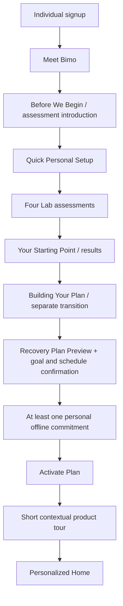
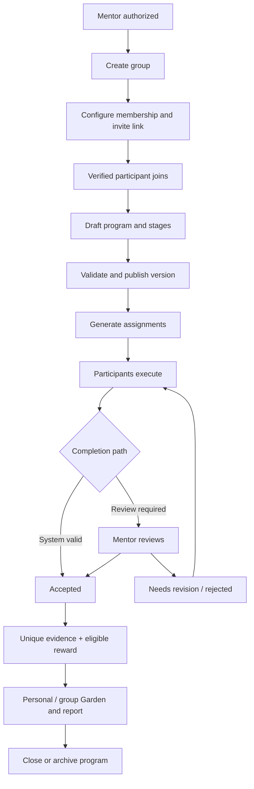

# DeepSprout

## Master Product, Experience, Business Workflow & Technical Specification

**Version:** 3.0 — Consolidated conversation specification  
**Prepared:** 13 October 2026  
**Status:** Target product specification and decision record; **not** a declaration of completed implementation  
**Primary audience:** Product owner, supervisors, designers, Angular and ASP.NET Core developers, database designers, testers, and reviewers  
**Primary technology direction:** Angular; ASP.NET Core Web API/C#; Entity Framework Core; SQL Server; a separately installed Chrome-compatible browser extension subject to technical validation  
**Language:** English product terminology and UI copy; localization can be added later.

> **Source-of-truth rule:** This document consolidates the entire product discussion and the previously supplied DeepSprout blueprints. **The most recent explicit product decisions override older proposals**. It preserves worthwhile ideas from earlier versions without silently restoring features subsequently removed. This document is for specifying what to build, not pretending it already exists.

### How to read requirement statuses

| Label | Meaning |
|---|---|
| **Agreed** | Explicitly accepted, repeatedly confirmed, or unambiguously chosen in the discussion. |
| **Agreed direction** | The concept and boundaries are accepted; exact UI copy, numeric thresholds or internal implementation remain adjustable. |
| **Recommended** | A concrete, reasoned design proposal not separately approved by the owner. |
| **Undecided** | A specific product, commercial or technical decision remains open. Do not invent a fixed value. |
| **Deferred / excluded** | Previously mentioned, but not part of the current agreed feature contract; preserve only for historical traceability. |

**Scope principle:** The owner intends **complete, integrated end-to-end cycles**, not a deliberately reduced demonstration limited to a few unrelated screens. A technical implementation sequence is useful for dependencies but must not be interpreted as permission to remove an agreed role or cycle.

---

## Contents

1. Vision, positioning, users and product boundaries
2. Fundamental concepts, authorization and workspaces
3. Public website, authentication and registration
4. Individual onboarding: Bimo, personal setup, assessments and activation
5. Recovery Plan: 28-day cycles, weeks, adjustments, evidence and consequences
6. Digital Shield: exactly two core capabilities
7. Activities: definitive catalog, progression, daily load and routine
8. Individual Home page: ordered section-by-section specification
9. Garden: **one simple plant scene**, earned growth, vitality and special rewards
10. Insights: credible sources, metrics, charts and recommendations
11. Explore: discovery, availability, registration and location
12. Community: retained scope and separation from recovery
13. Mentor and group-program management
14. Invited Student: secure limited participation
15. Institutions: registration, initiatives, forms, sessions and competitions
16. Outdoor Providers: experiences, camps, booking and waitlists
17. Supervisor: assigned workspace, cohorts, participation and evaluation
18. Partnerships: independent ownership with optional collaboration
19. Administration and cross-platform management
20. Subscription plans, entitlements and commercial decisions
21. Information architecture and page-state inventory
22. Backend architecture, domain modules, database and APIs
23. Authorization, evidence, lifecycle and consistency invariants
24. Safety, accessibility, privacy, measurement and operational quality
25. End-to-end scenarios and acceptance tests
26. Decision register: agreed, recommended, excluded and open
27. Design-system guidance and UI copy appendix
28. Required follow-on UML and engineering artifacts

---

# 1. Vision, positioning, users and product boundaries

## 1.1 The actual problem

DeepSprout's personal-product core helps people, especially young people, reduce **unwanted or compulsive short-form content scrolling** (Instagram Reels, YouTube Shorts, TikTok-style feeds), regain agency over attention and time, and reconnect with meaningful activities in ordinary life. The user may be interested in reducing scrolling *only*; studying, reading and becoming maximally productive are **not mandatory goals**.

DeepSprout is **not** a general Habit Tracker, **not** a standalone Focus Tracker, **not** an LMS/Trello clone, **not** a generic booking portal, **not** an endless social-media feed, and **not** a medical diagnosis or treatment tool. It can use focused work, practice, and personally chosen offline routines as *means* to support the larger goal. A lower dependency on DeepSprout itself is a desirable possible outcome.

**Product definition (consolidated):**

> DeepSprout is a digital wellbeing platform that helps young people reduce unintentional short-form content consumption and reclaim control over their attention. It combines individualized recovery journeys and browser-level protection with meaningful practice, offline routines, guided group programs, institutional youth initiatives, and organized real-world experiences.

**Important nuance:** Institutional initiatives are **not required to address Reels**. Institutions may run youth-awareness initiatives on procrastination, smoking prevention, media literacy, wellbeing or other appropriate topics. DeepSprout's **personal Recovery Engine remains centered on short-form scrolling and attention management**; an unrelated awareness initiative does not magically produce a better Reels recovery score.

## 1.2 Intended audience

- **Individual:** a person seeking a personal recovery journey, practice, browser protection, community and experiences.
- **Mentor:** a professional or facilitator running guided programs and groups focused on relevant goals.
- **Invited Student/Participant:** a group member who joins without traditional registration through an authenticated invitation flow; may later become an Individual.
- **Institution Representative:** a person acting on behalf of a verified institution, youth center, NGO, university, potentially public body or ministry. The institution itself is a governed entity, not a human login.
- **Outdoor Provider Representative:** a person authorized by an independent trip/camp/experience organization.
- **Supervisor:** an authorized person assigned to manage specific events, sessions, camps or participant cohorts, not a role users grant themselves.
- **Platform Admin:** a trusted internal operator with explicit, audited platform-management access.
- **Participants in initiatives, sessions and outdoor experiences:** may be existing Individual users, eligible invited users, or other supported verified identities according to admission rules.

The previous blueprint targeted approximately **ages 16–26**. This is a product audience rather than an automatic eligibility rule for every initiative or event. Any age restrictions, including safeguards for ages 16–17, must be defined for the relevant feature and jurisdiction.

## 1.3 Permanent architectural/product principles

1. **One identity, multiple authorized workspaces.** An Individual may also be a Mentor or a staff member of an organization; do not duplicate their user records.
2. **Real backend logic, not page counting.** ASP.NET Core owns validation, permission checks, transitions, reward policy, booking consistency and reporting rules.
3. **Evidence is labeled.** Browser-tracked time, self-reported offline action, an assessment score and supervisor-confirmed attendance are not interchangeable.
4. **An event is not a campaign.** Distinguish organizational container, staged program, scheduled session, external experience and personal exercise.
5. **Private by default.** Students' personal assessments, browser histories and sensitive responses are not automatically visible to Mentors or Institutions.
6. **Motivating but not manipulative.** No fabricated recovery percentage, arbitrary gamified posting, punishing app absence, or requirement to spend more time online.
7. **All cycles must connect cleanly.** Shared Identity, Permissions, Activities/Evidence, Garden Rewards, Reporting, Notifications and Auditing; domain ownership stays explicit.
8. **Technical limitations are part of the specification.** A Chrome extension cannot silently track all mobile-app Reels or make blocking impossible across devices.
9. **Meaningful offline opportunities.** Explore supports online and in-person youth initiatives and independently organized physical experiences, not only opportunities in the user's home governorate.
10. **No false claims of implementation.** Screenshots, UI mockups, diagrams and example numbers are illustrative until functionality is developed and tested.

---

# 2. Fundamental concepts, authorization and workspaces

## 2.1 Canonical terminology

| Term | What it means | What it is not |
|---|---|---|
| **Account / Identity** | Authenticated, recoverable person, shared across contexts | One database user per role |
| **Global role** | Server-issued platform-wide capability such as Admin | All organizational permissions |
| **Organization** | Institution with approved representatives and governed workspace | A user's personal profile |
| **Outdoor Provider** | Independent authorized operator of physical experiences | Automatically an Institution campaign organizer |
| **Mentor Group** | Membership cohort for a specific mentor's program(s) | A generic Trello team |
| **Program** | Versioned, staged, scheduled group pathway with assignments/reviews | An initiative or single event |
| **Initiative / Campaign** | Institution's goal-driven youth project, combining zero or more sessions, surveys, programs, competitions and optional experiences | Necessarily a session, competition, or Reels campaign |
| **Session / Workshop** | A scheduled online, in-person or hybrid meeting, potentially tied to an initiative | A mandatory in-person event |
| **Outdoor Experience** | Provider-operated organized trip, outing or other real-world activity | A user's self-reported offline walk |
| **Camp / Bootcamp** | Multi-session experience, with participants, schedule, supervisor and completion policy | Always a residential paid camp |
| **Supervisor Cohort** | Participants within an assigned event/camp under an authorized supervisor | An open general-purpose tasks group |
| **Activity** | Approved personal or program practice with execution/evidence rules | Every user-made to-do |
| **Participation Evidence** | Source-linked, provenance-labeled record of performance or attendance | Automatically a health improvement |
| **Garden Growth** | Visual state earned through qualifying activity/completion | The measurement of recovery itself |
| **Current Vitality** | Reversible current appearance based on defensible recent evidence | Permanent reward balance or login streak |
| **Entitlement** | Paid/free capability and usage limit attached to an account or organization | User role or permission to access any resource |

## 2.2 Identity and security model — agreed direction

- **Unified login:** email/password for conventional accounts, with verified recovery; authenticated existing identities can switch between authorized workspaces.
- **Public Register top-level choices — exactly two:** `Join as Individual` and `Join as a Partner`.
- **Partner second step — three choices:** `Mentor / Coach`, `Institution Representative`, `Outdoor Provider`.
- **No public `Register as Admin`; no self-issued `Supervisor` role; no generic `Invited Student` register card.**
- A representative applies for an organization/provider entity or accepts an authorized invitation to join an existing entity.
- A mentor requests/receives the appropriate professional capability, with approval policy as configured.
- An appointed Supervisor sees the Supervisor Workspace only for assigned resources.
- Invited students may use email OTP (passwordless verification) plus invitation token and obtain authenticated, persistent limited access.
- Server authentication and resource authorization are required at **every sensitive API endpoint**. Angular route guards are only a UI convenience.
- `Join as Partner` is a registration **path**, not a global security role; a single person may later hold several memberships/capabilities.

## 2.3 Workspaces and navigation

| Workspace | Primary navigation destinations |
|---|---|
| Individual | Home, Recovery Plan, Activities, Digital Shield, Garden, Lab, Insights, Explore, Community, profile/settings |
| Mentor | Dashboard, My Groups, My Students, Program Builder/Programs, Assignments, Reviews, Reports, Group Garden, notifications/settings |
| Invited Student | My Dashboard, My Tasks, My Group, My Garden, Focus/Protected Work where assigned, My Progress, account/upgrade |
| Institution | Dashboard, Initiatives, Sessions/Workshops, Forms/Surveys, Competitions, Team & Permissions, Partners/Mentors, Participants, Reports, Settings |
| Outdoor Provider | Overview, My Experiences, Camp Builder/Sessions, Registrations, Waiting List, Supervisors/Staff, Attendance, Evaluations, Reports, Profile |
| Supervisor | Dashboard, Assigned Experiences, My Cohorts, Participants, Schedule, Attendance, Evaluations, Group Garden, Reports |
| Admin | Overview, accounts/approvals, organizations/providers, mentors/groups, initiatives, experiences, activity and assessment catalog, reward/rule policies, CMS/content, community moderation, reports, audit, configuration |

An authorized user may have a **Workspace Switcher**. A switching UI never itself grants access; entitlements must be returned and validated by the API.

---

# 3. Public website, authentication and registration

## 3.1 Public pages

- Public landing/marketing page explaining the core problem, differentiators, product journey, use cases and clear entry CTA.
- `How It Works` / `Features`, `For Individuals`, `For Mentors`, `For Organizations`, `For Outdoor Providers`, `Pricing`, a responsible `Science / References` explanation, and FAQ/help as routes or sections as appropriate.
- Real `Privacy`, `Terms`, `Contact`, `Help`, account recovery and supported-device/extension information.
- Unified Login; two-level Register; invitation preview and OTP join routes.
- Footer with relevant working links and valid social accounts only; preserve the creator's attribution and © 2026 as previously requested, linking to the creator's website **once a real URL is supplied**. Avoid fabricated links, generic inspirational quote panels and a visible `About` footer column if that earlier design choice remains active.

## 3.2 Register screen — exact decision and visual behavior

**Headline:** `Choose how you'd like to get started.`

**Option 1:** `Join as Individual` — `Personal journey, activities, community and experiences.`

**Option 2:** `Join as a Partner` — `Lead programs, represent an institution or organize experiences.`

- Both options are presented as large, elegant selection cards. The selected card has clear visual emphasis and accessible keyboard state.
- **Individual selected:** warm ivory/cream with sage botanical elements and a subtle, evolving organic/neural network motif suggesting personal growth.
- **Partner selected:** same global palette/typography but background motifs shift to interconnected people, organizations, sessions and experiences.
- Background transition is coordinated, gentle and premium; do not suddenly replace the entire identity or create visual chaos. Honor `prefers-reduced-motion`.
- Individual continues to normal account creation. Partner continues to a **secondary path-selection screen** with Mentor / Institution Representative / Outdoor Provider; then authenticated person details and relevant application/invitation flow.
- Register options are **entry intentions**, not an irrevocable lifetime classification.
- The auth page uses the established cream/green/dark-heading identity, rounded, refined form/card, no unnecessary full marketing navbar above the card; footer stays professional.

## 3.3 Unified Login and routing

After authentication, API returns identity, onboarding state, workspace memberships/permissions and allowed default destination. The user can then open or switch to authorized workspaces. Admin access is privately provisioned; the login form need not show Admin as a public choice. Any passwordless or test-mode bypass must be **development-only**, environment gated, never exposed in production. Normal logout, recovery, OTP expiry and login errors must exist.

---

# 4. Individual onboarding: Bimo, personal setup, assessments and activation

## 4.1 End-to-end first-run sequence — latest direction supersedes old New-User Home proposal



Do **not** route a brand-new Individual directly to a marketing-like Active Home before these agreed first-run steps, unless the user is resuming an unfinished first run. Preserve return state at every meaningful stage; do not restart completed assessments after a browser close.

## 4.2 Bimo introduction — TWO short illustrated screens (recommended precise treatment)

Bimo uses **approved original mascot assets**. Do not generate a new lookalike or include Bimo in every card. Use separately layered still artwork and subtle camera/CSS movement, not mandatory Rive animations.

**Screen 01 — Meet Bimo:** Main Bimo art on a light cream botanical scene, waving, clear heading and one primary action. Exact previously accepted draft copy:

> **Hey, I'm Bimo!**  
> I'll be your friend along the way. Let's discover your starting point and build a plan that fits you.

CTA: **Let's Begin**. Secondary: **Skip Introduction**. No giant explanation of every feature here.

**Screen 02 — Before We Begin:** Bimo shifts to smaller side illustration; four assessment motifs/cards appear in the same cohesive background.

> **Let's find your starting point.**  
> We'll begin with a few questions and four short assessments.  
> Your answers and results are private by default. DeepSprout will use them to help build a plan around your goals.  
> There are no perfect answers. Just be yourself!  
> You can take a break and continue later.

Show an **honest time estimate**, provisionally **15–20 minutes** until actual test durations are validated; show how progress is saved and where privacy details can be read. CTA: **Start Assessments**. `Skip Introduction` skips only the explanatory screens, **not** the four tests. Optionally replay from Help. Screen one should never repeat on every login.

**Privacy qualification:** Do not promise raw answers are sent to an external AI. Results are private by default; the assessment/recommendation system uses them under the product's disclosed rules. If AI is integrated, its inputs, provider and consent boundaries must be documented separately.

## 4.3 Quick Personal Setup — useful questions only

Collect with quick choices, not long essays:

| Question | Functional reason and resulting use |
|---|---|
| Main goal? | Determines plan objective and relevant intervention candidates. Examples: reduce short-video scrolling, use phone more intentionally, create time for offline interests, support a specific focus objective. |
| Which services are most distracting? | Helps build a user-selected browser site list. Must not assume mobile app blocking is available. |
| When do you usually scroll more than intended? | Can **suggest** an intervention time; only a **self-report**, not automated inference. Include `varies / not sure`. |
| Approximate time spent scrolling? | Optional self-reported baseline; do not treat as objective usage measurement. |
| Where do you browse (computer Chrome or phone)? | Establish technical feature availability and honest Shield instructions. |
| What do you enjoy offline? | Selects relevant personal alternatives, not a clinical psychological diagnosis. |
| Time/available days for activities? | Prevents overload; supports a realistic weekly schedule. |
| Preferred protection intensity/notification tolerance? | Suggests reasonable Shield defaults, but user controls activation and limit. |
| **One small personal offline commitment** | Required before first plan activation under the latest discussed direction; e.g. walk five minutes, sketch, read two pages, practice music. The platform does not judge how impressive it is. |

A question about *why* the user scrolls (boredom, stress, avoidance) can exist as an **optional** multiple-choice input, never a repeated interrogation each time they open Instagram. Its lack does not block a functional plan. Personalization inputs are stored separately from performance scores; liking walking does not improve an attention-test result.

## 4.4 Four baseline assessments — unchanged set

| Assessment | Core interaction | Appropriate recorded outputs |
|---|---|---|
| **Digital Habits** | Short, honest questions about short-video use, stopping, habits and context | Clearly labeled self-reports and chosen goals; instrument version |
| **Sustained Attention** | Timed visual response task | Task accuracy, omissions/commissions, reaction times if measured correctly, attempt validity |
| **Inhibitory Control** | Respond to selected signals and withhold response to others | Response-control task metrics, errors, timing and version |
| **Depth Challenge** | Short reading passage with comprehension questions | Accuracy/reading-comprehension task outcomes; passage difficulty/version |

- Four assessments, not four diagnoses; no fake brain-health percentage.
- Assessment introduction, individual progress, pause/resume, failure/retry, timeouts, saved partial progress and Results are required states.
- Preserve item/content version, timestamps, relevant attempt metadata, scoring logic version and comparability constraints.
- Do not treat goals/preferences as test-score components.
- Estimate total duration using actual tasks before presenting a fixed claim.
- **Official periodic reassessment is free** and should occur when an appropriate repeat version/eligibility window exists. A roughly 28-day end-of-cycle reassessment is a *product proposal*, not a scientific standard and not necessarily an obligatory full four-test retake on the exact day. Weekly Review is not a fifth cognitive test. Optional practice/test rehearsal must not silently count as official reassessment.

## 4.5 Results → separate plan-building presentation → activation

**Result scene:** `Your Starting Point` shows four distinct categories, valid task results and concise caveats. A clean, coordinated animation assembles the results; do not imply a medical diagnosis or common 0–100 brain score.

**Plan-building scene:** a distinct, short illustrated transition: understanding goals → matching approved activity candidates → proposing a four-week roadmap → ready for review. Real API computation, **not artificially extended loading**. Bimo may appear contextually in one meaningful frame.

**Plan Preview:** user sees goal, proposed 28-day cycle, overall four-week direction, the *first detailed week*, recommended practice cadence, one chosen personal offline routine, and possible Shield support. The user can change permitted preferences and timing, see a recomputed preview if needed, then **Activate My Plan**. Do not start irreversible commitments merely because a preview was generated.

**Product Tour:** short contextual overlays showing Home (next action), Recovery Plan (planning), Activities (execution), Digital Shield (protection), Garden (visual achievements), Insights (measurement), Lab (assessments) and Explore (initiatives/experiences). Tour should be skippable, replayable from Help and not a mandatory ten-step wizard.

**Returning users:** use onboarding state to resume the exact relevant location: Bimo not seen, intro, quick setup, unfinished assessment, Results, plan preview, or active Home. Never treat partial progress as a completed baseline.

---
# 5. Recovery Plan: 28-day cycles, weeks, adjustments, evidence and consequences

## 5.1 What a plan is — and is not

**Recovery Journey** is a continuous personal history; **Recovery Cycle** is a bounded planning interval; **Week** is the current plan's detailed scheduling unit; **Daily Action** is a scheduled commitment, not an entire independent plan. The page is not a universal habit tracker or an overloaded generic calendar.

**Recommended/strongly favored:** first default cycle = **28 calendar days, four weeks**. The owner repeatedly explored and positively received this structure, but exact global duration/policy is not a clinically proven recovery period and should be marked as a configurable product default rather than a promise of recovery in 28 days. Completing 28 days does not reset the Garden or guarantee recovery.

The system initially builds a high-level roadmap for all four weeks, **but details only Week 1**. At each weekly boundary, validated evidence and the light Weekly Review generate the next detailed week. This adaptive scheduling model was expressly liked. Do not fabricate 28 fixed daily exercises on Day 0.

## 5.2 Suggested page tabs and exact responsibilities

The earlier mockup contained `Overview / Schedule / Adjust / History`. The more recent, clearer proposal is **`Overview / This Week / Adjust / History`**. User has welcomed the functionality but exact tab labels remain UI decisions.

### A. Overview

- Title `Your Personal Roadmap`, current goal/target, `Active Cycle`, cycle number, current week and day.
- One clear four-week roadmap, **W1 → W2 → W3 → W4** in English LTR. Week status: completed, current, upcoming, paused/closed where applicable.
- A compact description of this week's relevant focus, not generic fixed Prepare/Protect/Reconnect labels forced on everyone.
- Current week's key commitments: eligible core practice, small personal routine, and any opted-in browser protection settings; separated by evidence type.
- One prominent CTA to `Open This Week` / `Start Next Activity`, taking the user directly to Activities when execution is needed.
- Progress bar, if shown, must identify what it measures (e.g. elapsed days or due practices completed), **not a fictitious recovery percentage**.
- Weekly Review due/overdue or cycle-end banner when applicable.

### B. This Week (formerly Schedule)

- Day-by-day weekly list/calendar: required practice when assigned; personal offline routine; optional practices; review; days with nothing required.
- Each item displays title, estimated time, progress state, source, verification level, due window, and Start/Details/Reschedule action as appropriate.
- `Start` routes into **Activities** or the relevant supported Shield operation; do not implement a second activity player inside Recovery Plan.
- `Reschedule` is permitted for eligible future/unstarted personal activities according to business rules. No retroactive changing of attempt results.
- This is not a Google Calendar replacement, generic project planner, or endless to-do board.

### C. Adjust

Adjust is always **available to request**, but the engine distinguishes:

| Change category | Example | Rule |
|---|---|---|
| Small preference | Swap walking for drawing; available day | Update eligible future commitments without resetting cycle |
| Scheduling | Move tomorrow's unstarted reading exercise | Respect due windows/conflicts; append revision/audit |
| Practice load | Fewer core exercises or less intense level | Check engine limits; show change before confirming |
| Main-goal change | Change the main target or intervention strategy | Re-evaluate suitable plan components and generate new future-only preview; preserve history |
| Protected session | Change strict block mid-active timer | Respect opted-in locked-session rules and browser capabilities; do not promise impossible enforcement |
| Mentor assignment | Change a mentor-issued task | Participant **cannot** modify mentor's underlying assignment; request change from authorized Mentor |

A quick preference update does **not** create an entirely new 28-day cycle. Significant change produces a version/revision of **future** plan content; recorded history, assessment data, previously earned rewards and evidence do not disappear. Users cannot mark missed verified activities as completed merely by editing a schedule.

### D. History

- GitHub-style heatmap of **qualified scheduled activity completion**, not a graph of brain recovery or days signed in.
- Distinguish `No scheduled activity`, `Not due yet`, `Completed`, `Partial`, `Missed`, `No reliable data` with legend/tooltips and accessible non-color alternatives.
- Recent cycle history, summaries of 28-day cycles, weekly reviews, plan adjustments, current/stored goals and comparison links to Insights.
- Streak, if displayed, must have a strict definition involving **scheduled eligible days**, not every calendar login. Planned rest days do not constitute failure.
- Quick summary metrics may show planned/due/completed practices and number of reviews; avoid duplicating the entire Insights dashboard.

## 5.3 Commitments → Evidence → Adaptation (agreed core logic)

1. **Commitments:** a user-selected goal, optional Shield action, allocated core practices, a small offline routine, and schedule.
2. **Evidence:** system-validated in-app attempts, browser-provided supported events, explicit user self-reports, and third-party attendance/reviews, each with provenance.
3. **Adaptation:** server-side rules inspect suitable evidence; they propose continuation, reduced load, alternative content, progression or revised timing.

Do not conclude that the user opened Instagram for emotional reasons or spent time watching Reels from lack of site login. No forced manual diary after each social-media session.

## 5.4 Daily activity load and progression

- **Recommended starting load:** one core Meaningful Practice on roughly **3–4 scheduled days per week**, plus one chosen offline micro-routine; optional extra practice at most within a reasonable daily limit. These exact numbers remain **calibration parameters**, not formally adopted quantitative requirements.
- The owner mentioned **up to three activities in a day** as an illustration, **not three mandatory practices every day**.
- Plans adapt practice type/level to goal, demonstrated task results, available days and user preference. Do not assign reading by default to a person whose sole objective is reducing Reels unless they want it.
- Days with zero required in-app exercises are valid; DeepSprout should actively support time away from the app.
- Extras and repeated content do not generate limitless growth.

## 5.5 Weekly Review — simple decision point, NOT a Stillness activity

Triggered around the week's end or upon return when a scheduled review is pending:

- Show verified, reported and missing data distinctly; due vs completed practices; latest supported-browser summary where available.
- Ask **one or a few simple questions**, e.g., `How manageable did this plan feel?`, optionally `Did this week's activity choices fit you?`.
- Explain next week's recommendation and which inputs support it.
- Offer **Accept Next Week**, **Keep Current Pace** where safe, or **Adjust**. User decides important changes; never silently increase difficulty.
- Save plan revision/version plus reason and applicable dates. Preserve prior records.
- If review is skipped, maintain a **conservative continuation** rather than blocking the whole experience or automatically raising workload.

## 5.6 Missed days, long absence and cycle ending — agreed behavioral policy

| Real case | Required handling |
|---|---|
| One missed scheduled exercise | Mark the historical window missed/expired as appropriate; do not infer excessive Reels consumption |
| Several missed exercises | Gentle notice and rescheduling/load adjustment suggestion; don't pile up a backlog |
| User absent ~one week | On return show short summary and choice to resume/adapt; don't automatically reset Garden |
| Cycle ends while absent | Do not label it successfully recovered; offer cycle review then next cycle/maintenance |
| Shield validly operated in browser during website absence | Retain supported, verified records without requiring the site to be open |
| No measurements for several days | Treat as **unknown**, not success, relapse, zero usage or reason to kill plant |
| Genuine observed or honestly reported setback | Show honest trend and possible **reversible vitality** effect; avoid shaming and data fabrication |
| User completes entire cycle | Review outcomes, then select another cycle, adjusted approach or lighter maintenance mode |

**Important:** elapsed calendar time, plan adherence, scrolling-goal progress and assessment performance are **four different notions**. Neither days since signup nor activity count directly equals recovery.

## 5.7 Suggested state machine and termination

`Draft → Preview → Active → ReviewDue → (Adjusted Active / Active) → CycleEnded → Reviewed → (NextCycle / Maintenance)`.

Allow `Paused`, `Cancelled` and `Archived` where product rules justify them; define permitted transitions in C# and validate them server-side. Plan changes should target future obligations only. Maintain `RecoveryJourney`, `RecoveryCycle`, revision history, weekly schedules/assignments, weekly reviews, eligible assessment attempts and evidence identifiers.

## 5.8 Reassessment and Lab relationship

- Four baseline tests on initial Individual onboarding; formal reassessments later on defined, methodologically justified eligibility windows.
- An end-of-cycle opportunity near 28 days is a **candidate** default, not an obligation to retake all four every 28 days and not a medical claim.
- **Free** access to necessary official reassessments and core historical comparisons was recommended and repeatedly maintained; do **not** put the user's basic right to see progress behind Plus.
- Previous results remain stored, versioned and comparable only when instrument/scoring conditions allow. Practice effects can bias cognitive task scores. Inform users.

---

# 6. Digital Shield: exactly two core capabilities

**Latest explicit decision:** The public Shield feature set should contain **TWO** independently understandable capabilities, not the previous nine partly overlapping intervention names.

## 6.1 Manual Website Protection

**User flow:** open Shield → see extension connection status → choose supported websites/domains → choose countdown duration → inspect lock conditions → `Start Protection` → extension applies blocking rules inside the supported browser → countdown displays active/ending/expired status → resume normal access when the timer expires.

- User selects e.g., Instagram, TikTok, YouTube or eligible URLs; selection/configuration alone does not earn unlimited rewards.
- Blocking is **browser-scoped** and only as strong as actual extension capabilities. Do not claim that the user cannot uninstall the extension, change browser or use another device.
- Whether Instagram Reels can be blocked separately from non-Reels functions must be validated; never pretend reliable Reels-only detection if only full-site domain data is available.
- A locked session, if offered, should state limits honestly and not be silently overridden by the **other** intervention's `Continue` button.
- Distinguish `Configured`, `Extension Connected`, `Protection Active`, `Failed`, `Expired`, `Disconnected`.

## 6.2 Shared Website Usage Reminder

**User flow:** choose a group of supported websites → choose aggregate threshold, e.g., 30/60/120 minutes or custom permitted duration → the extension estimates **active supported-browser usage** over a defined daily period → show a prompt when threshold is crossed:

> **You've reached your chosen limit.**  
> **Continue Anyway** / **Back to DeepSprout**

- Time from selected sites is summed as a group, not tracked as separate guaranteed limits unless configured differently.
- Default threshold (including the user's original **two-hour example**) is **not finalized**. The user chooses the value; do not require 2 hours for everyone.
- Recommendation: one threshold reminder per daily period, avoiding an immediate repetitive popup after `Continue`.
- This **soft** warning does not defeat an already active strict block.
- Count only what can be measured with permitted tab/window/activity/idle APIs and handle offline/partial-event uncertainty. Domain-level tracked time is **not equivalent** to time spent on Reels alone.
- `Back to DeepSprout` should navigate to the relevant dashboard/goal or next eligible activity; it need not award anything merely for clicking.

## 6.3 What was removed from the current Shield catalog

**Not separate features/Activities in current scope:** Scheduled Protection, generic Daily Usage Limit marketed separately from the one shared reminder, Intentional Pause as a third user-facing feature, If–Then Plan as standalone, Return to Goal as standalone, Notification Cleanup, Morning Reset, Evening Reset, Quiet Break, Pause & Notice. The legitimate `Continue / Return` prompt is already part of **Usage Reminder**, not a separate activity. They appeared in early blueprints but were **explicitly rejected as redundant** in later discussion.

## 6.4 Supported extension and graduation demonstration

- Downloadable **ZIP source bundle** may be provided for test/demo. To use `Load unpacked` in Chrome, **extract** it and load the extension folder containing `manifest.json` from `chrome://extensions` with Developer Mode enabled. A ZIP cannot simply be treated as a store-installed extension.
- Extension enforces site blocking and produces reliable available browsing events **locally**; ASP.NET Core stores selected settings, authenticated sync and accepted evidence/usage records under consent and security controls.
- Design distinct pages/states for `Not Installed`, `Unpacked Extension Installation Guide`, `Connected`, `Blocking Active`, `Reached Limit`, `Disconnected`, `Sync Pending`, `Rule Failure`.
- Do not claim complete Android/iOS app coverage or bypass-proof enforcement. Restrict measurements to supported browser and permissions.
- Security: limit permissions, authenticate sync, validate events, handle clock skew, do not treat arbitrary client traffic as tamper-proof evidence; avoid collecting full browsing histories when unnecessary.

---

# 7. Activities: definitive catalog, progression, daily load and routine

## 7.1 Separation of concerns

- **Recovery Plan owns scheduling**, eligible recommendations and review.
- **Activities owns content, attempts, execution, completion and self-reported routine**.
- **Shield owns manual blocking and shared site-time reminder**; it is not a row of nine Activities.
- **Explore owns institution initiatives and organized offline/online opportunities**; these are not interchangeable with personal activities.
- **Lab owns four formal tests**, not daily training mini-games.
- **Insights owns analysis**; **Garden owns earned appearance**.

## 7.2 Four Meaningful Practice types — current adopted taxonomy

| Canonical type | User experience | Important completion conditions |
|---|---|---|
| **Depth Practice** | Read an approved short passage; answer questions about ideas, details and understanding. | Versioned passage, comparable difficulty tier, scored question attempt when applicable. |
| **Listening & Recall** | Listen to a short original/licensed audio clip; answer questions on the main point, details and relations. | Track audio attempt, permitted replays, question outcome, accessibility mode. |
| **Practical Micro-Challenge** | Perform a small concrete cognitive, organizational or creative task with a clear prompt and outcome. | Challenge-specific evidence; no arbitrary repeating for unlimited rewards. |
| **Protected Work** | Choose a meaningful real task, begin an optional supported browser protection/work session, and log appropriately. | Do not infer that work quality was excellent just from timer elapsed; distinguish support from verification. |

**Embedded steps rather than separate menu cards:** `Comprehension & Recall`, `Explain in Your Own Words` can occur within Depth/Listening. **Longer Learning Path** is an organizational sequence of exercises and was discussed as a later extension, **not a fifth required activity card**. Standalone Focus Timer and generic cognitive mini-games are excluded from the core training lineup.

## 7.3 Gradual exercise difficulty

- One-minute reading at entry, then perhaps 3, 5, 7 minutes is a **candidate example**, not a mandated daily or linear schedule.
- Duration is not difficulty on its own: content complexity, vocabulary, number/type of questions and demonstrated comprehension must be considered.
- Use **independent level per activity type**: reading advancement does not auto-raise Listening level.
- Proposed eligibility combines valid distinct completions, suitable scores where measurable, version/difficulty history, signs of struggle and user preference. **Two-day streak alone does not unlock a higher level**.
- When eligible, show a prompt `Ready to try a longer one?` with `Try Next Level` / `Stay Here`; safe step-down is allowed without destroying history.
- Numeric thresholds (number of attempts, passing performance, durations and load) are **to calibrate**, version and test, not clinical metrics or falsely agreed fixed values.
- A meaningful practice is distinct from official Lab reassessment; frequent practice cannot claim improved brain health.

## 7.4 Offline Life — light personal checklist, not full Habit Tracker

**Latest direction:** every Individual chooses **at least one small personal offline routine** while activating the first plan. User decides its meaning and intensity, e.g., 5-minute walk, drawing, hobby, reading a physical book, time with friends/family. The product should not judge the content's prestige. User may later add, edit, pause or schedule additional checklist items.

| Item idea | Treatment |
|---|---|
| Offline Walk | Personal self-reported activity; may be eligible mission under separate policy |
| Creative Activity | Drawing/making something; optional attachment only when genuinely needed |
| Physical Reading | Reading a real book if personally relevant |
| Offline Hobby | User-defined interest/activity |
| Social Activity | Meaningful offline interaction, without intrusive evidence demands |
| Personal Recovery Goal | Explicit personal goal/commitment, not automatically a scheduled task |
| Personal To-Do | Ordinary life task; **no automatic XP or Garden reward** |

**UI:** `My Offline Routine` within Activities. Allow Done/Skipped, optional times/days, reasonable editable recurrence. A checklist tick is **self-report**, not externally verified evidence. Apply a reward cap and repeat rules if a specific routine qualifies; never grant infinite growth from creating or completing arbitrary self-authored tasks.

## 7.5 Community behavior related to activities

`Share Achievement` is an **optional social post action** after a real achievement, not a rewarded practice. Sharing/likes/comments do **not** grant Garden Growth. `Joint Goal` and `Progress Check-In` belong to **Community's** collaborative goal workflow; `Accountability Partner` was previously discussed as a later refinement, **not a compulsory partner system**.

## 7.6 Removed Stillness & Reflection catalog

The user **explicitly chose to remove the entire user-facing `Stillness & Reflection` activity family**: Just Be / Quiet Break, Pause & Notice, Activity Reflection as standalone, Setback Review as a standalone task, Ink Room and similar prompts. **Weekly Review remains essential within Recovery Plan**, not within training catalog. Optional simple feedback within a practice can exist when legitimately necessary without resurrecting a separate Stillness category.

## 7.7 Activities page — functional organization

Recommended tabs: `For You`, `Explore Activities`, `Assigned`, `History`, plus a clearly visible `My Offline Routine` area. **Do not confuse the `Explore Activities` tab with the global `Explore` page for institutional opportunities.** A less ambiguous label could be `Browse Practices` (final label TBD).

- **For You:** current eligible core practice and optional one, source from the plan, next activity CTA.
- **Browse Practices:** approved training types with duration/type/difficulty filters; eligible on-demand access.
- **Assigned:** Mentor or program assignments, if the current identity belongs to an active group; deadlines/status/review path.
- **Offline Routine:** user-created simple daily hobby checklist; its records are visibly self-reported.
- **History:** attempts, completions, pending reviews, revised submissions and associated sources; not a substitute for Insights.

**Example daily combination:** one assigned Meaningful Practice + one personal offline commitment + optional additional practice. Do not schedule all four practices every day. Core activities assigned by a free Recovery Plan remain free even when optional extra-practice limits are reached.

## 7.8 Attempt and completion policies

Every activity definition is versioned and has: category, goal tags, estimated time, difficulty, prerequisite eligibility, content/media version, response/completion method, evidence tier, reward rules, repetition limits, and publication status. Store attempt lifecycle `Started`, `Paused/Interrupted`, `Submitted`, `Pending Review` when relevant, `Completed/Approved`, `Needs Revision`, `Cancelled/Expired` as appropriate. Never derive verified completion solely from a client-supplied boolean.

- **System-scored:** only if the exercise has real scoring logic and input validation.
- **Browser-observed:** only events within supported extension boundaries.
- **Self-reported:** offline checklist/mission; distinguish from independently confirmed events.
- **Mentor/Supervisor-reviewed:** authorized confirmation of participation/assignment completion.
- **Reward eligible:** only after policy validation; unique source identity/idempotency.

---

# 8. Individual Home page: ordered section-by-section specification

**Home is a personalized action hub styled as a rich modern homepage; not a second full dashboard, and not a generic marketing landing page.** The owner explicitly favored distinct, visually unified sections rather than one overloaded grid.

| Order | Section | Content and action |
|---|---|---|
| 1 | **Navbar** | Brand, Home, Recovery Plan, Activities, Digital Shield, Garden, Lab, Insights, Explore, Community; profile, notifications, and optional workspace selector. Responsive grouping if crowded. |
| 2 | **Hero** | Elegant branded welcome; goal context and **one state-aware primary action**, plus a clear secondary `Explore Activities`/Activities CTA. Avoid redundant filler. |
| 3 | **Your Goal** | Dedicated section with goal/target and appropriately labeled recent direction; opens Plan or Insights. |
| 4 | **Your Garden** | Dedicated visual preview of the **one plant** and latest meaningful growth; opens Garden. |
| 5 | **Offline Ideas to Try** | Small, relevant personal activities matching preferences; links to practice/details, not provider bookings. |
| 6 | **Outdoor Experiences** | Real organized trips/camps/available experiences; dates, location/online mode, organizer, booking availability where verified; opens Explore detail. |
| 7 | **Join an Initiative** | Youth initiatives (not all Reels-themed), with topic, provider/institution and participation status; opens Initiative page. |
| 8 | **Hear from Your Community** | Small curated/eligible selection of positive, useful actual community posts; no endless scrolling on Home. |
| 9 | **How It Works** | `Small steps. Real change.` four concise stages; prominent for first-time users, collapsible/less prominent later. |
| 10 | **Final CTA** | `Ready to grow a better you?` + `Continue your journey` / `View insights`, with state-correct routing. |
| 11 | **Footer** | Product/support/privacy/terms/contact/real official socials and creator attribution. |

**Suggested four How It Works stages, as discussed:**

1. **Set your goal** — Choose what you want to improve.
2. **Follow your plan** — Take small, personalized steps.
3. **Explore offline** — Practice focus in real life.
4. **See your growth** — Notice the progress you've made.

**State-aware Hero primary CTA:** no active plan → `Build My Recovery Plan`; practice due → `Continue Today's Activity`; review due → `Review Your Week`; returning after absence → `Resume Your Journey`; no immediate obligation → `Explore Activities`. A visible Activities shortcut remains desirable but should not override the genuinely most relevant next action.

**Home data rules:** do not show unavailable browser measurements as zeros or fabricated improvements; no fake live events/participants/likes; no invented testimonials. Garden preview should not reproduce the full Garden page. Keep layout elegantly cohesive with light ivory, pastel sage greens, appropriate typography, rounded cards and restrained shadows. The project has repeatedly rejected overly random, unrealistic, cluttered and repetitive visual layouts.

---

# 9. Garden: ONE simple plant scene, earned growth, vitality and special rewards

## 9.1 Latest explicit visual decision overrides earlier expansive mockups

**Firm direction from the last Garden discussion:** **NO open world, NO expanding map/islands/biomes, NO four segregated activity plots, NO elaborate garden-building game.**

The Garden should be **as simple as possible**: one fixed, bright white/soft-ivory composition, **one prominent central plant** (possibly growing into a small tree), minimal soil/pot/base, optional occasional small decorative flower or animal such as a bunny, and restrained Bimo appearances. The **one main plant** conveys the journey; it changes growth stage with earned events. The scene **does not grow into an explorable world**.

Still **undecided:** whether the central asset becomes a tree or remains a flowering potted plant. Do not silently commit to an elaborate tree world. The previous large illustration with four garden categories, fencing, XP dashboard and `Water your garden` is **reference art, not the final product requirement**.

## 9.2 Garden growth, earned state and vitality are separate

**Earned Growth:** persistent, auditable growth stage and occasional decorative unlock, derived from accepted eligible accomplishments. It does not reset every 28 days and is not a proven neural/cognitive improvement.

**Current Vitality:** separate and **reversible** recent visual state. Proposed `Thriving`, `Needs Care` and `No Recent Data` classification. Needs Care may show a few gently wilted leaves or lower brightness; renewed valid progress restores health. **Lack of app login or data is not a relapse** and must not kill the plant. Older earned landmarks/companion do not vanish because of a difficult week.

**Special reward:** a small decoration/memory or companion unlocked by eligible initiatives or supervised events; does **not** expand the scene with a camp area, roads or massive landscapes. A simple bunny beside the central plant is acceptable as a special asset; exact eligibility not finalized.

## 9.3 What earns something?

| Source | Evidence and treatment | Suggested modest visual impact |
|---|---|---|
| Initial account / first activation | Starting state, **not an earned achievement** | First small seedling/plant already present |
| Depth Practice | Approved qualifying attempt and repeat limits | Small progression step, leaf or bloom |
| Listening & Recall | Valid listening/comprehension attempt | Small progression step; reward version rules |
| Practical Micro-Challenge | Valid result according to challenge-specific policy | Small progression step |
| Protected Work | Supported recorded work/protection; subjective output not assumed verified | Limited contribution where eligible |
| Offline personal routine | **Self-report** with reasonable capped eligibility | Modest contribution; cannot farm arbitrary checkboxes |
| Qualified Shield record | Browser-limited and validated; mere configured blocklist earns nothing | Optional limited contribution; no fabricated time reclaimed |
| Institution workshop/initiative completion | Relevant verified completion criteria, distinct from joining | Small special decorative element / memory |
| Organized Outdoor Experience | Supervisor/organizer-confirmed completion | Special decorative unlock |
| Multi-session Camp | Completion policy met, not just QR arrival | More distinctive but still **small** special element/companion |
| Mentor/group milestone | Group-level eligible event | Group Garden contribution and narrowly specified personal reward, if any |
| Community post/likes | Social action only | **No garden reward** |
| Arbitrary Personal To-Do | Unbounded user-created task | **No automatic garden reward** |

`Registered` ≠ `Attended` ≠ `Completed`. One qualifying record gets the reward once. Different references to the **same underlying completion** must not grant duplicate growth. Significant rewards tied to true events should be visually distinguishable without using a giant XP multiplier, paid event bias, or a new garden region.

## 9.4 What the Garden page contains — deliberately minimal

1. **My Garden:** heading and one-line explanatory subtitle.
2. **Large central visual:** the main plant, its current earned growth stage, subtle current vitality effect, possibly Bimo and one small decorative companion. Minimal visual clutter, clean background.
3. **Your Growth / Next Unlock:** one compact indicator explaining what is needed next, based on **actual policy** (not random XP). Growth milestones need not be tied to calendar weeks.
4. **Recent Achievement / Garden Memory:** last real qualifying item, why it appeared, date and provenance. Optional `Share to Community` with informed user control.

If needed, a subtle **Group Gardens** link opens the simple shared garden of a group the user belongs to. The group version follows **one clear visual, not an enormous multi-zone collaborative game**. The owner originally favored group gardens for Mentor and Supervisor cohorts; preserve the concept while applying the **same simplicity constraint**.

**No `Water Your Garden` button awarding XP.** Bimo may perform a watering celebration *after* the backend confirms a reward; watering is visual feedback, not a farming mechanic.

## 9.5 Growth policy still requiring real numbers

The exact number of valid activities per stage, reward repeat ceilings, decoration unlock thresholds, any internal credits, and vitality lookback windows remain **undecided**. Product designers must author a **versioned Garden Reward Policy** that meets these invariants: source uniqueness, anti-abuse, auditability, no hidden medically framed score, permanent earned state, reversible current vitality, and accessibility/low-motion alternatives.

---

# 10. Insights: credible sources, metrics, charts and recommendations

## 10.1 Fundamental separation

**Garden celebrates earned events; Insights measures and explains distinct records.** The illustrative previous Insights design included `Focus Score 68`, `Depth Score 61`, `2.1h Average Scrolling Time`, `Consistency 76%` and smooth charts across days. These must **not** be presented as real values or objective neurocognitive improvement unless precise validated sources/definitions support them.

Do **not** plot unrelated percentages, assessment task scores, hours of browser use and completion rate on one common 0–100 axis as if comparable. Avoid a generic `brain recovery %` or unsourced daily focus score. Formal Lab assessments do not generate daily improvements unless an eligible retest took place.

## 10.2 Five distinct domains

| Domain | What is displayed | Data provenance and limitation |
|---|---|---|
| **Digital Usage** | Tracked usage on selected sites, supported-browser time trends, configured threshold comparisons | Chrome-extension observed/derived; **not** phone app time or certain Reels-only time |
| **Recovery Plan Adherence** | Due scheduled practices, completed, missed/excluded, reviews and plan adjustments | Plan scheduler + eligible activity records; not a diagnosis of behavioral recovery |
| **Meaningful Practice** | Valid attempts, reading/listening levels, question outcomes, Protected Work records | Activities Engine; progression may be different for each skill |
| **Lab Assessments** | Baseline and eligible comparison attempts for four instruments | Versioned, non-diagnostic, comparable only with valid matched versions/protocols |
| **Offline & Experiences** | Self-reported personal routine days, confirmed session/workshop/event/camp participation, initiative completions | Clearly separate self-report, registration, attendance and verified completion |

If no extension data exists, show **`No browser usage data available`**, not `0 minutes` or a zero-height bar. Manual phone Screen Time summaries may be accepted as **self-reported**, but must not be silently combined with extension-observed usage.

## 10.3 Credible metrics and formulas

**Scheduled Practice Completion Rate** (example):

`100 × eligible completed scheduled practices ÷ eligible scheduled practices due`

Document numerator/denominator, time window, exclusions and treatment of rescheduled/rest days. The presence of a calendar day with no scheduled practice does not create a missed task.

**Tracked Browser Usage Average** (example):

`sum(valid observed active minutes in chosen browser/site set) ÷ number of covered eligible days`

Data coverage and tracking scope must be indicated. A disconnected extension means an incomplete observation period, **not** proof of zero use.

**Assessment comparisons:** side-by-side attempt date, task variant, version and result. Do not show a growth percentage if only one baseline exists. Practice effects and test comparability must be explained.

**Offline:** `self-reported routine completions` and `supervisor-confirmed attendance` should remain separate labels, not a universal accuracy-weighted fake wellbeing score.

## 10.4 Insights page specification

1. **Compact identity-rich hero:** `Understand Your Progress`; Bimo illustration optional but smaller than in the old half-page banner; clear data period and source-coverage controls.
2. **At-a-glance cards:** no more than a few credible metrics; currently tracked goal, due practice completion and offline routine, each with period/source.
3. **Digital Usage:** dedicated well-labeled chart for supported site activity and goal threshold; separate reported phone-use summary if present.
4. **Practice & Plan:** adherence and training level progress. Link to detailed Recovery Plan History rather than duplicating the entire heatmap.
5. **Assessment Changes:** the four tests, latest result and eligible comparisons, linking back to Lab.
6. **Offline & Experiences:** routine participation, session and camp records; registration, attendance and completion statuses distinguished.
7. **Recommendations:** a **small** number of reasoned, actionable next steps with source explanations and real CTA (`Open Activity`, `Review Plan`).

Example truthful recommendation: `Your recent valid Depth Practice attempts meet the configured requirements for the next reading level. Try Level 2?` Not `Your brain has healed by 31%`.

## 10.5 Source-quality and account states

- New user: baseline only, comparisons pending.
- One week's evidence: a single-period summary; no fabricated month-over-month change.
- Disconnected extension: last known valid timestamp, gap warning.
- Reassessment unavailable/invalid: no comparison line.
- Changed goal or site set: reset/annotate comparison context; avoid conflating different denominators.
- Completed camp: count under structured experiences; its Garden decoration is a separate outcome.
- Privacy controls determine who can see reports; Mentor and Institution do not automatically see personal browsing or Lab results.

## 10.6 AI involvement

ASP.NET Core/C# rules and real data definitions remain authoritative for scoring, policy, reward eligibility and recommendation gating. AI **may** help phrase personalized explanations or carefully constrained ideas; no AI provider, price, input set, prompt policy or integration has been finally adopted. Do not send unneeded sensitive raw results to a model; record explanation source and enforce consent/privacy rules.

---

# 11. Explore: discovery, availability, registration and location

**Global Explore** is a dedicated destination for **institutional initiatives, sessions/workshops, competitions and organized trips/camps**, not the tab for browsing personal exercises within Activities.

## 11.1 Explore page and filters

- Page title, search bar and featured published opportunities.
- Content group filters: `All`, `Initiatives`, `Sessions & Workshops`, `Outdoor Experiences / Camps`, optionally `Competitions` or general events; render on one clear discovery interface.
- Filter by participation method `Online`, `In-person`, `Hybrid`; topic, relevant age eligibility, date, city/governorate, registration status, organizer/provider and availability where supported.
- **Preferred city is a discovery preference**, not a security gate. A person in Zarqa may join an online Jordan-wide initiative from an Amman organization or book an eligible in-person experience in Amman.
- Organization headquarters, initiative coverage, session venue, provider headquarters and user's search-location preference are **separate data fields**.
- Online initiatives can have geographically limited eligibility for legitimate reasons, but the backend checks explicit audience rules, not arbitrary physical proximity. Do not collect precise GPS by default.
- Clearly identify real verified listings versus mock/demo data; hide expired booking CTAs but keep appropriate historical details if allowed.

## 11.2 User's opportunity details and paths

| Opportunity | Detail page contains | User action |
|---|---|---|
| Initiative | Objectives, topic, institution, audience, overall timeline, list of optional/required components | `Join Initiative` only if enrollment required, then choose sessions/surveys/programs individually |
| Online Session | Speaker/facilitator, date/time/timezone, capacity/mode, registration form, meeting-link access rules | Register and receive confirmation; external meeting link at permitted time |
| In-person Workshop | Exact venue/address, date, capacity, age/safety terms, optional form | Register, confirm; QR check-in if adopted |
| Hybrid Session | Two participation modes and potentially separate capacity pools | Select mode, complete appropriate registration questions |
| Competition | Rules, eligibility, submission period, judging criteria, published outcome | Submit entry if eligible; follow review/judging lifecycle |
| Outdoor Experience | Operator, venue, schedule, safety/contact information, seats, supervisor as permitted | Register or join Waitlist |
| Camp | Provider, multi-session timetable, group/supervisor rules, registration and completion policy | Reserve place, attend sessions, receive verified completion if eligible |

`My Registrations` surfaces the participant's owned commitments and states (`Pending`, `Confirmed`, `Waitlisted`, `Checked-in`, `Completed`, `Cancelled`), while `My Initiatives` surfaces initiative enrollments and components. Joining an Initiative **does not book every constituent event**. Attendance **does not always equal completion**.

## 11.3 Integration with personal journey

- Home may feature one suitable Initiative and a few Outdoor Experiences, but links to **Explore** where actual registration occurs.
- Recovery Engine may **suggest** a relevant optional opportunity; it must never require purchase of a trip or participation in an unrelated topic to finish a personal Recovery Cycle.
- Completion evidence flows to shared Participation/Reward systems when eligible. A camp decoration in Garden does **not** imply a lower Reels time or improved Lab score.

---
# 12. Community: retained scope and separation from recovery

**Status:** Community exists conceptually and in previous visual discussions; detailed final redesign is **explicitly postponed for a separate conversation**. Preserve the features already explored; do not pretend its exact last mockup or ranking algorithm is final.

**Purpose:** meaningful, finite support and intentional sharing, **not** a new infinitely scrolling Reels feed or a source of XP from engagement.

## 12.1 Known Community components

- Public-to-members Community landing/hero conveying `A community that grows with you`, relevant supportive illustrations, navigation and `New Post` when eligible.
- Feed of short human posts (progress, wins, tips/resources, questions, challenges), with filters, search, reasonable images, author identity and moderation controls.
- Engagement mechanisms: reactions, comments, save/bookmark, reporting of abusive content; rate limits and content-moderation workflow.
- Sidebar / summary concepts previously shown: community participation totals, **This Week's Challenge**, trending topics, top contributors, perhaps an eligible challenge registration.
- Optional `Share Achievement` from an earned event; **opt-in**, with user control over data shared. Sharing itself yields **no Garden reward**.
- `Joint Goals` between peers/small groups and progress check-ins on real shared objectives; do not turn into general task/project management. `Accountability Partner` was mentioned but not separately finalized.
- No fake/staged real-looking users in production; no dark-pattern infinite scroll or endless notifications.

## 12.2 Current status

Page sections, actual social feature policy, whether contributor ranks/weekly challenges survive, moderation levels and final visual layout **remain to be finalized**. The prior Community screenshots are design reference, not fully adopted functional requirements. No added social metric should silently contaminate Recovery or Lab scores.

---

# 13. Mentor and group-program management

**Mentor is a distinct workspace, not an Individual account with one extra nav item.** It manages meaningful programs, groups, approved assignments and permitted participant progress. Avoid generic LMS/Trello boards, arbitrary academic grading and unrestricted access to students' personal information.

## 13.1 Mentor access and profile

- Enters via `Join as a Partner` → `Mentor / Coach` (the label `Mentor` should be normalized throughout the app).
- Creates/uses a single verified identity, completes relevant mentor profile; applies for approval if the platform requires it.
- Sees status `Submitted`, `Pending Verification`, `Approved`, `Needs More Info`, `Rejected`, `Suspended` under the policy.
- Can switch back to Individual Workspace if also entitled.

## 13.2 Mentor Workspace pages and exact responsibilities

| Page | Contains | Main operations |
|---|---|---|
| Dashboard | active groups/programs, enrolled students, due reviews, completion summaries, pending invitations | Open actionable queues and summaries |
| My Groups | group list, capacity, description, enrollment rule, status, members | Create/edit/archive group, invite, approve/remove authorized members |
| My Students | members from *the mentor's groups only*, status, eligible submitted work, participation history | Search/filter by group, inspect permitted student record |
| Program Builder / Programs | titles, objectives, stages, dates, approved catalog activities, publication status | Create draft, validate, publish, version, activate, complete, archive; reuse templates where configured |
| Activities & Assignments | group/individual assignment forms, due windows, required/optional flags, review policy | Assign, track, reschedule if permitted, cancel with audit |
| Reviews | queue of submissions needing human decision, evidence, notes | Approve, reject or request revision with a reason |
| Reports | group/program participation, completion, late/missing, source-qualified progress, date filters, exports | View and export authorized summaries |
| Group Garden | simple shared plant/garden state earned by eligible group activity | Inspect milestone and source, not individual private assessment |
| Notifications / Settings | invites, upcoming program dates, account preferences | Manage operational notices and settings |

## 13.3 Complete business sequence



**Concrete example:** 14-day program to reduce unplanned short-form scrolling. Mentor selects appropriate catalog items, assigns Protected Work or allowed practices, optionally offers activities outside the browser, reviews relevant submissions. A program should remain focused on digital wellbeing, attention or relevant structured engagement instead of generic homework management.

## 13.4 Group, invitation, program and submission policies

- Mentor can access/manage only groups/programs for which they hold a **resource-level** role. An approved Mentor badge alone is insufficient.
- Group enrollment may be public-by-invite, single-use, limited-use, approval-required or capacity-restricted as configured.
- Invitations: secure tokens, expiration, revocation, use counters; consistent validation under concurrent join requests.
- Program state: `Draft → Published → Active → Completed → Archived`, with relevant `Cancelled`/`Paused` transitions. Publishing validates nonempty content, dates, stages, authorized owner and versioned activity references.
- Published/active program definitions must not be silently altered under historical student work. Major edits create revisions or replacement assignments.
- Assignment ownership is explicit (`program`, `stage`, `student/group`, `activity version`, `due window`, `review method`). Multiple requests must not create duplicate obligations.
- Submission state: `Assigned → In Progress → Submitted → (Approved / Needs Revision / Rejected)`. Some system-scored activities can skip manual review. Overdue is a **derived status or controlled transition** according to policy.
- Mentor does **not** see students' four Lab results, Shield browsing records or general private Recovery Plans by default. Only program-relevant authorized data.
- Group Garden is separate from an Individual Garden and follows source-linked eligible group milestones; **latest simplicity constraint applies**.

---

# 14. Invited Student: secure limited participation

## 14.1 Entry flow

1. Mentor creates an approved group invite; backend generates an unguessable expiring/revocable token and appropriate admission rule.
2. Student opens `Join Group` invite URL; sees mentor/group/program preview (no private details of others).
3. Already authenticated member joins with existing verified identity if eligible.
4. New student enters short identifying details, **verified email OTP** (recommended adopted solution), not a full password registration or four mandatory assessments.
5. API validates token, OTP, expiration, member limit and optional approval; creates/finds identity and membership transactionally.
6. Student lands in a **Limited Student Workspace** with group assignments, current group, small Garden, own permitted progress.
7. Optionally `Upgrade to Full Individual`: add account credentials/consents, preserve same identity, membership, submissions, rewards and Garden; then offer the four baseline assessments as a **separate personal journey**.

An automatically generated integer user ID **is not authentication**; sessions require verified identity and secure restoration.

## 14.2 Student pages

`My Dashboard` (next assigned action, group events), `My Tasks` (program submissions), `My Group`, `My Garden`, `Focus Sessions / Protected Work` where eligible, `My Progress`, `Profile / Account Access`, optional upgrade. The limited experience should not force all public Individual features or personal Lab completion.

Student must never read another person's private submission simply by changing an ID. Removing group membership revokes program-scoped access; data retention must follow policy and user rights.

---

# 15. Institutions: registration, initiatives, forms, sessions and competitions

## 15.1 Independent Institution Workspace

Organizations include youth centers, NGOs, universities, educational/community institutions and possible government ministries. A representative **registers a person first**, then applies for/joins a governed organization. A displayed ministry name is not a claim of official partnership or verification unless evidence and approval exist.

**Institution workflow:**

1. `Join as Partner → Institution Representative` or authorized staff invitation.
2. Person authenticates. For a new entity, `Register Your Organization` requests institution name, type, official contact, country/governorate/address, representative name/position, optional website and appropriate documentation.
3. Backend creates `PendingReview` organization application; Admin/authorized verification team reviews documents, requests additional information, approves or rejects with audit.
4. Upon approval organization becomes Active; initiating verified person receives appropriately scoped `OrganizationOwner/Manager` capability.
5. Institution adds coordinators, team members, Mentors and partners by **scoped invitation**, not by giving them global admin roles.
6. Institution drafts/publishes awareness initiatives, adds components and manages participation/sessions/reports.
7. Archived initiatives remain reportable without allowing late signups.

## 15.2 What an initiative actually is — researched concept adopted in discussion

An **Initiative/Campaign** is a project by an institution with a topic, objective, audience, time window, participation rules and one or more **optional component types**. It is **not automatically a session or a competition**. The institution can run an initiative about **smoking awareness, procrastination, digital literacy, youth wellbeing, reducing screen distraction**, etc. DeepSprout's personal Recovery score is unaffected by the topic itself.

**Six types of initiative components:**

| Component type | What the participant does | Required service distinction |
|---|---|---|
| Awareness content | Reads authorized resources/article/guide | Content publishing + versioning; may not require enrollment |
| Online / In-person / Hybrid sessions | Registers, chooses mode if hybrid, attends permitted session | Capacity, schedule, venue/meeting access, forms, attendance |
| Surveys / Quizzes | Answers a versioned questionnaire, sometimes anonymously | Questions, branching if supported, responses, privacy and aggregate reports |
| Competition | Submits an entry; judges score based on criteria; results published | Submission cutoff, eligibility, assignment of evaluators, judging and appeals |
| Challenges / Mentor Programs | Completes a short series or joins a guided cohort | Program stages/assignments/reviews; avoid duplicate engines |
| Linked Outdoor Experience | Books and attends an independent Provider event or camp | Partnership linking; Provider retains operations ownership |

Examples from discussion: `Choose Your Health` (smoking awareness: optional opening survey, online webinar, Amman workshop, closing feedback/quiz); `Start Today` (procrastination awareness: survey, short webinar, optional 5-day challenge, discussion); `Youth Creativity Competition` (submission/judging/results); `Beyond Reels` (digital-balance initiative with optional online and outdoor components).

## 15.3 Initiative Builder — six sequential stages

1. **Basic Info:** topic, goal, summary, institution, dates, cover image; choose factual positioning without unsupported medical claims.
2. **Audience & Coverage:** suitable ages, eligibility, locations/cities/governorates, whether nationwide, online, in-person or multiple delivery modes; audience is **not** inferred only from organization headquarters.
3. **Components:** add session(s), workshop, form/survey, challenge/program, competition, or partnership-linked outdoor experience as needed. Each component has its own lifecycle.
4. **Participation Rules:** initiative-level join requirement, consent, enrollment opening/closing, max participants if appropriate, moderation/approval, access to content without joining.
5. **Team & Responsibilities:** coordinators, Mentors, facilitators, session hosts, partner connections, access permissions.
6. **Review & Publish:** preflight validation, preview public detail page, approve/publish, communicate schedule. Save drafts between steps.

**Critical distinction:** `Initiative Enrollment` ≠ `Session Registration` ≠ `Form Submission` ≠ `Event Booking`. Joining an initiative **does not** reserve seats in every session. The page contains an overview, audience, schedule/components, venue or online modes, organizer, eligibility and clear independent CTAs for each component.

## 15.4 Online, in-person and hybrid participation

- **Online:** meeting date/time/timezone, external supported videoconference link (e.g., Zoom/Teams/Meet), registration/confirmation; restrict sharing of private links. Opening meeting link alone is not validated attendance.
- **In-person:** precise venue and travel instructions, capacity, age/safety requirements, registration form and authorized check-in process.
- **Hybrid:** one session with online/in-person registration modes; separate capacity pools when warranted; conditional form questions appropriate to each mode.
- Sessions may be in **Amman**, the user may live in **Zarqa**, and participation may still be fully online or voluntarily in person if eligible. Geography and mode are not the same field.

## 15.5 Registration Forms, Surveys and Feedback — shared, governed Form Engine

Forms are reusable and versioned but have distinct purposes: `Registration Form`, `Survey` (optionally anonymous), `Post-event Feedback`, `Competition Submission Form`. Suggested question types: short/long text, single/multiple choice, rating, number/date and limited validated uploads when genuinely needed. An online/in-person selection may conditionally show venue/accessibility questions (an advanced conditional form builder was discussed, not yet numerically scoped).

- Questions that ask for sensitive health or accessibility information must be optional/necessary and access-restricted; ask only what is needed.
- The exact published form version is pinned to each response; later edits never silently rewrite old answers.
- Anonymous surveys must not secretly attach participant identity.
- Survey analytics use permitted aggregates with appropriate privacy thresholds.
- One-time/duplicate response policies, consent, closing time and editable response rules must be defined per form.

## 15.6 Initiative and Institution pages

| Page | Functional elements |
|---|---|
| Organization Dashboard | Active initiatives, total enrolled/attended/completed across owned resources, alerts, recent activity |
| Initiatives | Draft/published/closed list, builder, component management, controlled revisions |
| Sessions & Workshops | Online/in-person/hybrid schedule, capacities, registrants, attendance |
| Forms & Surveys | Definition templates, versioned questions, permitted responses, analytics |
| Competitions | Rules, submission window, judges, criteria, reviews/results; exact advanced scope to finalize |
| Team & Permissions | Add/revoke staff, coordinators, facilitators, scoped capability assignments |
| Partners & Mentors | Invite Mentor, approve/reject partnership, resources each partner can manage |
| Participants | Enrollments and allowed participation status; not global site users directory |
| Reports & Analytics | Initiative and component date-range aggregates, filters, exports and evidence labels |
| Settings | Verified profile, representative, contact, privacy/notice defaults, branch info if adopted |

## 15.7 Reporting and business rules

Track invited/registered/confirmed/attended/completed **separately**. Reports may show online vs in-person session participation, program completion, authorized survey aggregates, operating metrics, registration conversion, date/location/topic breakouts. Avoid claiming an awareness initiative medically treats smoking or proves reduced Reels usage without a valid corresponding measurement.

An Institution owns an Initiative and its own sessions; a linked Outdoor Provider owns its own event. Partnership does not give Institution unbounded access to the provider's attendance names or special safety-form responses.

---

# 16. Outdoor Providers: experiences, camps, booking and waitlists

## 16.1 Independent Operator / Provider Cycle — chosen model

An approved Outdoor Provider has its **own workspace and operational accountability**, regardless of whether its experience is linked to an Institution Initiative. It manages scheduling, capacity, registration, supervisors, attendance, evaluation, reporting and safety/communication information. Not every Provider activity is necessarily part of an institutional initiative.

**Provider flow:** representative joins Partner → selects Outdoor Provider → submits verification/application → Admin approval → creates provider profile/team → drafts experience/camp → adds venue, dates, capacity, audience, required participant form and supervision → validates/publishes → accepts bookings/waitlist → runs attendance/participation → closes and reports.

## 16.2 Provider Workspace pages

`Overview`, `My Experiences`, `Calendar & Sessions`, `Camp Builder`, `Registrations`, `Waiting List`, `Supervisors & Staff`, `Attendance`, `Evaluations`, `Reports`, `Provider Profile` and operational notifications.

## 16.3 Outdoor Experience creation

Required/configurable fields: title, description/goal, activity kind, owning provider, venue/address, city/governorate, start/end/timezone, capacity, registration window, attendance policy, optional approval, eligibility and participant conditions, contact/safety instructions, cancellation/change procedure, assigned supervisor(s), optional registration form, completion criteria, visibility, optional initiative link. An `Experience` is distinct from a user's `Offline Walk` checklist.

A **Camp/Bootcamp** contains multiple scheduled **Sessions** with their own check-in/completion policy. Day-camp operation is a coherent default example; accommodation/transport/payment logistics were not adopted merely to add backend complexity.

## 16.4 Registration and Booking lifecycle

- Participant reads the full experience info and form, checks age/consent eligibility, requests a place.
- Backend checks organizer status, booking cutoff, identity, capacity, current state, duplicate booking and mode/eligibility **atomically**.
- Reg status (model proposal): `PendingApproval` where required, `Confirmed`, `Waitlisted`, `SeatOffered`, `CheckedIn`, `Completed`, with terminal `Cancelled`, `Rejected`, `NoShow` when applicable. Some statuses should be derived; implementation should choose a **valid non-contradictory state machine**.
- Participant sees status/booking code/QR only when eligible. Modifying client data cannot create an extra confirmed seat.
- An attendance record is separate from a confirmed booking; completion is separate from check-in.

## 16.5 Waiting List — explicitly celebrated feature, substantive backend workflow

1. Registration reaches full confirmed capacity.
2. If enabled, eligible user chooses **Join Waiting List**; creates an ordered and auditable waitlist entry, **not a confirmed reservation**.
3. A confirmed participant cancels or provider increases capacity.
4. `WaitlistService`/job detects the available seat, offers it to the next eligible entry under published priority rules.
5. `SeatOffer` reserves the seat only until its short **configurable** expiry. Notify the user of the offer; do not auto-confirm someone who no longer wants to attend.
6. On `Accept`, atomically convert offer to confirmed booking and consume the seat once.
7. On decline/expiry, release seat and offer the next eligible person.
8. Reject duplicate registration, confirmation beyond capacity, double acceptance and expired offer races.

**Exact expiry period and ordering exceptions remain undecided.** In the UI show `Full`, `Waitlisted (# if policy allows)`, `Seat Available`, `Offer Expires`, `Confirmed` accurately. Use SQL transactions/locking or concurrency handling, unique constraints, idempotency keys and jobs; never rely solely on client-side seat counts.

## 16.6 Day of experience and aftermath

- Assigned Supervisor/authorized check-in operator scans signed or high-entropy **QR booking credential**, validates event/session registration, prevents replay and records check-in.
- Manual override is possible for permitted exceptional cases, with explicit reason and audit.
- Supervisor evaluates completion of announced session criteria (not an unvalidated psychological recovery score); operations team can review corrections/incident records.
- Participants optionally submit feedback on experience quality.
- Close experience, release unneeded active resources, persist immutable history, generate permitted Provider report.
- Successful **qualifying completion** may trigger a small distinctive **Garden decorative unlock**, **not a new map section**, and may contribute to an appropriate Supervisor Cohort Garden.

---

# 17. Supervisor: assigned workspace, cohorts, participation and evaluation

## 17.1 Explicit decision: own experience, but assigned access

The owner strongly preferred a fuller Supervisor cycle with participants, group invitations, a shared garden, dashboard and reports, but did **not** want generic Trello/assignment management. Reconciled design:

- **Supervisor has a distinct Workspace**.
- They **cannot self-register publicly as Supervisor**; an authorized Provider or Institution **assigns** them to a specific Camp/Event/Session or scoped group.
- Their `Experience Cohort` is a subgroup **within** an organized experience, with eligibility bounded by **confirmed participants**.
- A Supervisor may create cohorts and share scoped group join links if granted that capability; link cannot bypass the parent event's real booking capacity or verification.
- They manage **participation**, **scheduled experience sessions**, **completion evaluation**, **group milestones** and **reports**, not arbitrary project cards, deadlines and grades.

A Mentor remains different: the Mentor operates a multi-week digital-wellbeing program; the Supervisor manages the operational and participant experience of an event/camp. Some people may have both capabilities in different contexts.

## 17.2 Supervisor pages and responsibility

| Page | What the assigned Supervisor sees/does |
|---|---|
| Dashboard | Assigned experiences, upcoming sessions, attendance queues, own cohorts, alerts |
| My Experiences | Only authorized events/camps and their operational schedule |
| My Cohorts | Create permitted group, assign only eligible registered participants, link/invite, view membership |
| Participants | Eligible per-cohort records, attendance and participation states, not unrelated users |
| Session Schedule | Sessions, locations, session activity requirements and timing |
| Attendance | QR check-in, manual exception with audit, lists of checked-in/not arrived |
| Evaluations | Completion criteria per session/participant; documented outcomes and revision rights |
| Group Garden | Simple shared visual earned from eligible cohort/group milestones |
| Reports | Attendance, completion, operational notes, exceptions and submitted supervisor summary |

## 17.3 Example: Weekend Camp

Provider publishes 40-person, two-day camp; confirms eligible registrations; appoints Supervisor A and B; authorized supervisors create Forest and River cohorts of 20 confirmed participants each; each runs scheduled activities, verifies per-session attendance, records exceptions, marks relevant completion, contributes to shared cohort garden and submits a close-out report. Cohorts archive at camp closure while entitled past participants may still see permitted historical memories.

## 17.4 Three *different* evaluations

1. **Attendance & participation evaluation** by authorized Supervisor: check-in, session completion against predeclared criteria.
2. **Experience feedback** voluntarily from participant: venue, quality, facilitator, perceived usefulness; separate from eligibility and personal health.
3. **Supervisor performance evaluation** by Provider/institution management: staff duties and operational quality; **not** a mental-health assessment of participants.

Do not let a supervisor declare a user's clinical recovery status or view private personal Lab/Shield history. A supervisor's `Group Garden` reflects eligible **group** accomplishments and stays visually simple.

---

# 18. Partnerships: independent ownership with optional collaboration

**Chosen model:** **Institution** and **Outdoor Provider** are **independent but optionally linked**. Neither entity absorbs the other's operations or user records. This was preferred over (1) institutions running everything or (2) two unconnected silos.

## 18.1 Concrete example

An Institution runs a `Start Today` procrastination initiative. It may host its own webinar and survey, then invite an approved Provider to operate a weekend outing. The institution sends a partnership request with initiative, proposed activity, participation scope and requested dates. Provider accepts or rejects; after acceptance Provider creates or authorizes an Experience link. The Initiative public page displays the Experience, but seats, safety, check-in, staff and cancellation remain Provider-owned.

**No automatic shared raw data:** Institution may see authorized aggregate impact counts, while Provider sees necessary participant booking/safety records. Detailed field sharing requires explicit purpose, scope and policy. No two owners may silently edit the same resource.

## 18.2 Supported partnership roles (distinguish them)

- **Organizer / Owner:** operationally owns and controls a given initiative, session or outdoor experience.
- **Co-organizer:** accepted limited operational permissions by explicit partnership.
- **Venue Partner:** listed as providing location, not implicitly given participant data access.
- **Mentor / Facilitator:** scoped program/session responsibility; separate program management permissions.
- **Sponsor:** disclosed supporter/branding role; **not** automatically a full financial sponsorship/payments management system.

## 18.3 Partnership states and safeguards

`Requested → Accepted / Declined → Active → Ended/Revoked` (recommended). Changes, cancellation and public display need clear approvals and auditing. A session can be run directly by an Institution; an outdoor trip can be entirely independent; an Initiative may link a program, a session, a competition or a provider experience without forcing all component types.

---
# 19. Administration and cross-platform management

The **Admin Cycle** is not a separate public registration choice, nor merely a front-end edit pencil. It is the governed **platform management layer** operating across all user experiences, with least-privilege access, meaningful review workflows and full audit of sensitive changes.

## 19.1 Admin layout and sections

**UI direction:** Admin uses a structured **sidebar dashboard**, not the Individual top navigation. `Overview` surfaces aggregate counts and operational queues; e.g. registered individuals, mentors, organizations, groups, active programs, initiatives, experiences, bookings, pending verification requests, reported posts and important system health indicators. Figures must come from actual backend aggregates with time-range labels, not mock constants in production.

| Admin page | Responsibilities |
|---|---|
| Overview | high-level aggregated health, counts, queues, alerts, quick moderation and verification entry points |
| Users & Access | users, status, role assignment, account suspension, supported recovery, scoped entitlement overview |
| Mentor Applications | pending professional verification/approval, conditions, rejections, audit |
| Organizations | registration documents, representative authority, verification, approval, suspension and support |
| Outdoor Providers | provider applications, approval, compliance metadata and operational suspensions |
| Groups & Programs | management oversight, reports/flags, policy-appropriate intervention, not unauthorized editing of student work |
| Initiatives & Sessions | content policy oversight, initiative publication/flagging, safety/reporting issues |
| Experiences & Camps | provider verification, operational flags, unsafe event reports and control actions |
| Activity Catalog | content CRUD with versioning, eligible reward/completion rules, publication states |
| Lab & Assessment Content | four instrument versions, test item/rubric handling, comparability and change history |
| Recovery & Garden Policy | plan configuration, allowed intervention catalog, difficulty and reward rules, vitality policy versions |
| CMS / Visual Editing | approved public page content, text/images/headings, typography and styles within constrained design tokens |
| Community Moderation | reported posts/comments, actions, appeals, content policy and abusive-account handling |
| Reports | aggregated platform and domain operational statistics, privacy-aware filters and export |
| Notifications / System | templates, delivery logs, background jobs, feature flags, extension compatibility and monitoring |
| Audit / Governance | immutable action records, access logs where appropriate, reasons for approvals and changes |
| Pricing & Entitlements | configurable plan definitions, limits and access settings; billing only if integrated |

## 19.2 Visual edit mode — earlier explicitly desired feature

The user previously envisioned an **Admin Edit Mode** with a pencil near editable texts/images. Preserve that requirement as a distinct CMS capability:

- Enter admin-only edit mode on approved pages; inline pencil beside editable component or text slot.
- Edit text, heading size, typography typeface, color and image/media placement using **controlled design tokens and component constraints**, not arbitrary unsafe CSS/HTML.
- Preview before publishing, preserve source asset references and alt text, and maintain draft/published versioning and rollback/audit where necessary.
- Separate content editors from super-admin system roles when designing scoped permissions.
- Admin edit mode may be activated across public/managed content pages as appropriate; **not** to secretly mutate users' personal medical/private results or completed exercises.
- Security: content sanitization, media storage validation, upload size/type constraints, draft review and role checks.

## 19.3 Authentication and prior temporary test shortcut

A previous front-end testing conversation requested a one-click Admin login **without email/password**. The later secure architecture explicitly chose unified real login and no public Admin registration. Reconcile as follows: a seeded **dev/test-only** helper is permitted in a non-production environment if specifically needed for testing, but must be disabled by environment configuration and never implemented as a production auth bypass. Never confuse a mock UI admin toggle with authorization.

---

# 20. Subscription plans, entitlements and commercial decisions

**Pricing integrity notice:** The conversation established **tier concepts and differentiation**, but **no actual JD/USD monthly/annual amounts were finalized**. This document deliberately does **not** fabricate subscription prices, trial lengths, quota numbers, payment processing providers, billing taxes or institution contracts. The definitive public price list is **to decide**.

**Critical separation:** a **Role/Workspace** determines what an actor may do; a **Subscription/Entitlement** determines which included capability/limit applies. A paying user does not become Admin, and a Provider staff member does not gain unrelated Institution records.

## 20.1 Proposed subscription architecture

| Audience | Proposed tiers | Price status |
|---|---|---|
| Individuals | **Free / Plus** | **Not set** |
| Mentors | **Starter / Pro** | **Not set** |
| Institutions | **Standard / Enterprise** | **Not set; public body/ministry may require negotiated agreement** |
| Outdoor Providers | **Standard / Pro** | **Not set** |
| Supervisor | No separately purchased supervisor tier; authorization comes from an assignment | N/A |
| Invited Student | Limited invited access; no personal premium purchase required to receive permitted group work | N/A |
| Admin | Internal platform privilege only | N/A |

These tier names were proposed in the product discussion and positively explored, **but they are not a signed price/feature catalog**. Separate subscriptions may be attached to an Individual billing account or entity-level payer. A user may hold multiple roles without purchasing duplicate personal identity records.

## 20.2 Individual Free vs Plus — desired policy

| Capability | Free | Plus proposal |
|---|---|---|
| Initial four assessments and Starting Profile | Included | Included |
| Scheduled official reassessments and essential result history | Included | Included |
| Consecutive 28-day Recovery Cycles and Weekly Reviews | Included continuously | Included continuously |
| Core practices assigned by free Recovery Plan | Included | Included |
| Basic supported Shield blocking and reminder functions | Included | Included; possible non-essential customization only |
| Personal Garden and earned non-paywalled rewards | Included | Same earned rewards; cosmetic customization may be extended |
| Basic Insights | Included | More flexible comparison, export and detailed explanation |
| Additional optional practice beyond plan | Fair usage limits to decide | Higher usage limits to decide |
| Plan customization | Essential adjustments included | Additional non-essential scheduling/customization |
| AI explanations | Basic/no dependency on AI | Optional enhanced interpretations if transparent and safely implemented |
| Initiative/Event participation | Eligible regardless of Plus | No automatic booking priority just for paying |

The basic recovery path, vital reassessment and qualified earned growth should **not** be locked behind Plus. Premium status does **not** make an identical activity generate more Garden growth. If plan expires, keep existing personal data, historical results, garden growth and basic access; only premium extras are restricted.

## 20.3 Mentor Starter vs Pro

Both support actual Mentor workflows: groups, programs, assignments/reviews, Group Garden, invited students and basic reports. Pro may raise group/student/active-program quotas, add more templates and advanced reporting/export; the **actual counts remain undecided**. Students invited by a paying Mentor do not need to pay themselves simply to carry out assigned activities.

## 20.4 Institution Standard vs Enterprise

Both cover verified organization workspace, initiative building, sessions, forms/surveys, eligible competitions, team, participation and fundamental reporting. Enterprise may expand simultaneous initiatives, team seats, multi-branch policies and aggregate reporting/export. Ministry/government support may require quote-based contractual arrangements, not a fabricated fixed consumer price.

## 20.5 Outdoor Provider Standard vs Pro

Both cover creation/management of experiences, registration, capacity, Waiting List, QR attendance, supervisor/cohort basics and reporting. Pro may increase concurrent experiences, sessions, active staff/supervisors, advanced reports/export. **Event ticket payments, booking fees, commissions, transport or lodging payments are not automatically part of these tiers.**

## 20.6 Entitlement implementation contract

A server-side `EntitlementService` computes effective access given identity, role, entity membership, plan and actual usage limits. This is independent of resource authorization. Keep plan definitions and prices versioned; track active subscriptions, limits, billing accounts and usage counters. If billing is integrated later, add payment provider, webhooks and retry/idempotency controls. Avoid sprinkling hardcoded `isPlus` checks across controllers.

**Open commercial decisions:** currencies, price amounts, billing period, trial, renewals, cancellation/refunds, subscription owner, student capacity and seat limits, free/provider promotional access, quota change effect, payment integrations and institutional contracts.

---

# 21. Information architecture and page-state inventory

## 21.1 Route architecture (illustrative; not a mandated Angular URL map)

| Prefix | Main routes |
|---|---|
| `/` | landing, pricing, how-it-works, individual, partner, references, privacy, terms, contact |
| `/auth` | register path selection, individual signup, partner sub-selection, login, account recovery, OTP verification |
| `/join/:token` | mentor group invitation / limited-student join |
| `/app` | home, recovery-plan, activities, shield, garden, lab, insights, explore, community, profile/settings |
| `/mentor` | dashboard, groups, students, programs, assignments, reviews, reports, group-garden |
| `/student` | dashboard, tasks, group, focus/protected-work, garden, progress, upgrade |
| `/organization` | dashboard, initiatives, sessions, forms, competitions, team, partners, participants, reports |
| `/provider` | overview, experiences, camps, registrations, waitlist, supervisors, attendance, feedback, reports |
| `/supervisor` | dashboard, assignments, cohorts, participants, schedule, attendance, evaluations, garden, reports |
| `/admin` | overview, users, verification, content/CMS, rules, reporting, community, audit, system |

Actual routes, lazy loading and shared Angular components/layouts can differ as long as public-facing navigation and server authorization stay coherent.

## 21.2 Page-state checklist — every page has more than its happy path

| Feature | Mandatory states/edge cases |
|---|---|
| Auth | first register, existing identity, password reset, unverified email, expired session, failed login, rate-limit, consent |
| Bimo/Onboarding | not viewed, viewed, skipped **intro** only, resumed assessments, plan preview pending, activated |
| Assessments | introduction, in progress, paused, completed, expired/invalid, scored, results, retest eligibility |
| Recovery Plan | preview, active, missing day, review due, adjusted/revised, cycle ended, maintenance, archived |
| Activities | no assignment, eligible, in progress, interrupted, completed, pending review, retry, exhausted reward eligibility |
| Offline Routine | none yet, one selected, added, done/self-report, skipped, rescheduled, paused |
| Shield | extension absent, installing, connected, disconnected, configured, active lock, reminder due/shown, expired, partial sync |
| Garden | initial seedling, new earned growth, special reward, needs-care vitality, unknown evidence, previous reward history |
| Insights | baseline only, comparative data, source incomplete, no data, invalid retest, source-change, export denied |
| Explore | no matches, draft/unpublished hidden, online/in-person/hybrid, eligible/ineligible, full/waitlisted/offer, cancelled |
| Community | no posts, new post, edit/moderate, reported content, blocked reply, removed content |
| Group invitation | valid, expired, revoked, exhausted, group full, pending mentor approval, already joined, OTP expired |
| Organization/provider approval | draft, submitted, pending, needs info, approved, rejected, suspended |
| Initiative | draft, validation errors, published, active, closed, archived, cancelled |
| Session registration | public content, form submitted, pending, confirmed, cancelled, capacity full, checked-in, completed |
| Booking/Waitlist | seat race, pending, confirmed, waitlisted, offer issued, offer expired/accepted, cancelled, no-show |
| Supervisor | unassigned, invited, active assignment, multiple cohorts, expired rights, evidence correction, report pending |
| Admin CMS | edit mode disabled/enabled, draft, preview, published, rollback, failed validation, unauthorized |

Error states require understandable messages, next steps and accessible controls. Never show marketing/demo values as real.

---

# 22. Backend architecture, domain modules, database and APIs

## 22.1 Overall architecture

Use a **modular monolith** unless proven requirements justify distribution: Angular front end calling an ASP.NET Core Web API, relational persistence with EF Core/SQL Server, and limited, opt-in browser-extension integration. Modular domain/application/infrastructure boundaries are a recommended organization—not an excuse to build a forest of unnecessary folders or microservices.

**Representative solution layout:**

```text
DeepSprout/
  DeepSprout.Api/
    Controllers/          # thin HTTP orchestration and input/permission boundaries
    Authorization/        # policies and resource-access handlers
    Middleware/           # error handling, request IDs, audit context
  DeepSprout.Application/
    Identity/ Organizations/ Mentorship/
    Initiatives/ Forms/ Experiences/ Supervisor/
    Recovery/ Activities/ DigitalShield/
    Garden/ Insights/ Community/ Billing/
    Notifications/ Reports/
  DeepSprout.Domain/
    Entities/ ValueObjects/ Enums/ DomainRules/ Events/
  DeepSprout.Infrastructure/
    Persistence/ Configurations/ Migrations/
    Mail/ Files/ ExtensionSync/ BackgroundJobs/
  DeepSprout.Tests/
    Unit/ Integration/ Authorization/ Concurrency/
```

Each logical module may expose use-case services, DTOs, validators, repository/query patterns only where justified, policy configuration, and event handlers. Keep controllers thin. Separate relational constraints from pure domain rules; EF Core entity tracking and database transactions must preserve invariants.

## 22.2 Modules and representative responsibilities

| Module | Critical C# services/use cases |
|---|---|
| Identity/Access | authentication, role/membership authorization, OTP, invitation proof, workspace resolution |
| Organization/Provider | applications, verification, team permissions, account suspension |
| Initiative | creation, component orchestration, enrollment, publishing, collaboration |
| Sessions | online/in-person/hybrid schedules, seat pools, registration, attendance |
| Forms/Surveys | versioned definitions, response validation, anonymous handling, aggregate reporting |
| Competitions | entries, publication/deadline validation, judging roles, scoring criteria/results |
| Mentor | groups, member invitations, program lifecycle, staged assignment, reviews |
| Outdoor | experiences/camps, registration/capacity, waitlist offers, attendance/check-in, feedback |
| Supervisor | scoped assignments, cohorts, session completion evaluation, close-out reporting |
| Recovery | goal/profile, rules-based recommendations, cycle scheduling, weekly review, revisions |
| Activities | catalog versions, attempts, qualification, training-level progression, offline routine |
| Digital Shield | policy configuration, browser event ingestion, provenance, usage summaries |
| Rewards/Garden | eligible event ledger, growth stage projection, small special unlocks, vitality |
| Insights/Reporting | domain aggregates, source-aware comparisons, scoped report export |
| Community | posts, comments, reports/moderation, optional joint goals |
| Billing/Entitlements | effective plan limits separated from account roles/resource security |
| Admin/CMS | approval workflows, governed content/versioning, audit and operational jobs |

## 22.3 Relational data model — candidate domain tables

**These are candidate logical entities, not a final normalized physical ERD**. Do not create each as a table blindly; determine cardinality, value objects, versioning and owned entities first.

| Domain | Candidate tables/entities |
|---|---|
| Core identity | `Users`, `Roles`, `GlobalRoleAssignments`, `Sessions`, `VerifiedEmails`, `OtpChallenges`, `Consents` |
| Professional applications | `MentorProfiles`, `VerificationRequests`, `ApprovalDecisions` |
| Organizations | `Organizations`, `OrganizationMembers`, `OrganizationRoleAssignments`, `OrganizationDocuments` |
| Providers | `Providers`, `ProviderMembers`, `ProviderRoleAssignments`, `ProviderVerificationRequests` |
| Initiatives | `Initiatives`, `InitiativeComponents`, `InitiativeEnrollments`, `InitiativeRegions`, `InitiativePartners` |
| Geography | `Countries`, `Governorates`, `Cities`, `Venues` |
| Sessions | `Sessions`, `SessionModes/CapacityPools`, `SessionRegistrations`, `SessionAttendance` |
| Form engine | `FormDefinitions`, `FormVersions`, `FormQuestions`, `FormOptions`, `FormResponses`, `FormAnswers` |
| Competitions | `Competitions`, `CompetitionEntries`, `JudgingCriteria`, `JudgeAssignments`, `JudgingScores`, `CompetitionResults` |
| Mentors & groups | `Groups`, `GroupMemberships`, `Invitations`, `Programs`, `ProgramVersions`, `ProgramStages`, `ProgramActivities`, `Assignments`, `Submissions`, `Reviews` |
| Recovery / assessments | `PersonalGoals`, `PersonalPreferences`, `AssessmentDefinitions`, `AssessmentVersions`, `AssessmentAttempts`, `AssessmentResults`, `RecoveryJourneys`, `RecoveryCycles`, `PlanRevisions`, `ScheduledActions`, `WeeklyReviews` |
| Activities | `ActivityDefinitions`, `ActivityVersions`, `ActivityAttempts`, `ActivityCompletions`, `OfflineRoutineItems`, `OfflineRoutineCheckIns`, `TrainingLevels` |
| Extension | `ShieldPolicies`, `ProtectionSessions`, `SupportedUsageEvents`, `UsageAggregates`, `ExtensionDevices` |
| Experiences | `Experiences`, `ExperienceSessions`, `ExperienceRegistrations`, `WaitlistEntries`, `SeatOffers`, `AttendanceRecords`, `SupervisorAssignments`, `ExperienceCohorts`, `CohortMembers`, `ParticipationEvaluations` |
| Cross-domain evidence | `ParticipationEvidence`, `CompletionProvenance`, `RewardTransactions`, `GardenGrowthState`, `GardenUnlocks`, `GroupGardenContributions`, `GardenVitalitySnapshots` |
| Community/ops | `Posts`, `Comments`, `Reactions`, `Reports/Flags`, `JointGoals`, `Notifications`, `AuditLogs`, `ContentVersions`, `OutboxMessages` |
| Pricing | `SubscriptionPlans`, `PlanVersions`, `PlanEntitlements`, `Subscriptions`, `BillingAccounts`, `UsageCounters` |

**Important modeling decisions:** avoid two separate identity systems for Institution and Provider human representatives; avoid duplicating a session attendance row in Experience and Institution modules without a single source of truth; avoid giving an `OrganizationId` to every personal Recovery record unnecessarily; define one canonical completion evidence identity that several views can reference safely.

## 22.4 Relational cardinalities and constraints

- One user → many verified memberships/role assignments; one organization/provider → many scoped staff members.
- One institution → many initiatives; each initiative → many components and enrollments; components may link to one owned session, program, form or authorized Provider experience.
- One Mentor → many groups/programs (subject to permission); a group → many unique active members; a program → many versioned stages/assignments.
- One Provider → many experiences; experience → sessions/bookings/attendance/supervisor assignments/cohorts.
- One confirmed registration per identity per event/seat category unless explicit exception; waiting and confirmed records enforce valid uniqueness.
- One eligible reward per unique `(recipient, reward policy version, qualifying source)` where appropriate; concurrency and retries cannot generate duplicates.
- Soft/archive policies for resources with historical evidence; never cascade-delete a completed event and inadvertently erase rewards or audit.
- Use explicit `rowversion`/optimistic concurrency or transactional locks as appropriate for inventory and publish transitions.
- Design indexes for membership scope, upcoming sessions, status/date filtering, provider+experience bookings, waitlist ordering, user+date usage, form version/responses and reporting time windows.

## 22.5 Proposed REST APIs — illustrative, server-owned operations

```http
# Identity / professional entry
POST /api/auth/register/individual
POST /api/auth/login
POST /api/auth/otp/request
POST /api/auth/otp/verify
GET  /api/me/workspaces
POST /api/mentor/applications
POST /api/organizations/applications
POST /api/providers/applications

# Individual onboarding and personal recovery
GET  /api/assessments/catalog
POST /api/assessments/{type}/attempts
POST /api/assessments/attempts/{id}/submit
GET  /api/assessments/eligibility
GET  /api/assessments/history
POST /api/recovery-plans/preview
POST /api/recovery-plans/activate
GET  /api/recovery-plans/current
GET  /api/recovery-plans/current/roadmap
GET  /api/recovery-plans/current/week
POST /api/recovery-plans/current/reviews
POST /api/recovery-plans/current/adjustments
POST /api/recovery-plans/current/next-cycle

# Activities / Shield / Garden / Insights
GET  /api/activities
POST /api/activities/{id}/attempts
POST /api/activities/attempts/{id}/submit
GET  /api/me/offline-routine
POST /api/me/offline-routine
POST /api/me/offline-routine/{id}/check-ins
GET  /api/shield/configuration
POST /api/shield/protection-sessions
PUT  /api/shield/usage-reminder
POST /api/shield/usage-events
GET  /api/garden/current
GET  /api/garden/rewards
GET  /api/insights/summary
GET  /api/insights/usage
GET  /api/insights/assessments

# Mentor / student
POST /api/groups
POST /api/groups/{id}/invitations
POST /api/invitations/redeem
POST /api/programs
POST /api/programs/{id}/publish
POST /api/programs/{id}/assignments
POST /api/assignments/{id}/submissions
POST /api/submissions/{id}/approve
GET  /api/groups/{id}/reports
GET  /api/student/my-tasks

# Institutions, initiatives, sessions, forms
POST /api/admin/organizations/{id}/approve
POST /api/organizations/{id}/initiatives
POST /api/initiatives/{id}/publish
POST /api/initiatives/{id}/enrollments
GET  /api/initiatives?topic=procrastination
POST /api/sessions/{id}/registrations
POST /api/forms/{id}/responses
GET  /api/initiatives/{id}/reports

# Outdoor experiences, booking, waitlist, supervisor
POST /api/experiences
POST /api/experiences/{id}/registrations
POST /api/experiences/{id}/waitlist
POST /api/seat-offers/{id}/accept
POST /api/experiences/{id}/check-ins
POST /api/experiences/{id}/supervisors
POST /api/experiences/{id}/cohorts
POST /api/cohorts/{id}/members
POST /api/participation-evaluations
GET  /api/providers/{id}/reports

# Partnerships, Admin, entitlements
POST /api/partnership-requests
POST /api/partnership-requests/{id}/accept
GET  /api/admin/overview
POST /api/admin/content/{id}/publish
GET  /api/me/entitlements
GET  /api/subscription-plans
```

HTTP verbs, IDs, controller boundaries, payload schemas, status codes and actual naming must be validated in the eventual API contract. State transitions should use explicit commands such as `publish`, `approve` and `redeem` rather than a generic `PUT status` that allows illegal transitions.

---
# 23. Authorization, evidence, lifecycle and consistency invariants

## 23.1 Cross-workspace authorization matrix

| Operation | Individual | Mentor | Invited Student | Institution team | Provider team | Supervisor | Admin |
|---|---|---|---|---|---|---|---|
| View own recovery and Lab details | Own only | Own if also Individual | Only if upgraded/entitled | No default access | No default access | No default access | No default support access |
| Manage mentor group/program | Member participation only | **Owned/assigned groups** | No | Only if specifically authorized as Mentor | No generic access | No generic access | Governed oversight |
| Submit group assignments | When eligible member | As own participant only | Own active assignments | As own participant only | As own participant only | As own participant only | Not forged on others' behalf |
| Create initiative | No | Only if delegated entity capability | No | **Authorized own organization** | No unless independently a representative | Only if separately delegated | Policy oversight |
| Publish Provider experience | No | No automatic right | No | Only if separately provider owner | **Authorized own provider** | No | Governance/suspension only |
| Manage camp cohort/attendance | Only own check-in details | Only if specifically assigned | Own participation only | Delegated event operator only | Assigned operations team | **Assigned experience/cohort only** | Audited exceptional support |
| See organizational report | No by default | Program reports only | No | **Own institution and permitted aggregates** | Only linked permitted data | Cohort report only | Scoped oversight |
| Change Garden/Reward rules | No | No | No | No | No | No | Authorized Admin rule editor with audit |
| Set own subscription preferences | Own account | Own/allowed billing context | Not required | Entity billing manager | Entity billing manager | Not by role alone | Platform catalog admin only |

The backend verifies both **capability** and **resource relationship**. Identity, group member IDs or tenant/org IDs supplied by Angular are not proof of authorization. Resource checks must include ownership, active role assignment, entity status, event assignment dates and context-specific privacy policies.

## 23.2 Evidence hierarchy — do not collapse source types

| Evidence class | Source | Appropriate claim | Unsupported claim |
|---|---|---|---|
| `SYSTEM_ATTEMPT` | Versioned in-app practice/test | Task completed/score according to rule | General intelligence or brain recovery |
| `BROWSER_OBSERVED` | Supported extension, if integrity checks pass | Selected-browser site activity/protection observation | All time on apps or all Reels watched |
| `SELF_REPORTED` | User offline routine/screen-time estimate | User reports that activity or usage | Independent proof that it happened |
| `SUPERVISOR_CONFIRMED` | Assigned facilitator + published criteria | Check-in/participation/completion per rules | All-day offline behavior or mental-health benefit |
| `MENTOR_REVIEWED` | Authorized mentor reviewing an assigned submission | Approved item of program activity | Total private life/clinical wellbeing outcome |
| `INSTITUTION_AGGREGATE` | Aggregated eligible records | Initiative participation/completion summary | Individual user diagnoses or fully verified behavior change |

Every critical record should support: originating resource, actor/source, status, timestamp/timezone, definition/rule version, verification method, correction trail and idempotency key where appropriate. A descriptive provenance field should be human-readable in UI when it matters.

## 23.3 Non-negotiable business invariants

1. **Capacity:** a confirmed event seat count never exceeds the published eligible pool capacity during concurrent requests.
2. **Invitation:** only valid, authorized, unexpired tokens create membership; duplicate redemption returns safe existing state instead of duplicate user/group members.
3. **Seat offer:** only one eligible recipient can accept a particular unexpired offer; expired/released seats cannot be double claimed.
4. **Permission:** a Mentor cannot query another Mentor's group; a Supervisor cannot check in participants for an unassigned event; an Organization cannot change a Provider-owned experience without a valid delegation.
5. **Versions:** a published program/session/form/activity/assessment version remains attributable to historical responses/completions. Future changes require revisions.
6. **Submissions:** unauthorized, late/closed or duplicate submissions are rejected/handled according to state rules; review decisions are audited.
7. **Rewards:** a qualifying event yields at most its authorized reward once; source-linked ledger and database uniqueness enforce this even under retries.
8. **Garden:** no growth from likes, mere login, mere registration, configured blocklist, invalid browser records or arbitrary repeated to-dos; latest **one-plant scene** stays the sole target visual.
9. **Vitality:** no activity/app data is an **unknown** state, not a failure.
10. **Recovery:** plan revisions cannot silently rewrite past assessments or earned achievements. Missing practice ≠ proof of scrolling.
11. **Reassessments:** test version, interval and comparability determine whether change percentages are defensible.
12. **Data access:** an initiative's presence on the public Explore page never exposes participant contact data/sensitive form answers.
13. **Subscriptions:** plan features never substitute for ownership/authorization. A payment does not issue Admin/Supervisor rights.
14. **Audit:** verification decisions, safety cancellations, privileged role changes, CMS publications, rewards and attendance corrections must be traceable.
15. **Integrity under failure:** creating a reward should not succeed twice when reporting/notification delivery retries; outbox/event handling can be used for durable asynchronous side effects.

## 23.4 Business state models — recommendations to formalize

| Resource | Example lifecycle |
|---|---|
| Professional application | Draft → Submitted → PendingReview → Approved / Rejected / NeedsInfo; suspension after activation |
| Institution / Provider | PendingVerification → Active → Suspended / Archived |
| Mentor group | Draft → Open → ClosedToEnrollment → Archived |
| Program | Draft → Published → Active → Completed → Archived; Cancelled when appropriate |
| Initiative | Draft → Published → Open/Active → Closed → Archived; Cancelled if necessary |
| Experience | Draft → PendingApproval when needed → Published → BookingOpen → Running → Completed/Cancelled → Archived |
| Booking | Pending/Confirmed/Waitlisted → CheckedIn → Completed or Cancelled/NoShow |
| Seat offer | Created → Offered → Accepted / Declined / Expired |
| Form version | Draft → Published → Closed / Retired |
| Assessment attempt | Created → InProgress → Submitted → Scored / Invalidated; partial save allowed |
| Personal cycle | Preview → Active → ReviewDue/Adjusted → Ended → Reviewed → NextCycle or Maintenance |
| Reward | Candidate → Eligible → Granted or Rejected; corrections auditable |

Actual state machines must define **every allowed command**, authorized actor, guard condition, atomic side effect, rollback/compensation, user notification and final/archival behavior before coding.

---

# 24. Safety, accessibility, privacy, measurement and operational quality

## 24.1 Privacy and young people

- Individual assessment answers and private Results, Recovery, extension usage and personal routine are **private by default**.
- Mentor sees **program-relevant** member participation and review material only. Institution sees only its authorized enrollment/attendance and privacy-aware aggregates. Provider sees data needed to safely run its events; Supervisor sees assigned participant operations. Do not grant all of them a universal `UserDetails` endpoint.
- Ages 16–17 require age-appropriate consent/notice and stronger safeguards under applicable local law. Do not collect location, behavior, health and guardianship information merely because it is convenient.
- If an offline event has legally/policy required parent/guardian consent, publish this before booking and handle the consent documentation securely; do not infer laws for all events.
- Forms may include optional accessibility accommodations; sensitive answers should have separate scopes, retention controls and explicit purposes. Anonymous surveys must remain anonymous by design.
- Institute data retention periods, export/delete requests, consent withdrawal and secured audit; the precise legal regime and operational details need jurisdiction-specific legal review.

## 24.2 Real-world experience safety and liability

- Approved Provider status does not automatically guarantee event safety; publish operator responsibility, contact, venue/time, eligibility and cancellation/incident rules.
- Supervisor check-in and event criteria document what has been verified and who did it. QR represents a booking identity, not necessarily completion of a physically demanding activity.
- No unregulated medical treatments, smoking-cessation diagnosis, or clinical evaluation from a general awareness initiative.
- In-person location visibility to participants should be purposeful; do not broadcast private contact details unnecessarily.
- Provider/Institution is responsible for applicable real-world supervision, permits, emergency planning and relevant participant consent; DeepSprout needs clear policy and safe reporting mechanism.

## 24.3 Ethical recovery and gamification

- Never equate missed site login with relapse; no permanent Garden destruction for a few bad days.
- Make reversible vitality changes explainable and grounded in evidence. Avoid emotional manipulation or excessive notification loops.
- Keep the Garden's earned **one main plant** stable across planning cycles and purchases.
- Do not incentivize spending money, spamming the Community feed or performing arbitrarily many tasks to boost rewards.
- Do not make sensitive self-reports punitive enough to encourage fabricated data.

## 24.4 Accessibility and internationalization

- Keyboard navigation, semantic headings/forms, visible focus, ARIA-compliant modal/dialog controls, accessible tabs, RTL-ready Arabic and English LTR direction.
- For visual assessments, support adequate contrast, understandable instructions, alternatives when feasible and clear limitations of tasks.
- For Listening & Recall, content needs original/licensed audio; transcripts/captions should be available for accessibility, while noting altered test mode for comparability.
- Motion-rich welcome transitions require `prefers-reduced-motion` and no essential information embedded only in animation.
- Garden should provide a text equivalent for growth/achievement/vitality; charts need descriptions, accessible legends and non-color status labels.
- Forms with conditional fields require accessible validation, save/resume behavior when necessary and privacy notices.

## 24.5 Measurement and scientific integrity

- Sustained Attention, Inhibitory Control and Depth Challenge are **tasks**, not medical diagnoses.
- Report task-specific metrics, source coverage and valid comparison periods; account for practice effects.
- Browser extension is scoped to **selected supported sites in the browser**; domain usage is not necessarily Reels consumption and is not phone-app total usage.
- Show `Unavailable`, `No data`, `Self-reported`, `System-observed`, `Supervisor-confirmed` clearly where useful.
- Informational awareness campaigns may be broad, but may not alter a user's personal recovery assessment except under a legitimate applicable goal/evidence design.

## 24.6 Operational requirements

- Standard API error contracts with correlation IDs; input validation and reasonable rate limits.
- Secure password storage, OTP hashing/rate limits, hashed invite credentials, robust token/session revocation.
- EF Core migrations, transactional consistency, background job retry/idempotency, structured logging and fault alerts.
- Auth and consent audit logs; roles/tenant tests; no private sensitive values in application logs.
- Rate limiting and moderation for Community posts and forms; spam controls for invitation/OTP endpoints.
- Monitoring of extension compatibility and stale connection status.
- Backups/restore testing and cleanup/retention jobs.
- Scalable queries: filtering, pagination, aggregates, time-range/source coverage and appropriate indexes.

---

# 25. End-to-end scenarios and acceptance tests

## 25.1 Scenario A — New Individual personal journey

1. Selects Individual from two-card Register; environment smoothly changes to botanical background.
2. Registers, sees Bimo first illustration and introductory assessment screen with truthful private-data notice.
3. Chooses goal `Reduce unplanned short videos`, identifies e.g., Instagram at night (self-report), names a small walk as one offline routine.
4. Completes **four** resumable assessments, then sees four distinct Starting Point results.
5. Watches concise *separate* plan-building scene, checks goals/preferences and activates candidate 28-day cycle.
6. Takes quick page tour; sees state-aware Home hero, dedicated goal/garden sections and opportunities.
7. Runs a qualifying one-minute Depth Practice only if relevant to chosen plan; later progresses using content validity/score rules, not a two-day login streak.
8. Starts Manual Protection in a connected supported browser; separately configures usage reminder across selected sites, with `Continue Anyway` or `Back to DeepSprout` when its selected threshold is met.
9. Garden one plant grows from eligible record. Insights correctly shows only relevant sourced metrics.
10. Misses two days: past uncompleted tasks do not pile up and no Reels relapse is assumed. Weekly Review recommends lighter/adjusted next week where justified.
11. Complete/close current cycle without guaranteeing cure; begin next cycle or lighter maintenance.

**Acceptance:** one account, persisted assessment state, proper private results, validated plan, activity and evidence stored, at most one reward, one-plant Garden update, credible Insights, safe absent-data handling.

## 25.2 Scenario B — Mentor → Invited Student → Reviews → Group Garden

1. Mentor gains scoped access and creates group.
2. Creates an invitation (expiring and optionally capped) and sends link.
3. Student verifies email OTP and joins without regular registration or four Lab tests.
4. Mentor publishes versioned multi-stage program and assigned activity.
5. Student completes exercise or submits eligible evidence.
6. API validates ownership, published activity version, review requirement, and assignment state.
7. Mentor approves or requests revision where applicable.
8. Unique evidence yields permitted personal growth and simple Group Garden contribution.
9. Mentor generates scoped group report; cannot open student's unrelated personal Lab/Shield data.
10. Student later upgrades same identity to Individual without losing assigned work.

**Acceptance:** invitation security, no duplicate member or reward, no unauthorized access across mentor groups, complete submission audit.

## 25.3 Scenario C — Institution awareness initiative with hybrid session and survey

1. Institution representative's application is verified/approved by Admin.
2. Creates `Choose Your Health` (smoking awareness); chooses audience and nationwide reach; adds optional survey, online webinar and Amman in-person workshop.
3. Publishes Initiative after validating session details, consent, audience and form version.
4. Participant living in Zarqa can open the initiative, take its online session and survey if eligible; is not rejected merely because Institution headquarters are in Amman.
5. In-person workshop has its own separate capacity and location; attendance recorded under its own policy.
6. Institution sees aggregated registrations, attendance and permitted survey results, not unrestricted personal Lab data.

**Acceptance:** components independent of enrollment, hybrid capability, valid locations, versioned form responses, data restrictions, truthful reports.

## 25.4 Scenario D — Outdoor trip, last seat and Waiting List

1. Approved Provider publishes a 25-seat trip; seats fill.
2. User 26 joins waiting list. Another participant cancels.
3. Waitlist engine offers freed seat to first eligible entry, holding it for a configurable expiry.
4. User accepts while eligible; confirmation becomes final. Two concurrent acceptance attempts cannot overbook.
5. QR on day of trip enables assigned staff to verify check-in once; legitimate manual override audited.
6. Supervisor marks announced completion criteria; reporting and earned Garden decoration update once.

**Acceptance:** `Confirmed <= Capacity`, no duplicate confirmation, correct expiry progression and human-auditable attendance.

## 25.5 Scenario E — Institution ↔ independent Outdoor Provider partnership

1. Institution owns procrastination-awareness Initiative.
2. Requests an optional partnership with approved Provider for weekend camp.
3. Provider accepts and owns camp, booking, session staff and safety operations.
4. Institution publicly displays linked camp under Initiative components; its staff cannot edit Provider's seat inventory by default.
5. After event, Provider sees its operational report; Institution sees only permitted aggregate participation. User sees an earned small Garden decoration and accurate participation record.

**Acceptance:** cross-tenant authorization, explicit partnership approval, controlled sharing, correct completion-source provenance and separate dashboards.

## 25.6 Scenario F — Supervisor cohorts and Garden

1. Provider creates two-day 40-place camp and assigns two supervisors.
2. Confirmed participants are allocated among two supervised cohorts. Cohort invitation never bypasses camp capacity.
3. Supervisor A sees only Forest cohort and its sessions/attendance; Supervisor B only River.
4. Each reviews attendance/participation, files an operational report, contributes eligible events to their cohorts' **simple shared plants**.
5. Provider sees overall rollup; completed camp archives cohort editing, preserves permitted historical memories.

**Acceptance:** supervisor-only access, no cross-cohort reads without grant, provenance and milestone reward caps.

## 25.7 Minimum test families — not merely unit-level CRUD

| Test ID | Test idea | Required result |
|---|---|---|
| AUTH-01 | Public requests `Register as Admin` | Not offered and never elevates privileges |
| AUTH-02 | Revoked, expired or forged group invite | No membership created |
| AUTH-03 | Existing student re-redeems invite | Reuses existing identity/member without duplicate |
| IND-01 | Close browser after two Lab assessments | Resumes progress without loss/duplicate scoring |
| IND-02 | Change plan goal after completed work | Only future plan revision; history preserved |
| IND-03 | One week without logging in | Does not presume scrolling or kill Garden plant |
| IND-04 | Complete due practice, retry request concurrently | One counted reward, correct completion state |
| SHD-01 | Extension disconnected | No fabricated `0 minutes` or active-protection claim |
| SHD-02 | 45 min Instagram + 75 min TikTok within supported scope | Shared 120-min reminder once according to user rule |
| SHD-03 | Continue Reminder during active Strict Block | Does not silently disable blocking rule |
| GAR-01 | Attempt reward farm with self-authored to-dos | No unlimited growth |
| GAR-02 | Earn first camp decoration | One small unlock, **not** new world area |
| ANA-01 | One baseline only | No invalid comparative % improvement |
| MEN-01 | Mentor A attempts Mentor B group | `403 Forbidden` |
| MEN-02 | Submission approved twice | At most one eligible reward |
| ORG-01 | Institution A edits Institution B Initiative | `403 Forbidden` |
| ORG-02 | New organization claims Ministry identity | Pending verification, never auto-verified |
| FORM-01 | Change form after previous responses | Old responses remain linked to old version |
| EVT-01 | Concurrent last-seat requests | At most one seat confirmed |
| EVT-02 | Expired waitlist offer accepted | Reject; offer next eligible member |
| EVT-03 | Replay checked-in QR | No duplicate attendance |
| SUP-01 | Supervisor edits unassigned camp | Reject |
| PRI-01 | Institution requests private Student Lab records | Denied by default |
| CMS-01 | Unauthorized user calls Admin content publish API | `403 Forbidden` |
| BILL-01 | Expired Plus membership | Personal recovery/garden/history not deleted |

A graduation demo should exercise **actual API and database state changes** across these workflows instead of simulating the results with hardcoded Angular constants.

---

# 26. Decision register: agreed, recommended, excluded and open

## 26.1 Agreed and highly settled directions

| Topic | Status | Latest position |
|---|---|---|
| Core problem | Agreed | Unintentional Reels/short-form scrolling, attention and reconnection with offline life |
| Institution topics | Agreed | Not limited to Reels; may cover wider youth awareness topics |
| Register top level | Agreed | **Individual / Partner** only |
| Partner secondary | Agreed direction | Mentor / Institution Representative / Outdoor Provider |
| Admin/Supervisor signup | Agreed | Neither openly self-registers in public flow |
| Background switching | Agreed | Botanical individual ↔ interconnected partner network, same premium cream/sage brand |
| Bimo introduction | Agreed direction | Before tests, original mascot, short illustrated introduction; exact **two-screen** breakdown recommended |
| Four baseline assessments | Agreed | Digital Habits, Sustained Attention, Inhibitory Control, Depth Challenge |
| Assessment intro Skip | Agreed | Skip **intro**, not automatically skip actual tests |
| Results and plan | Agreed | Separate reveal scenes; user confirms goal/plan before activation |
| Personalized Home | Agreed | Dedicated Hero, Goal, Garden, Offline Ideas, Experiences, Initiative, Community, How It Works, final CTA, footer |
| Recovery structure | Agreed direction | Long journey, bounded cycles, weeks and daily actions; preview full roadmap, detail current week |
| 28 days | Strong recommendation, **confirm exact global default** | Candidate 4-week initial cycle, not scientific cure duration |
| Review and adjustments | Agreed | Evidence-aware weekly adaptation; future-only revisions; no automatic task pileup |
| Missed days | Agreed | No inference of Reels from absence; resume/review; preserve history |
| Meaningful Practice | Agreed | Four activity types: Depth, Listening & Recall, Practical Micro-Challenge, Protected Work |
| Difficulty progression | Agreed direction | Gradual per type; not simply a two-day streak; exact thresholds unapproved |
| Offline Life | Agreed direction | A user-chosen small routine/to-do checklist with at least one first commitment; self-report, anti-farming |
| Stillness activity family | **Removed** | No separate Quiet Break, Ink Room, Stillness group or standalone Weekly Review activity |
| Shield | **Agreed explicit scope** | Manual Protection + shared usage Reminder with Continue / Back only |
| Explore | Agreed | Institution initiatives, online/hybrid sessions, external provider camps/events; separate from personal Activities |
| Institution ↔ Provider | Agreed | Two independently managed workspaces with optional Partnerships |
| Initiatives | Agreed | Container for sessions, surveys, competitions, programs and optional linked experience |
| Waiting List | **Agreed enthusiastic** | Real bookable queue with controlled offers and expiry |
| Supervisor | Agreed direction | Own assigned workspace, cohorts, evaluations, reports and simple group garden; no generic task-management app |
| Garden simplicity | **Firm latest decision** | **One fixed scene + one main plant**, no expanding open-world layout |
| Garden growth/vitality | Agreed direction | Earned permanent growth separate from reversible current appearance; special event effects small |
| Insights | Agreed direction | Source-separated measurable trends and responsible comparisons, not decorative focus/brain scores |
| Community | Retained, detailed decision pending | Meaningful optional sharing and joint goals; no rewards from likes/posts |
| Backend | Agreed direction | ASP.NET Core API + EF Core + SQL Server, server-owned business rules and scoped permissions |
| Graduated delivery goal | Agreed | Complete integrated cycles; implementation phases are dependencies, not removal of product roles |

## 26.2 Superseded/removed earlier assumptions — DO NOT quietly reintroduce

- Old public registration `Individual / Mentor` two-card choice **superseded by** `Individual / Partner` with Mentor at second step.
- Direct New-User Home before tests was **superseded by** first meeting Bimo and running intro/assessment flow before Active Home.
- Nine named Digital Shield interventions were **reduced to two core controls**.
- Stillness & Reflection activity category **explicitly removed**; Weekly Review retained *inside Recovery Plan*.
- `Comprehension & Recall` and `Explain in Your Own Words` are **embedded exercise steps**, not necessarily new global training cards.
- `Longer Learning Path` is not a mandated fifth core practice type.
- Generic Standalone Focus Timer, cognitive mini-game collection, endless AI paths, arbitrary daily challenges and reward farming are excluded from the personal core.
- Garden concepts involving four beds/skill gardens, open world, island expansion, paths, ponds, campsites and large collection/inventory have been **explicitly rejected for the final personal Garden**.
- The `Water Your Garden` manual-click XP mechanic is rejected; automatic watering during earned celebrations remains a visual possibility.
- Wide raw numerical `Focus Score` or `Brain Recovery %` as if clinical metrics were validated is rejected.
- All initiatives being required to address Reels is **rejected**; only the *personal recovery core* is dedicated to that mission.
- Any assumption that the city of institution headquarters limits online participation is rejected.
- Assumption that every Supervisor is a self-registering Mentor clone is rejected; appointment and event-scoped cohorts are the agreed direction.

## 26.3 Exact decisions STILL OPEN — do not fill with invented facts

1. Final central Garden asset: **tree emerging from seedling vs flowering plant in pot** (owner had not chosen when asked).
2. Garden growth numerical thresholds, decorative unlock catalog, bunny eligibility, vitality thresholds/lookback and recovery rules.
3. Exact default cycle duration setting (28 days strongly favored), allowed cycle extension, definitions of maintenance and special cases.
4. Exact time-budget and maximum daily/weekly number of core or optional practices.
5. Difficulty progression thresholds, per-type level taxonomy, and whether 1/3/5/7-minute content tiers are used as written.
6. Actual assessment task items/protocols, validated duration (15–20 min provisional), scoring formulas and acceptable reassessment cadence/variant comparability.
7. Final Bimo art assets, staging motion, exact two-screen copy localization and optional skip/replay details.
8. Whether/where AI is used, vendor, access controls, cost and disclosure/consent model.
9. Chrome extension feasibility for accurate short-video-specific detection versus full-site tracking, strict-mode capabilities, usage counting rules and reminder defaults.
10. Local/online availability, eligibility, age and consent policies for each real activity type; exact check-in and cancellation rules.
11. Institution/provider vetting requirements, mentor approval mandatory/optional, staff/co-organizer role granularity and verification documents.
12. Form conditional branching depth, competition judging machinery, multi-session camp reporting policy and incident procedures.
13. Waiting List time-to-accept, priority exceptions, offer delivery channels and escalation/cancellation rules.
14. Full Community feature contract, moderation policy, post filters/ranking, Joint Goal specifics and final UI design.
15. **All actual prices and numeric quotas:** Free/Plus; Mentor Starter/Pro; Institution Standard/Enterprise; Provider Standard/Pro; payment provider/tax/currency and subscriptions policy.
16. Precise SQL physical schema, shared event-link model, concurrency strategy, API route contract and implementation schedule.
17. Final visual typography/color token values, responsive breakpoints and routing after onboarding for secondary workspaces.

Open decisions are **not missing features to invent arbitrarily**; they are tracked requirements for design/engineering review. An implementation should not hardcode guesswork as irreversible business policy.

---

# 27. Design-system guidance and UI copy appendix

## 27.1 Art direction already established

- **Theme:** premium, refined, calm **ivory/cream and pastel sage green**, dark forest/navy headings, clean warm white surfaces, restrained organic leaves and subtle network texture.
- **Typography:** deliberate readable hierarchy, consistent font family/weights, generous whitespace, strong alignment, not mixed type styles in random cards.
- **UI:** quietly rounded cards, proportional widths, controlled shadow/borders, excellent desktop/mobile layouts, consistent header/footer/iconography.
- **Illustration:** preserve **original Bimo mascot design and project artwork**. Do not use generic sprout/robot lookalikes in final assets; avoid overly photorealistic mascot styles.
- **Motion:** coordinated, meaningful scene-to-scene transitions using image layers/CSS, lightweight neural/organic motif when appropriate. Avoid decorative motion in every card, excessive glowing effects or distracting parallax. Respect reduced-motion users.
- **Auth backgrounds:** Individual (personal growing plant/neural root network) and Partner (interconnected people/institutions/activities), shared brand, smooth transition.
- **Home:** premium full page with polished hero, separate intentional content sections, credible imagery only when real and relevant.
- **Recovery Plan:** precise information density, calm segmented tabs, coherent week direction and obvious action links to Activities; not a plain giant table.
- **Garden:** **white/ivory scene with a single main plant**; visual quietness is the defining design requirement.
- **Insights:** data clarity and honest legend/coverage take priority over decorative scores; Bimo landscape banner can be shortened.
- **Admin:** functional sidebar, editing controls within audited CMS; not a clone of the Individual top navbar.

## 27.2 Copy that emerged from the discussion

**Register:**

> Choose how you'd like to get started.  
> Join as Individual — Personal journey, activities, community and experiences.  
> Join as a Partner — Lead programs, represent an institution or organize experiences.

**Bimo — Screen 1:**

> Hey, I'm Bimo!  
> I'll be your friend along the way. Let's discover your starting point and build a plan that fits you.

**Assessment intro — Screen 2:**

> Let's find your starting point.  
> We'll begin with a few questions and four short assessments.  
> Your answers and results are private by default. DeepSprout will use them to help build a plan around your goals.  
> There are no perfect answers. Just be yourself!

**Suggested results and plan scenes:** `Your Starting Point` → `Building Your Plan` → `Activate My Plan`.

**Home How It Works:**

> Small steps. Real change.  
> A simple path to help you build healthier digital habits and a richer, real-world life.

Stages `Set your goal` → `Follow your plan` → `Explore offline` → `See your growth`.

**Home final CTA (owner's concept):**

> Ready to grow a better you?  
> Keep building healthier habits and more meaningful moments, one step at a time.  
> Continue your journey → / View insights

**Digital Shield reminder:**

> You've reached your chosen limit.  
> Continue Anyway / Back to DeepSprout

**Garden:** `My Garden` with a simple subtitle such as `Your progress grows here.` The phrase describes earned visual progress, not medically measured recovery.

**Insights:** `Understand Your Progress` / `See the bigger picture of your progress.` Any explanatory text should specify data source and time period.

**Explore:** `Explore Beyond the Screen` for initiatives, sessions, events and camps, with no claim that all are nearby or in-person.

These are accepted/discussed **drafts**, not immutable literal strings. Final copyediting should simplify English, preserve meaning and not overpromise functionality.

---

# 28. Required follow-on UML and engineering artifacts

This specification is the **upstream product contract**. Before intensive implementation or UI generation, derive separate consistent artifacts:

| Artifact | Exact question it answers |
|---|---|
| **Feature Decision Register** | What is agreed vs still open, and who approves changes? |
| **Persona & Workspace Access Matrix** | Which verified identity/role may see and change each resource? |
| **Information Architecture / Sitemap** | Every page, destination, route and its navigation relationship |
| **User Flow / Journey Diagrams** | What happens screen-by-screen for first-time/returning/partner users? |
| **Activity Catalog Specification** | For each practice: content, duration, attempts, evidence, progression, reward and error cases |
| **Recovery Engine Rule Book** | How goals/tests/time availability affect weekly schedule and revision? |
| **Garden Reward & Vitality Rule Book** | Exactly which events unlock which growth in the **one-plant scene**, with caps and anti-duplication? |
| **Assessment Protocols** | Four instruments: task mechanics, validation, scoring, comparability and privacy notices |
| **Extension Feasibility Contract** | Technically verified Chrome blocking/supported-site tracking behavior, failure states and installation |
| **Use Case UML** | Primary actors, authorized use cases, include/extend relationships where justified |
| **Activity / State UML** | Approval, Initiative, Experience Booking, Seat Offer, Program, Submission, Plan and Reward state machines |
| **Sequence UML** | New user→plan; invitation→OTP→member; booking race; check-in→reward→report; partner linking; review→new week |
| **Class/Domain UML** | Aggregates, entities, value objects, domain events and ownership boundaries |
| **ERD & Database Constraints** | Normalized schema, keys, cardinalities, uniqueness and concurrency strategies |
| **API Contract (OpenAPI)** | Paths, request/response DTOs, errors, authorization and idempotency guarantees |
| **Frontend Design System** | Components, typography, palettes, Bimo scenes, animations, responsive states and page templates |
| **Role-specific UX Specifications** | Individual, Mentor, Student, Institution, Provider, Supervisor and Admin page/state contracts |
| **Test & Demo Plan** | Integration/security/concurrency cases proving real ASP.NET Core and SQL Server behavior |
| **Commercial Specification** | Actual prices, quotas, billing terms and entitlement tables once decided |

## 28.1 Engineering implementation dependency order — not feature removal

1. Identity, scopes, authorization, audit foundation, versioning conventions.
2. Individual first-run, Lab, Recovery, Activities, Shield interface contract, simple Garden and Insights.
3. Mentor program/group invitations, secure Invited Student membership and group rewards.
4. Institution applications, Initiative Builder, sessions, forms/surveys and participation reports.
5. Provider applications, experiences, booking/capacity, Waiting List, attendance/camps.
6. Supervisor assignments, cohorts, scoped evaluations and simple shared gardens.
7. Partnership linking and controlled cross-organization reports.
8. Full Admin governance/CMS, commercial entitlements and cross-cutting notifications/testing/refinement.

The plan describes dependencies; **all agreed end-to-end cycles remain within the target system**. Parallel Angular/UI work is sensible after shared contracts are fixed, but do not design a visually polished page that depends on a nonexistent backend state.

## 28.2 Final coherence check

A valid DeepSprout implementation must allow a user to reduce their short-form scrolling with nothing more than an honest baseline, an adjustable Recovery Plan, optional browser protection, a small chosen offline routine and relevant practice. It must also allow real Mentors, Institutions and Outdoor Providers to operate separate, permissioned programs, awareness initiatives and experiences with secure participant flows and meaningful operational reporting. Supervisor-led cohorts must remain tied to concrete experiences. Across all cases, evidence and rewards must be auditable, and the **Garden stays intentionally simple: one plant, one coherent scene, no open-world expansion**.

> **North star:** A cohesive digital wellbeing platform with powerful backend workflows and a calm, low-friction user experience — not many disconnected pages, not a general-purpose habit tracker, and not a collection of exaggerated AI or recovery claims.

---

**End of DeepSprout Master Specification (v3.0).**
