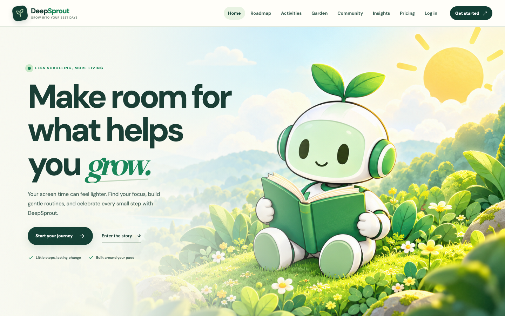
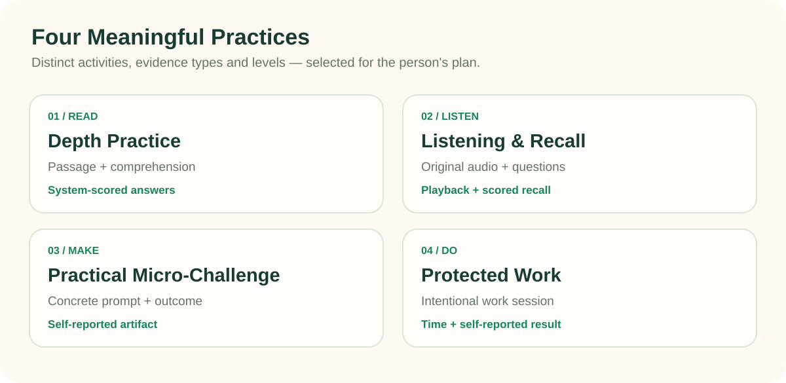
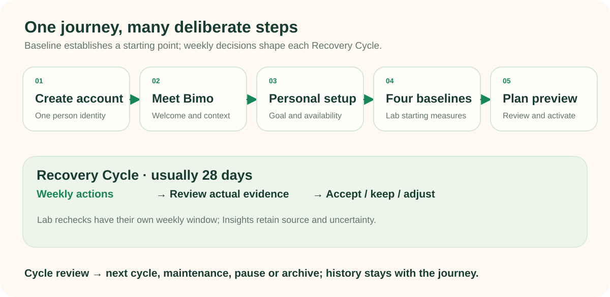
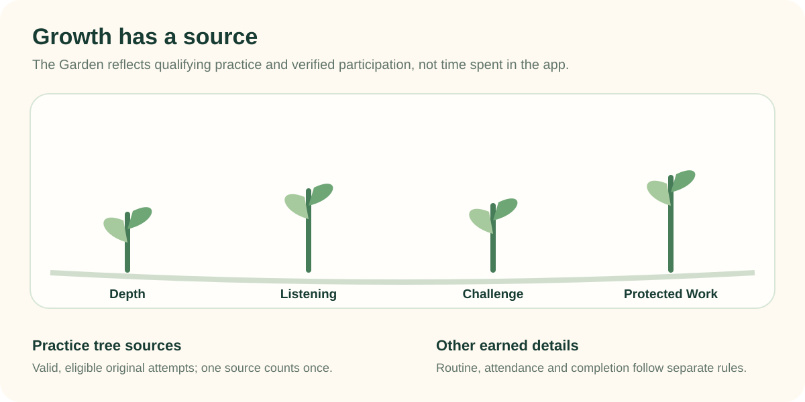
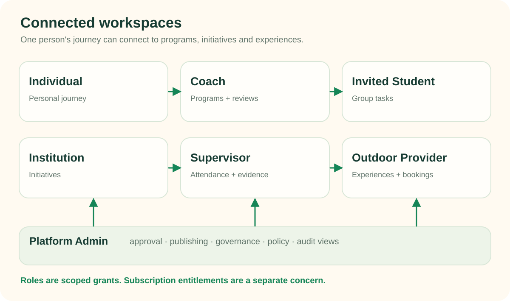
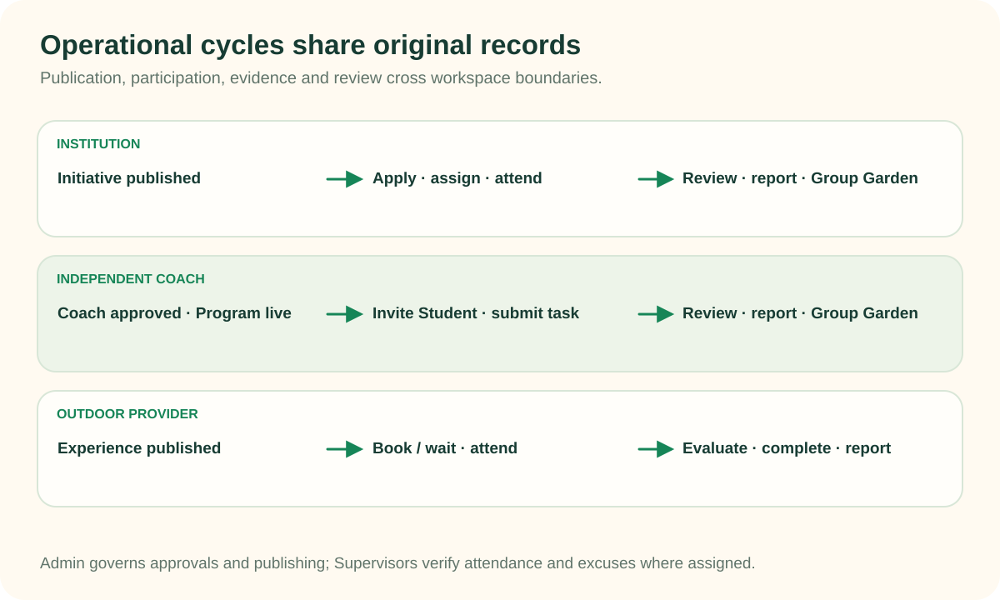
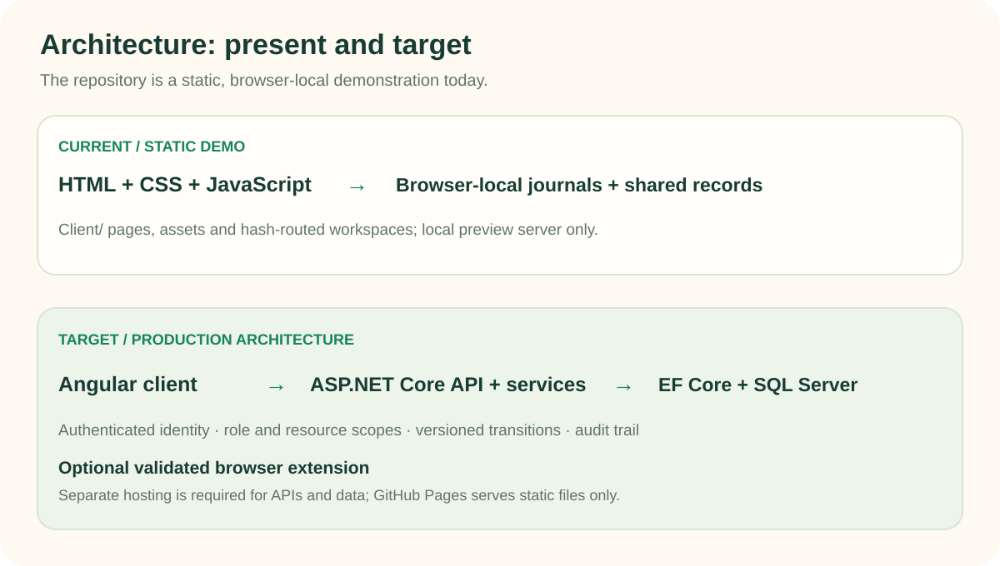

<div align="center">
  
  <h1>DeepSprout</h1>
  <p><strong>Less scrolling. More living.</strong></p>
  <p>A digital wellbeing platform for reclaiming attention from compulsive short-form feeds and making room for meaningful life beyond the screen.</p>
  <p>
    
    
    <a href="https://github.com/ahmadfa100/DeepSprout"></a>
  </p>
</div>


DeepSprout joins a **personal Recovery Journey** with practice, browser support, real-world opportunities, and guided group work. The [product specification](DeepSprout.md) describes the intended platform. This repository currently runs a substantial **static demonstration** with browser-local records; it is not a deployed health service or production multi-user system.

**Explore the demo:** [Home](index.html) · [Individual activities](Client/src/pages/member/training/training.html) · [Partner workspaces](Client/workspaces.html#/auth/login) · [System Journey walkthrough](Client/workspaces.html#/admin/system-journey)

## Contents

- [Why DeepSprout](#why-deepsprout)
- [Product preview](#product-preview)
- [What the platform does](#what-the-platform-does)
- [The Recovery Journey](#the-recovery-journey)
- [Meet Bimo](#meet-bimo)
- [Garden and evidence](#garden-and-evidence)
- [Connected workspaces](#connected-workspaces)
- [Operational workflows](#operational-workflows)
- [Pages and navigation](#pages-and-navigation)
- [Architecture and technology](#architecture-and-technology)
- [Repository structure](#repository-structure)
- [Run locally](#run-locally)
- [GitHub Pages deployment](#github-pages-deployment)
- [Status and roadmap](#status-and-roadmap)
- [Testing, accessibility and privacy](#testing-accessibility-and-privacy)
- [Contributing and license](#contributing-and-license)

## Why DeepSprout

Short-form feeds can consume time a person meant to spend on rest, relationships, learning, or simply being offline. DeepSprout helps people, especially young people, notice that pattern and make intentional changes. Reading or focused work can support that goal, but becoming maximally productive is not a requirement. DeepSprout is neither a clinical treatment nor a general habit tracker.

The personal journey is supported by four distinct systems: **Recovery Plan** schedules and adapts actions; **Activities** holds practice and an optional offline routine; **Digital Shield** offers browser-scoped protection and usage reminders; **Lab and Insights** retain measurement and its source. **Explore** brings institution initiatives, workshops, and provider experiences into the same participation journey. Community and the original companion Bimo make the experience more welcoming. See [master §§1–2](DeepSprout.md#1-vision-positioning-users-and-product-boundaries) for product boundaries.

## Product preview



The image above is a **real local browser capture** of the current homepage at 1440 × 900 with its seeded demo account. It is distinct from the conceptual diagrams below. The [root entry](index.html) and [Client source](Client/index.html) render the same page.

## What the platform does

| Area | Purpose | Current checkout |
| --- | --- | --- |
| Onboarding with Bimo | Welcome, personal setup, four baseline Lab assessments, Starting Point, plan preview and activation | Browser-local flow; timed task and handoff validation documented in the [Round 2A report](docs/implementation/deepsprout-round2a-individual-onboarding-lab-report.md) |
| Recovery Plan | One continuous journey with usually 28-day cycles, an actionable week, review, future-only adjustment, and continuation decisions | Browser-local versioned journal; [Round 2C report](docs/implementation/deepsprout-round2c-adaptive-recovery-report.md) |
| Meaningful Practices | Depth Practice, Listening & Recall, Practical Micro-Challenge, and Protected Work; independent levels and evidence | Four local players and versioned content; [Round 2B report](docs/implementation/deepsprout-round2b-meaningful-practices-report.md) |
| Offline Routine | Small personally chosen real-world commitments | Local self-report, separate from system-scored practice |
| Digital Shield | Manual Website Protection and one shared selected-site Usage Reminder | Optional **local Chrome extension**; supported-domain, browser-only coverage and pairing limits in its [guide](Client/extensions/digital-shield/README.md). No Pages pairing or production sync is claimed |
| Personal Garden | Earned visual growth from eligible practice and selected participation records | Four practice-type trees and bounded details in the current demo; source rules remain subject to product review |
| Lab and Insights | Four baselines, periodic rechecks, source-labelled progress and missing-data context | Weekly demo Lab window and local source-labelled views; no clinical measurement claim |
| Explore and Community | Discover initiatives, workshops, experiences and community participation | Local opportunity, registration and community flows; no public multi-user service |
| Notifications, profile and account | Next steps, operational notices, profile settings and workspace entry | In-app/browser-local notices and demo identities; no real email, OTP or server authentication |



## The Recovery Journey

**Account creation → Meet Bimo → Personal setup → Four baseline assessments → Starting Point → Plan preview → Activation → Weekly actions and reviews → Insights → Continued cycles.** The baseline set is Digital Habits, Sustained Attention, Inhibitory Control, and Depth Challenge. It establishes an initial comparison context; it is not a diagnosis.



A **Journey** is the person's continuing history. A **Recovery Cycle** is one bounded planning interval within it, normally four weeks in the present demo. A **week** contains scheduled actions, rest or routine context, and a review. A **Meaningful Practice** is an activity attempt with its own content and evidence; a scheduled action only points to it. **Lab assessments** are separate formal check-ins, including a weekly eligibility window in the current demo. The weekly review can accept a suggested next week, keep pace, or explicitly adjust future work. A cycle ending leads to review and a deliberate next-cycle or maintenance choice; elapsed days are not a recovery score. Details: [master §§4–5](DeepSprout.md#4-individual-onboarding-bimo-personal-setup-assessments-and-activation) and [Round 2C](docs/implementation/deepsprout-round2c-adaptive-recovery-report.md).

## Meet Bimo

<p align="center"></p>

Bimo is DeepSprout's **original approved companion**. Bimo welcomes people, guides the first-run sequence, and explains selected milestones in a calm, friendly voice. The image above is an existing runtime asset; source references and poses live in [`Client/references/bimo/`](Client/references/bimo/). Bimo is a guide in the interface, not a claim that a conversational AI service is running.

## Garden and evidence



The Garden makes earned participation visible. Valid, eligible original practice attempts contribute to their corresponding four practice-type trees; routine and verified participation can produce bounded details under different rules. It does not grow merely because an app was opened, a timer elapsed, or a booking was made. Missing observations should remain unknown rather than be treated as failure. The illustration explains the source model; it is **not a screenshot** of the current Garden page. See [the live Garden](Client/src/pages/member/garden/garden.html) and [master §9](DeepSprout.md#9-personal-garden-and-group-garden). The owner’s proposed single-plant visual direction remains a separately scoped design decision; this documentation does not alter the current scene.

## Connected workspaces



| Workspace | Primary pages and job | Connection |
| --- | --- | --- |
| **Individual** | [Home](index.html), [Recovery Plan](Client/src/pages/member/recovery-plan/recovery-plan.html), [Activities](Client/src/pages/member/training/training.html), [Lab](Client/src/pages/member/lab/lab.html), [Shield](Client/src/pages/member/shield/shield.html), [Garden](Client/src/pages/member/garden/garden.html), [Insights](Client/src/pages/member/insights/insights.html), [Explore](Client/src/pages/member/explore/explore.html) | Receives its own assignments, applications, bookings and attributed outcomes |
| **Coach / Mentor** | [Dashboard, Programs, Groups, Assignments, Reviews, Group Garden, Reports](Client/workspaces.html#/mentor/dashboard) | Runs an independent Program or reviews scoped group work |
| **Invited Student** | [Dashboard, My Tasks, My Group, Progress, Group Garden](Client/workspaces.html#/student/dashboard) | Joins a group through invitation; can later upgrade the same person identity to Individual |
| **Institution Representative** | [Dashboard, Initiatives, Applications, Team, Sessions, Forms, Reports](Client/workspaces.html#/organization/dashboard) | Publishes and runs youth initiatives, assigns staff, reviews participation |
| **Outdoor Provider** | [Overview, Experiences, Registrations, Waiting List, Evaluations, Reports](Client/workspaces.html#/provider/overview) | Owns experiences and camps, bookings, offers, completion rules |
| **Supervisor** | [Dashboard, Schedule, Attendance, Excuses, Reports](Client/workspaces.html#/supervisor/dashboard) | Acts only on assigned Institution or Provider resources; confirms operational evidence |
| **Platform Admin** | [Overview, approvals, catalog, policy, CMS, moderation, reports, audit](Client/workspaces.html#/admin/overview) | Governs publication and platform policy; [legacy Admin](Client/admin.html#/dashboard) still holds some separate demo capabilities |

A person can have multiple **role grants**, each scoped to the relevant resource. A workspace switch does not grant permission. **Subscription entitlements** are a separate proposed commercial mechanism, not a substitute for identity or authorization; no real billing runs here. The current browser guards demonstrate policy, but production enforcement requires server-side checks. See [master §§2, 20, 23](DeepSprout.md#2-fundamental-concepts-authorization-and-workspaces).

## Operational workflows



- **Individual recovery:** baseline → plan → practice and routine → weekly review → Insights and earned Garden growth → next decision. Evidence stays tied to its original person, attempt and cycle.
- **Independent Coach Program:** Admin approves a Coach; the Coach publishes an invite-only Program and owns groups; an invited Student submits assigned work; Coach review, reports and a Group Garden reflect eligible outcomes. Upgrade keeps the same person identity and history. [Implementation report](docs/implementation/independent-coach-cycle-implementation-report.md).
- **Institution Initiative:** an approved Representative publishes an Initiative into regular Explore; an Individual applies; admission, groups, Coach tasks, sessions, forms and reports refer to shared records. Supervisor check-in and excuse decisions remain separate from registration. [Institution report](docs/implementation/institution-cycle-implementation-report.md) · [Supervisor report](docs/implementation/supervisor-cycle-implementation-report.md).
- **Outdoor experience:** a Provider publishes a versioned experience or camp; an Individual books or joins a waiting list. Offers have expiry and capacity rules; an assigned Supervisor verifies attendance; completion follows the published criteria, then reports and eligible Garden effects read the original record. [Provider report](docs/implementation/deepsprout-round1-outdoor-provider-report.md).
- **Admin governance:** application approval, publication, policy, moderation and audit views span these flows. The two Admin demos still require measured consolidation before production.

These flows share person, resource and participation identities in the newer browser-local demo. A registration is not attendance; attendance is not completion; a self-report is not a system-scored result. Current cross-workspace status and unresolved seams are tracked in the [cycle audits](docs/cycles/README.md) and [implementation reports](docs/README.md).

## Pages and navigation

| Area | Public entry points | Destination routes |
| --- | --- | --- |
| Public and access | [Home](index.html), [former story landing](Client/landing.html), [Pricing](Client/pricing.html), [Register](Client/register.html), [Login](Client/login.html), [Partner entry](Client/partners.html) | Public pages and auth pages under [`Client/src/pages/`](Client/src/pages/) |
| Individual first run | [Onboarding](Client/onboarding.html), [Lab](Client/lab.html) | Bimo/setup/Starting Point and four Lab tasks |
| Individual ongoing | [Recovery Plan](Client/recovery-plan.html), [Weekly Review](Client/weekly-review.html), [Activities](Client/training.html), [Shield](Client/shield.html), [Garden](Client/garden.html), [Insights](Client/insights.html), [Explore](Client/explore.html), [Community](Client/community.html), [Profile](Client/profile.html) | Most short `Client/*.html` URLs forward to corresponding `Client/src/pages/member/...` pages |
| Partner and administration | [Partner workspaces](Client/workspaces.html#/auth/login), [legacy Admin](Client/admin.html#/dashboard) | Hash routes such as `#/mentor/dashboard`, `#/organization/initiatives`, `#/provider/waitlist`, `#/supervisor/attendance`, `#/admin/overview` |

The workspace [navigation source](Client/src/workspaces/navigation.js) is the exact current menu inventory. The [client guide](Client/README.md) records other page and experiment entry points.

## Architecture and technology



| Layer | Running in this repository | Planned production direction |
| --- | --- | --- |
| Frontend | Static HTML, CSS and JavaScript in `Client/`; page files plus hash-routed `workspaces.html` | Angular client with deliberate routing and accessible states |
| State | Browser-local person journals, ecosystem graph, seeded JSON and some separate legacy Admin data | ASP.NET Core Web API and C# domain services; Entity Framework Core with Microsoft SQL Server |
| Identity and access | Demo identity selector and browser-side scoped guards | Authenticated identity, role and resource-scoped server authorization |
| Business changes | Local commands and projections; some original records bridge Individual and partner screens | Versioned workflows, transactions, service-layer invariants and durable audit trails |
| Browser protection | Optional Chrome extension with local-origin pairing and restricted site coverage | Technically validated extension and authenticated, consent-aware sync |
| Hosting | Static files from a local HTTP server or GitHub Pages | Separately hosted frontend, API, database and extension distribution |

The root [`index.html`](index.html) is generated from `Client/index.html` by [`scripts/build_root_home.py`](scripts/build_root_home.py). It adds `<base href="./Client/">` so the **same homepage markup** resolves its relative CSS, scripts, media and links when served at `/DeepSprout/`; a small handler keeps same-page anchors on the root URL. The normal `Client/` entry remains usable. Generated output is checked with `--check`. No Angular, ASP.NET Core service, SQL Server database, production authentication, email delivery or payment processor is present in this checkout.

## Repository structure

```text
.
├── index.html                 # Generated root homepage for static hosting
├── README.md                  # This guide
├── DeepSprout.md              # Authoritative product specification
├── DESIGN.md / DeepSprout-DESIGN.md
├── Client/
│   ├── index.html             # Canonical homepage source
│   ├── *.html                 # Stable entries and demo pages
│   ├── src/                   # Page code, layouts, styles, browser-local domain
│   ├── assets/                # Runtime media, Bimo poses, local vendor assets
│   ├── references/bimo/       # Approved original character references
│   ├── extensions/digital-shield/
│   ├── tests/                 # Model, wiring and browser checks
│   ├── docs/                  # Client architecture and validation records
│   └── serve.py               # Client-root preview with custom 404
├── Server/README.md           # Reserved location; no backend implementation
├── docs/
│   ├── assets/readme/         # README diagrams and illustrations
│   ├── cycles/                # Cross-workspace audits and route inventories
│   ├── implementation/        # Dated implementation evidence
│   └── audits/                # Broader verification and gap analyses
├── scripts/                   # Root homepage and diagram generation
└── experiments/              # Independent Bimo/visual experiments
```

## Run locally

**Prerequisites:** Python 3 for the static server. Node.js and an installed browser are needed only for selected tests; the website itself has no npm build step.

```sh
git clone https://github.com/ahmadfa100/DeepSprout.git
cd DeepSprout
python3 scripts/build_root_home.py --check
python3 -m http.server 8765 --bind 127.0.0.1
```

Open **`http://127.0.0.1:8765/`** for the root homepage. The same server exposes `http://127.0.0.1:8765/Client/workspaces.html#/auth/login` and other `Client/` routes. If you prefer the client at origin root, run `python3 Client/serve.py --port 8765` instead and open `/`; that server also returns the custom `Client/404.html` with HTTP 404. Run `python3 scripts/build_root_home.py` after changing `Client/index.html`, then commit both source and generated root entry.

The demo stores records in the **browser origin**. Changing between root and client-root server layouts, ports, or Pages creates a distinct origin; saved local progress does not automatically transfer. The seeded demo and identity switch are for review, not real accounts.

## GitHub Pages deployment

This project uses **branch publishing from the repository root**; no build service or framework is required. The committed `.nojekyll` keeps the static tree as-is.

1. Merge and push this documentation/root-entry change to the repository's publishing branch (`main` is the current remote default).
2. On GitHub open **Settings → Pages → Build and deployment**. Choose **Deploy from a branch**, select **`main`** and **`/(root)`**, then save.
3. After GitHub reports publication, open the expected project URL: `https://ahmadfa100.github.io/DeepSprout/`. This is an **expected URL**, not a claim that publication has already happened.
4. After future homepage edits, run `python3 scripts/build_root_home.py` and `python3 scripts/build_root_home.py --check` before pushing.

The root homepage is a full rendered page, not a redirect. Relative links enter `Client/` and continue resolving under the `/DeepSprout/` project prefix. Partner `#/...` routes stay on `Client/workspaces.html`; query strings and hashes on those destinations are preserved by normal relative links. GitHub Pages can only serve static files. It cannot run ASP.NET Core or SQL Server, provide real multi-user persistence, secure cross-device authorization, email, payments, or browser extension pairing. The current extension's allowlist is for local demo origins, so Pages does **not** provide live Shield enforcement or telemetry pairing. A future API/database will need separate hosting and a reviewed integration boundary.

## Status and roadmap

The spec's [§29 snapshot](DeepSprout.md#29-current-implementation-versus-agreed-target-15-october-2026) predates some newer rounds. Read the dated reports alongside it rather than treating that older gap table as the final state of this working checkout.

| Status | Scope |
| --- | --- |
| **Implemented in the local demo** | Static public/member pages; Bimo onboarding; four baseline task interfaces and local activation; four practice players; local Recovery cycles and reviews; institution/Coach/Student/Supervisor/Provider records, routes and tested example flows; community interactions; root Pages-ready homepage |
| **Partial or simulated** | Local identity, permissions, QR/code checks, notices, demo capacity and clocks, payment acknowledgements, Admin split, source coverage and some cross-workspace edge cases. Extension pairing/enforcement is restricted to supported local Chrome conditions |
| **Next validation and product work** | Re-run cross-workspace acceptance after active changes; consolidate Admin by capability; settle Garden direction and thresholds; test additional accessibility, responsive and error states; validate extension distribution and consent policy |
| **Planned production engineering** | Angular migration, ASP.NET Core/EF Core/SQL Server services, real authentication and resource authorization, transactional capacity, durable audits, secure notifications, deployment/operations and threat review |

For precise evidence and remaining limitations see the [Round 0](docs/implementation/deepsprout-round0-stabilization-report.md), [Provider](docs/implementation/deepsprout-round1-outdoor-provider-report.md), [Round 2A](docs/implementation/deepsprout-round2a-individual-onboarding-lab-report.md), [Round 2B](docs/implementation/deepsprout-round2b-meaningful-practices-report.md), and [Round 2C](docs/implementation/deepsprout-round2c-adaptive-recovery-report.md) reports. Earlier [cycle audits](docs/cycles/README.md) remain useful for route inventories and historical gaps.

## Testing, accessibility and privacy

The focused, dependency-light checks are:

```sh
python3 scripts/build_root_home.py --check
python3 tests/pages-root.test.py
node Client/tests/page-wiring.test.cjs
node --test Client/tests/partner-store.test.mjs Client/tests/institution-cycle.test.mjs Client/tests/supervisor-cycle.test.mjs Client/tests/coach-cycle.test.mjs
node --test Client/tests/round2a-personal.test.mjs Client/tests/round2b-practices.test.mjs Client/tests/round2c-recovery.test.mjs Client/tests/round2d-shield.test.mjs
python3 Client/tests/not-found-server.test.py
node tests/pages-browser.test.cjs  # requires Playwright Chromium; checks desktop/mobile and Pages subpath
```

Browser suites in `Client/tests/` need Playwright and Chrome. The [client guide](Client/README.md) lists the relevant `BASE_URL`, `CHROME_PATH` and `NODE_PATH` settings. Some existing browser tests write screenshots under validation folders; choose a temporary `SHOTS_DIR` when supported and inspect the test before running it. The root `package.json` has a placeholder `npm test` command, so use the actual test commands above.

Responsive layouts, keyboard controls and reduced-motion states have targeted implementation evidence, but no complete assistive-technology audit is claimed. Avoid using the demo for sensitive personal information: browser-local records are not a production privacy or security boundary. Insights should distinguish system-scored, self-reported, browser-observed and Supervisor-confirmed sources; missing evidence should remain unknown. The [master safety and accessibility section](DeepSprout.md#24-safety-accessibility-privacy-measurement-and-operational-quality) defines the intended safeguards.

## Contributing and license

Start with [`DeepSprout.md`](DeepSprout.md), then read [`AGENTS.md`](AGENTS.md), [`DESIGN.md`](DESIGN.md) and the relevant [cycle report](docs/cycles/README.md). Keep changes scoped, add evidence for a changed cross-workspace effect, preserve Bimo's approved artwork, and document whether a feature is local demonstration or production behavior. For homepage changes, regenerate the root entry; for diagram changes, run `python3 scripts/build_readme_diagrams.py`. Open an issue or pull request with the affected route, expected behavior and test result.

No repository-level `LICENSE` file is present. The root `package.json` contains an `ISC` metadata field, but that alone is not presented here as a verified license for all source and artwork. Ask the repository owner before reusing or redistributing assets outside the project.
