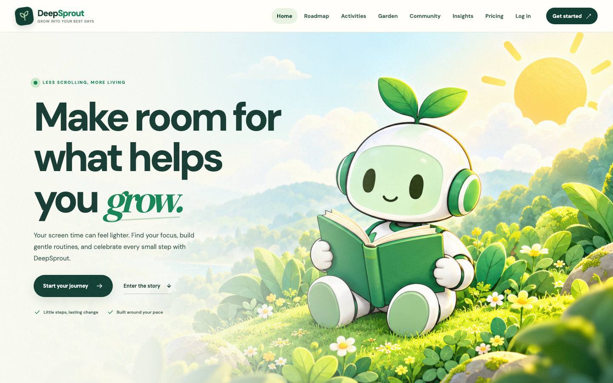
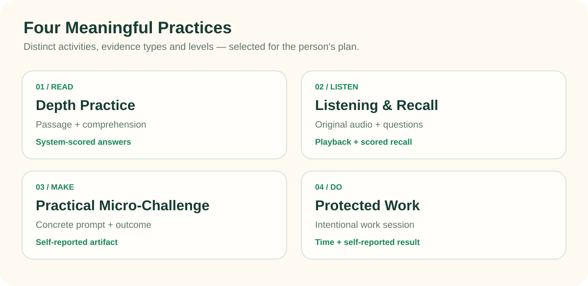
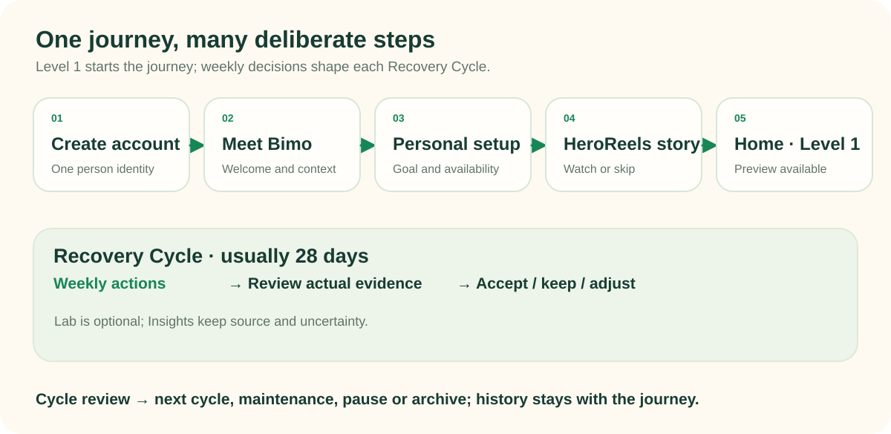
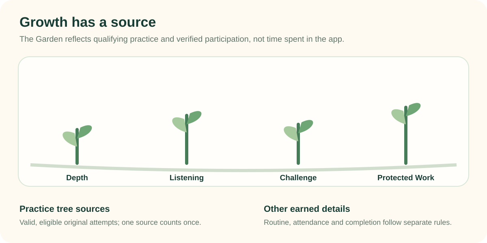
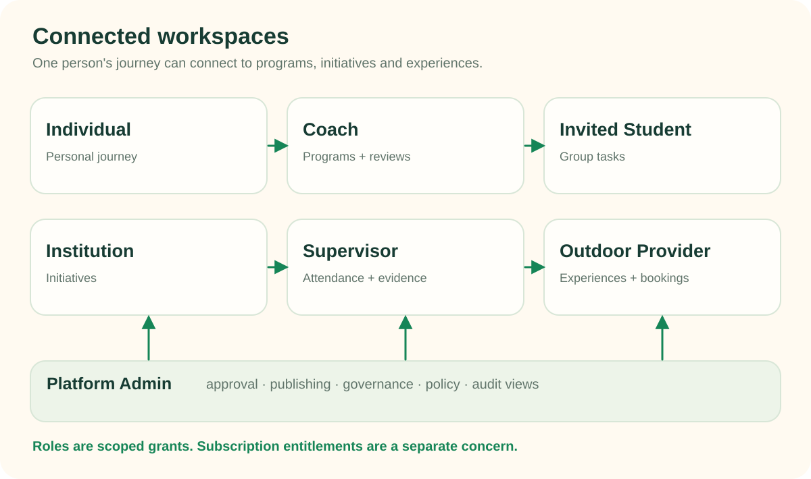
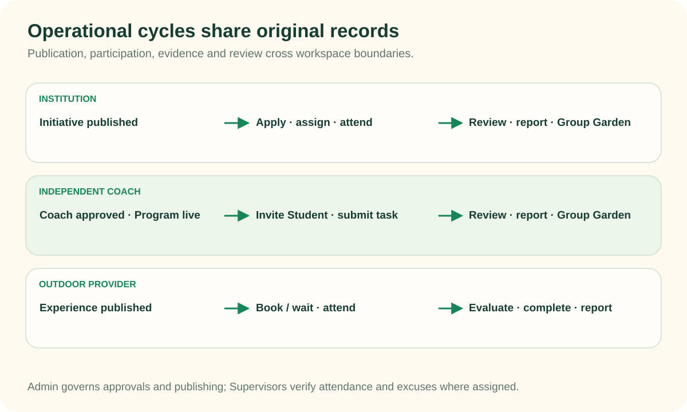
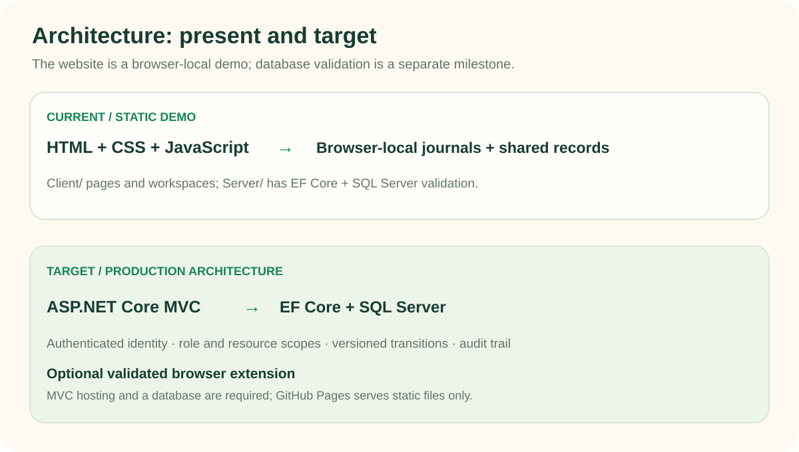

<div align="center">
  
  <h1>DeepSprout</h1>
  <p><strong>Less scrolling. More living.</strong></p>
  <p>A digital wellbeing platform for reclaiming attention from compulsive short-form feeds and making room for meaningful life beyond the screen.</p>
  <p>
    
    
    <a href="https://github.com/ahmadfa100/DeepSprout"></a>
  </p>
</div>


DeepSprout joins a **personal Recovery Journey** with practice, browser support, real-world opportunities, and guided group work. The [v4.1 product specification](DeepSprout.md) and [P0 target map](docs/architecture/p0-target-v4.1.md) define the Institution-only partner model. The MVC application serves Razor views and uses Identity and the approved [58-table V5 SQL Server design](docs/architecture/database/README.md). Signed-in Individual Recovery and Community workflows use SQL. Partner operational workflows still use browser data. See the [current product guide](docs/current-product-guide.md) for actual functionality and verification.

**Explore the demo:** [Home](http://127.0.0.1:8765/) · [Individual activities](http://127.0.0.1:8765/src/pages/member/training/training.html) · [Partner workspaces](http://127.0.0.1:8765/workspaces.html#/auth/login) · [System Journey walkthrough](http://127.0.0.1:8765/workspaces.html#/admin/system-journey)

## Contents

- [Why DeepSprout](#why-deepsprout)
- [Current page and cycle guide](#current-page-and-cycle-guide)
- [Product preview](#product-preview)
- [What the platform does](#what-the-platform-does)
- [The Recovery Journey](#the-recovery-journey)
- [Meet Azm](#meet-azm)
- [Garden and evidence](#garden-and-evidence)
- [Connected workspaces](#connected-workspaces)
- [Operational workflows](#operational-workflows)
- [Pages and navigation](#pages-and-navigation)
- [Architecture and technology](#architecture-and-technology)
- [Repository structure](#repository-structure)
- [Run locally](#run-locally)
- [Status and roadmap](#status-and-roadmap)
- [Testing, accessibility and privacy](#testing-accessibility-and-privacy)
- [Contributing and license](#contributing-and-license)

## Why DeepSprout

Short-form feeds can consume time a person meant to spend on rest, relationships, learning, or simply being offline. DeepSprout helps people, especially young people, notice that pattern and make intentional changes. Reading or focused work can support that goal, but becoming maximally productive is not a requirement. DeepSprout is neither a clinical treatment nor a general habit tracker.

The personal journey is supported by four distinct systems: **Recovery Plan** schedules and adapts actions; **Activities** holds practice and an optional offline routine; **Digital Shield** offers browser-scoped protection and usage reminders; **Lab and Insights** retain measurement and its source. **Explore** brings Institution Initiatives, workshops, and Institution-owned Outdoor Activities into the same participation journey. Community and the original companion Azm make the experience more welcoming. See [master §§1–2](DeepSprout.md#1-vision-positioning-users-and-product-boundaries) for product boundaries.

## Current page and cycle guide

The [current product guide](docs/current-product-guide.md) inventories the seven product cycles and notes the live SQL, demo and historical paths. The [persistence contract](docs/architecture/database/persistence-contract.md) maps them to their runtime sources.

## Product preview



The image above is a **local browser capture** of the homepage at 1440 × 900 with a seeded demo account, taken for an earlier documentation pass. The current page may have changed since that capture. The [root entry](http://127.0.0.1:8765/) and `/index.html` are served by the same MVC view.

## What the platform does

| Area | Purpose | Current checkout |
| --- | --- | --- |
| Onboarding with Azm | Meet Azm, six quick questions, HeroReels story, then Home at Journey Level 1 with a preliminary Week 1 plan | Six answers save in V5 and survive a new login. |
| Recovery Plan | One continuous journey with 28-day cycles, four progressively detailed weeks, reviews and continuation | SQL preview, explicit activation, weekly and final review, history and Next Cycle/Maintenance |
| Meaningful Practices | Depth Practice, Listening & Recall, Visual Observation & Analysis, and Reasoning & Digital Judgment | Four server-scored practice families with pinned content and independent Activity Levels 1–3. Legacy attempts retain original attribution. |
| Offline Routine | Small personally chosen real-world commitments | SQL routine and self-reported check-ins, separate from system-scored practice |
| Digital Shield | Manual Website Protection and one shared selected-site Usage Reminder | Optional **local Chrome extension**; supported-domain, browser-only coverage and pairing limits in its [guide](extensions/digital-shield/README.md). No Pages pairing or production sync is claimed |
| Personal Garden | Earned visual growth from eligible practice and selected participation records | Four trees and bounded decorations drawn from the same SQL projection as Home. Production thresholds and the separate one-main-plant direction remain open. |
| Lab and Insights | Optional assessments, source-labelled progress and missing-data context | Lab is optional and browser-local. Core Insights reads saved SQL evidence. No new periodic official Lab window is scheduled. |
| Explore and Community | Discover initiatives, workshops, experiences and community participation | Explore projects browser-local partner records and samples. Community posts, interactions and moderation use SQL; quiz rooms stay local. |
| Notifications, profile and account | Next steps, operational notices, profile settings and workspace entry | Individual credentials, sessions and own account profile use Identity. Partner access, notices and most member settings are browser-local. Email delivery is pending. |



## The Recovery Journey

**Account creation → Meet Azm → Six quick questions → HeroReels story (watch or skip) → Home at Journey Level 1 → Review a preliminary Week 1 plan → Explicit activation → Weekly actions and reviews → Insights → Continued cycles.** The four Lab assessments are optional and keep their historical results. Setup answers personalize the first proposal; they are not cognitive scores.



A **Journey** is the person's continuing history, beginning at Level 1. A **Recovery Cycle** is one bounded planning interval within it, 28 calendar days across four weeks for every new cycle. A **week** contains scheduled actions, rest or routine context, and a review. A **Meaningful Practice** is an activity attempt with its own content and evidence; a scheduled action only points to it. **Lab assessments** are optional separate measurements; their old weekly eligibility rule is retired. The weekly review can accept a suggested next week, keep pace, or explicitly adjust future work. A cycle ending leads to review and a deliberate next-cycle or maintenance choice; elapsed days are not a recovery score. Details: [master §§4–5](DeepSprout.md#4-individual-onboarding-azm-six-questions-the-story-and-journey-level-1).

## Meet Azm

<p align="center"></p>

Azm is DeepSprout's **original approved companion**. Azm welcomes people, guides the first-run sequence, and explains selected milestones in a calm, friendly voice. The image above is an existing runtime asset; source references and poses live in [`docs/references/bimo/`](docs/references/bimo/). Azm is a guide in the interface, not a claim that a conversational AI service is running.

## Garden and evidence



The Garden makes earned participation visible. Valid, eligible original practice attempts contribute to their corresponding four practice-type trees; routine and verified participation can produce bounded details under different rules. It does not grow merely because an app was opened, a timer elapsed, or a booking was made. Missing observations should remain unknown rather than be treated as failure. The illustration explains the current source model; it is **not a screenshot** of the Garden. See [the live Garden](http://127.0.0.1:8765/src/pages/member/garden/garden.html). The later design guidance calls for one clean ivory scene with one main plant; the current four-tree implementation remains until a separately scoped Garden task resolves its visual and evidence mapping.

## Connected workspaces in the current demo



| Workspace | Primary pages and job | Connection |
| --- | --- | --- |
| **Individual** | [Home](http://127.0.0.1:8765/), [Recovery Plan](http://127.0.0.1:8765/src/pages/member/recovery-plan/recovery-plan.html), [Activities](http://127.0.0.1:8765/src/pages/member/training/training.html), [Lab](http://127.0.0.1:8765/src/pages/member/lab/lab.html), [Shield](http://127.0.0.1:8765/src/pages/member/shield/shield.html), [Garden](http://127.0.0.1:8765/src/pages/member/garden/garden.html), [Insights](http://127.0.0.1:8765/src/pages/member/insights/insights.html), [Explore](http://127.0.0.1:8765/src/pages/member/explore/explore.html) | Receives its own assignments, applications, bookings and attributed outcomes |
| **Coach / Mentor** | [Dashboard, Programs, Groups, Assignments, Reviews, Group Garden, Reports](http://127.0.0.1:8765/workspaces.html#/mentor/dashboard) | Reviews scoped group work. The demo still offers independent Programs, which v4.1 retires; they are history-only in the approved database |
| **Invited Student** | [Dashboard, My Tasks, My Group, Progress, Group Garden](http://127.0.0.1:8765/workspaces.html#/student/dashboard) | Joins a group through invitation; can later upgrade the same person identity to Individual |
| **Institution Representative** | [Dashboard, Create new, Initiatives, Outdoor Activities, Applications, Bookings & waitlist, Team, Sessions, Forms, Reports](http://127.0.0.1:8765/workspaces.html#/organization/dashboard) | Publishes and runs Initiatives (online, hybrid or face-to-face) **and** Outdoor Activities (trips, hikes, camps), appoints staff, reviews participation and received Supervisor reports |
| ~~Outdoor Provider~~ | Retired 6 Nov 2026 — `#/provider/*` explains the change | Institutions organize Outdoor Activities directly; see the [v4.1 partner-workspace redesign log](docs/implementation/partner-workspaces-v41-redesign.md) |
| **Supervisor** | [Dashboard, Schedule, Attendance, Excuses, Competitions, Reports](http://127.0.0.1:8765/workspaces.html#/supervisor/dashboard) | Acts only on an assigned Initiative or appointed Outdoor Activity sessions; confirms field evidence |
| **Platform Admin** | [Overview, approvals, catalog, policy, CMS, moderation, reports, audit](http://127.0.0.1:8765/workspaces.html#/admin/overview) | Governs publication and platform policy; [legacy Admin](http://127.0.0.1:8765/admin.html?legacy=1#/dashboard) holds separate demo capabilities. [Signed-in Community moderation](http://127.0.0.1:8765/admin.html#/community) uses the current SQL Platform Admin role. |

A person can have multiple **role grants**, each scoped to the relevant resource. A workspace switch does not grant permission. **Subscription entitlements** are a separate proposed commercial mechanism, not a substitute for identity or authorization; no real billing runs here. The current browser guards demonstrate policy, but production enforcement requires server-side checks. See [master §§2, 20, 23](DeepSprout.md#2-fundamental-concepts-authorization-and-workspaces).

## Operational workflows in the current demo



- **Individual recovery:** six setup answers → preliminary plan → explicit activation → practice and routine → weekly review → Insights and earned Garden growth → next decision. Evidence stays tied to its original person, attempt and cycle.
- **Independent Coach Program:** Admin approves a Coach; the Coach publishes an invite-only Program and owns groups; an invited Student submits assigned work; Coach review, reports and a Group Garden reflect eligible outcomes. Upgrade keeps the same person identity and history. Retired by v4.1: Coaches serve through Institution Initiative invitations.
- **Institution Initiative:** an approved Representative publishes an Initiative into regular Explore; an Individual applies; admission, groups, Coach tasks, sessions, forms and reports refer to shared records. The Representative's current Reports route is a received Supervisor-report inbox with attached Coach reports. Supervisor check-in and excuse decisions remain separate from registration.
- **Outdoor Activity:** a verified Institution publishes a versioned trip, hike, camp or outdoor event; an Individual books or joins a waiting list in regular Explore. Offers have expiry and capacity rules; an appointed Supervisor verifies attendance (the Representative cannot); completion follows the published criteria, then reports and eligible Garden effects read the original record. [Redesign log](docs/implementation/partner-workspaces-v41-redesign.md).
- **Admin governance:** application approval, publication, policy, moderation and audit views span these flows. The two Admin demos still require measured consolidation before production.

The partner operations above illustrate the browser-local workflows. Signed-in Individual Recovery and Community use live server records. The v4.1 target removes independent Coach and Outdoor Provider ownership: Institutions own Initiatives and Outdoor Activities, and Coaches/Supervisors serve through scoped Institution invitations. A registration is not attendance; attendance is not completion; a self-report is not a system-scored result. Where each workflow keeps its data, and which of the 58 tables it maps to, is in the [persistence contract](docs/architecture/database/persistence-contract.md).

## Pages and navigation

| Area | Public entry points | Destination routes |
| --- | --- | --- |
| Public and access | [Home](http://127.0.0.1:8765/), [former story landing](http://127.0.0.1:8765/landing.html), [Pricing](http://127.0.0.1:8765/pricing.html), [Register](http://127.0.0.1:8765/register.html), [Login](http://127.0.0.1:8765/login.html), [Partner entry](http://127.0.0.1:8765/partners.html) | MVC Razor views under [`src/DeepSprout.Web/Views/`](src/DeepSprout.Web/Views/) |
| Individual first run | [Onboarding](http://127.0.0.1:8765/onboarding.html), [Home](http://127.0.0.1:8765/) | Meet Azm → six questions → HeroReels story (watch or skip) → Home at Journey Level 1. The [Lab](http://127.0.0.1:8765/lab.html) is optional. |
| Individual ongoing | [Recovery Plan](http://127.0.0.1:8765/recovery-plan.html), [Weekly Review](http://127.0.0.1:8765/weekly-review.html), [Activities](http://127.0.0.1:8765/training.html), [Shield](http://127.0.0.1:8765/shield.html), [Garden](http://127.0.0.1:8765/garden.html), [Insights](http://127.0.0.1:8765/insights.html), [Explore](http://127.0.0.1:8765/explore.html), [Community](http://127.0.0.1:8765/community.html), [Profile](http://127.0.0.1:8765/profile.html) | Historic `.html` URLs resolve through [the MVC route manifest](src/DeepSprout.Web/page-routes.json). |
| Partner and administration | [Partner workspaces](http://127.0.0.1:8765/workspaces.html#/auth/login), [Community moderation](http://127.0.0.1:8765/admin.html#/community), [legacy Admin demo](http://127.0.0.1:8765/admin.html?legacy=1#/dashboard) | Hash routes include `#/mentor/dashboard`, `#/organization/initiatives`, `#/organization/bookings`, `#/supervisor/attendance`, and `#/admin/overview`. |

The workspace [navigation source](src/DeepSprout.Web/wwwroot/src/workspaces/navigation.js) is the exact current menu inventory. The [current product guide](docs/current-product-guide.md) describes every destination and cycle.

## Architecture and technology



| Layer | Running in this repository | Planned production direction |
| --- | --- | --- |
| Web experience | 46 Razor views and MVC routing in `src/DeepSprout.Web`; CSS, JavaScript and images under `wwwroot/`, and the hash-routed `workspaces.html` partner workspaces | Server-backed MVC actions; the older Angular client direction needs a separate integration decision |
| State | SQL-backed migrated workflows use `DeepSproutV5DbContext`. Demo operations, several settings, Lab and Shield use local journals or the partner graph. | ASP.NET Core MVC application with C# domain services on the approved 58-table SQL Server database |
| Identity and access | ASP.NET Core Identity and signed JWT session, server ownership checks, and SQL Platform Admin checks for Community. Partner guards are browser-local. | Expand one human account and server-enforced resource grants across partner workflows. |
| Business changes | V5 commands and audit for migrated workflows. Partner projections and commands share one browser origin. | Versioned workflows, transactions, service-layer invariants and durable audit trails |
| Browser protection | Optional Chrome extension with local-origin pairing and restricted site coverage | Technically validated extension and authenticated, consent-aware sync |
| Hosting | One ASP.NET Core MVC application run locally; validation database is separate | Hosted ASP.NET Core MVC application, database and optional extension distribution |

DeepSprout is **one ASP.NET Core MVC solution**. The pages are Razor views in `src/DeepSprout.Web/Views`; their CSS, JavaScript, images and fonts live in `src/DeepSprout.Web/wwwroot`. Page URLs keep their historical `.html` form (for example `/training.html`), routed by `PagesController` from `page-routes.json`. There is no separate static HTML site.

## Repository structure

```text
.
├── DeepSprout.sln                 # Open this in Visual Studio
├── DeepSprout.Database.slnx       # Database-focused solution
├── src/
│   ├── DeepSprout.Web/            # ASP.NET Core MVC website
│   │   ├── Controllers/           # PagesController (page routing)
│   │   ├── Models/                # PageCatalog (routes from page-routes.json)
│   │   ├── Views/                 # 46 Razor views grouped by area
│   │   ├── wwwroot/               # assets/ (media, Azm, vendor) and src/ (page JS/CSS, workspaces)
│   │   ├── Program.cs  page-routes.json  appsettings.json
│   ├── DeepSprout.Domain/         # Domain records (no persistence dependency)
│   ├── DeepSprout.Application/    # Command contracts and DTOs
│   └── DeepSprout.Infrastructure/ # V5/: approved 58-table EF Core context and migrations; root: historical 129-table M1 context
├── tests/
│   ├── mvc-smoke.mjs              # Routes every page and resolves every local link/asset
│   ├── client/                    # Browser-model and Playwright suites (run against the MVC site)
│   └── DeepSprout.DatabaseValidation/  # Historical M1 SQL suite (DeepSprout_Validation only)
├── extensions/digital-shield/     # Optional Chrome extension (not part of the website)
├── docs/                          # Product guide, database architecture, design/validation records
│   ├── architecture/database/     # Approved 58-table design, persistence contract, EF Core adoption
│   ├── client/                    # Former client architecture, design and validation records
│   └── references/                # Approved Azm and design references
├── tools/                         # README diagram and media helper scripts
├── experiments/                   # Independent Azm/visual experiments
├── DeepSprout.md  DESIGN.md  DeepSprout-DESIGN.md  AGENTS.md
```

## Run locally

Open [`DeepSprout.sln`](DeepSprout.sln) in Visual Studio, set `DeepSprout.Web` as the startup project and press F5. From a terminal with .NET SDK 10:

```sh
dotnet run --project src/DeepSprout.Web/DeepSprout.Web.csproj
```

Open `http://127.0.0.1:8765/`. Partner workspaces are at `/workspaces.html#/auth/login`. The demo stores records in the **browser origin**, so a different port or host starts with empty local data. Configure a V5 SQL Server connection in `ConnectionStrings__DeepSprout` and set `Jwt__Issuer`, `Jwt__Audience` and a random `Jwt__SigningKey` of at least 32 UTF-8 bytes outside source control. The host uses the configured database for live workflows and never applies migrations at startup. See the [authentication guide](docs/backend/authentication/README.md) for protected Data Protection keys and the [EF Core adoption guide](docs/architecture/database/efcore-v5-adoption.md) for disposable database setup.

Razor views are compiled into the site DLL, while CSS and JavaScript are served live from `wwwroot`. After changing a `.cshtml` file, rebuild and restart; the site logs a warning at startup when a view is newer than the running build. Starting `bin/.../DeepSprout.Web.exe` directly runs as Production (`dotnet run` uses Development from `launchSettings.json`). Workspace stylesheets are listed once, in `wwwroot/src/workspaces/workspace-styles.css`.

Publish with `dotnet publish src/DeepSprout.Web/DeepSprout.Web.csproj -c Release`.


## Status and roadmap

The [current product guide](docs/current-product-guide.md#end-to-end-cycles-and-evidence) records all seven cycles and their verification limits. The [backend implementation plan](docs/implementation/backend-start-plan.md) puts Platform Admin authority, Institution verification, Initiative and regular Explore integration first. It then covers scoped staff, sessions, Outdoor Activities, and Admin consolidation. Legacy design illustrations and the [§29 snapshot](DeepSprout.md#29-current-implementation-versus-agreed-target-15-october-2026) describe earlier milestones.

## Testing, accessibility and privacy

```powershell
dotnet build DeepSprout.sln --no-restore
node --test tests/client/*.test.mjs
node --test tests/onboarding-integration.test.mjs
```

The client model suite checks browser-local behavior. The integration suite requires SQL Server at `localhost`, `sqlcmd`, EF CLI and Playwright Chromium. It creates and drops a fresh disposable V5 database, starts its own MVC host, and exercises HTTP, browser flows and routing smoke checks. To check routes against an already running local instance, run `node tests/mvc-smoke.mjs` with that instance's `BASE_URL`. Older browser scripts document their demo identities and may need the original entry route or updated fixtures; a passing demo does not prove SQL persistence. Some standalone scripts write screenshots, so check their configured output paths before running them.

The approved database has its own checks: `docs/architecture/database/v5-lean-design/submission/DeepSprout-v5-NEGATIVE-TESTS.sql` (40 rolled-back tests) and the EF Core commands in [EF Core adoption](docs/architecture/database/efcore-v5-adoption.md).

Responsive layouts, keyboard controls and reduced-motion states have targeted implementation evidence, but no complete assistive-technology audit is claimed. Avoid using the demo for sensitive personal information: browser-local records are not a production privacy or security boundary. Insights should distinguish system-scored, self-reported, browser-observed and Supervisor-confirmed sources; missing evidence should remain unknown. The [master safety and accessibility section](DeepSprout.md#24-safety-accessibility-privacy-measurement-and-operational-quality) defines the intended safeguards.

## Contributing and license

Start with [`DeepSprout.md`](DeepSprout.md), then read [`AGENTS.md`](AGENTS.md), [`DESIGN.md`](DESIGN.md) and the [documentation map](docs/README.md). Keep changes scoped, add evidence for a changed cross-workspace effect, preserve Azm's approved artwork, and document whether a feature is local demonstration or production behavior. For homepage changes, regenerate the root entry; for diagram changes, run `python3 tools/build_readme_diagrams.py`. Open an issue or pull request with the affected route, expected behavior and test result.

No repository-level `LICENSE` file is present. The root `package.json` contains an `ISC` metadata field, but that alone is not presented here as a verified license for all source and artwork. Ask the repository owner before reusing or redistributing assets outside the project.
