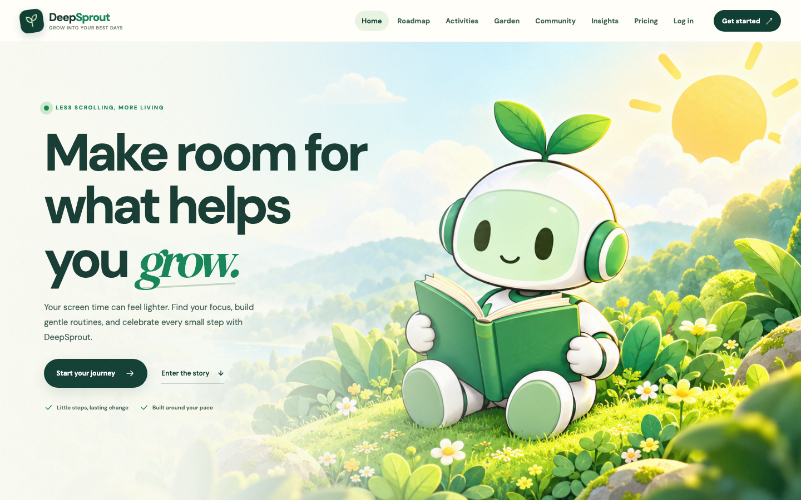
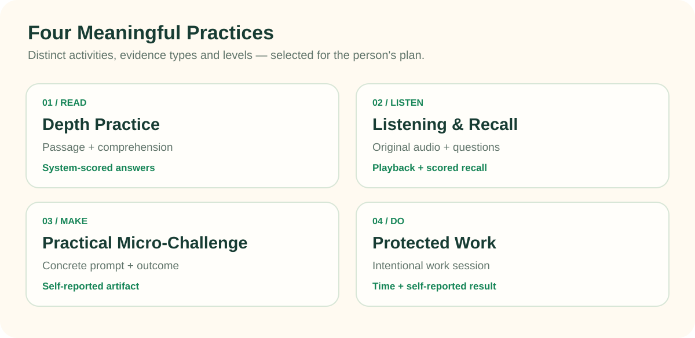
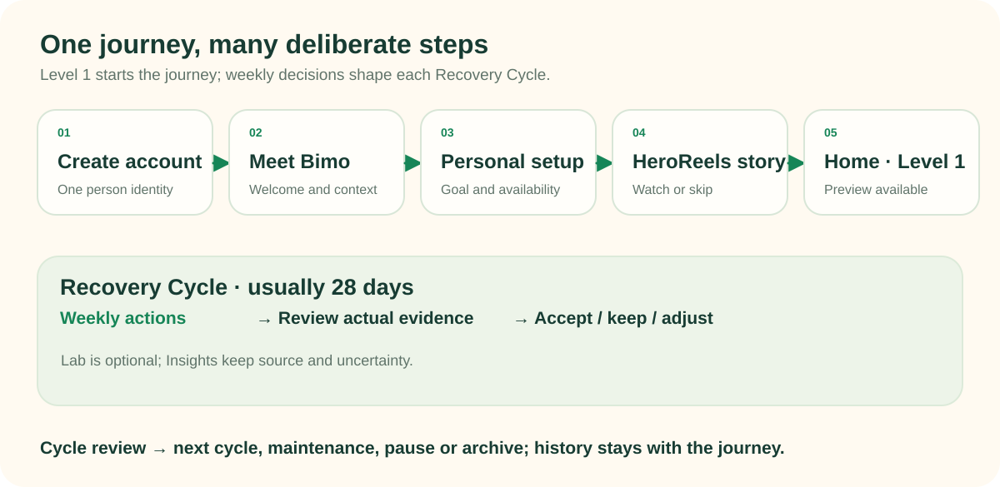
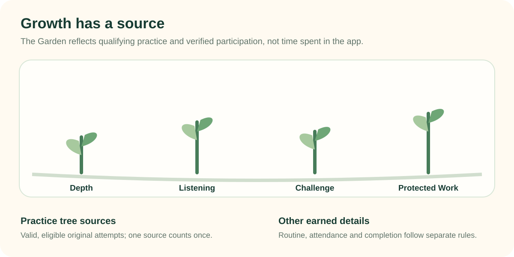
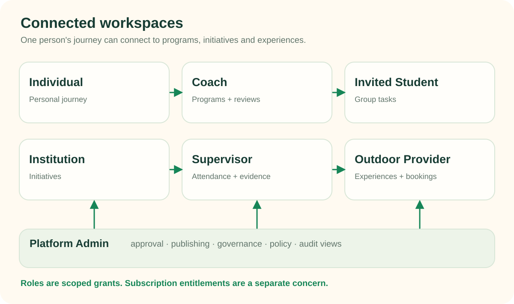
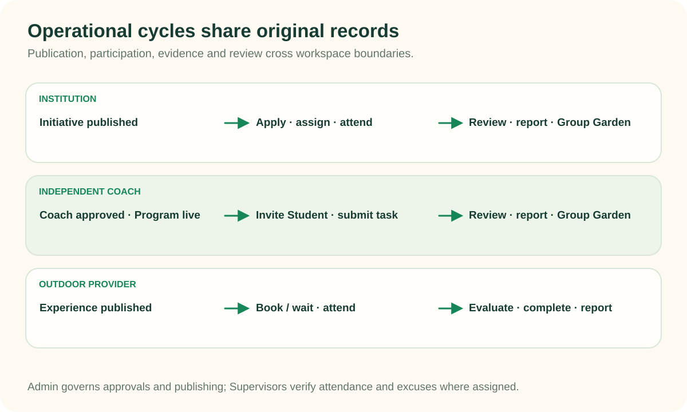
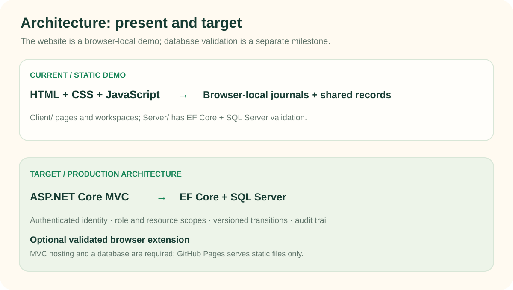

<div align="center">
  
  <h1>DeepSprout</h1>
  <p><strong>Less scrolling. More living.</strong></p>
  <p>A digital wellbeing platform for reclaiming attention from compulsive short-form feeds and making room for meaningful life beyond the screen.</p>
  <p>
    
    
    <a href="https://github.com/ahmadfa100/DeepSprout"></a>
  </p>
</div>


DeepSprout joins a **personal Recovery Journey** with practice, browser support, real-world opportunities, and guided group work. The [v4.1 product specification](DeepSprout.md) and [4 November P0 target map](docs/architecture/p0-target-v4.1.md) define the intended Institution-only partner model. The [current product guide](docs/current-product-guide.md) inventories the demo, including older Coach and Provider routes that require migration. The ASP.NET Core MVC website serves Razor views from `src/DeepSprout.Web`; interactions still use browser-local demo records, so Identity-backed access and durable product workflows remain future work. The approved database is the [58-table design](docs/architecture/database/README.md), modelled in EF Core but not yet used by any page.

**Explore the demo:** [Home](http://127.0.0.1:8765/) · [Individual activities](http://127.0.0.1:8765/src/pages/member/training/training.html) · [Partner workspaces](http://127.0.0.1:8765/workspaces.html#/auth/login) · [System Journey walkthrough](http://127.0.0.1:8765/workspaces.html#/admin/system-journey)

## Contents

- [Why DeepSprout](#why-deepsprout)
- [Current page and cycle guide](#current-page-and-cycle-guide)
- [Product preview](#product-preview)
- [What the platform does](#what-the-platform-does)
- [The Recovery Journey](#the-recovery-journey)
- [Meet Bimo](#meet-bimo)
- [Garden and evidence](#garden-and-evidence)
- [Connected workspaces](#connected-workspaces)
- [Operational workflows](#operational-workflows)
- [Pages and navigation](#pages-and-navigation)
- [Architecture and technology](#architecture-and-technology)
- [Repository structure](#repository-structure)
- [Run locally](#run-locally)
- [Status and roadmap](#status-and-roadmap)
- [Testing, accessibility and privacy](#testing-accessibility-and-privacy)
- [Contributing and license](#contributing-and-license)

## Why DeepSprout

Short-form feeds can consume time a person meant to spend on rest, relationships, learning, or simply being offline. DeepSprout helps people, especially young people, notice that pattern and make intentional changes. Reading or focused work can support that goal, but becoming maximally productive is not a requirement. DeepSprout is neither a clinical treatment nor a general habit tracker.

The personal journey is supported by four distinct systems: **Recovery Plan** schedules and adapts actions; **Activities** holds practice and an optional offline routine; **Digital Shield** offers browser-scoped protection and usage reminders; **Lab and Insights** retain measurement and its source. **Explore** brings Institution Initiatives, workshops, and Institution-owned Outdoor Activities into the same participation journey. Community and the original companion Bimo make the experience more welcoming. See [master §§1–2](DeepSprout.md#1-vision-positioning-users-and-product-boundaries) for product boundaries.

## Current page and cycle guide

The [3 November 2026 guide](docs/current-product-guide.md) inventories the public and access pages, every Individual destination, partner and Admin workspaces, and the personal, Institution, Coach, Student, Provider, Supervisor and governance cycles. It distinguishes what the browser demo does now from the database milestone and intended MVC server.

## Product preview



The image above is a **local browser capture** of the homepage at 1440 × 900 with a seeded demo account, taken for an earlier documentation pass. The current page may have changed since that capture. The [root entry](http://127.0.0.1:8765/) and `/index.html` are served by the same MVC view.

## What the platform does

| Area | Purpose | Current checkout |
| --- | --- | --- |
| Onboarding with Bimo | Meet Bimo, six quick questions, HeroReels story, then Home at Journey Level 1 with a preliminary Week 1 plan | Browser-local flow; [Onboarding 2.0 report](docs/implementation/onboarding2-reconciliation-report.md) |
| Recovery Plan | One continuous journey with usually 28-day cycles, an actionable week, review, future-only adjustment, and continuation decisions | Browser-local versioned journal |
| Meaningful Practices | Depth Practice, Listening & Recall, Practical Micro-Challenge, and Protected Work; independent levels and evidence | Four local players and versioned content |
| Offline Routine | Small personally chosen real-world commitments | Local self-report, separate from system-scored practice |
| Digital Shield | Manual Website Protection and one shared selected-site Usage Reminder | Optional **local Chrome extension**; supported-domain, browser-only coverage and pairing limits in its [guide](extensions/digital-shield/README.md). No Pages pairing or production sync is claimed |
| Personal Garden | Earned visual growth from eligible practice and selected participation records | Four practice-type trees and bounded details in the current demo; a later one-main-plant design direction is a separate Garden task |
| Lab and Insights | Optional assessments, source-labelled progress and missing-data context | Historical attempts and versions retained; no new weekly official window is scheduled |
| Explore and Community | Discover initiatives, workshops, experiences and community participation | Local opportunity, registration and community flows; no public multi-user service |
| Notifications, profile and account | Next steps, operational notices, profile settings and workspace entry | In-app/browser-local notices and demo identities; no real email, OTP or server authentication |



## The Recovery Journey

**Account creation → Meet Bimo → Six quick questions → HeroReels story (watch or skip) → Home at Journey Level 1 → Review a preliminary Week 1 plan → Explicit activation → Weekly actions and reviews → Insights → Continued cycles.** The four Lab assessments are optional and keep their historical results. Setup answers personalize the first proposal; they are not cognitive scores.



A **Journey** is the person's continuing history, beginning at Level 1. A **Recovery Cycle** is one bounded planning interval within it, normally four weeks in the present demo. A **week** contains scheduled actions, rest or routine context, and a review. A **Meaningful Practice** is an activity attempt with its own content and evidence; a scheduled action only points to it. **Lab assessments** are optional separate measurements; their old weekly eligibility rule is retired. The weekly review can accept a suggested next week, keep pace, or explicitly adjust future work. A cycle ending leads to review and a deliberate next-cycle or maintenance choice; elapsed days are not a recovery score. Details: [master §§4–5](DeepSprout.md#4-individual-onboarding-bimo-six-questions-the-story-and-journey-level-1).

## Meet Bimo

<p align="center"></p>

Bimo is DeepSprout's **original approved companion**. Bimo welcomes people, guides the first-run sequence, and explains selected milestones in a calm, friendly voice. The image above is an existing runtime asset; source references and poses live in [`docs/references/bimo/`](docs/references/bimo/). Bimo is a guide in the interface, not a claim that a conversational AI service is running.

## Garden and evidence



The Garden makes earned participation visible. Valid, eligible original practice attempts contribute to their corresponding four practice-type trees; routine and verified participation can produce bounded details under different rules. It does not grow merely because an app was opened, a timer elapsed, or a booking was made. Missing observations should remain unknown rather than be treated as failure. The illustration explains the current source model; it is **not a screenshot** of the Garden. See [the live Garden](http://127.0.0.1:8765/src/pages/member/garden/garden.html). The later design guidance calls for one clean ivory scene with one main plant; the current four-tree implementation remains until a separately scoped Garden task resolves its visual and evidence mapping.

## Connected workspaces in the current demo



| Workspace | Primary pages and job | Connection |
| --- | --- | --- |
| **Individual** | [Home](http://127.0.0.1:8765/), [Recovery Plan](http://127.0.0.1:8765/src/pages/member/recovery-plan/recovery-plan.html), [Activities](http://127.0.0.1:8765/src/pages/member/training/training.html), [Lab](http://127.0.0.1:8765/src/pages/member/lab/lab.html), [Shield](http://127.0.0.1:8765/src/pages/member/shield/shield.html), [Garden](http://127.0.0.1:8765/src/pages/member/garden/garden.html), [Insights](http://127.0.0.1:8765/src/pages/member/insights/insights.html), [Explore](http://127.0.0.1:8765/src/pages/member/explore/explore.html) | Receives its own assignments, applications, bookings and attributed outcomes |
| **Coach / Mentor** | [Dashboard, Programs, Groups, Assignments, Reviews, Group Garden, Reports](http://127.0.0.1:8765/workspaces.html#/mentor/dashboard) | Reviews scoped group work. The demo still offers independent Programs, which v4.1 retires; they are history-only in the approved database |
| **Invited Student** | [Dashboard, My Tasks, My Group, Progress, Group Garden](http://127.0.0.1:8765/workspaces.html#/student/dashboard) | Joins a group through invitation; can later upgrade the same person identity to Individual |
| **Institution Representative** | [Dashboard, Create new, Initiatives, Outdoor Activities, Applications, Bookings & waitlist, Team, Sessions, Forms, Reports](http://127.0.0.1:8765/workspaces.html#/organization/dashboard) | Publishes and runs Initiatives (online, hybrid or face-to-face) **and** Outdoor Activities (trips, hikes, camps), appoints staff, reviews participation and received Supervisor reports |
| ~~Outdoor Provider~~ | Retired 6 Nov 2026 — `#/provider/*` explains the change | Institutions organize Outdoor Activities directly; see the [v4.1 partner-workspace redesign log](docs/implementation/partner-workspaces-v41-redesign.md) |
| **Supervisor** | [Dashboard, Schedule, Attendance, Excuses, Competitions, Reports](http://127.0.0.1:8765/workspaces.html#/supervisor/dashboard) | Acts only on an assigned Initiative or appointed Outdoor Activity sessions; confirms field evidence |
| **Platform Admin** | [Overview, approvals, catalog, policy, CMS, moderation, reports, audit](http://127.0.0.1:8765/workspaces.html#/admin/overview) | Governs publication and platform policy; [legacy Admin](http://127.0.0.1:8765/admin.html#/dashboard) still holds some separate demo capabilities |

A person can have multiple **role grants**, each scoped to the relevant resource. A workspace switch does not grant permission. **Subscription entitlements** are a separate proposed commercial mechanism, not a substitute for identity or authorization; no real billing runs here. The current browser guards demonstrate policy, but production enforcement requires server-side checks. See [master §§2, 20, 23](DeepSprout.md#2-fundamental-concepts-authorization-and-workspaces).

## Operational workflows in the current demo



- **Individual recovery:** six setup answers → preliminary plan → explicit activation → practice and routine → weekly review → Insights and earned Garden growth → next decision. Evidence stays tied to its original person, attempt and cycle.
- **Independent Coach Program:** Admin approves a Coach; the Coach publishes an invite-only Program and owns groups; an invited Student submits assigned work; Coach review, reports and a Group Garden reflect eligible outcomes. Upgrade keeps the same person identity and history. Retired by v4.1: Coaches serve through Institution Initiative invitations.
- **Institution Initiative:** an approved Representative publishes an Initiative into regular Explore; an Individual applies; admission, groups, Coach tasks, sessions, forms and reports refer to shared records. The Representative's current Reports route is a received Supervisor-report inbox with attached Coach reports. Supervisor check-in and excuse decisions remain separate from registration.
- **Outdoor Activity:** a verified Institution publishes a versioned trip, hike, camp or outdoor event; an Individual books or joins a waiting list in regular Explore. Offers have expiry and capacity rules; an appointed Supervisor verifies attendance (the Representative cannot); completion follows the published criteria, then reports and eligible Garden effects read the original record. [Redesign log](docs/implementation/partner-workspaces-v41-redesign.md).
- **Admin governance:** application approval, publication, policy, moderation and audit views span these flows. The two Admin demos still require measured consolidation before production.

These flows document the current browser-local demo. The v4.1 target removes independent Coach and Outdoor Provider ownership: Institutions own Initiatives and Outdoor Activities, and Coaches/Supervisors serve through scoped Institution invitations. A registration is not attendance; attendance is not completion; a self-report is not a system-scored result. Where each workflow keeps its data, and which of the 58 tables it maps to, is in the [persistence contract](docs/architecture/database/persistence-contract.md).

## Pages and navigation

| Area | Public entry points | Destination routes |
| --- | --- | --- |
| Public and access | [Home](http://127.0.0.1:8765/), [former story landing](http://127.0.0.1:8765/landing.html), [Pricing](http://127.0.0.1:8765/pricing.html), [Register](http://127.0.0.1:8765/register.html), [Login](http://127.0.0.1:8765/login.html), [Partner entry](http://127.0.0.1:8765/partners.html) | MVC Razor views under [`src/DeepSprout.Web/Views/`](src/DeepSprout.Web/Views/) |
| Individual first run | [Onboarding](http://127.0.0.1:8765/onboarding.html), [Home](http://127.0.0.1:8765/) | Meet Bimo → six questions → HeroReels story (watch or skip) → Home at Journey Level 1. The [Lab](http://127.0.0.1:8765/lab.html) is optional. |
| Individual ongoing | [Recovery Plan](http://127.0.0.1:8765/recovery-plan.html), [Weekly Review](http://127.0.0.1:8765/weekly-review.html), [Activities](http://127.0.0.1:8765/training.html), [Shield](http://127.0.0.1:8765/shield.html), [Garden](http://127.0.0.1:8765/garden.html), [Insights](http://127.0.0.1:8765/insights.html), [Explore](http://127.0.0.1:8765/explore.html), [Community](http://127.0.0.1:8765/community.html), [Profile](http://127.0.0.1:8765/profile.html) | Historic `.html` URLs resolve through [the MVC route manifest](src/DeepSprout.Web/page-routes.json). |
| Partner and administration | [Partner workspaces](http://127.0.0.1:8765/workspaces.html#/auth/login), [legacy Admin](http://127.0.0.1:8765/admin.html#/dashboard) | Hash routes such as `#/mentor/dashboard`, `#/organization/initiatives`, `#/provider/waitlist`, `#/supervisor/attendance`, `#/admin/overview` |

The workspace [navigation source](src/DeepSprout.Web/wwwroot/src/workspaces/navigation.js) is the exact current menu inventory. The [current product guide](docs/current-product-guide.md) describes every destination and cycle.

## Architecture and technology



| Layer | Running in this repository | Planned production direction |
| --- | --- | --- |
| Web experience | 46 Razor views and MVC routing in `src/DeepSprout.Web`; CSS, JavaScript and images under `wwwroot/`, and the hash-routed `workspaces.html` partner workspaces | Server-backed MVC actions; the older Angular client direction needs a separate integration decision |
| State | Browser-local person journals, ecosystem graph, seeded JSON and some separate legacy Admin data. The approved 58-table EF Core model (`DeepSproutV5DbContext`) and its migrations exist but no page uses them | ASP.NET Core MVC application with C# domain services on the approved 58-table SQL Server database |
| Identity and access | Demo identity selector and browser-side scoped guards | ASP.NET Core Identity for one human account, with server-enforced resource-scoped authorization and one Platform Admin |
| Business changes | Local commands and projections; some original records bridge Individual and partner screens | Versioned workflows, transactions, service-layer invariants and durable audit trails |
| Browser protection | Optional Chrome extension with local-origin pairing and restricted site coverage | Technically validated extension and authenticated, consent-aware sync |
| Hosting | One ASP.NET Core MVC application run locally; validation database is separate | Hosted ASP.NET Core MVC application, database and optional extension distribution |

DeepSprout is **one ASP.NET Core MVC solution**. The pages are Razor views in `src/DeepSprout.Web/Views`; their CSS, JavaScript, images and fonts live in `src/DeepSprout.Web/wwwroot`. Page URLs keep their historical `.html` form (for example `/training.html`), routed by `PagesController` from `page-routes.json`. There is no separate static HTML site.

## Repository structure

```text
.
├── DeepSprout.sln                 # Open this in Visual Studio
├── DeepSprout.Database.slnx       # Database-focused solution
├── src/
│   ├── DeepSprout.Web/            # ASP.NET Core MVC website
│   │   ├── Controllers/           # PagesController (page routing)
│   │   ├── Models/                # PageCatalog (routes from page-routes.json)
│   │   ├── Views/                 # 46 Razor views grouped by area
│   │   ├── wwwroot/               # assets/ (media, Bimo, vendor) and src/ (page JS/CSS, workspaces)
│   │   ├── Program.cs  page-routes.json  appsettings.json
│   ├── DeepSprout.Domain/         # Domain records (no persistence dependency)
│   ├── DeepSprout.Application/    # Command contracts and DTOs
│   └── DeepSprout.Infrastructure/ # V5/: approved 58-table EF Core context and migrations; root: historical 129-table M1 context
├── tests/
│   ├── mvc-smoke.mjs              # Routes every page and resolves every local link/asset
│   ├── client/                    # Browser-model and Playwright suites (run against the MVC site)
│   └── DeepSprout.DatabaseValidation/  # Historical M1 SQL suite (DeepSprout_Validation only)
├── extensions/digital-shield/     # Optional Chrome extension (not part of the website)
├── docs/                          # Product guide, database architecture, design/validation records
│   ├── architecture/database/     # Approved 58-table design, persistence contract, EF Core adoption
│   ├── client/                    # Former client architecture, design and validation records
│   └── references/                # Approved Bimo and design references
├── tools/                         # README diagram and media helper scripts
├── experiments/                   # Independent Bimo/visual experiments
├── DeepSprout.md  DESIGN.md  DeepSprout-DESIGN.md  AGENTS.md
```

## Run locally

Open [`DeepSprout.sln`](DeepSprout.sln) in Visual Studio, set `DeepSprout.Web` as the startup project and press F5. From a terminal with .NET SDK 10:

```sh
dotnet run --project src/DeepSprout.Web/DeepSprout.Web.csproj
```

Open `http://127.0.0.1:8765/`. Partner workspaces are at `/workspaces.html#/auth/login`. The demo stores records in the **browser origin**, so a different port or host starts with empty local data. A database connection is optional (`ConnectionStrings__DeepSprout`, registering the approved 58-table context); running the site never migrates or writes to any database. Before adding server sessions, configure a persistent protected key store through `DataProtection__KeyDirectory`.

Razor views are compiled into the site DLL, while CSS and JavaScript are served live from `wwwroot`. After changing a `.cshtml` file, rebuild and restart; the site logs a warning at startup when a view is newer than the running build. Starting `bin/.../DeepSprout.Web.exe` directly runs as Production (`dotnet run` uses Development from `launchSettings.json`). Workspace stylesheets are listed once, in `wwwroot/src/workspaces/workspace-styles.css`.

Publish with `dotnet publish src/DeepSprout.Web/DeepSprout.Web.csproj -c Release`.


## Status and roadmap

The spec's [§29 snapshot](DeepSprout.md#29-current-implementation-versus-agreed-target-15-october-2026) is dated 15 October and predates substantial client and database work. Use the [current product guide](docs/current-product-guide.md) and milestone evidence for this working tree.

| Status | Scope |
| --- | --- |
| **Implemented in the local demo** | Static public/member pages; six-question Bimo onboarding, HeroReels handoff and Home at Level 1; optional Lab interfaces and user-confirmed local plan activation; four practice players; local Recovery cycles and reviews; institution/Coach/Student/Supervisor/Provider records and example flows; received Institution report inbox; community interactions; root Pages-ready homepage |
| **Partial or simulated** | Local identity, permissions, QR/code checks, notices, demo capacity and clocks, payment acknowledgements, Admin split, source coverage and some cross-workspace edge cases. Extension pairing/enforcement is restricted to supported local Chrome conditions |
| **Next validation and product work** | Re-run cross-workspace acceptance after active changes; consolidate Admin by capability; settle Garden direction and thresholds; test additional accessibility, responsive and error states; validate extension distribution and consent policy |
| **Implemented MVC presentation and database foundation** | 46 routed Razor views and static assets; the approved 58-table design as SQL script, EF Core model and two tested migrations (not yet applied to `DeepSprout_V5_Demo`); product records remain browser-local |
| **Planned production engineering** | Server-backed MVC commands with EF Core/SQL Server persistence, real authentication and resource authorization, transactional capacity, durable audits, secure notifications, deployment/operations and threat review; any Angular client work is a separate target described in the specification |

Dated round reports and cycle audits were retired on 8 November 2026 (they remain in Git history). The [documentation map](docs/README.md) lists the current sources.

## Testing, accessibility and privacy

With the site running (`dotnet run --project src/DeepSprout.Web`), the checks are:

```sh
node tests/mvc-smoke.mjs                      # every routed page, custom 404, every local link and asset
node --test tests/client/partner-store.test.mjs tests/client/institution-cycle.test.mjs tests/client/supervisor-cycle.test.mjs tests/client/coach-cycle.test.mjs
node --test tests/client/four-cycle.test.mjs tests/client/outdoor-activity-cycle.test.mjs   # Institution-owned Outdoor Activities, timeline, governance
node --test tests/client/round2a-personal.test.mjs tests/client/round2b-practices.test.mjs tests/client/round2c-recovery.test.mjs tests/client/round2d-shield.test.mjs
BASE_URL=http://127.0.0.1:8765 node tests/client/round0-browser.test.cjs   # Playwright suites; set CHROME_PATH
BASE_URL=http://127.0.0.1:8765 node tests/client/onboarding2-browser.test.cjs          # Onboarding 2.0: six questions, story skip, Level 1, explicit activation
BASE_URL=http://127.0.0.1:8765 node tests/client/personal-tour-lab-browser.test.cjs    # activation without Lab, product tour, optional Lab and practice
```

Browser suites in `tests/client/` need Playwright and Chrome (`CHROME_PATH`) and the site at `BASE_URL`. Some existing browser tests write screenshots under validation folders; choose a temporary `SHOTS_DIR` when supported and inspect the test before running it. The root `package.json` has a placeholder `npm test` command, so use the actual test commands above.

The approved database has its own checks: `docs/architecture/database/v5-lean-design/submission/DeepSprout-v5-NEGATIVE-TESTS.sql` (40 rolled-back tests) and the EF Core commands in [EF Core adoption](docs/architecture/database/efcore-v5-adoption.md).

Responsive layouts, keyboard controls and reduced-motion states have targeted implementation evidence, but no complete assistive-technology audit is claimed. Avoid using the demo for sensitive personal information: browser-local records are not a production privacy or security boundary. Insights should distinguish system-scored, self-reported, browser-observed and Supervisor-confirmed sources; missing evidence should remain unknown. The [master safety and accessibility section](DeepSprout.md#24-safety-accessibility-privacy-measurement-and-operational-quality) defines the intended safeguards.

## Contributing and license

Start with [`DeepSprout.md`](DeepSprout.md), then read [`AGENTS.md`](AGENTS.md), [`DESIGN.md`](DESIGN.md) and the [documentation map](docs/README.md). Keep changes scoped, add evidence for a changed cross-workspace effect, preserve Bimo's approved artwork, and document whether a feature is local demonstration or production behavior. For homepage changes, regenerate the root entry; for diagram changes, run `python3 tools/build_readme_diagrams.py`. Open an issue or pull request with the affected route, expected behavior and test result.

No repository-level `LICENSE` file is present. The root `package.json` contains an `ISC` metadata field, but that alone is not presented here as a verified license for all source and artwork. Ask the repository owner before reusing or redistributing assets outside the project.
