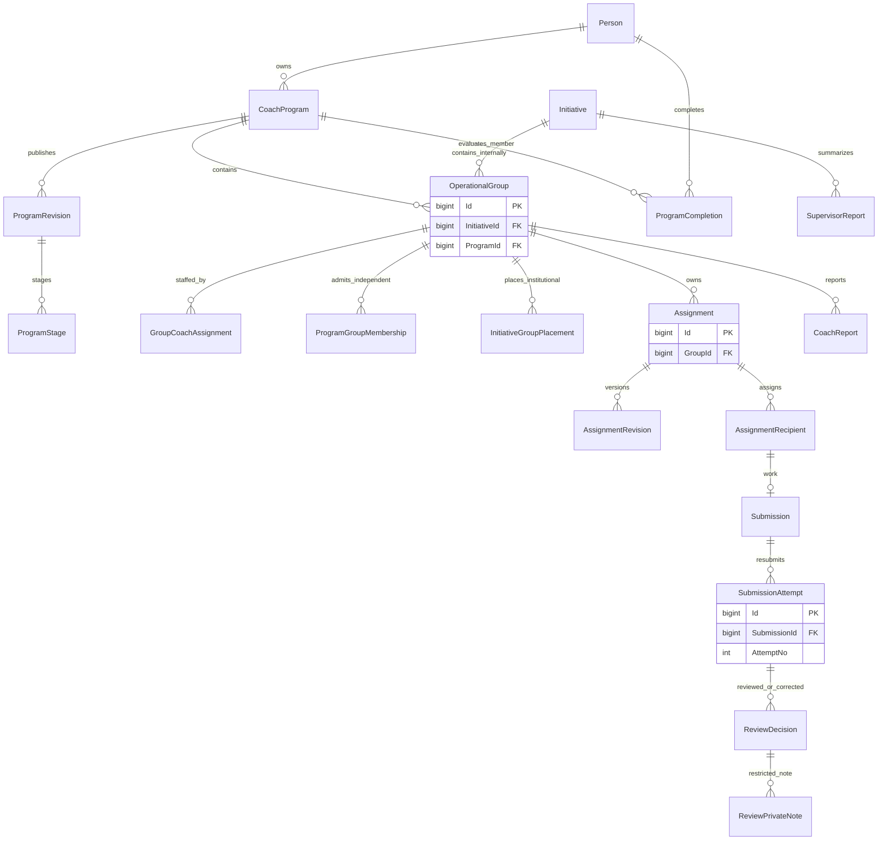

# Independent Coach, Group and shared assignment ERD

`OperationalGroup.InitiativeId XOR ProgramId` is a database check. Review correction supersedes an old decision; transfer closes a placement or Coach assignment but never rewrites authored attempts.
