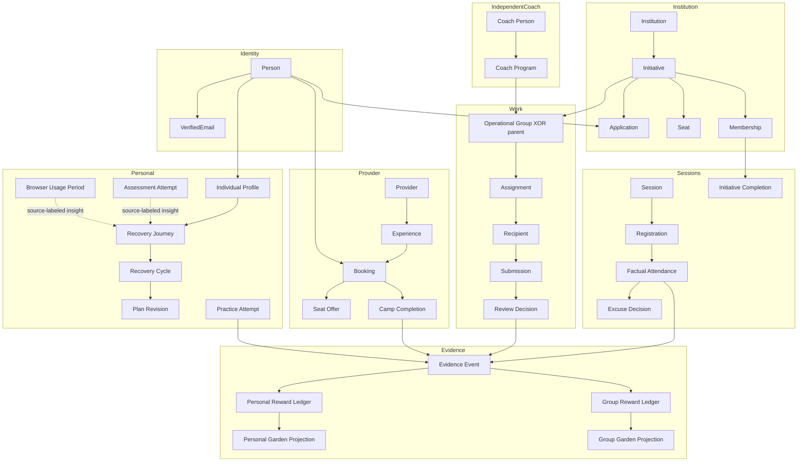

# Conceptual domain model and aggregate boundaries

Each subgraph is an aggregate boundary; edges across boxes carry IDs/events, not an eagerly loaded object graph.

The two incoming parent arrows to Group mean **exclusive OR**, never simultaneous ownership. An Initiative can link an independently owned Program or Experience by accepted partnership without moving its Group or Booking aggregate.
