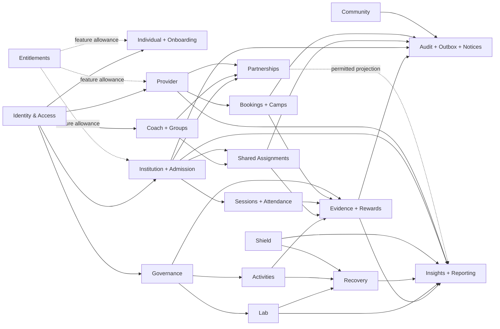

# System domain context map

Solid arrows represent authoritative data/events; dashed arrows are scoped read projections. All boxes run inside the proposed modular monolith and one SQL Server database.

Identity supplies a subject, not an automatic resource grant. Entitlements affect capability limits only after authorization. Community engagement is not a reward source. Personal Lab/Shield/Recovery data do not flow into partner operational reports by default.
