# Critical state machines and transaction sequences

These diagrams describe proposed server behavior. Guards include active selected grant, published version and server time; every accepted transition records audit/outbox.

## Application, membership and invitation

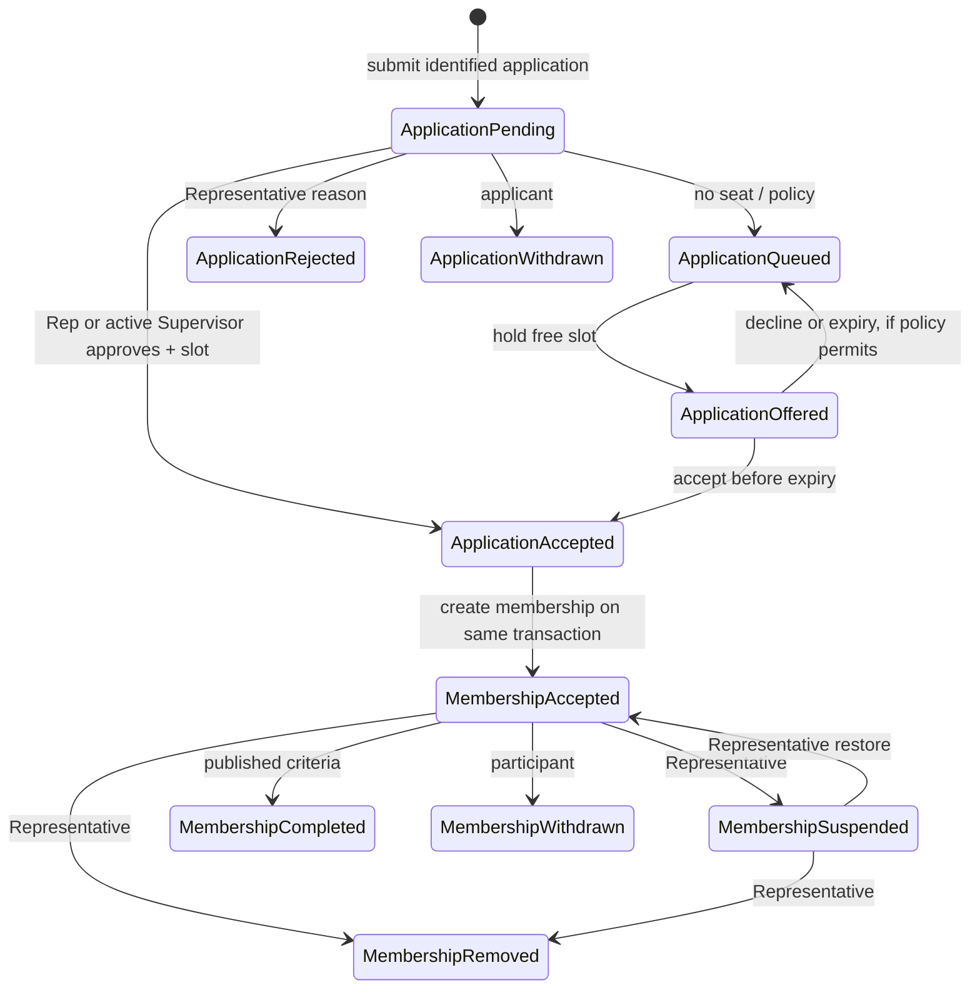

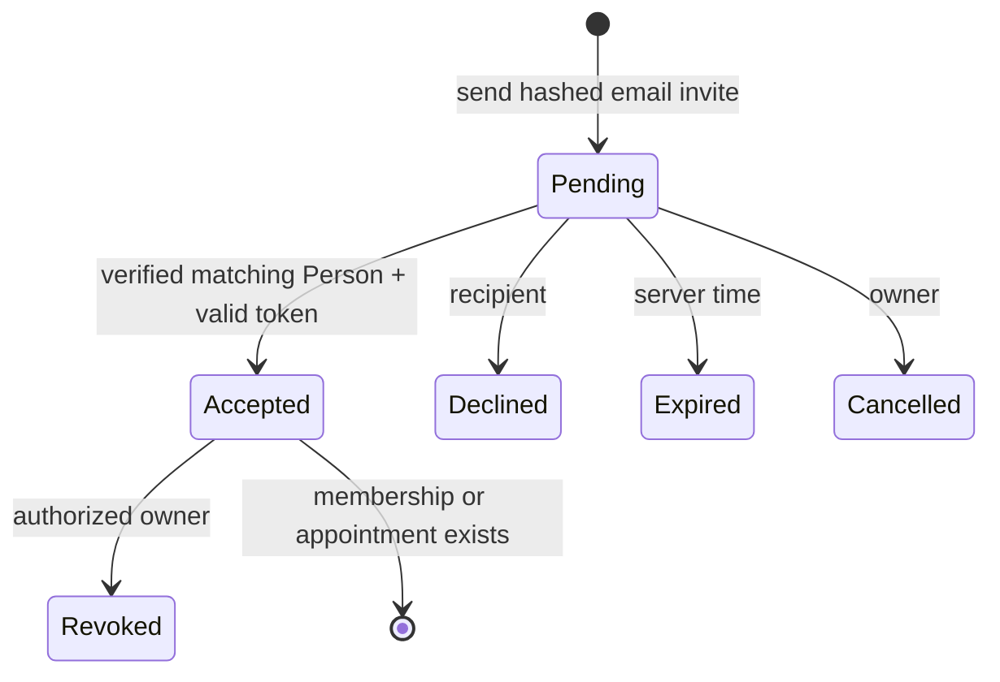

An invitation status is not a grant. A valid acceptance transaction creates the scoped appointment/membership exactly once. Pending invitations do not consume the three active Initiative Supervisor places.

## Assignment, booking, attendance, Recovery and reward

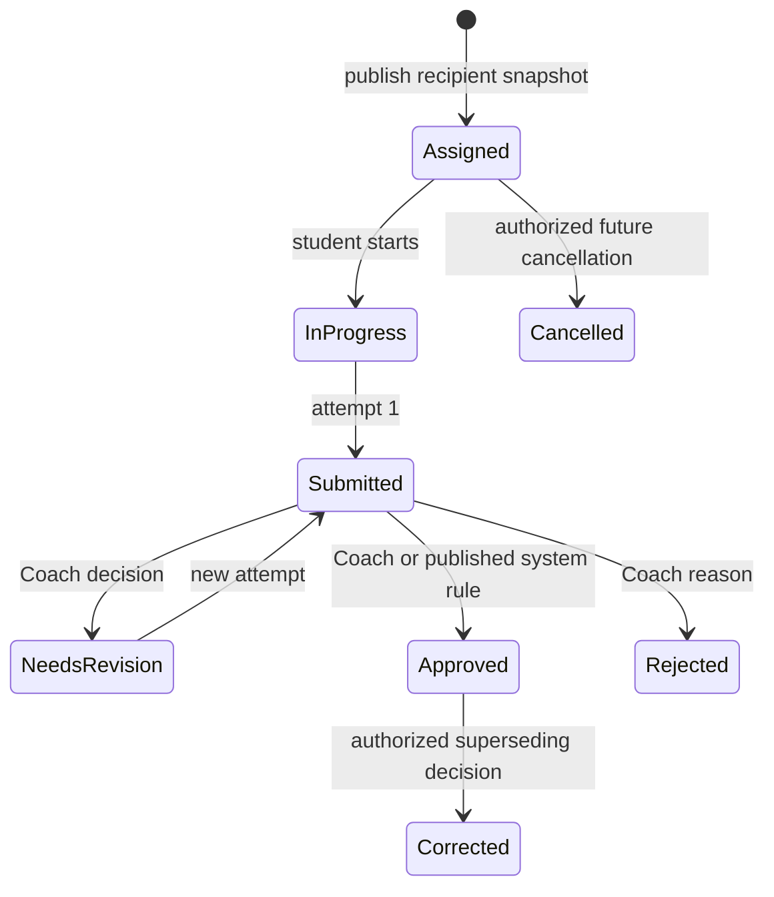

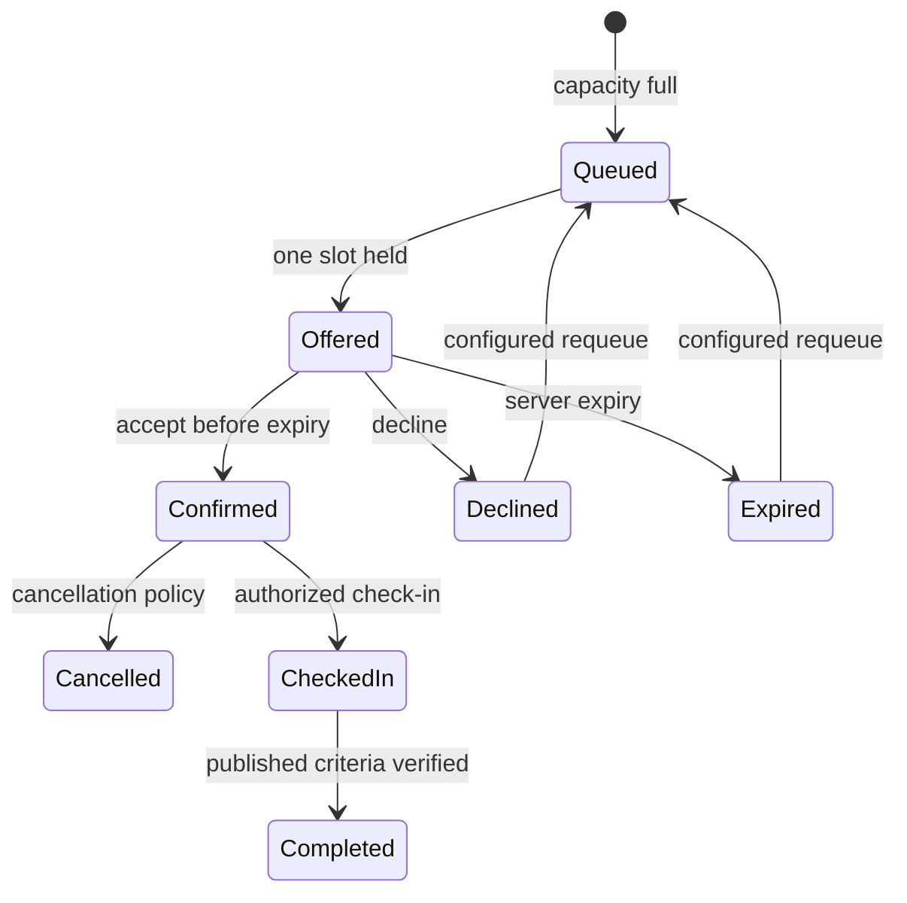

`SeatOffer` is its own time-limited record; the booking state above is the participant-facing projection.

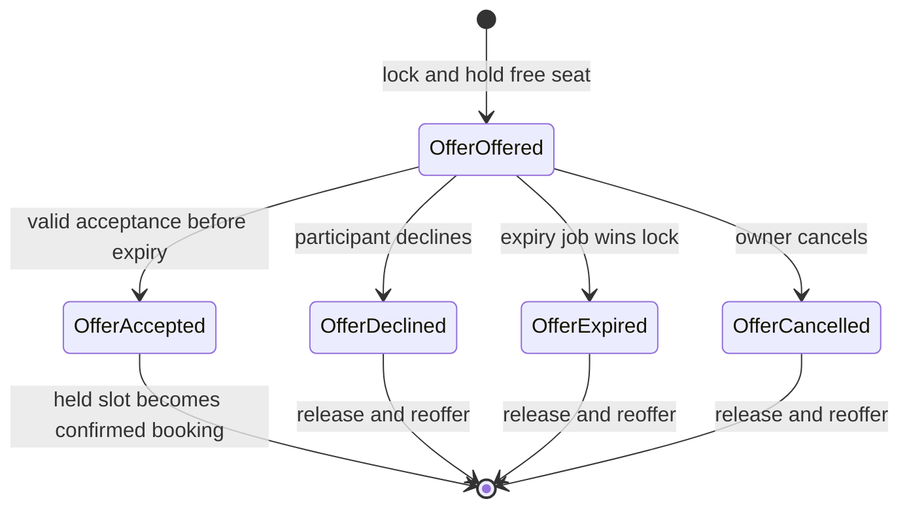

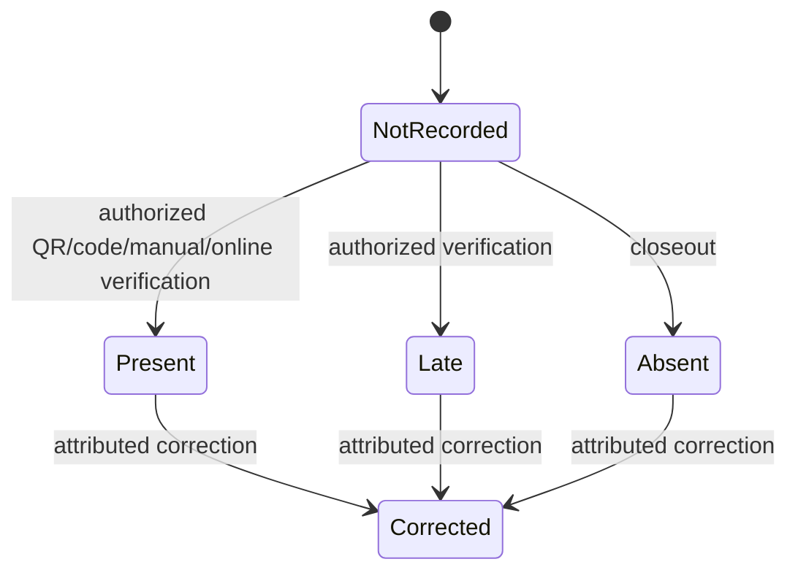

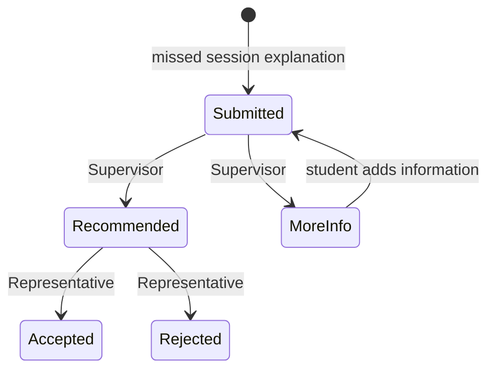

Excuse is a **separate aggregate**; an accepted excuse plus factual `Absent` displays “Excused Absence” without changing attendance or granting rabbit.

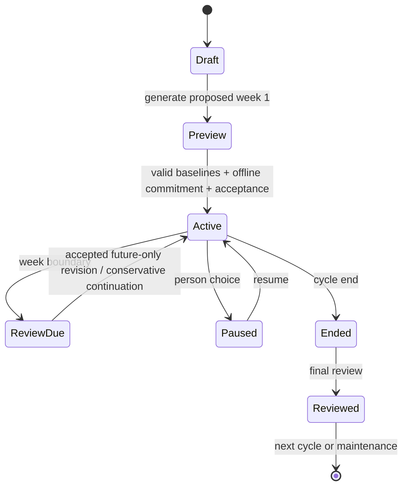

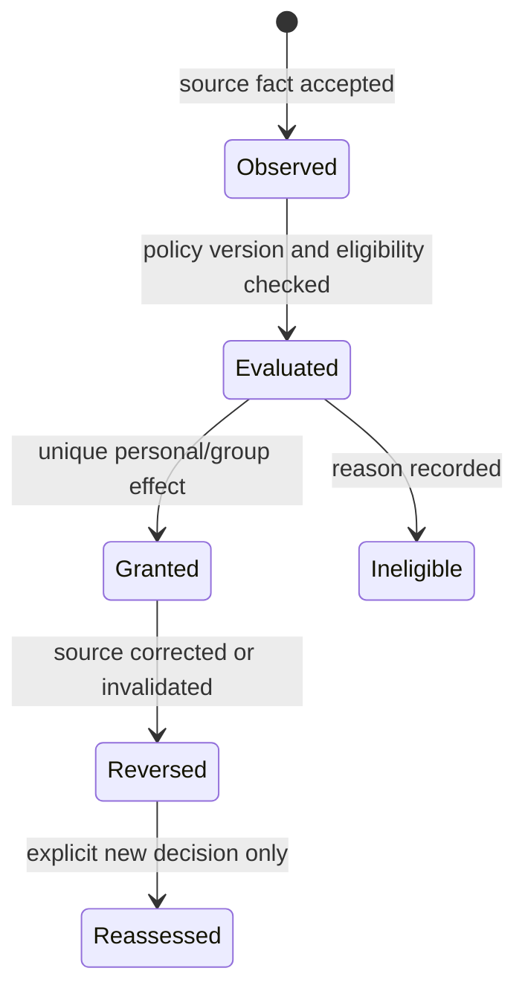

## Concurrent Initiative approval

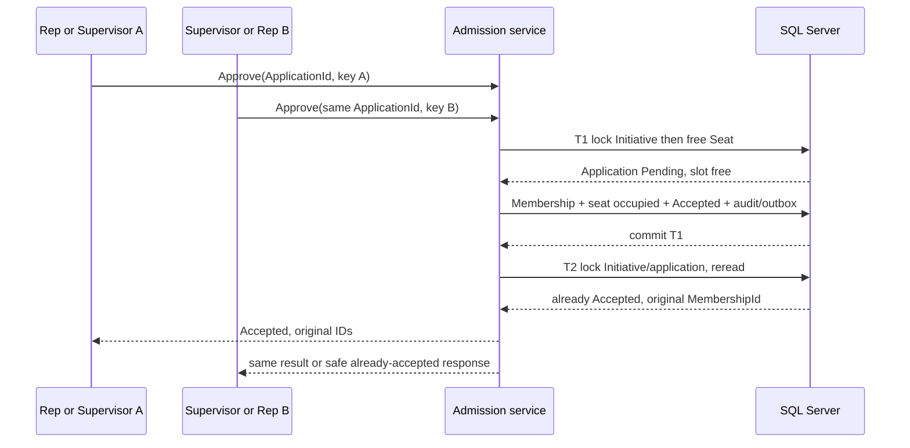

## Waitlist offer acceptance

```mermaid
sequenceDiagram
  participant P as Participant
  participant J as Expiry job
  participant API as Booking service
  participant DB as SQL Server
  P->>API: Accept(OfferId, idempotency key)
  J->>API: ExpireDueOffers()
  API->>DB: lock Experience → Seat → Offer → Booking
  alt unexpired Offered wins
    DB-->>API: live held slot
    API->>DB: Offer Accepted; Seat holder Booking; Booking Confirmed; outbox
    API-->>P: confirmed original BookingId
  else expiry wins or offer stale
    API->>DB: Offer Expired; clear slot; offer next eligible
    API-->>P: expired/conflict, no confirmed booking
  end
```

## Assignment approval to Garden

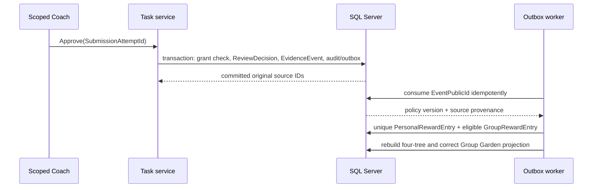

## Authorized attendance to completion and reporting

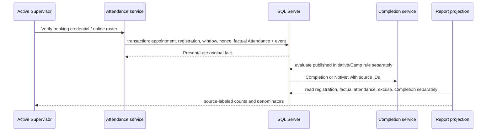

## Invited Student to full Individual

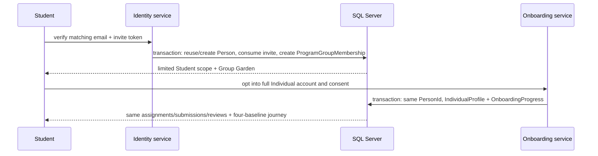
