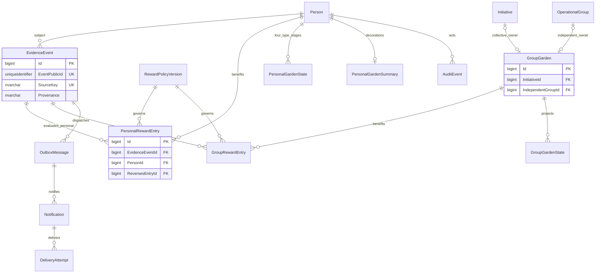

# Evidence, rewards, projections, reporting and audit ERD

The source fact table retains the original operational FK; `EvidenceEvent` is a unique integration envelope. Personal and Group ledgers have separate beneficiary FKs. Projections may be rebuilt; audit/outbox are durable records.
