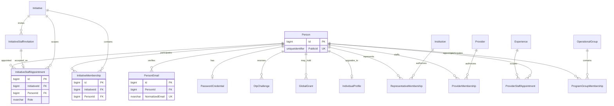

# Identity and permission ERD

`GlobalGrant` is not a replacement for resource appointment. Invitation tokens and OTP are hashes. The appointed Person ID remains the same through Student→Individual upgrade.
