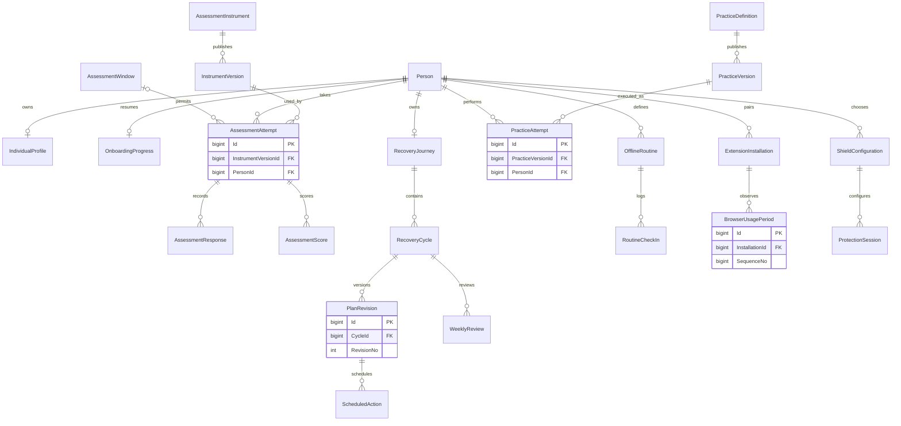

# Individual, Lab, Recovery, Activity and Shield ERD

These sources remain distinct. A Lab score, self-report, supported-browser observation and scheduled practice completion are not interchangeable measurements.
