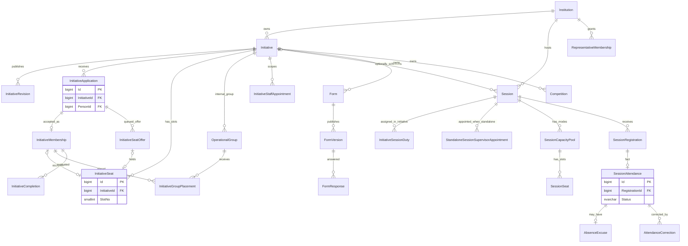

# Institution, Initiative, admission, session and forms ERD

The Initiative admission seat, Session mode seat, factual Attendance and Initiative Completion are four different facts. Seat slots and active Supervisor appointments enforce separate approved operational limits.
