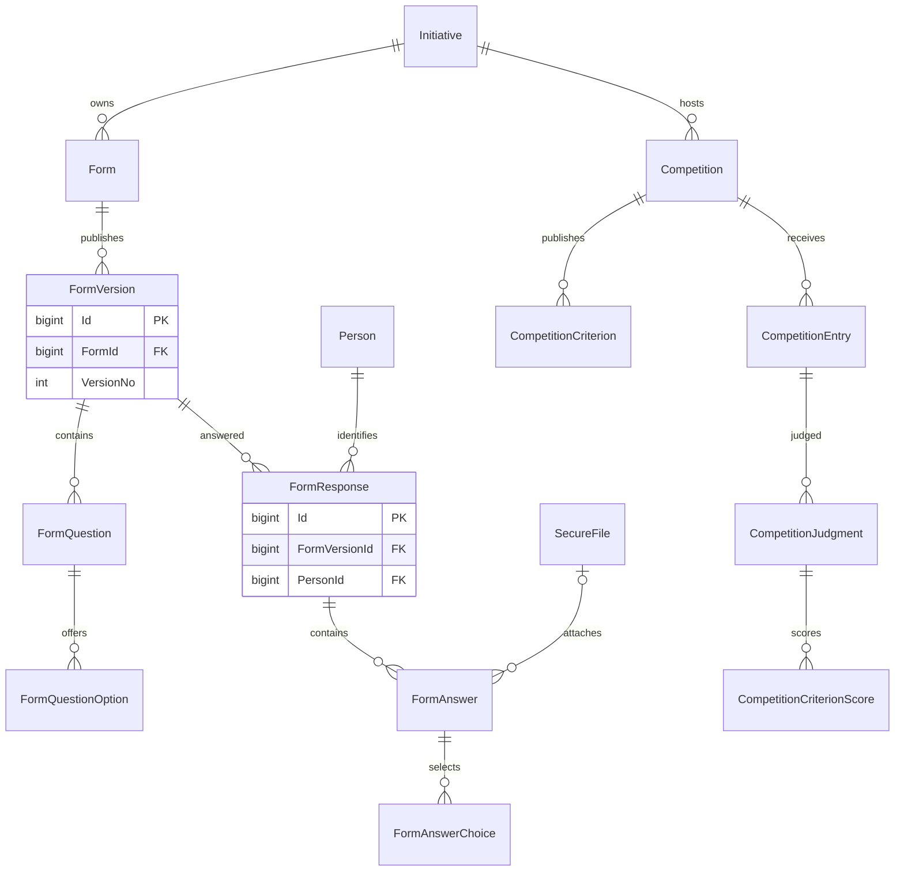
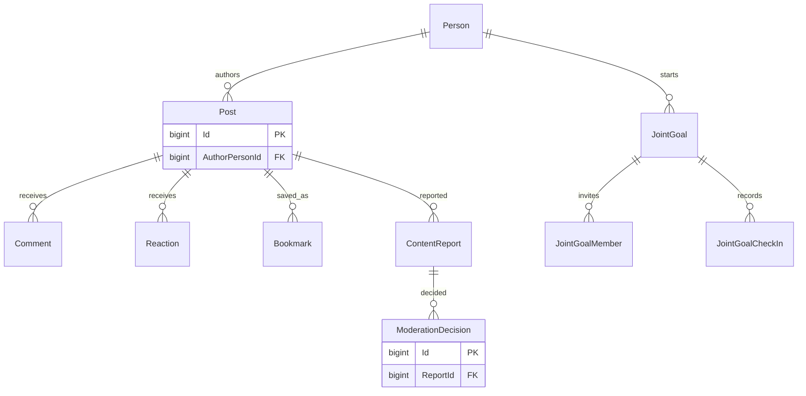
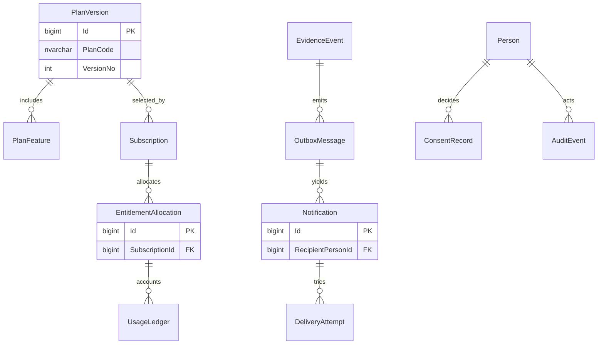

# Supporting contexts ERDs

These small ERDs cover identified forms, Community, entitlements and operational delivery. They complement the core ERDs and the full keyed dictionary.

Subscription/entitlement beneficiary is an explicit checked union of Person, Institution or Provider in the dictionary. That is a closed business set with real FKs, not an arbitrary resource ID table. Community posts/reactions are never reward sources.
