# 04 — Context map, simplified master ERD and detailed relationship views

These diagrams describe the **128-table complete target** at a readable level. An arrow in an ERD denotes an actual proposed FK, not authorization. Some composite FK columns and supporting records are omitted for space and are normative in [the target dictionary](03-target-dictionary.md). The old diagrams in `../diagrams/` remain historical, including their seat tables. The `files.SecureFile` move and removed projection/Submission/slot tables are reflected here.

## 1. Platform context map

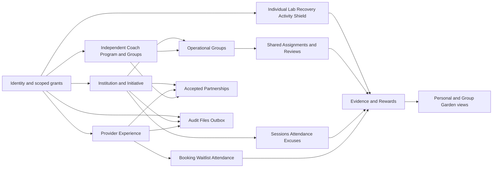

## 2. Simplified master ERD

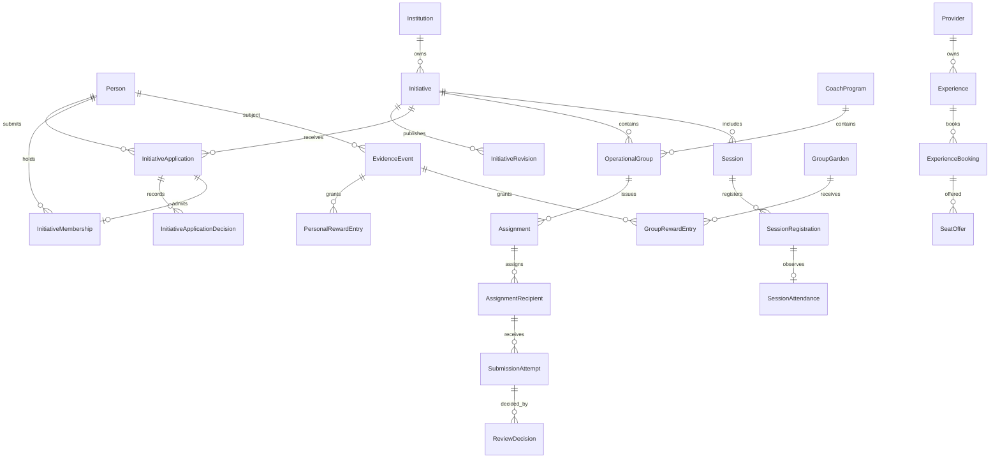

`OperationalGroup` has XOR Initiative/CoachProgram ownership; the two lines mean alternatives, not dual ownership. One Person may have many **historical** memberships, but the filtered unique index permits at most one in `Accepted`/`Suspended` state.

## 3. Identity and resource-scoped authorization

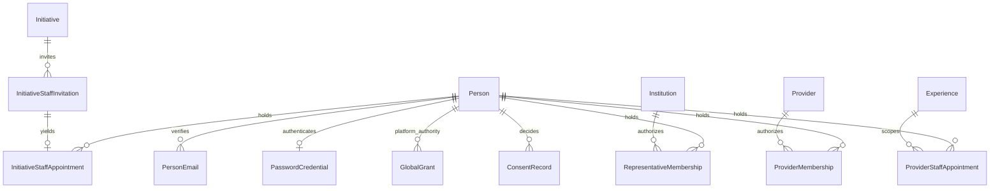

Grant lookup uses the exact resource and active status each time. An invitation is not a grant. Revocation stops future reads/writes while existing authored facts retain their Person IDs.

## 4. Institution, admission and membership

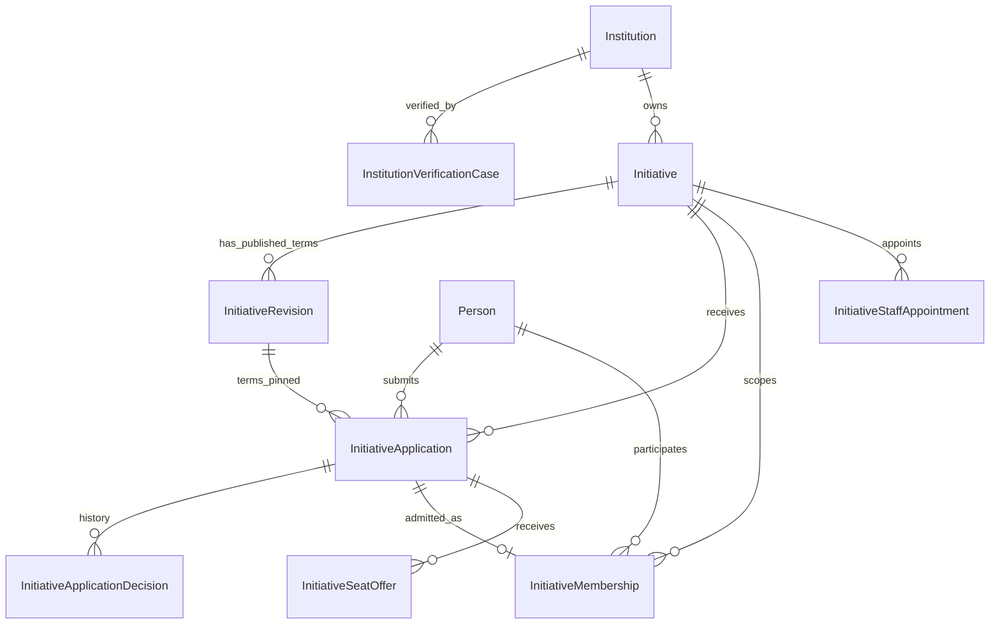

Application/decision/offer/membership all carry InitiativeId where necessary for same-parent composite FKs. Membership also pins PersonId to the same Application. `CapacityReleasedAtUtc IS NULL` rows and active offers consume capacity. Application attempts are distinct; policy determines if a new attempt may be submitted.

## 5. Coach, Groups and Assignments

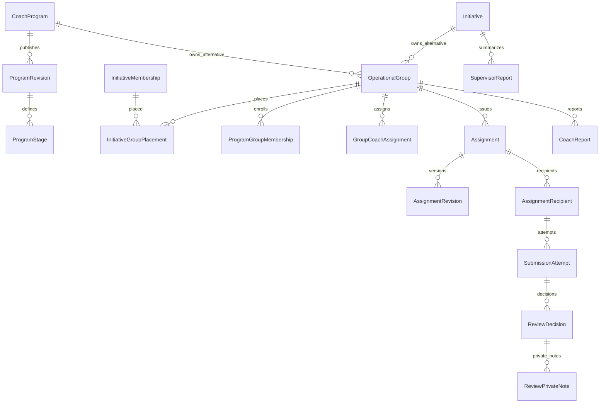

AssignmentRecipient absorbs old Submission current state; Attempts and Reviews stay immutable. Group parent XOR and placement composite FKs prevent cross-Initiative/Program moves. Transfer changes placement/responsibility, not author IDs.

## 6. Sessions, factual attendance and excuses

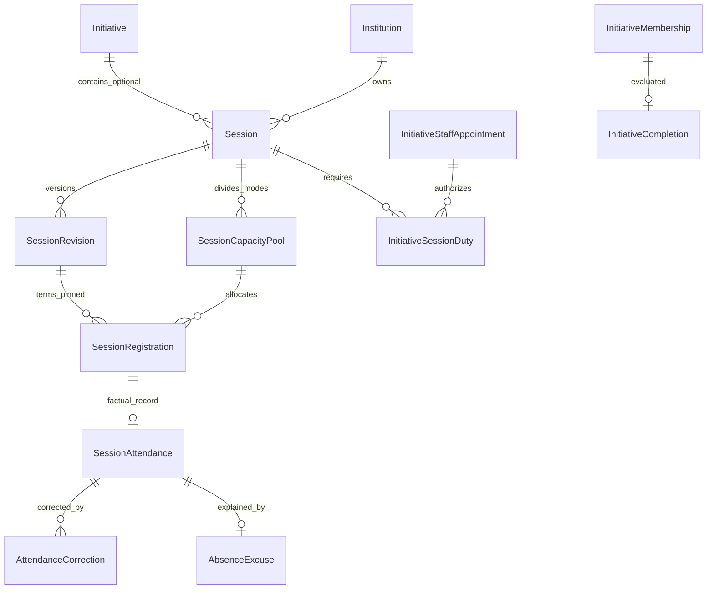

The Session's Initiative FK is nullable for stand-alone sessions. Stand-alone Supervisor authority is a conditional table until the product confirms that workflow. Accepted excuse leaves attendance `Absent`; completion uses published criteria separately. Registration count under a locked Pool enforces mode capacity.

## 7. Provider, booking and held offers

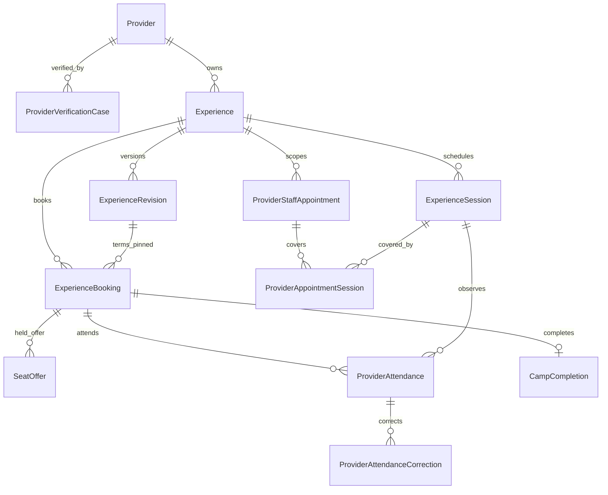

The Booking and Offer both carry ExperienceId for same-parent FKs. Count confirmed claims plus live Offered holds under the Experience row lock. Provider cohort/incident records are conditional on safety policy and do not own a Garden.

## 8. Individual, Lab, Recovery, Activities and Shield

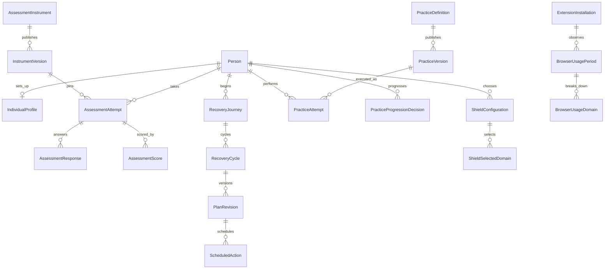

Onboarding fields are in IndividualProfile. RecoveryJourney is retained with one active journey per Person and archived history. AI may explain these source facts through an authorized projection; it never creates PlanRevision/Score/Reward.

## 9. Evidence, Rewards and Garden

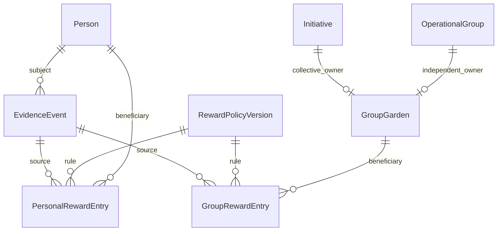

The two Garden owner relationships are XOR, with composite `(IndependentGroupId,ProgramId)` pointing to a CoachProgram-owned Group. Four personal trees and bounded decorations are query results from the personal ledger, by PracticeType and effect. No Garden-state cache is authoritative.

## 10. Security, files, audit and outbox

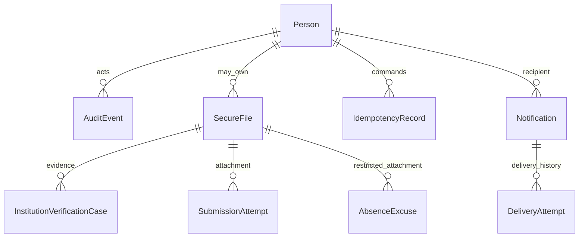

`AuditEvent.ResourceKind/ResourcePublicId` and Outbox event references are metadata, not generic ownership FKs. File download authorization resolves the actual owning case/attempt/excuse and current grant. Outbox is written with a domain transaction for external delivery.

## Critical states

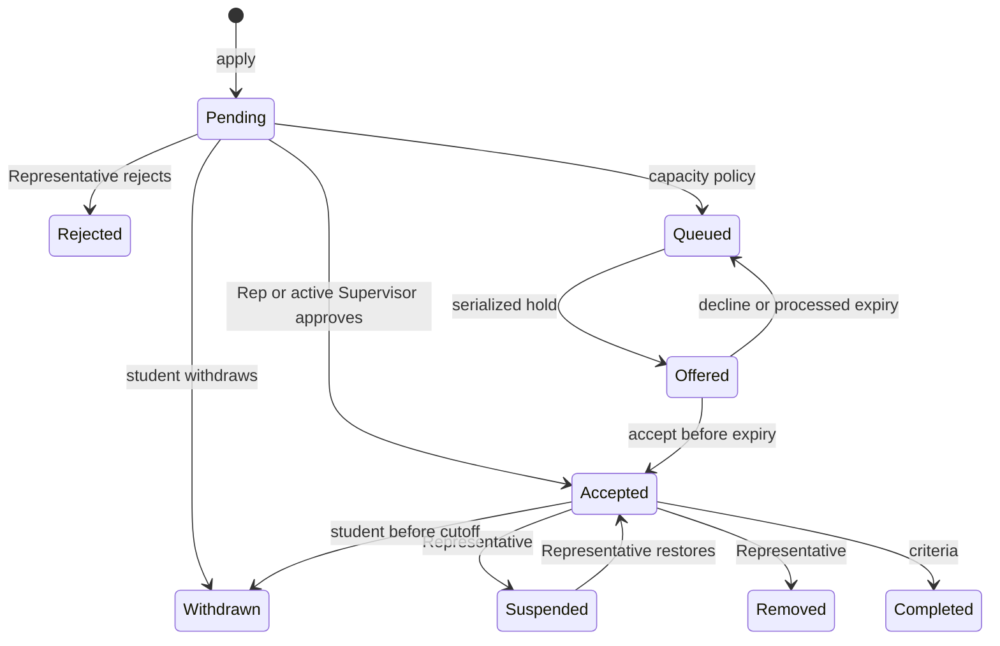

`Accepted` here denotes application/membership transition shorthand; the SQL tables keep distinct application and membership rows. An attempted second effective Initiative membership must fail, including concurrent approvals.
