# DeepSprout v4 — مخططات العلاقات (ERD)

> **ملف مُولَّد** من `model/*.mjs` بواسطة `node generate.mjs`. لا تحرره يدويًا؛ عدّل النموذج ثم أعد التوليد.

المخططات مولَّدة من المفاتيح الأجنبية المعرفة في النموذج نفسه، فلا توجد علاقة مرسومة غير موجودة في القاموس. تُعرض بـMermaid (GitHub وVS Code وأغلب عارضات Markdown).

**قراءة الرموز:** `||--o{` أب إلزامي وأبناء كثيرون؛ `|o--o{` الأب اختياري (FK يقبل NULL)؛ `--o|` علاقة واحد لواحد على الأكثر. الأعمدة المعروضة هي المفاتيح والحالة والنوع؛ الأعمدة الكاملة في [02-data-dictionary-ar.md](02-data-dictionary-ar.md). لتخفيف الزحام، روابط `iam.Person` لأعمدة الفاعل (`…ByPersonId`، المراجع، المقيِّم…) لا تُرسم في مخططات الوحدات؛ كلها مفاتيح حقيقية في القاموس.

## 1. الخريطة العامة للوحدات

كل عقدة وحدة (schema) بعدد جداولها، وكل سهم = مفاتيح أجنبية من الوحدة إلى الوحدة الهدف (بالعدد). `iam` هدف لكل الوحدات تقريبًا لأن الهوية واحدة.

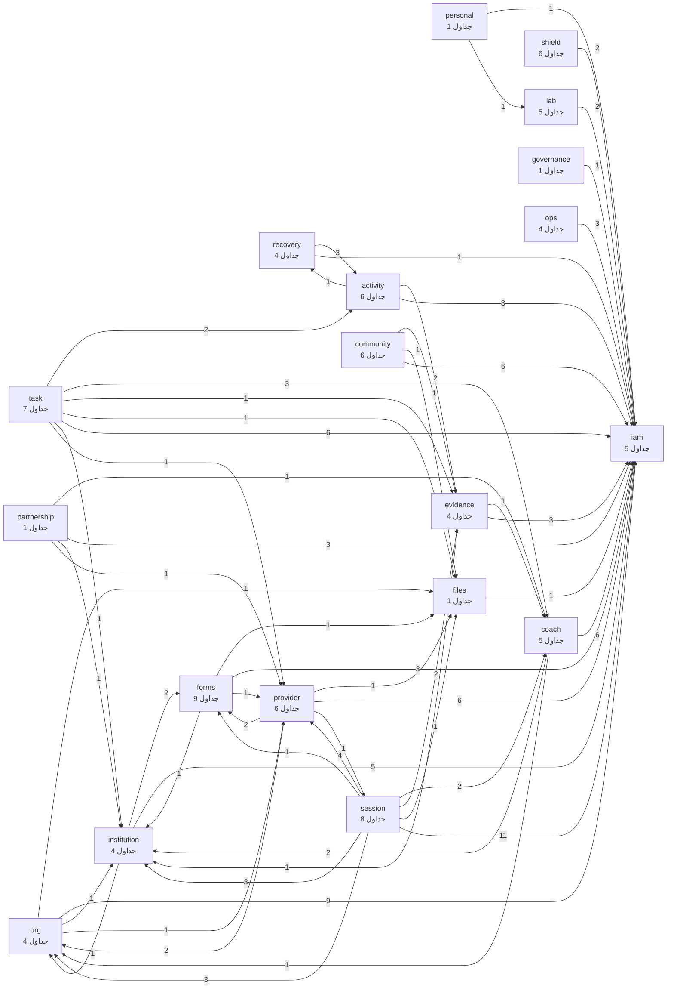

## 2. مخططات الوحدات

كل جدول في التصميم يظهر في مخطط وحدته بالضبط. الجداول الخارجية تظهر كأطراف علاقات فقط.

### 2.1 iam — الهوية والمصادقة

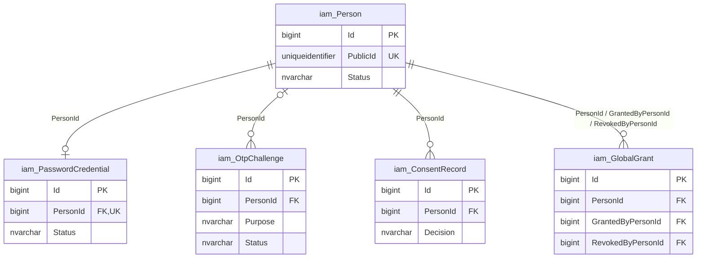

الجداول: `iam.Person`، `iam.PasswordCredential`، `iam.OtpChallenge`، `iam.ConsentRecord`، `iam.GlobalGrant`.

### 2.2 org — المنظمات والتحقق والطاقم

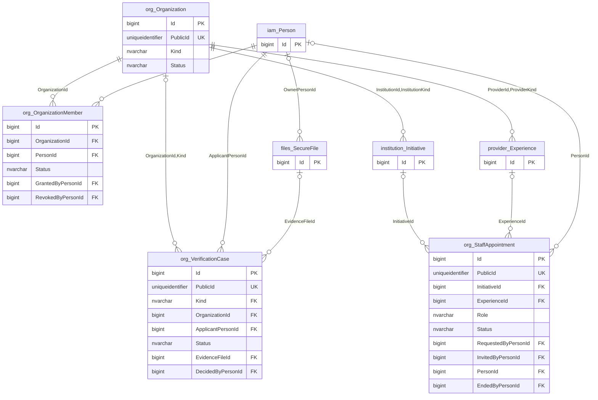

الجداول: `org.Organization`، `org.OrganizationMember`، `org.VerificationCase`، `org.StaffAppointment`. أطراف خارجية: `iam.Person`، `files.SecureFile`، `institution.Initiative`، `provider.Experience`.

### 2.3 personal — الملف الشخصي والرحلة

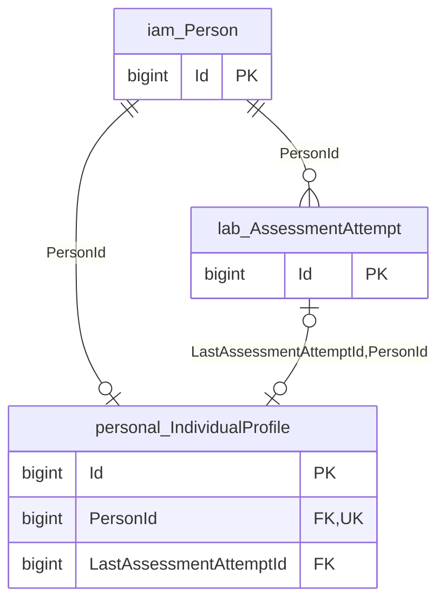

الجداول: `personal.IndividualProfile`. أطراف خارجية: `iam.Person`، `lab.AssessmentAttempt`.

### 2.4 lab — Lab: الاختبارات

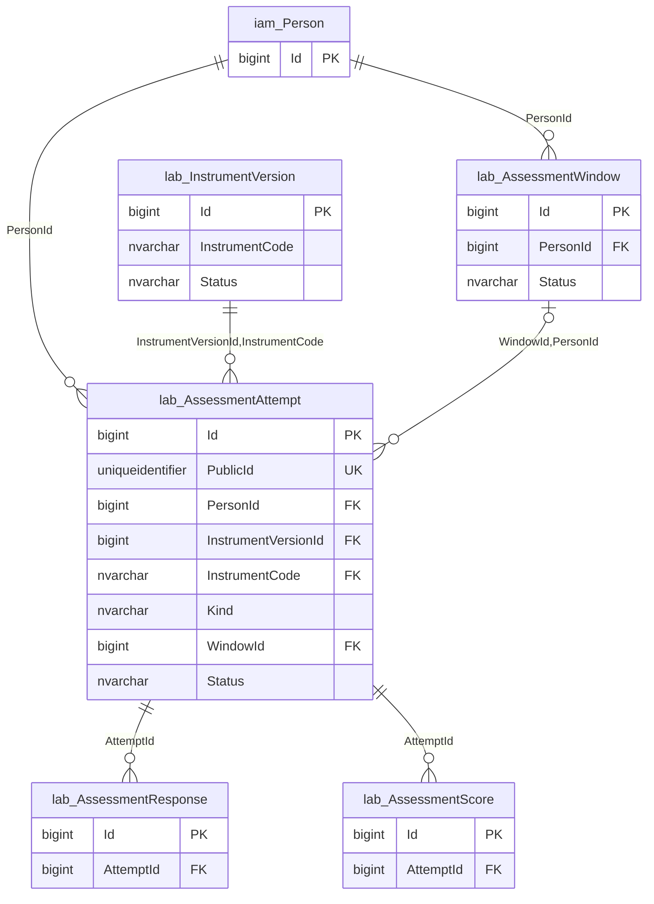

الجداول: `lab.InstrumentVersion`، `lab.AssessmentWindow`، `lab.AssessmentAttempt`، `lab.AssessmentResponse`، `lab.AssessmentScore`. أطراف خارجية: `iam.Person`.

### 2.5 recovery — Recovery Plan

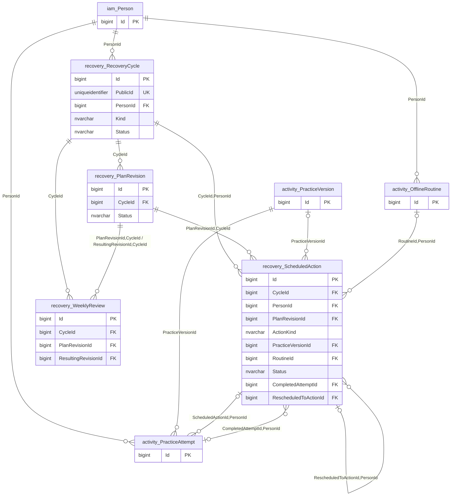

الجداول: `recovery.RecoveryCycle`، `recovery.PlanRevision`، `recovery.ScheduledAction`، `recovery.WeeklyReview`. أطراف خارجية: `iam.Person`، `activity.PracticeVersion`، `activity.OfflineRoutine`، `activity.PracticeAttempt`.

### 2.6 activity — Activities والروتين

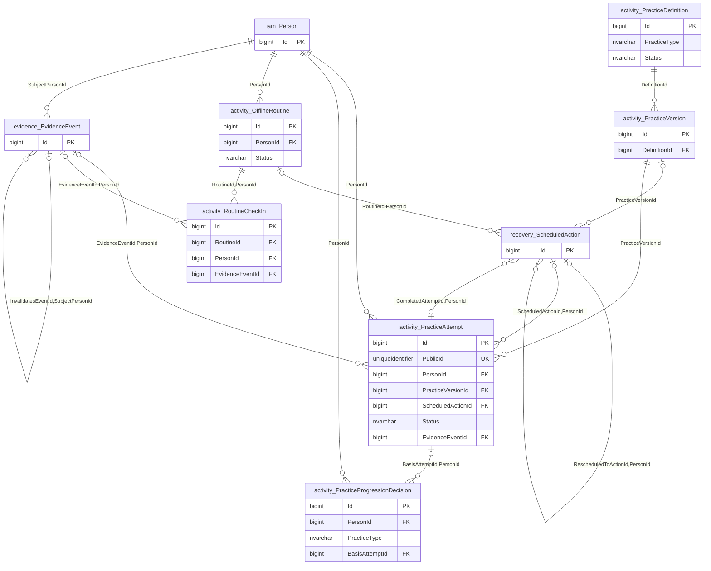

الجداول: `activity.PracticeDefinition`، `activity.PracticeVersion`، `activity.PracticeAttempt`، `activity.PracticeProgressionDecision`، `activity.OfflineRoutine`، `activity.RoutineCheckIn`. أطراف خارجية: `iam.Person`، `recovery.ScheduledAction`، `evidence.EvidenceEvent`.

### 2.7 shield — Digital Shield

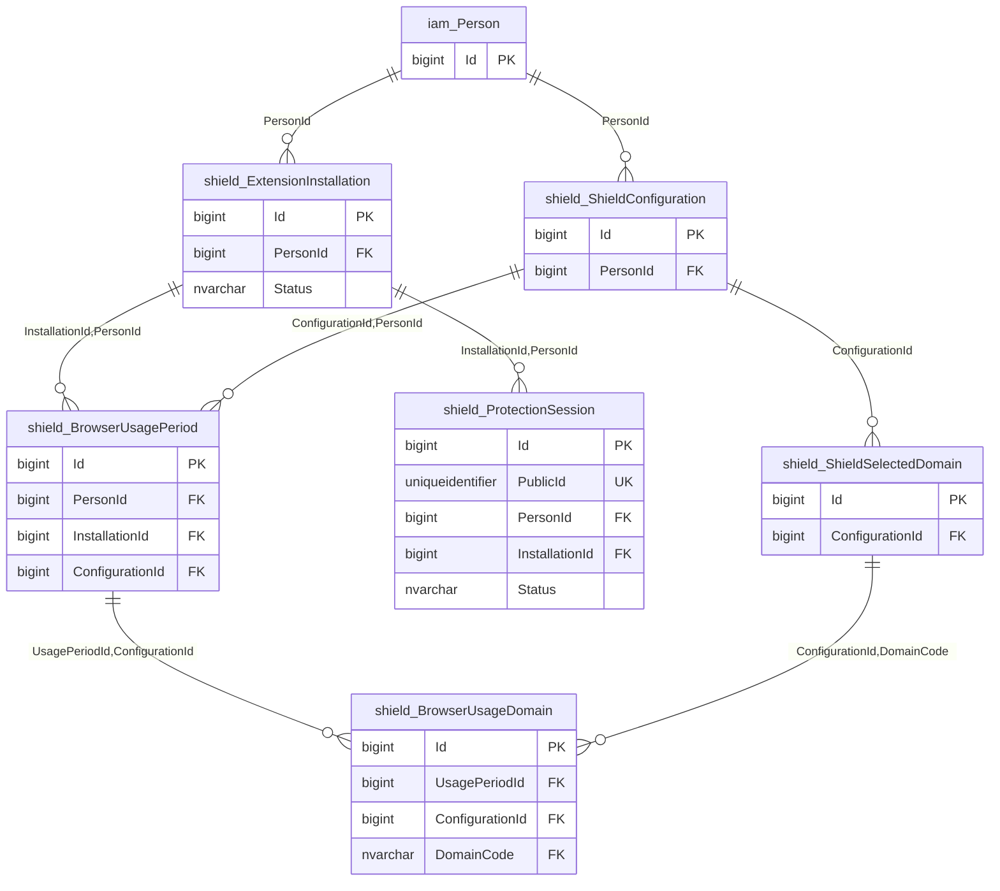

الجداول: `shield.ExtensionInstallation`، `shield.ShieldConfiguration`، `shield.ShieldSelectedDomain`، `shield.ProtectionSession`، `shield.BrowserUsagePeriod`، `shield.BrowserUsageDomain`. أطراف خارجية: `iam.Person`.

### 2.8 evidence — الأدلة والحدائق

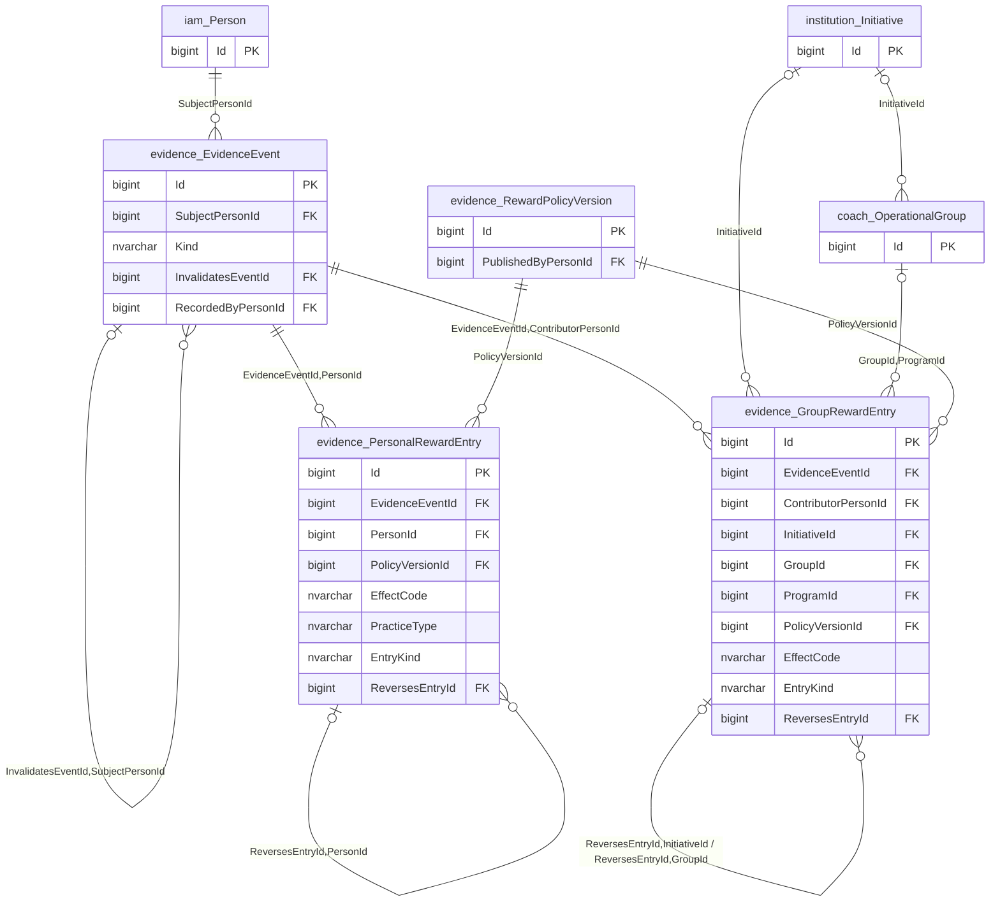

الجداول: `evidence.EvidenceEvent`، `evidence.RewardPolicyVersion`، `evidence.PersonalRewardEntry`، `evidence.GroupRewardEntry`. أطراف خارجية: `iam.Person`، `institution.Initiative`، `coach.OperationalGroup`.

### 2.9 institution — مبادرات المؤسسة

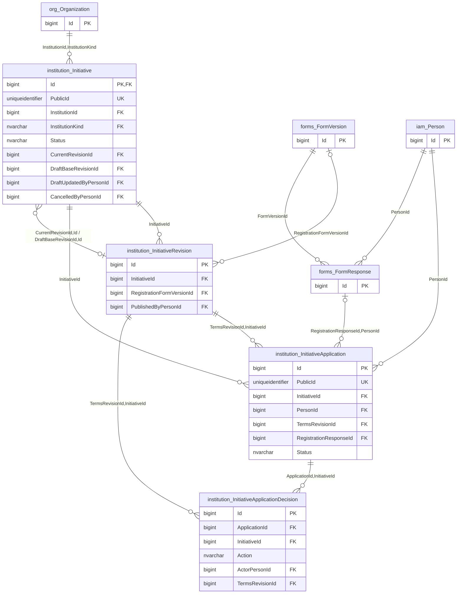

الجداول: `institution.Initiative`، `institution.InitiativeRevision`، `institution.InitiativeApplication`، `institution.InitiativeApplicationDecision`. أطراف خارجية: `org.Organization`، `forms.FormVersion`، `iam.Person`، `forms.FormResponse`.

### 2.10 coach — برامج المدربين والمجموعات

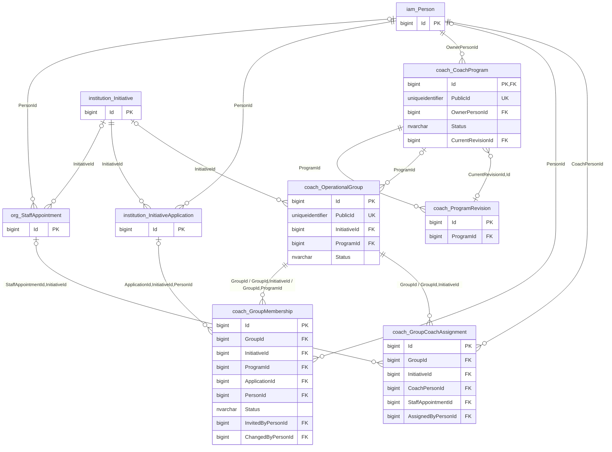

الجداول: `coach.CoachProgram`، `coach.ProgramRevision`، `coach.OperationalGroup`، `coach.GroupMembership`، `coach.GroupCoachAssignment`. أطراف خارجية: `iam.Person`، `institution.Initiative`، `institution.InitiativeApplication`، `org.StaffAppointment`.

### 2.11 task — محرك المهام والتقارير

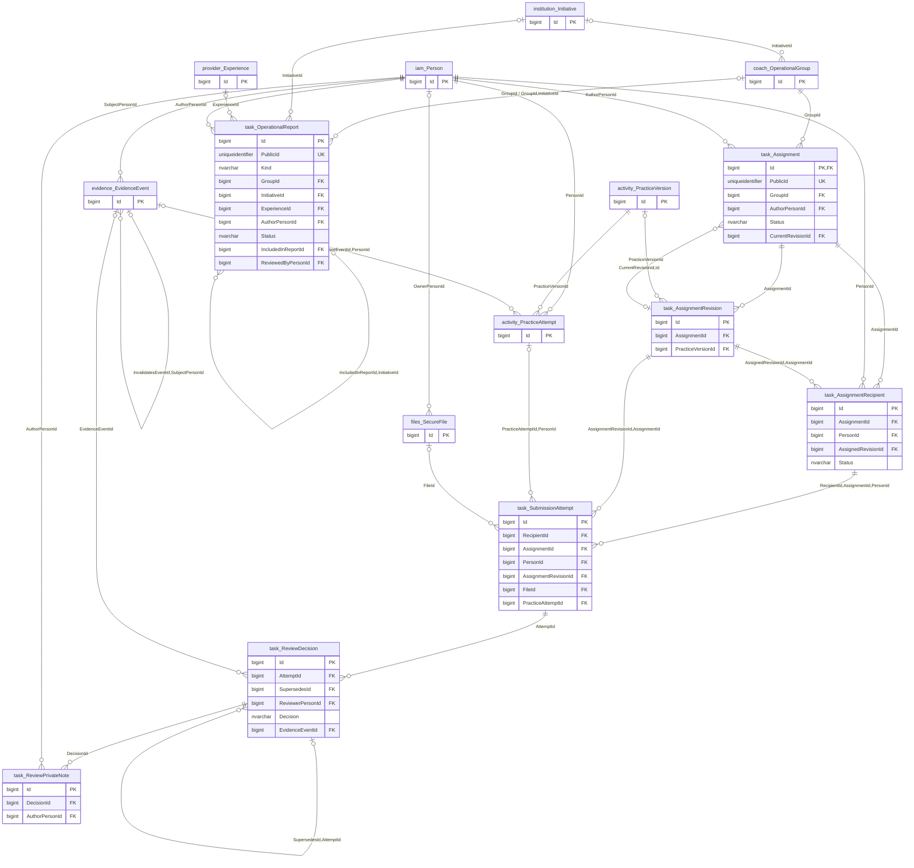

الجداول: `task.Assignment`، `task.AssignmentRevision`، `task.AssignmentRecipient`، `task.SubmissionAttempt`، `task.ReviewDecision`، `task.ReviewPrivateNote`، `task.OperationalReport`. أطراف خارجية: `coach.OperationalGroup`، `iam.Person`، `activity.PracticeVersion`، `activity.PracticeAttempt`، `files.SecureFile`، `evidence.EvidenceEvent`، `institution.Initiative`، `provider.Experience`.

### 2.12 session — الجلسات والحضور والإكمال

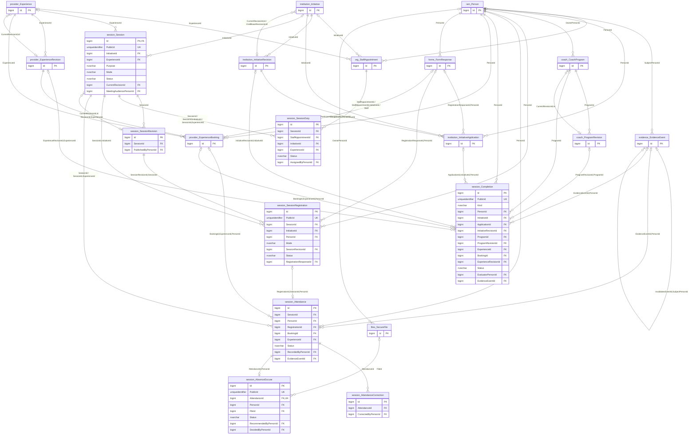

الجداول: `session.Session`، `session.SessionRevision`، `session.SessionDuty`، `session.SessionRegistration`، `session.Attendance`، `session.AttendanceCorrection`، `session.AbsenceExcuse`، `session.Completion`. أطراف خارجية: `institution.Initiative`، `provider.Experience`، `org.StaffAppointment`، `iam.Person`، `forms.FormResponse`، `provider.ExperienceBooking`، `evidence.EvidenceEvent`، `files.SecureFile`، `institution.InitiativeApplication`، `institution.InitiativeRevision`، `coach.CoachProgram`، `coach.ProgramRevision`، `provider.ExperienceRevision`.

### 2.13 provider — تجارب المزوّد

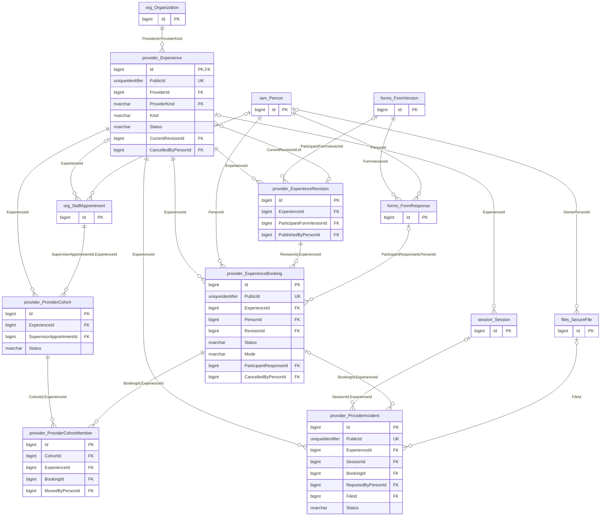

الجداول: `provider.Experience`، `provider.ExperienceRevision`، `provider.ExperienceBooking`، `provider.ProviderCohort`، `provider.ProviderCohortMember`، `provider.ProviderIncident`. أطراف خارجية: `org.Organization`، `forms.FormVersion`، `iam.Person`، `forms.FormResponse`، `org.StaffAppointment`، `session.Session`، `files.SecureFile`.

### 2.14 forms — النماذج والمسابقات

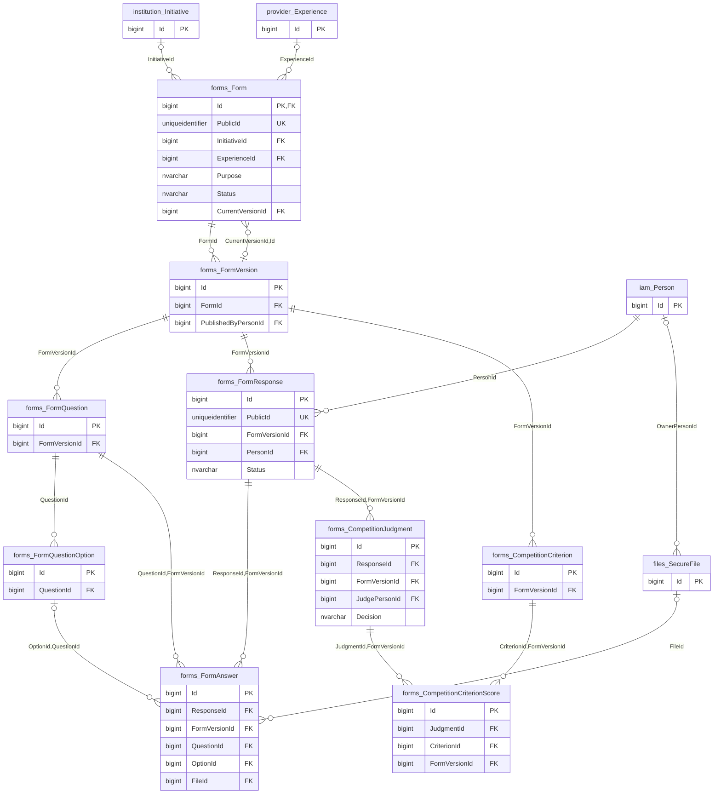

الجداول: `forms.Form`، `forms.FormVersion`، `forms.FormQuestion`، `forms.FormQuestionOption`، `forms.FormResponse`، `forms.FormAnswer`، `forms.CompetitionCriterion`، `forms.CompetitionJudgment`، `forms.CompetitionCriterionScore`. أطراف خارجية: `institution.Initiative`، `provider.Experience`، `iam.Person`، `files.SecureFile`.

### 2.15 community — المجتمع

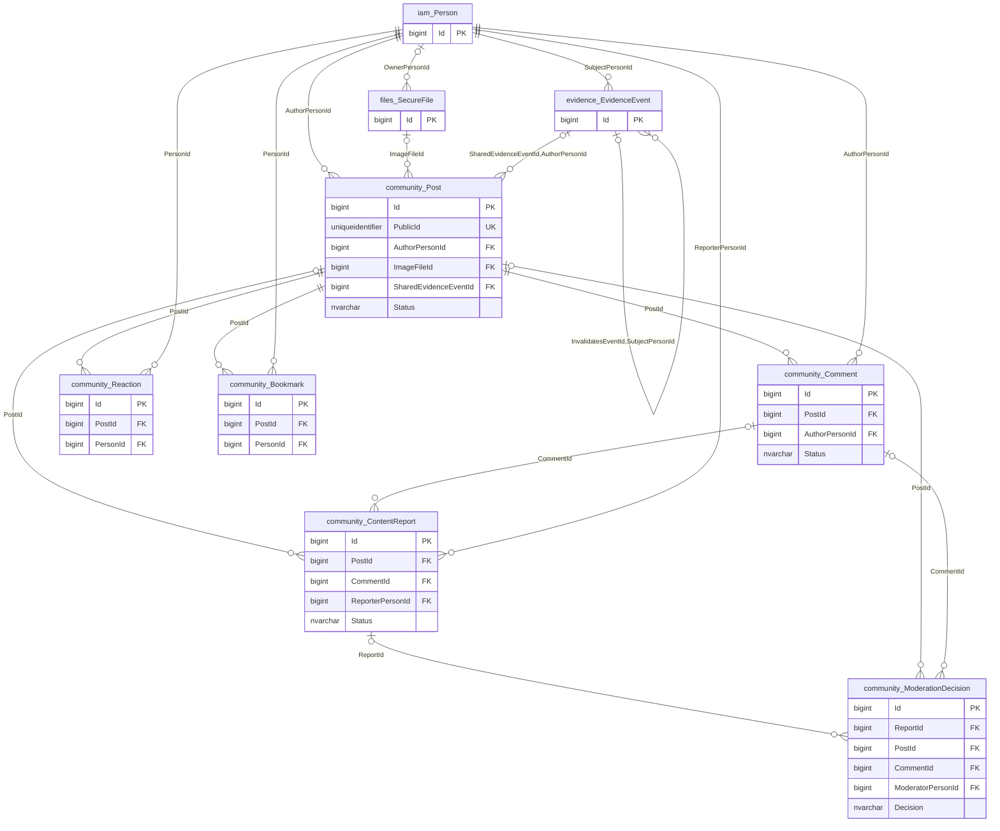

الجداول: `community.Post`، `community.Comment`، `community.Reaction`، `community.Bookmark`، `community.ContentReport`، `community.ModerationDecision`. أطراف خارجية: `iam.Person`، `files.SecureFile`، `evidence.EvidenceEvent`.

### 2.16 partnership — الشراكات

```mermaid
erDiagram
  partnership_PartnershipLink {
    bigint Id PK
    uniqueidentifier PublicId UK
    bigint InitiativeId FK
    bigint ProgramId FK
    bigint ExperienceId FK
    nvarchar Purpose
    nvarchar Status
    bigint RequestedByPersonId FK
    bigint RespondedByPersonId FK
    bigint EndedByPersonId FK
  }
  institution_Initiative {
    bigint Id PK
  }
  coach_CoachProgram {
    bigint Id PK
  }
  provider_Experience {
    bigint Id PK
  }
  institution_Initiative ||--o{ partnership_PartnershipLink : "InitiativeId"
  coach_CoachProgram |o--o{ partnership_PartnershipLink : "ProgramId"
  provider_Experience |o--o{ partnership_PartnershipLink : "ExperienceId"
```

الجداول: `partnership.PartnershipLink`. أطراف خارجية: `institution.Initiative`، `coach.CoachProgram`، `provider.Experience`.

### 2.17 governance — المحتوى المحكوم (CMS)

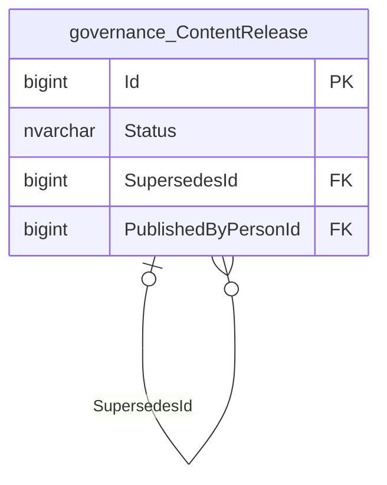

الجداول: `governance.ContentRelease`.

### 2.18 ops — التشغيل: تدقيق، إشعارات، Outbox، Idempotency

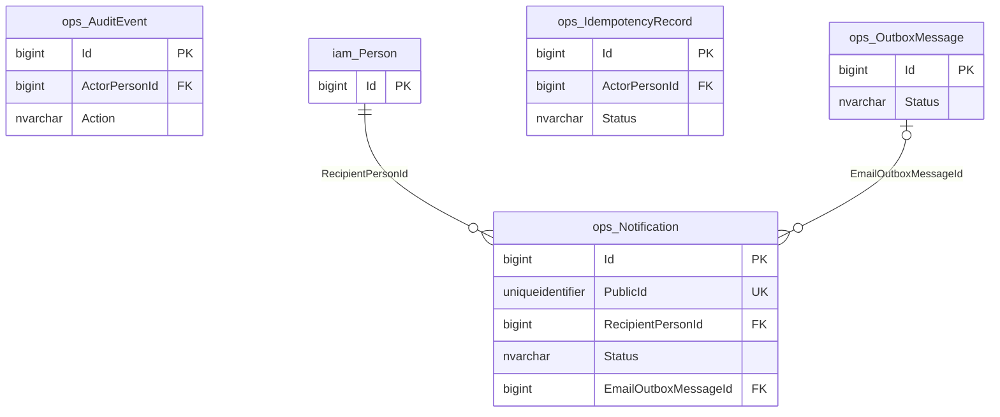

الجداول: `ops.AuditEvent`، `ops.Notification`، `ops.OutboxMessage`، `ops.IdempotencyRecord`. أطراف خارجية: `iam.Person`.

### 2.19 files — الملفات الآمنة

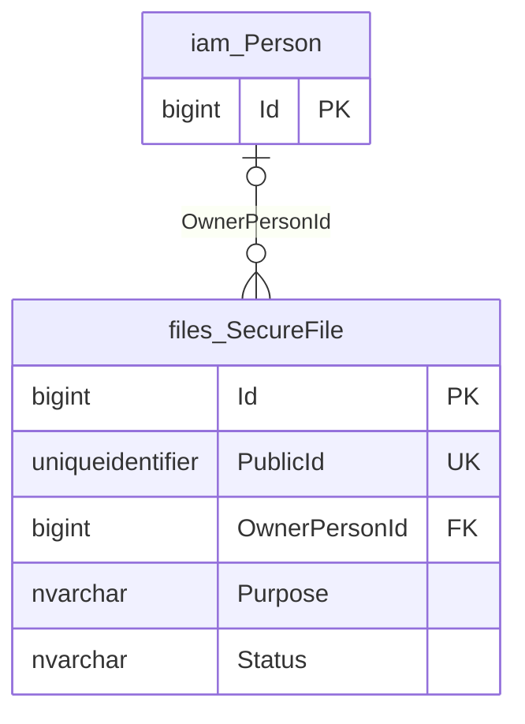

الجداول: `files.SecureFile`. أطراف خارجية: `iam.Person`.

## 3. خرائط عابرة للوحدات

### 3.1 الهوية والتفويض: من يملك صلاحية على ماذا

كل صلاحية مورد هي صف بحالة وفترة يربط Person بمورد محدد؛ لا يوجد دور عام يمنح قراءة بيانات خاصة. مساحات العمل في الـWorkspace Switcher تُشتق من هذه الصفوف النشطة فقط.

```mermaid
erDiagram
  iam_Person {
    bigint Id PK
  }
  iam_GlobalGrant {
    bigint Id PK
  }
  org_Organization {
    bigint Id PK
  }
  org_OrganizationMember {
    bigint Id PK
  }
  org_VerificationCase {
    bigint Id PK
  }
  org_StaffAppointment {
    bigint Id PK
  }
  institution_Initiative {
    bigint Id PK
  }
  provider_Experience {
    bigint Id PK
  }
  coach_CoachProgram {
    bigint Id PK
  }
  coach_OperationalGroup {
    bigint Id PK
  }
  coach_GroupMembership {
    bigint Id PK
  }
  coach_GroupCoachAssignment {
    bigint Id PK
  }
  session_Session {
    bigint Id PK
  }
  session_SessionDuty {
    bigint Id PK
  }
  provider_ProviderCohort {
    bigint Id PK
  }
  iam_Person ||--o{ iam_GlobalGrant : "PersonId / GrantedByPersonId / RevokedByPersonId"
  org_Organization ||--o{ org_OrganizationMember : "OrganizationId"
  iam_Person ||--o{ org_OrganizationMember : "PersonId / GrantedByPersonId / RevokedByPersonId"
  org_Organization |o--o{ org_VerificationCase : "OrganizationId,Kind"
  iam_Person ||--o{ org_VerificationCase : "ApplicantPersonId / DecidedByPersonId"
  institution_Initiative |o--o{ org_StaffAppointment : "InitiativeId"
  provider_Experience |o--o{ org_StaffAppointment : "ExperienceId"
  iam_Person |o--o{ org_StaffAppointment : "PersonId / RequestedByPersonId / InvitedByPersonId / EndedBy"
  org_Organization ||--o{ institution_Initiative : "InstitutionId,InstitutionKind"
  iam_Person |o--o{ institution_Initiative : "DraftUpdatedByPersonId / CancelledByPersonId"
  iam_Person ||--o{ coach_CoachProgram : "OwnerPersonId"
  institution_Initiative |o--o{ coach_OperationalGroup : "InitiativeId"
  coach_CoachProgram |o--o{ coach_OperationalGroup : "ProgramId"
  coach_OperationalGroup ||--o{ coach_GroupMembership : "GroupId / GroupId,InitiativeId / GroupId,ProgramId"
  iam_Person |o--o{ coach_GroupMembership : "PersonId / InvitedByPersonId / ChangedByPersonId"
  coach_OperationalGroup ||--o{ coach_GroupCoachAssignment : "GroupId / GroupId,InitiativeId"
  org_StaffAppointment |o--o{ coach_GroupCoachAssignment : "StaffAppointmentId,InitiativeId"
  iam_Person ||--o{ coach_GroupCoachAssignment : "CoachPersonId / AssignedByPersonId"
  institution_Initiative |o--o{ session_Session : "InitiativeId"
  provider_Experience |o--o{ session_Session : "ExperienceId"
  iam_Person |o--o{ session_Session : "MeetingAudiencePersonId"
  session_Session ||--o{ session_SessionDuty : "SessionId / SessionId,InitiativeId / SessionId,ExperienceId"
  org_StaffAppointment ||--o{ session_SessionDuty : "StaffAppointmentId / StaffAppointmentId,InitiativeId / Staff"
  iam_Person ||--o{ session_SessionDuty : "AssignedByPersonId"
  org_Organization ||--o{ provider_Experience : "ProviderId,ProviderKind"
  iam_Person |o--o{ provider_Experience : "CancelledByPersonId"
  provider_Experience ||--o{ provider_ProviderCohort : "ExperienceId"
  org_StaffAppointment ||--o{ provider_ProviderCohort : "SupervisorAppointmentId,ExperienceId"
```

### 3.2 العضوية والمشاركة عبر المالكين

المبادرة: طلب واحد يحمل الطابور والعرض والعضوية؛ التسكين في المجموعة يشير إليه. البرنامج: عضوية المجموعة بالدعوة. المزوّد: الحجز يحمل الطابور والعرض. الجلسة: تسجيل المبادرة أو حجز المزوّد مصدر الحضور (XOR). الإكمال يشير إلى أحد الثلاثة.

```mermaid
erDiagram
  iam_Person {
    bigint Id PK
  }
  institution_Initiative {
    bigint Id PK
  }
  institution_InitiativeApplication {
    bigint Id PK
  }
  institution_InitiativeApplicationDecision {
    bigint Id PK
  }
  coach_OperationalGroup {
    bigint Id PK
  }
  coach_GroupMembership {
    bigint Id PK
  }
  coach_CoachProgram {
    bigint Id PK
  }
  provider_Experience {
    bigint Id PK
  }
  provider_ExperienceBooking {
    bigint Id PK
  }
  provider_ProviderCohortMember {
    bigint Id PK
  }
  session_Session {
    bigint Id PK
  }
  session_SessionRegistration {
    bigint Id PK
  }
  session_Attendance {
    bigint Id PK
  }
  session_AbsenceExcuse {
    bigint Id PK
  }
  session_Completion {
    bigint Id PK
  }
  institution_Initiative ||--o{ institution_InitiativeApplication : "InitiativeId"
  iam_Person ||--o{ institution_InitiativeApplication : "PersonId"
  institution_InitiativeApplication ||--o{ institution_InitiativeApplicationDecision : "ApplicationId,InitiativeId"
  iam_Person ||--o{ coach_CoachProgram : "OwnerPersonId"
  institution_Initiative |o--o{ coach_OperationalGroup : "InitiativeId"
  coach_CoachProgram |o--o{ coach_OperationalGroup : "ProgramId"
  coach_OperationalGroup ||--o{ coach_GroupMembership : "GroupId / GroupId,InitiativeId / GroupId,ProgramId"
  institution_InitiativeApplication |o--o{ coach_GroupMembership : "ApplicationId,InitiativeId,PersonId"
  iam_Person |o--o{ coach_GroupMembership : "PersonId"
  institution_Initiative |o--o{ session_Session : "InitiativeId"
  provider_Experience |o--o{ session_Session : "ExperienceId"
  session_Session ||--o{ session_SessionRegistration : "SessionId,InitiativeId"
  iam_Person ||--o{ session_SessionRegistration : "PersonId"
  session_Session ||--o{ session_Attendance : "SessionId / SessionId,ExperienceId"
  iam_Person ||--o{ session_Attendance : "PersonId"
  session_SessionRegistration |o--o| session_Attendance : "RegistrationId,SessionId,PersonId"
  provider_ExperienceBooking |o--o{ session_Attendance : "BookingId,ExperienceId,PersonId"
  session_Attendance ||--o| session_AbsenceExcuse : "AttendanceId,PersonId"
  iam_Person ||--o{ session_Completion : "PersonId"
  institution_InitiativeApplication |o--o{ session_Completion : "ApplicationId,InitiativeId,PersonId"
  coach_CoachProgram |o--o{ session_Completion : "ProgramId"
  provider_ExperienceBooking |o--o{ session_Completion : "BookingId,ExperienceId,PersonId"
  provider_Experience ||--o{ provider_ExperienceBooking : "ExperienceId"
  iam_Person ||--o{ provider_ExperienceBooking : "PersonId"
  provider_ExperienceBooking ||--o{ provider_ProviderCohortMember : "BookingId,ExperienceId"
```

### 3.3 الأدلة والمكافآت: من المصدر إلى الحديقة

خمسة مصادر فقط تنتج EvidenceEvent بمفتاح مصدر فريد؛ دفترا المكافأة يستهلكان الحدث مرة واحدة لكل أثر، والعكس يشير إلى المنح. التسجيل والعذر المقبول والنقر والمنشورات لا تنتج دليلًا (المنشور يشير إلى دليل موجود فقط للمشاركة).

```mermaid
erDiagram
  iam_Person {
    bigint Id PK
  }
  evidence_EvidenceEvent {
    bigint Id PK
  }
  activity_PracticeAttempt {
    bigint Id PK
  }
  activity_RoutineCheckIn {
    bigint Id PK
  }
  task_ReviewDecision {
    bigint Id PK
  }
  session_Attendance {
    bigint Id PK
  }
  session_Completion {
    bigint Id PK
  }
  community_Post {
    bigint Id PK
  }
  evidence_RewardPolicyVersion {
    bigint Id PK
  }
  evidence_PersonalRewardEntry {
    bigint Id PK
  }
  evidence_GroupRewardEntry {
    bigint Id PK
  }
  institution_Initiative {
    bigint Id PK
  }
  coach_OperationalGroup {
    bigint Id PK
  }
  iam_Person ||--o{ activity_PracticeAttempt : "PersonId"
  evidence_EvidenceEvent |o--o{ activity_PracticeAttempt : "EvidenceEventId,PersonId"
  evidence_EvidenceEvent |o--o{ activity_RoutineCheckIn : "EvidenceEventId,PersonId"
  iam_Person ||--o{ evidence_EvidenceEvent : "SubjectPersonId"
  evidence_EvidenceEvent |o--o{ evidence_EvidenceEvent : "InvalidatesEventId,SubjectPersonId"
  evidence_EvidenceEvent ||--o{ evidence_PersonalRewardEntry : "EvidenceEventId,PersonId"
  evidence_RewardPolicyVersion ||--o{ evidence_PersonalRewardEntry : "PolicyVersionId"
  evidence_PersonalRewardEntry |o--o{ evidence_PersonalRewardEntry : "ReversesEntryId,PersonId"
  evidence_EvidenceEvent ||--o{ evidence_GroupRewardEntry : "EvidenceEventId,ContributorPersonId"
  institution_Initiative |o--o{ evidence_GroupRewardEntry : "InitiativeId"
  coach_OperationalGroup |o--o{ evidence_GroupRewardEntry : "GroupId,ProgramId"
  evidence_RewardPolicyVersion ||--o{ evidence_GroupRewardEntry : "PolicyVersionId"
  evidence_GroupRewardEntry |o--o{ evidence_GroupRewardEntry : "ReversesEntryId,InitiativeId / ReversesEntryId,GroupId"
  institution_Initiative |o--o{ coach_OperationalGroup : "InitiativeId"
  task_ReviewDecision |o--o{ task_ReviewDecision : "SupersedesId,AttemptId"
  evidence_EvidenceEvent |o--o{ task_ReviewDecision : "EvidenceEventId"
  iam_Person ||--o{ session_Attendance : "PersonId"
  evidence_EvidenceEvent |o--o{ session_Attendance : "EvidenceEventId,PersonId"
  iam_Person ||--o{ session_Completion : "PersonId"
  evidence_EvidenceEvent |o--o{ session_Completion : "EvidenceEventId,PersonId"
  iam_Person ||--o{ community_Post : "AuthorPersonId"
  evidence_EvidenceEvent |o--o{ community_Post : "SharedEvidenceEventId,AuthorPersonId"
```

### 3.4 النسخ الثابتة ومن يثبّت عليها

كل مورد منشور له جذر قابل للتغيير ونسخ إلحاقية؛ كل فعل مشارك يثبَّت على النسخة التي تم بموجبها، فلا يُعاد كتابة شرط قُبل عليه أحد.

```mermaid
erDiagram
  institution_Initiative {
    bigint Id PK
  }
  institution_InitiativeRevision {
    bigint Id PK
  }
  institution_InitiativeApplication {
    bigint Id PK
  }
  coach_CoachProgram {
    bigint Id PK
  }
  coach_ProgramRevision {
    bigint Id PK
  }
  provider_Experience {
    bigint Id PK
  }
  provider_ExperienceRevision {
    bigint Id PK
  }
  provider_ExperienceBooking {
    bigint Id PK
  }
  session_Session {
    bigint Id PK
  }
  session_SessionRevision {
    bigint Id PK
  }
  session_SessionRegistration {
    bigint Id PK
  }
  session_Completion {
    bigint Id PK
  }
  forms_Form {
    bigint Id PK
  }
  forms_FormVersion {
    bigint Id PK
  }
  forms_FormResponse {
    bigint Id PK
  }
  task_Assignment {
    bigint Id PK
  }
  task_AssignmentRevision {
    bigint Id PK
  }
  task_SubmissionAttempt {
    bigint Id PK
  }
  activity_PracticeDefinition {
    bigint Id PK
  }
  activity_PracticeVersion {
    bigint Id PK
  }
  activity_PracticeAttempt {
    bigint Id PK
  }
  lab_InstrumentVersion {
    bigint Id PK
  }
  lab_AssessmentAttempt {
    bigint Id PK
  }
  lab_InstrumentVersion ||--o{ lab_AssessmentAttempt : "InstrumentVersionId,InstrumentCode"
  activity_PracticeDefinition ||--o{ activity_PracticeVersion : "DefinitionId"
  activity_PracticeVersion ||--o{ activity_PracticeAttempt : "PracticeVersionId"
  institution_InitiativeRevision |o--o{ institution_Initiative : "CurrentRevisionId,Id / DraftBaseRevisionId,Id"
  institution_Initiative ||--o{ institution_InitiativeRevision : "InitiativeId"
  forms_FormVersion |o--o{ institution_InitiativeRevision : "RegistrationFormVersionId"
  institution_Initiative ||--o{ institution_InitiativeApplication : "InitiativeId"
  institution_InitiativeRevision ||--o{ institution_InitiativeApplication : "TermsRevisionId,InitiativeId"
  forms_FormResponse |o--o{ institution_InitiativeApplication : "RegistrationResponseId,PersonId"
  coach_ProgramRevision |o--o{ coach_CoachProgram : "CurrentRevisionId,Id"
  coach_CoachProgram ||--o{ coach_ProgramRevision : "ProgramId"
  task_AssignmentRevision |o--o{ task_Assignment : "CurrentRevisionId,Id"
  task_Assignment ||--o{ task_AssignmentRevision : "AssignmentId"
  activity_PracticeVersion |o--o{ task_AssignmentRevision : "PracticeVersionId"
  task_AssignmentRevision ||--o{ task_SubmissionAttempt : "AssignmentRevisionId,AssignmentId"
  activity_PracticeAttempt |o--o{ task_SubmissionAttempt : "PracticeAttemptId,PersonId"
  institution_Initiative |o--o{ session_Session : "InitiativeId"
  provider_Experience |o--o{ session_Session : "ExperienceId"
  session_SessionRevision |o--o{ session_Session : "CurrentRevisionId,Id"
  session_Session ||--o{ session_SessionRevision : "SessionId"
  session_Session ||--o{ session_SessionRegistration : "SessionId,InitiativeId"
  session_SessionRevision ||--o{ session_SessionRegistration : "SessionRevisionId,SessionId"
  forms_FormResponse |o--o{ session_SessionRegistration : "RegistrationResponseId,PersonId"
  institution_InitiativeApplication |o--o{ session_Completion : "ApplicationId,InitiativeId,PersonId"
  institution_InitiativeRevision |o--o{ session_Completion : "InitiativeRevisionId,InitiativeId"
  coach_CoachProgram |o--o{ session_Completion : "ProgramId"
  coach_ProgramRevision |o--o{ session_Completion : "ProgramRevisionId,ProgramId"
  provider_ExperienceBooking |o--o{ session_Completion : "BookingId,ExperienceId,PersonId"
  provider_ExperienceRevision |o--o{ session_Completion : "ExperienceRevisionId,ExperienceId"
  provider_ExperienceRevision |o--o{ provider_Experience : "CurrentRevisionId,Id"
  provider_Experience ||--o{ provider_ExperienceRevision : "ExperienceId"
  forms_FormVersion |o--o{ provider_ExperienceRevision : "ParticipantFormVersionId"
  provider_Experience ||--o{ provider_ExperienceBooking : "ExperienceId"
  provider_ExperienceRevision ||--o{ provider_ExperienceBooking : "RevisionId,ExperienceId"
  forms_FormResponse |o--o{ provider_ExperienceBooking : "ParticipantResponseId,PersonId"
  institution_Initiative |o--o{ forms_Form : "InitiativeId"
  provider_Experience |o--o{ forms_Form : "ExperienceId"
  forms_FormVersion |o--o{ forms_Form : "CurrentVersionId,Id"
  forms_Form ||--o{ forms_FormVersion : "FormId"
  forms_FormVersion ||--o{ forms_FormResponse : "FormVersionId"
```

### 3.5 كل الإشارات إلى الهوية الموحدة `iam.Person`

| الوحدة | الأعمدة |
|---|---|
| iam | `PasswordCredential.PersonId`، `OtpChallenge.PersonId`، `ConsentRecord.PersonId`، `GlobalGrant.PersonId`، `GlobalGrant.GrantedByPersonId`، `GlobalGrant.RevokedByPersonId` |
| org | `OrganizationMember.PersonId`، `OrganizationMember.GrantedByPersonId`، `OrganizationMember.RevokedByPersonId`، `VerificationCase.ApplicantPersonId`، `VerificationCase.DecidedByPersonId`، `StaffAppointment.PersonId`، `StaffAppointment.RequestedByPersonId`، `StaffAppointment.InvitedByPersonId`، `StaffAppointment.EndedByPersonId` |
| personal | `IndividualProfile.PersonId` |
| lab | `AssessmentWindow.PersonId`، `AssessmentAttempt.PersonId` |
| recovery | `RecoveryCycle.PersonId` |
| activity | `PracticeAttempt.PersonId`، `PracticeProgressionDecision.PersonId`، `OfflineRoutine.PersonId` |
| shield | `ExtensionInstallation.PersonId`، `ShieldConfiguration.PersonId` |
| evidence | `EvidenceEvent.SubjectPersonId`، `EvidenceEvent.RecordedByPersonId`، `RewardPolicyVersion.PublishedByPersonId` |
| institution | `Initiative.DraftUpdatedByPersonId`، `Initiative.CancelledByPersonId`، `InitiativeRevision.PublishedByPersonId`، `InitiativeApplication.PersonId`، `InitiativeApplicationDecision.ActorPersonId` |
| coach | `CoachProgram.OwnerPersonId`، `GroupMembership.PersonId`، `GroupMembership.InvitedByPersonId`، `GroupMembership.ChangedByPersonId`، `GroupCoachAssignment.CoachPersonId`، `GroupCoachAssignment.AssignedByPersonId` |
| task | `Assignment.AuthorPersonId`، `AssignmentRecipient.PersonId`، `ReviewDecision.ReviewerPersonId`، `ReviewPrivateNote.AuthorPersonId`، `OperationalReport.AuthorPersonId`، `OperationalReport.ReviewedByPersonId` |
| session | `Session.MeetingAudiencePersonId`، `SessionRevision.PublishedByPersonId`، `SessionDuty.AssignedByPersonId`، `SessionRegistration.PersonId`، `Attendance.PersonId`، `Attendance.RecordedByPersonId`، `AttendanceCorrection.CorrectedByPersonId`، `AbsenceExcuse.RecommendedByPersonId`، `AbsenceExcuse.DecidedByPersonId`، `Completion.PersonId`، `Completion.EvaluatorPersonId` |
| provider | `Experience.CancelledByPersonId`، `ExperienceRevision.PublishedByPersonId`، `ExperienceBooking.PersonId`، `ExperienceBooking.CancelledByPersonId`، `ProviderCohortMember.MovedByPersonId`، `ProviderIncident.ReportedByPersonId` |
| forms | `FormVersion.PublishedByPersonId`، `FormResponse.PersonId`، `CompetitionJudgment.JudgePersonId` |
| community | `Post.AuthorPersonId`، `Comment.AuthorPersonId`، `Reaction.PersonId`، `Bookmark.PersonId`، `ContentReport.ReporterPersonId`، `ModerationDecision.ModeratorPersonId` |
| partnership | `PartnershipLink.RequestedByPersonId`، `PartnershipLink.RespondedByPersonId`، `PartnershipLink.EndedByPersonId` |
| governance | `ContentRelease.PublishedByPersonId` |
| ops | `AuditEvent.ActorPersonId`، `Notification.RecipientPersonId`، `IdempotencyRecord.ActorPersonId` |
| files | `SecureFile.OwnerPersonId` |
