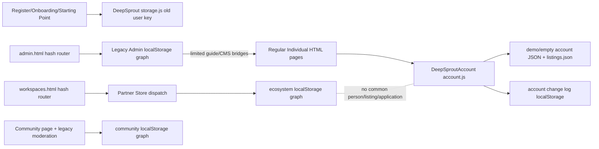
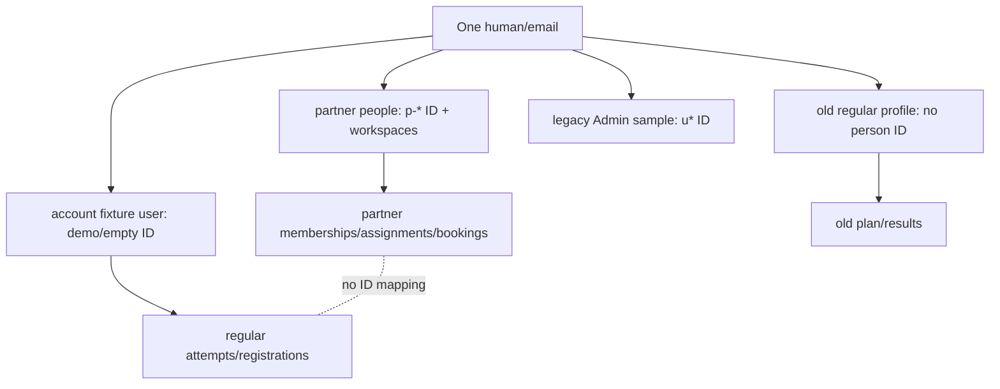
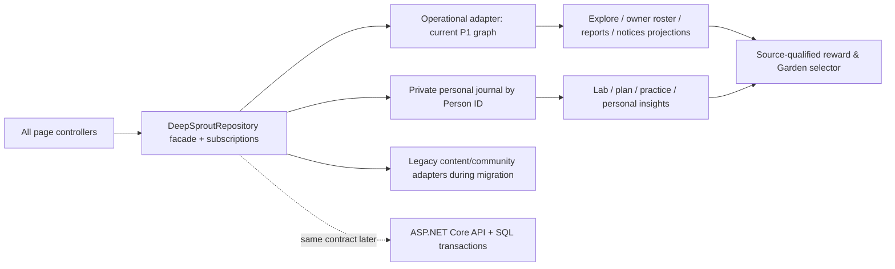

# DeepSprout Phase 0 technical readiness audit

**Audited working tree:** 15 October 2026. **Target authority:** [`DeepSprout.md` v4.0](../../DeepSprout.md), especially §§22–26, 29–30. **Execution boundary:** application code, existing documentation and tests were read only; this report is the sole created artifact. The working tree already contained extensive uncommitted application and documentation work (77 `git status --porcelain` entries before this report). Findings describe files on disk, not a clean commit. No chronology between those edits and the same-day cycle audits can be proven from Git.

**Evidence labels.** **FRESH TEST** = executed during Phase 0; **FRESH SOURCE** = inspected current file/line; **PRIOR RUNTIME** = dated [`docs/cycles/README.md`](../cycles/README.md) browser result; **PRIOR SOURCE** = detailed dated cycle audit reused; **NOT TESTED** = no runtime claim. `PASS — LOCAL STORE ONLY` never means the regular Individual flow passes. Source line references are working-tree lines; several partner renderers compress a whole route into one physical line.

## 1. Executive summary and documentation baseline

The documentation consolidation is present **on disk**: `DeepSprout.md:5,28,1387-1435` says v4.0 and contains §29 current-state analysis and §30 handoff; `docs/product-specification.md:1-5` is a pointer; root, Client, Client/docs, docs and Server READMEs link to the master. The dated `docs/cycles/` reports are present and identify themselves as evidence, not policy. The relevant tracked documentation diff passes `git diff --check`. **Discrepancy:** `DeepSprout.md` and `docs/cycles/` are still untracked, and many README/docs files are modified, so consolidation is not committed or reflected in a clean tree. No documentation was changed in this audit. A second discrepancy in master §29 is substantive: its reference to an “added bridge” does not establish the first-run result handoff. Current `assessment.js:447-467` writes **only** `DeepSproutAccount`, and `starting-point.js:9,22-26` reads only the older `DeepSprout` store. The master itself cautioned that first run needed retesting; the present source proves a broken handoff (see §8).

The central architectural fact is five independent workflow-bearing local record graphs: partner ecosystem, seed-plus-event Individual account, older Individual first-run state, legacy Admin, and Community. Four independent person/identity representations occur inside those graphs (partner `people`, account seed `user`, older `profile`, legacy Admin sample `users`); one human is not one record. Ancillary preference/session keys add more storage paths. Partner commands are substantial and reusable, but publication, participation, staff scope, tasks, reporting and rewards do not propagate to the **regular** Individual experience. The static phase can become coherent through a shared browser repository with one person and resource ID contract; secure cross-device guarantees require the later server.

## 2. Verified repository architecture

**FRESH SOURCE:** `Client/` is static HTML/CSS/JavaScript served by `Client/serve.py:1-45` (`python3 Client/serve.py --port 8765`). `Server/` contains a README, no service project. There is no package manifest, Angular workspace, ASP.NET project, SQL database, IndexedDB, extension manifest or browser extension storage path in the inspected tree. `index.html`, `register.html`, `login.html`, `onboarding.html`, `explore.html`, `training.html`, `lab.html`, `recovery-plan.html`, `garden.html`, `insights.html`, `profile.html`, `community.html`, and `weekly-review.html` are regular member/public entries or wrappers to `src/pages/`. `partners.html`/`join.html` lead to `workspaces.html`; `admin.html` hosts legacy Admin.



`Client/src/workspaces/app.js:8-48` dynamically imports role page modules, parses hash routes and gates visible workspaces through `store.js:18-36`; `navigation.js:1-10` declares seven role sidebars. `store.js:11-43` seeds, clones, dispatches guarded commands and persists one ecosystem graph. `Client/src/admin/app.js:11-31` separately routes legacy Admin by hash; `reports` aliases to `subscriptions` at line 25. Member pages load `account.js` as a browser global and use direct HTML links; `member-layout.js:202-207` can inject it. No frontend build command or package installation is required to serve the demo. Local tests use Node's test runner, optional jsdom/Playwright, and Python for the 404 server (`Client/README.md:25-35,68`). GSAP is vendored for visual animation, not a domain service.

Authentication is simulated: regular register stores name/email in old local state but discards password (`register.js:30-45`); regular login discards credentials and resumes that device (`login.js:35-43`). Partner `auth.account` reuses email within partner `people`, `auth.otp/auth.verify/auth.join` use fixed demo code `246810`, and session is `s.session.personId` in the editable ecosystem key (`store.js:24-34`). Legacy Admin uses a separate local/session demo flag (`admin/store.js:81-83`, `login.js:5-9`). None gives server authorization.

## 3. Complete storage inventory

Counts are deliberate: **five primary logical workflow graphs** (P1–P5 below), **15 additional browser key families**, and **three JSON fixture families** (`demo-account.json`, `empty-account.json`, `listings.json`). The account event key is one **family** with `:demo` and `:empty` instances. Thus there are **20 browser key families**, potentially more physical entries if choices expand. The Admin session key can reside in either local or session storage. The partner graph itself contains many record collections; it is one persistence key, not one record type. `storage.js:100-109` can erase **all** local keys prefixed `deepsprout-`, a high migration/reset risk.

| ID / exact mechanism | Defined / initialized; material writers → readers | Records, identity, persistence/scope; problem and migration risk |
|---|---|---|
| P1 `localStorage.deepsprout-ecosystem-demo-v1` | `workspaces/store.js:11-16`, seeded from `data/{mentorship,institution,outdoor,platform}.js:1-13`; `dispatch`/four `commands/*.js:2-42` → seven `pages/*.js`, `shared.js` reports | Schema-1 graph: `people`, `session`, applications, organizations/providers, groups/invites, programs/assignments/submissions, initiatives/enrollments/sessions, experiences/bookings/offers, attendance, rewards, notices, audit, drafts. Person ID `p-*` or generated. Reload/browser restart yes on same origin; memory fallback. Partner only. **High:** most reusable operations live here, but no regular member reader and v1 schema gate (`store.js:16`) can silently fall to seed for unknown schema. |
| P2 `localStorage.deepsprout-account-changes-v1:<choice>` | `js/data/account.js:105-117,125-195,895-910`; member `assessment.js`, `onboarding.js`, Explore, Activities, routine, weekly review, Profile → `DeepSproutAccount` consumers Home/Lab/Recovery/Explore/Garden/Insights/Profile | Event overlay on JSON account seed, keyed by `demo`/`empty`, not person; attempts, setup, routine, reviews, registrations, plan adjustments. Survives browser restart, scoped to current origin/account choice. **High:** user-specific data can attach to a generic fixture and cannot join `people.id`. |
| P3 `localStorage.deepsprout-user-v1` | `js/utils/storage.js:13-109,144-495`; regular Register/Onboarding/Starting Point → old first-run page and login resume | Profile email/name/answers; assessments, plan, routines, registrations/reviews; no stable person ID. Survives restart. **High:** duplicate personal state, first-run split, global-prefix reset. |
| P4 `localStorage.deepsprout-admin-demo-v1` | `admin/store.js:2,9-79`; legacy `core.js`, `operations.js`, `platform.js`, `community.js`, `subscriptions.js` → legacy Admin; `js/services/published-content.js:4`, member `training.js:261` | Sample `u*` users/groups, activities, plan templates, Lab metadata, Shield/Garden metadata, CMS, settings, subscriptions/payments/events. Restart yes. **High:** distinct identities/resources; selectively bridged public content must be preserved. |
| P5 `localStorage.deepsprout-community-demo-v1` | member `community.js:9-22,166,241`, legacy `admin/community.js:2-21` → member feed/moderation | Posts, reports, moderation; author/display identity not canonical person ID. Restart yes. **Medium:** live local Admin/member island but separate from workspace Admin moderation. |

| Additional exact key family / mechanism | Writer → reader; scope/persistence; migration risk |
|---|---|
| `sessionStorage.deepsprout-account-choice` | `account.js:27,974-1013` member choice (`demo`/`empty`) → account loader; tab session; **medium** because choice is an identity surrogate. |
| `deepsprout-admin-demo-session` localStorage, session fallback | `admin/store.js:3,81-83`, `auth/login.js:5-9` → legacy Admin guard; restart if local; **medium**, separate Admin identity. |
| `localStorage.deepsprout-admin-sidebar-collapsed`; `deepsprout-admin-notifications-seen` | `admin/app.js:22,29-44` → same UI; restart; **low**, presentation state only. |
| `localStorage.deepsprout-preferences` | `member/profile.js:6-8` → Profile; restart; **low**, presentation preference. |
| `localStorage.deepsprout-shield-time`, `deepsprout-shield-apps`, `deepsprout-shield-custom-apps`, `deepsprout-shield-reminder` | `member/shield.js:41-55,277-280` → Shield settings; restart; **medium**, private preference without person ID or extension enforcement. |
| `sessionStorage.deepsprout-shield-focus-timer` | `member/shield.js:58,161` → same timer; tab session; **low**, ephemeral. |
| `localStorage.deepsprout-recovery-focus`, `deepsprout-recovery-settings`, `deepsprout-scroll-reminder` | `member/recovery-plan.js:17-21,450-468`; Training reads focus at `training.js:86`; restart; **medium**, not the account's authoritative plan. |
| `localStorage.deepsprout-training-saved` | `member/training.js:33-37,106-122` → saved session UI; restart; **low**. |
| `sessionStorage.deepsprout-garden-entrance-v2` | `member/garden.js:28,404,591` → animation replay flag; tab session; **low**, never a reward record. |

The table totals 15 ancillary families: account choice (1), Admin session (1), Admin UI (2), Profile (1), Shield settings (4), Shield timer (1), Recovery settings (3), Training (1), Garden animation (1). No indexed database, cookies, browser extension data or backend persistence was found in application storage searches. `workspaces/store.js:13-16` also keeps an in-memory fallback; page module state, builder drafts inside P1, and the seed fixtures are additional **non-independent** state sources. `account.js:895-910` emits a same-document `deepsprout:account` event; `workspaces/app.js:46` listens for cross-tab partner storage changes. Neither makes the graphs share records.

## 4. Store read/write dependency matrix

| Domain record and original writer | Current readers / key and ID | Missing reader or duplicate |
|---|---|---|
| Partner Person/application/entity: `store.dispatch`, `platformCommand` (`store.js:30-34`, `commands/platform.js:3-25`) | Partner Auth/Admin/role pages; P1 `people.id`, `applications.personId` | Regular Profile/Register/Login and legacy Admin sample directory. |
| Institution Initiative, enrollment, session registration, attendance: `institutionCommand` (`commands/institution.js:5-11,24-26`) | Institution/Partner Participant/reports; P1 `initiativeId`, `personId`, `sessionId` | Regular Explore and My Initiatives/registration; regular `account.js:181-188,752-780` creates a different registration. |
| Provider Experience, Booking, Offer, appointment, attendance: `outdoorCommand` (`commands/outdoor.js:3-22`), `domain.js:13-23` | Provider/Supervisor/Partner Participant; P1 `experienceId`, `bookingId`, `personId` | Regular Explore/Profile/Garden/Insights. |
| Coach Group, invitation, assignment, submission/review/reward: `mentorshipCommand` (`commands/mentorship.js:3-33`), `domain.js:15` | Coach/Invited Student/partner reports and Group Garden; P1 IDs | Regular Individual Activities → Assigned, Profile, Personal Garden, Supervisor Insights/Institution reports. |
| Four Lab attempts, routine, reviews, personal registrations: member page `account.mutate` (`account.js:125-195,895-910`) | Regular Home/Lab/Recovery/Explore/Garden/Insights/Profile; P2 fixture choice | Starting Point's old result and plan store; partner owner rosters/reports. |
| Old setup/plan/assessment fields: `DeepSprout.update` / `activatePlan` (`storage.js:70-109,144-495`) | Onboarding/Starting Point/login resume; P3 | Current `assessment.js` and account-backed Home/Recovery. |
| Legacy Admin published activities/content and member Community moderation (`admin/*.js`) | Regular Training/landing/Community via explicit P4/P5 reads | Workspace Admin catalog/CMS/moderation; partner publication. |

Every browser-local graph is same-origin/device scoped, survives a reload when localStorage works, and is forgeable. Static JSON fixtures reset/reload deterministically but are not a live publication repository. `account.js:207-212` derives date-relative `opportunities` from `listings.json`; matching seed titles across stores are not a relationship.

## 5. Identity and workspace access analysis

**Answer: no.** A regular registration writes email/name only to P3 (`register.js:30-45`) and does not create a partner `people.id`; a regular account page loads seed `user` by `demo|empty` choice (`account.js:27-31,198-215,974-1004`), where public `account.id` is the choice (`account.js:914-935`). A partner account creates/reuses a P1 person by lowercase email **within P1 only** (`store.js:30-32`); it carries `workspaces[]`, `verified`, `status` and P1 session personId. Legacy Admin sample users have `u*` IDs (`admin/store.js:12-27`), and its demo flag has no partner `p-leen` relation. P5 Community posts are not keyed to a canonical person. Identical emails across these stores do not prove common identity.

**Current grant model:** Partner Admin approval creates Mentor/Institution/Provider workspace (`platform.js:12-22`); `workspaces()` checks applications for those areas (`store.js:21`). Invited Student uses expiring group token, matching email, OTP and either immediate group member or pending membership (`store.js:22,30-32`; `mentorship.js:11-14`). Provider Supervisor uses accepted appointment and session IDs (`domain.js:11-12`; `outdoor.js:13-21`). Institution team invite checks email plus team record ID, then grants the entire `organization` workspace and injects an already Approved application (`platform.js:11`); `team.capability/scope` is not a consistent command guard (`institution.js:3-4,19-20`). No Institution Initiative Supervisor role/grant is represented. Team invite has no expiry/resend behavior in that command, and revocation changes team status without removing `organizations.memberIds` or `people.workspaces`; the effective organization access may persist (source-derived risk; no fresh runtime revocation test). There is no full Individual-to-partner membership redemption path. Partner `account.upgrade` sets only `individualHandoff=true` (`platform.js:36`, `shared.js:18`), leaving P1 history separate.



**Recommendation, not existing code:** canonical `Person.id`, normalized verified email and one session subject; separate `WorkspaceGrant(personId, role, entityId, initiativeId/groupId/experienceId, status, acceptedAt, revokedAt)`; `Membership` and `Application` use the same person ID. A verified existing person accepts an invite only when email/scope/token match. Upgrade adds the `individual` capability to the same person; it does not copy or overwrite partner work. Demo guards remain explicitly simulated; backend later authenticates and enforces every grant.

## 6. Current cycle inventory, workspace by workspace

The following is a dependency summary of **current** behavior. The dated route/field/control tables remain the detailed evidence and are incorporated by reference in §7; reproducing their full contents would add no fresh verification.

| Workspace, entry and page source | Current operational loop, end state and evidence | Status against regular Individual/target |
|---|---|---|
| Regular Individual, `register.html` → onboarding/Lab/Starting Point; member pages (`src/pages/member/**`, `account.js`, `storage.js`) | Registration stores old profile; onboarding dual-writes setup; Lab writes four account attempts; regular Explore registers against static fixture listing; Community/legacy content have local bridges. | **PARTIAL**: first-run plan handoff broken; owner participation absent. See [`individual-integration.md`](../cycles/individual-integration.md) and §8. |
| Institution Representative, `#/auth/account/organization` → application/Admin approval → `#/organization/*` (`pages/organization.js`, builder, `commands/institution.js`) | Six-stage Initiative draft/publish, sessions/forms/competition/team/partnership/enrollment/report within P1. | **PASS — LOCAL STORE ONLY** for tested commands, **BROKEN CROSS-WORKSPACE** at regular Explore. Staff/admission target differs. [`institution.md`](../cycles/institution.md). |
| Supervisor, Provider appointment → `#/supervisor/*` (`pages/supervisor.js`, `commands/outdoor.js`) | Accept appointment, scoped Experience/Cohort, check-in/evaluation/closing report into Provider P1 records. | **PASS — LOCAL STORE ONLY** for tested commands; in-person credential is simulated; Institution Supervisor absent. [`supervisor.md`](../cycles/supervisor.md). |
| Coach/Mentor, partner application/Admin approval → `#/mentor/*` (`pages/mentor.js`, `commands/mentorship.js`) | Group/invite, five-step Program, assignment, Student revision/approval, deduped reward, group/report view. | **PASS — LOCAL STORE ONLY** for tested command path; no regular Assigned task or Institution Coach scope. [`mentor.md`](../cycles/mentor.md). |
| Invited Student, `join.html?token` → OTP → `#/student/*` (`pages/student.js`) | Own tasks/start/submit/revise, group, progress, group plant, partner account upgrade flag. | **PASS — LOCAL STORE ONLY** invitation/review; **BROKEN CROSS-WORKSPACE** upgrade/history. [`invited-student.md`](../cycles/invited-student.md). |
| Outdoor Provider, partner application/Admin approval → `#/provider/*` (`pages/provider.js`, builder, `commands/outdoor.js`) | Experience/sessions, booking, queue/offer, appointment, attendance/evaluation and reports; Provider retains linked Experience ownership. | **PASS — LOCAL STORE ONLY** tested seat/offer commands; regular booking absent. [`outdoor-provider.md`](../cycles/outdoor-provider.md). |
| Partner Participant, automatically available to verified partner people → `#/participant/*` (`pages/participant.js`) | Discovers P1 publications, enrolls/books/responds; owner pages see same P1 IDs. | **PASS — LOCAL STORE ONLY**; this is **not** regular Individual Explore. [`individual-integration.md`](../cycles/individual-integration.md). |
| Legacy Admin, `login.html` demo shortcut → `admin.html#/…` (`src/admin/*.js`) | Sample users/groups, member guides, plan/Lab/Shield/Garden metadata, landing CMS, Community moderation, illustrative subscriptions. | **PARTIAL**: Activity/CMS/Community have explicit member effects; most policy editors do not. [`platform-admin.md`](../cycles/platform-admin.md). |
| Workspace Admin, provisioned `p-leen` → `#/admin/*` (`pages/admin.js`, `commands/platform.js`) | Partner application/entity approval, resource governance, catalog/CMS, partner moderation/reports/audit. | **PASS — LOCAL STORE ONLY** for tested approval/CMS; separate from legacy Admin/member. [`platform-admin.md`](../cycles/platform-admin.md). |

## 7. Page and route coverage

This index names **actual** routes and the source of the full field/action/state audit. Route access is simulated by hash guards and command checks, not production permission. All route families below were previously code-inspected; Phase 0 freshly checked `navigation.js:1-10`, `app.js:8-25`, regular entries and the critical action paths. It did **not** click every control again. Missing target pages are in §8/§11.

| Entry / route family (actual) | Current sections, forms/actions and evidence location | Data/permission boundary |
|---|---|---|
| `register.html`, `login.html`; `src/pages/member/onboarding/{onboarding,starting-point}.html`; `src/pages/member/lab/{lab,assessment}.html` | Registration validation/demo login; Bimo/setup questions; four timed/self-report tasks; Starting Point results/commitment/activation; Lab history/recheck. `register.js:15-45`, `login.js:24-43`, `onboarding.js:225-289`, `assessment.js:447-520`, `starting-point.js:295-358`. | P3/P2 split; registration is no auth; Lab final link goes to Insights, not Starting Point. |
| `index.html`, `explore.html`, `recovery-plan.html`, `training.html`, `garden.html`, `insights.html`, `profile.html`, `community.html`, `shield.html`, `weekly-review.html` plus nested `src/pages/member/*/*.html` | Home account summary, static discovery cards; Explore filters/detail/form/register/cancel; Recovery schedule and settings; Activities/timers/offline routine/Admin guides; Garden source memories; Insights; Profile/preferences; Community posts/reports; Shield preferences/timer; weekly review. Full current Individual inventory: [`individual-integration.md:28-41`](../cycles/individual-integration.md). | P2/P3/P4/P5 and ancillary keys; no common partner identity. `explore.js:88-110,255-340`, `account.js:749-780`. |
| `workspaces.html#/auth/{register,login,workspaces,account/:type,verify/:type,application/:type,application-status/:id,institution-invitation}`; `#/join/:token` | Partner account/reuse, simulated OTP, application draft/submit/status, institution/team or group invite; `pages/auth.js:1-36`, `store.js:22,30-34`. | P1 only. Application approval and invite rules differ by role. |
| `#/organization/{dashboard,initiatives,initiatives/new,initiatives/:id,initiatives/:id/edit,sessions,sessions/:id,forms,forms/new,forms/:id,forms/:id/edit,forms/:id/responses,competitions,competitions/:id,participants,team,partners,reports,settings,account}` | Six-step builder, session modal, form builder, judging, team/partnership modal, owner roster and reports. Exact fields/buttons/statuses: [`institution.md:7-67`](../cycles/institution.md); current source `pages/organization.js:8-40`, `builders/initiative.js:6-13`, `commands/institution.js:5-28`. | P1 owner graph; regular Explore absent; team capability not enforced consistently. |
| `#/mentor/{dashboard,groups,groups/:id?tab=overview|members|invitations|programs|activity|settings,students,students/:id,programs,programs/new,programs/:id,programs/:id/edit,assignments,reviews,reviews/:id,group-garden,reports,notifications,profile,account}` | Group/invite/capacity, five-step Program, assignment/review, local Group Garden and reports. Exact forms/states: [`mentor.md:7-52`](../cycles/mentor.md); source `pages/mentor.js:8-36`, `commands/mentorship.js:3-33`. | P1 owned group; regular Assigned destination absent. |
| `#/student/{dashboard,tasks,tasks/:id,group,garden,progress,protected-work/:assignmentId,account}` | Own task/history/revision, local focus timer, Group Garden, upgrade button; [`invited-student.md:7-33`](../cycles/invited-student.md); `pages/student.js:8-18`. | P1 person/group; no full Individual history bridge. |
| `#/provider/{overview,experiences,experiences/new,experiences/:id,experiences/:id/edit,calendar,registrations,waitlist,supervisors,partnerships,attendance,evaluations,reports,profile,account}` | Six-step Experience builder, booking/offer controls, appointment, check-in/evaluation/reports; exact fields/states: [`outdoor-provider.md:7-52`](../cycles/outdoor-provider.md); `pages/provider.js:8-35`. | P1 owned Experience; no regular booking/notice. |
| `#/supervisor/{dashboard,experiences,experiences/:id,cohorts,cohorts/:id,participants,schedule,attendance,evaluations,group-garden,reports,account}` | Accepted appointment, assigned roster/session, credential/manual attendance, closing report; [`supervisor.md:7-34`](../cycles/supervisor.md); `pages/supervisor.js:5-15`. | P1 Provider scope only; Institution Supervisor cycle missing. |
| `#/participant/{discover,initiatives,initiatives/:id,sessions/:id,forms/:id,competitions/:id,experiences/:id,bookings/:id,registrations,programs/:id,cohorts/:token,account}` | Partner discovery, age/consent join/book, session mode/register, forms/entries, offer response/feedback; [`individual-integration.md:7-26`](../cycles/individual-integration.md); `pages/participant.js:7-26`. | P1 only. This route cannot stand in for regular `explore.html`. |
| `admin.html#/{dashboard,users,groups,activities,plans,assessments,shield,garden,content,community,subscriptions,settings,audit}`; `reports` is a subscriptions alias | Legacy management/editor pages and their exact fields/recipient effects: [`platform-admin.md:7-47,67-86`](../cycles/platform-admin.md); `admin/app.js:11-31`, `admin/{core,operations,platform,community,subscriptions}.js`. `groups`, `garden`, `audit` are routable but hidden from navigation. | P4; only selected public/member bridges, P5 moderation. |
| `#/admin/{overview,users,mentor-applications,mentor-applications/:id,organizations,organizations/:id,providers,providers/:id,programs,initiatives,experiences,activity-catalog,assessments,policies,cms,moderation,reports,audit,system,entitlements,account}` | Partner approval, governance, catalog/CMS, reports/CSV/audit and illustrative system/entitlement controls; [`platform-admin.md:23-86`](../cycles/platform-admin.md); `pages/admin.js:7-43`. | P1; no reach to P2/P4/P5 except no shared Admin identity. |

## 8. Cross-workspace workflow verification

Status refers to the **full target chain**. The prior browser result remains dated; current source confirms the same read/write separation. Each chain states its first stop or missing record rather than treating a rendered screen as success.

| Flow / actual chain and break | Evidence level and status | Required integration test after implementation |
|---|---|---|
| **1 Institution publication.** `builder.save` → `organization.initiative.save/publish` writes P1; Partner Participant `discover` reads P1. Regular `account.js:995-1003` fetches `listings.json`, builds opportunities at `account.js:207-212`, and `explore.js:88-110` reads those only. P1 publication survives reload on same origin if storage works; no live regular projection. | **PRIOR RUNTIME:** unique published Initiative, partner discovery match 1, regular Explore match 0 ([cycle test log](../cycles/README.md#coverage-and-tests)). **FRESH SOURCE:** unchanged boundary. **BROKEN CROSS-WORKSPACE.** | New unique draft hidden, publish visible in **regular** Explore after reload, status/cancel reflected, same resource ID. |
| **2 Staff invitations.** Coach group token has expiry/use/email/OTP and partner reuse (`store.js:22,30-32`; `mentorship.js:13-14`). Institution team record checks email+ID and grants generic organization access (`platform.js:11`), with no expiry/scoped Initiative Supervisor or Coach grant. Revoke may leave membership arrays. | **FRESH SOURCE; PARTIAL.** Local Student invitation passed test; Institution staff target is not met. | Existing/new verified person accepts, wrong email/expired/revoked denied, scoped grant/revoke effective immediately without Admin reapproval. |
| **3 Student admission.** P1 `participant.enroll` creates `enrollments` (`institution.js:24`) as Enrolled or Pending Approval and counts all non-Cancelled toward configured capacity; no single `Application` queue for Rep/Supervisor decisions. Regular Explore creates P2 `registration.add` (`account.js:181-188`, `explore.js`). No 135 accepted/three Supervisor per-Initiative rules or Rep-only discipline. | **FRESH SOURCE; BROKEN CROSS-WORKSPACE / NOT IMPLEMENTED** for approved authority/state model. | One Application ID seen by Individual/Rep/Supervisor, one approval seats once, 135th allowed/136th denied or queued, pending not seated, Rep-only reject/remove/suspend/restore/block. |
| **4 Groups and Coaches.** Independent Mentor groups/assignments use `groups.ownerId`, `memberIds`, `programId` and `mentor.*` commands (`mentorship.js:3-29`). Institution `team` and Initiative `teamIds` do not create internal Initiative groups or a Coach assignment grant. | **FRESH SOURCE; PASS — LOCAL STORE ONLY** for independent group; **NOT IMPLEMENTED** for Institution group allocation/transfer. | One parent per Group; Rep/Supervisor allocate and transfer, Coach sees assigned roster only, historical submissions retained. |
| **5 Assignments/reviews.** Mentor Program publish creates P1 assignments; Student submits/revises; Mentor approves/rejects with one source reward (`mentorship.js:21-33`, `domain.js:15`). No regular Activities → Assigned reader, Institution Coach scope, Supervisor Insights aggregation, or Rep report of that chain. | **FRESH TEST** first partner domain case passed; **BROKEN CROSS-WORKSPACE** for full chain. | Same task/submission/review ID across Student and regular Individual, scoped Coach/Supervisor/Rep projections, one reward. |
| **6 Attendance/QR.** Institution `session.attend` changes one `sessionRegistration.attendance` under organization owner with no active Supervisor grant (`institution.js:11`). Provider appointment/credential/manual reason flow uses P1 distinct attendance/evaluation (`outdoor.js:13-21`), but credential is an ordinary string, not rendered/signed QR. Online verified method and mode-specific Institution gate absent. | **FRESH TEST** Provider local attendance case passed; **PARTIAL/SIMULATED** target. | Active assigned Supervisor gate, in-person rendered QR + typed/manual reason, online roster method, correction audit; factual attendance separate from completion. |
| **7 Excuses.** No `excuse` collection/command/route was found in P1 models, commands or navigation; prior role inventories list none. | **FRESH SOURCE search + PRIOR SOURCE; NOT IMPLEMENTED.** | Student request → Supervisor recommendation → Rep final decision; `Absent` remains factual and accepted excuse never awards rabbit. |
| **8 Coach reports/Supervisor insights.** `shared.js:30-44` derives P1 Mentor/Institution/Provider date-filtered tables; Provider Supervisor saves closing report (`outdoor.js:21`). No Institution Coach periodic report record feeding assigned Initiative Supervisor insight and Rep report. | **PRIOR SOURCE + FRESH SOURCE; PARTIAL.** | Source-derived Coach report → Initiative Supervisor summary → Rep drilldown with authorship and scope. |
| **9 Group Garden.** P1 `rewards` source dedup exists (`domain.js:15`); Mentor group garden and Provider cohort/Supervisor group garden render local plants. No Initiative-wide Group Garden keyed by initiative, and Provider cohort garden conflicts with target. | **FRESH SOURCE + PRIOR SOURCE; PARTIAL/CONFLICTING.** | One Garden per Initiative, one per independent Coach group; collective milestone; no Provider cohort Garden. |
| **10 Personal Garden.** `account.js:789-853` combines valid practices, routine ticks, weekly reviews and organiser-confirmed attendance into generic growth; quiet days lower vitality. `garden.js:519-559` renders central journey tree plus per-achievement trees. P1 rewards never reach it. | **FRESH SOURCE; IMPLEMENTED BUT CONFLICTING.** | Exactly four practice-type trees, neutral no-data, source-dedup flower/rabbit/birdhouse only, no completion object. |
| **11 Provider booking/waitlist.** P1 `seats/occupied/offerNext/expireOffers` (`domain.js:13-23`) and booking/offer commands (`outdoor.js:8-12`) work locally. Offer expiry is minutes from `settings.offerMinutes`, Admin bounds 1–120 minutes (`platform.js:32`), not configurable 24-hour default. Regular P2 Explore is independent. | **FRESH TEST** local cancellation/offer/expiry tests passed; **BROKEN CROSS-WORKSPACE** for regular Individual. | Regular booking/queue/offer/accept/decline/expire/reoffer, owner sees same ID; test clock 24-hour default; no local overbooking. |
| **12 Individual first run.** Register → P3; onboarding dual-writes setup to P3/P2 (`onboarding.js:239-254`); `assessment.html` **does not load** `storage.js` (`assessment.html:16-18`) and official finish writes P2 only (`assessment.js:447-467`). After fourth task `assessment.js:494-518` links to Insights/Lab, never Starting Point. Starting Point P3 `DS.assessmentAttempt` sees no new results (`starting-point.js:9,22-75`); activation writes P3 plan (`starting-point.js:321-339`), while Home/Recovery use P2. Short skippable orientation is absent. | **FRESH SOURCE; BROKEN CROSS-WORKSPACE** with three precise handoff breaks. Full timed browser flow **NOT TESTED**. | All four official attempts appear in Starting Point; activate one P2/canonical plan; orientation then Home/Recovery agree after reload. |
| **13 Weekly Lab.** P2 has official history/version/result comparisons and duplicate-cycle guard (`account.js:510-603`, `assessment.js:58-78,447-467`). `checkInWindow` opens around 28-day plan end (`account.js:525-553`); `checkInTasks` uses Digital Habits + rotating task, every `fullEveryCycles` four tasks (`account.js:514-522`). P3 also has older 28-day retest rule (`storage.js:153-154`). | **FRESH SOURCE; PARTIAL/CONFLICTING** with weekly target; no fresh browser recheck. | Weekly eligible pair, version-aware history/comparison and duplicate prevention, selected window policy tested. |
| **14 Platform Admin.** P4 guide/CMS/Community reaches regular member; P1 approval/resource suspension/catalog/CMS/reports reaches partner. Each has its own users, policy/content records and session (`admin/store.js`, `workspaces/store.js`). Legacy `reports` route aliases subscriptions (`admin/app.js:25`). | **FRESH SOURCE + PRIOR SOURCE; PARTIAL.** | One Admin identity, explicit publication targets and parity ledger; each existing member/partner effect still visible after migration. |

**Current code difference from dated narrative:** master §29's assessment bridge statement is inaccurate on disk; no `DeepSprout.saveAssessment` invocation appears in current `assessment.js`. The route/source contract supports a high-confidence break even though a browser timer walkthrough was unavailable. Other dated results are not silently upgraded to current browser passes. Because the cycle reports and master are untracked and many source files are modified, Git cannot timestamp whether any specific code difference occurred after the audits.

## 9. Currently working features worth preserving

| Component / evidence | Proven current behavior and reuse decision |
|---|---|
| `workspaces/store.js:23-43` dispatch/clone/persist and `commands/{mentorship,institution,outdoor,platform}.js` | **FRESH TEST:** 10/10 partner domain cases. **Adapt** behind a repository/transaction facade; preserve command transition rules and negative cases. Do not claim security or regular Individual integration. |
| `domain.js:13-23` seats, held offers, expiry; `outdoor.js:8-12` | **FRESH TEST:** cancel→offer→decline/expiry→reoffer/accept without local overbooking. **Adapt** to shared person/booking IDs and test clock; backend later owns atomicity. |
| `mentorship.js:3-33`, `domain.js:15` | **FRESH TEST:** invitation/reuse, group ownership, Student revision/review and source reward dedup. **Adapt** for Initiative Coach groups and regular Assigned reader; preserve independent Coach Program. |
| `builders/{engine,initiative,program,experience,form}.js` | **PRIOR SOURCE/FRESH SOURCE:** draft save, validation and staged UI; Initiative six stages and owner commands exist. **Adapt** fields and publication projection; retain builders. |
| `institution.js:5-18,21-28` | **FRESH SOURCE/FRESH TEST:** draft/publish, separate session registration, versioned form/competition and Provider link. **Adapt** admission/staff/attendance/identity; do not rewrite page family wholesale. |
| `account.js:105-195,198-215,510-603,749-780,895-965` | **FRESH SOURCE:** event replay, derived personal metrics, assessment history, accessible member APIs and local mutation event. **Adapt** personal modules to canonical person/plan; retain computation where policy agrees. |
| Legacy Admin member bridges: `published-content.js:4-38`, `training.js:261`, `admin/community.js:2-21` | **PRIOR SOURCE + FRESH SOURCE:** real local recipients for landing, guides and moderation. **Preserve with compatibility adapters** until the one Admin has equivalent tested targets. |
| Partner `shared.js:30-51`, Admin and role reports | **PRIOR SOURCE:** source-record aggregations/CSV. **Adapt** to canonical IDs and privacy scope; avoid sample totals as real Individual outcomes. |

## 10. Broken and missing connections

The highest-impact seams are: P1→regular Explore publication; P2/P3 first-run results/plan; P1/P2/P3 identity; regular application→same Institution owner record; Institution staff grant/admission authority; P1 assignment→regular Assigned; Provider P1 booking/offer→regular person; attendance/excuses→source-qualified reports/rewards; P1/P4/P5 Admin convergence. In each case, the source has a real local handler, but no common record ID or reader at the destination. Additional target-only records are Initiative Group, scoped Initiative Supervisor grant, student Application decision history, ExcuseRequest/Decision, periodic CoachReport, and eligible Garden event. Their absence is supported by role navigation/commands and dated full route inventories, not by an assertion that every UI state was clicked.

## 11. Current-versus-target gap matrix

Severity follows the request: P0 blocks a coherent graduation demonstration, P1 is an important incomplete operation, P2 is secondary UX/reporting quality, and Future Backend is a genuine security/durability/concurrency limitation. Each acceptance is a future test, not a current pass.

| Target → current (evidence/root cause) | Roles/pages, dependency, severity | Recommended action → acceptance |
|---|---|---|
| One person across workspaces → P1/P2/P3/P4 IDs differ (`store.js:30-32`, `account.js:914-935`, `storage.js:15-45`, `admin/store.js:12-23`) | Every role; foundation; **P0** | Canonical Person/grants and deterministic migration → same person ID after member login, invite and upgrade. |
| New owned Initiative/Experience in regular Explore → static `listings.json` only (`account.js:995-1003`) | Rep/Provider/Individual/Admin; identity/resource contract; **P0** | Read one published projection → new resource visible after reload, draft/suspended absent. |
| Same application/booking/status across owner/person → P1 enrollments/bookings and P2 registration are separate (`institution.js:24`, `outdoor.js:8`, `account.js:181-188`) | Individual/Rep/Supervisor/Provider; shared ID; **P0** | One command/original record → same ID/status in both views, cancellation retained. |
| Four baselines → Starting Point → active Home plan → P2/P3 split and wrong link (`assessment.js:447-518`, `starting-point.js:321-339`) | Individual; account migration; **P0** | Canonical attempts/plan and route handoff → clean first-run/reload passes. |
| Weekly Lab pair/history → end-of-cycle window (`account.js:514-576`) | Individual; canonical plan and policy; **P0** | Weekly eligibility, rotating task, versioned comparison → due/early/duplicate tests. |
| 135 accepted/3 active Supervisors per Initiative, shared decisions → free capacity and P1 enrollment, no Initiative grants (`institution.js:24`, `platform.js:11`) | Rep/Supervisor/Individual; Person/Application; **P0** | Explicit admission/grant commands → boundary and authority tests. |
| Institution Groups/Coach task/report chain → independent Mentor group only (`mentorship.js:3-33`) | Rep/Supervisor/Coach/Student; Initiative grant/group; **P0** | One-parent Group and shared task engine → assigned roster, review, summary and privacy tests. |
| QR/typed/online attendance and separate excuses → local Provider credential/manual, Institution owner attendance, no excuse (`outdoor.js:18-20`, `institution.js:11`) | Supervisor/Rep/Student; grants/registration; **P0** | Mode-specific check-in and ExcuseRequest/Decision → Absent+accepted stays Absent, no reward. |
| Exactly four Personal trees, neutral data, bounded decorations → journey/per-achievement trees plus vitality decay (`garden.js:519-559`, `account.js:789-853`) | Individual; source events/reward contract; **P0** | Typed idempotent reward projection → four trees, no decay/duplicate/extra object. |
| Initiative/independent Coach Group Gardens, no Provider Garden → Mentor and Provider cohort plants (`supervisor.js`, `mentor.js`) | Rep/Coach/Student/Provider; Group ownership; **P0** | Garden keyed by Initiative or independent group → collective source events only. |
| Full Provider queue in regular Individual; 24h default → P1-only and 1–120 minute setting (`domain.js:17-23`, `platform.js:32`) | Provider/Individual/Supervisor; shared booking + demo clock; **P0** | Preserved offer algorithm, shared notices/status → accept/decline/expire/reoffer with clock. |
| One Platform Admin with tested parity → P1/P4 separate; P5 special bridge (`admin/store.js`, `workspaces/store.js`) | Admin/all; shared identity and recipient contracts; **P1** | Capability migration ledger, explicit targets → each old recipient still sees changes. |
| Identified versioned forms and notice delivery → P1 anonymous response option, local notice toggles (`institution.js:27`, `domain.js:16`) | Rep/Individual/Admin; person ID/privacy; **P1** | Identified response, scoped access, visible local notice states → reload and wrong-role tests. |
| Honest empty/error/mobile states → many route states only code-inspected (cycle page tables) | All; after flows stabilize; **P2** | Browser matrix across empty/full/expired/cancelled/error/mobile/reduced motion. |
| Secure auth, external notices, signed QR, atomic capacity, durable audit/files → browser-only code (`store.js:11-16`, `Server/README.md`) | All; future service; **FUTURE BACKEND** | ASP.NET Core API with server grants, transactions, signed credentials and integration tests. The static demo still needs coherent visible behavior first. |

## 12. One shared data architecture proposal

**Recommendation; no code changed.** Keep one authoritative record **per domain**, expose it through one API-shaped browser repository, and derive recipient views. P1's existing graph can initially remain the authoritative **operational** partition: people, grants, resources, applications, bookings, assignments, attendance, audit. Move P2/P3 personal records to a separate **per-Person private journal** partition after identity mapping; it owns Lab, plan, Shield settings, practices and personal review. Do not clone an Initiative into `listings.json`, an Application into a second Individual log, or partner rewards into an independent Garden array. `Explore`, My Initiatives/Bookings, Institution roster and reports become projections of original operational IDs; Personal Garden derives from qualified original events across the two partitions. Legacy Admin content and Community keep adapters until each publication target is migrated. This is modular, avoids a giant personal/partner localStorage blob, and avoids a second competing operational store. Cross-partition effects are **derived** or idempotently re-read rather than requiring fragile dual writes.



**Canonical records and relationships.** `Person(id, normalizedVerifiedEmail, displayName, lifecycle)`, `WorkspaceGrant(id, personId, role, scopeType, scopeId, status, acceptedAt, revokedAt)`, `Institution/Provider/IndependentCoach(id, ownerPersonId, status)`, `Initiative(id, institutionId, version, status, publication)`, `Program(id, coachId, version, status)`, `Experience(id, providerId, status)`, `Group(id, parentType: Initiative|Program, parentId, coachGrantId, status)`, `Membership(id, personId, groupId, status)`, `Application(id, personId, initiativeId, status, decisionActorId, history)`, `SessionRegistration(id, sessionId, personId, mode, status)`, `Booking(id, experienceId, personId, status)`, `SeatOffer(id, bookingId, expiresAt, status)`, `Attendance(id, sessionId, personId, factualStatus, method, actorGrantId, history)`, `ExcuseRequest(id, attendanceId, personId, recommendation, finalDecision, restrictedEvidenceRef)`, `Assignment(id, groupId, studentId?, type, due, version)`, `Submission(id, assignmentId, personId, status, immutableAttempts[])`, `CoachReport(id, groupId, authorId, period, version)`, `FormResponse(id, formVersionId, personId, consentVersion, answers)`, `Notification(id, recipientId, sourceType, sourceId, state)`, `AuditEvent(id, actorId, command, resourceId, result, at)`. `PersonalJournal(personId)` contains versioned official Lab attempts, plan, activity attempts, routine, reviews and Shield preferences. `GardenEligibility(personId, sourceType, sourceId, effectType)` is a **derived/unique source claim**, never a discretionary Coach grow button. `GroupGarden` is a projection keyed by `initiativeId` or independent `groupId`, never Provider cohort ID.

**Invariants.** Stable opaque IDs; one `Person.id` across member and partner UI; one resource owner; one parent per Group; distinct Application, Enrollment, SessionRegistration, Booking, Attendance, Excuse and Completion; accepted seats count only accepted states; maximum 135 accepted and three active Supervisor grants **per Initiative**; staff scope checked in command, not just button; Provider remains original booking/safety owner under linked Institution component. A state change carries `commandId`/idempotency key, actor, resource version, timestamp and audit reason. Selectors are permission-filtered and avoid leaking private Lab/Shield/Recovery data into partner reports. Browser persistence still cannot enforce these against developer tools.

## 13. Proposed module/file contracts

Suggested paths are **future** modules under `Client/src/shared/`, not files created in this audit. Keep P1 `store.js` and command modules as compatibility internals while moving callers one family at a time. A precise interface makes failures observable:

```ts
// Client/src/shared/repository.js (proposal)
type Actor = { personId: string; grantIds: string[]; demoSessionId: string };
type Command = { id: string; type: string; resourceId?: string; expectedVersion?: number; payload: unknown };
type Result<T> = { record: T; version: number; notices: string[] };

interface DeepSproutRepository {
  resolvePerson(input: { verifiedEmail?: string; legacySource?: string; legacyId?: string }): PersonResolution;
  activeGrants(personId: string): WorkspaceGrant[];
  getPublishedExplore(actor: Actor, filter: ExploreFilter): ExploreCard[];
  getResource(actor: Actor, resourceId: string): ResourceDetail;
  getApplications(actor: Actor, scope: { initiativeId?: string; personId?: string }): Application[];
  getAssignments(actor: Actor, scope: { groupId?: string; personId?: string }): AssignmentView[];
  getPersonalJournal(actor: Actor): PersonalJournal;
  getGarden(actor: Actor, scope: { personId?: string; initiativeId?: string; groupId?: string }): GardenView;
  execute<T>(actor: Actor, command: Command): Result<T>; // validates scope/state and logs once
  subscribe(topic: 'identity'|'resources'|'participation'|'personal'|'content', fn: () => void): () => void;
  migrate(dryRun: boolean): MigrationReport; // idempotent, backup-aware, no destructive reset
}
```

`shared/adapters/partner-v1.js` wraps `store.read/dispatch` with stable operational IDs; `shared/adapters/account-v1.js` reads JSON + change logs and maps `demo|empty` to a deliberate Person binding; `shared/adapters/old-user-v1.js` imports onboarding fields/results/plan once; `shared/adapters/legacy-admin-v1.js` and `community-v1.js` preserve existing content/feedback effects. `shared/identity.js` owns verified email normalization and legacy-ID mapping; `shared/selectors/{explore,participation,assignments,garden,reports}.js` owns read models; `shared/commands/{admission,grants,attendance,excuses}.js` adds approved invariants; `shared/persistence/browser.js` versions and backs up each partition, emits one `CustomEvent` plus `storage` invalidation and supports an injected clock. Existing `workspaces/domain.js` seat, offer and reward logic should be called through those commands until equivalent tests pass. Later an HTTP adapter implements the same repository contract; server authorization and transactions replace the demo guards without redefining record semantics.

**Command examples:** `execute(actor,{id:'cmd-…',type:'initiative.publish',resourceId,expectedVersion,payload:{}})` writes the original Initiative only; Explore selector sees it. `application.submit` returns one Application ID; `application.approve` checks Rep/Supervisor grant, capacity and idempotency, updates that record and membership once. `attendance.record` requires active Initiative Supervisor grant or Provider appointment and method-specific evidence. `excuse.decide` writes a separate decision while leaving factual `Absent`. `reward.eligible` is a selector keyed by `(personId,sourceType,sourceId,effectType)`; the same completion cannot grow twice. In a browser demo these operations are synchronous within the operational partition; the future API must enforce transaction and version checks.

## 14. Data migration and compatibility strategy

Migration must be idempotent and **non-destructive**. First inventory current origin/keys and hash versions; copy P1/P2/P3/P4/P5 into versioned backup entries or offer an explicit export, never call `DeepSprout.reset()` (`storage.js:100-109`) during migration. Dry-run identity mapping and record counts. Normalize email but do not merge merely by email when unverified/ambiguous; show unresolved candidates. Seed/demo `asOf` stories (`account.js:203-215`) remain labeled fixture data and must not be mistaken for a real current account. Map partner IDs unchanged where possible, map P2 `demo|empty` and P3 email through an explicit verified/demo binding, retain legacy IDs in an alias table, and preserve original timestamps/source labels. Legacy Admin sample `u*` users/groups should stay samples unless independently matched and authorized.

| Ordered module/page conversion | Conversion/compatibility and benefit | Regression check and rollback |
|---|---|
| 0. Snapshot P1–P5 plus ancillary keys; `shared/persistence/browser.js` version/backup and manifest | Detect unknown schema, preserve every account, group, invite, initiative, booking, activity, submission, attendance, Lab attempt, plan, reward, Admin content and demo seed; no UI behavior change | Compare counts/checksums; restore only audited partition from backup, leave untouched keys alone. |
| 1. `store.js`, `pages/auth.js`, regular `register.js`/`login.js`, `profile.js`; `shared/identity.js` | P1 `people.id` becomes initial canonical ID; bind regular identity explicitly; scoped grants/session subject; P3/P2 profiles read through adapter. Existing invite token/OTP retained. | Existing partner 10 tests + new same-person sign-in/invite/upgrade browser test; rollback facade to legacy readers using backup alias map. |
| 2. `account.js`, `storage.js`, `onboarding.js`, `assessment.js`, `starting-point.js`, `home.js`, `recovery-plan.js` | Merge P3 first-run fields and P2 attempts/plan into private per-person journal, preserve all official history and instrument version. Temporarily read P3 on missing canonical field; no dual write after cutover. | Four-task→Starting Point→plan→Home/reload, seeded/empty profiles; rollback selector, retain backup, never erase old data. |
| 3. `institution.js`, Initiative builder, `pages/organization.js`, `pages/participant.js`, regular `explore.js`, `account.js` listing/registration selectors, Profile/My Initiatives | P1 Initiative remains original; project published eligible cards into regular Explore; `application.submit` and owner/person pages use same ID. Existing `listings.json` remains explicitly labeled fixture until migrated, no duplicate live copy. | Unique draft/publish/apply/approve/cancel/reload, owner and regular person compare IDs; rollback regular projection to fixture with a feature switch, keep P1 originals. |
| 4. `platform.js`, `mentorship.js`, Institution/Coach/Student/Supervisor pages | Convert institution team and group invites into scoped grants; one-parent groups, single assignment/review engine, same-identity Student upgrade. Preserve history and original authorship. | Wrong-email/expired/revoked/foreign-role tests; Student task→review→regular Assigned; rollback UI selector/command flag, retain immutable originals. |
| 5. `outdoor.js`, `domain.js`, Provider/Participant/Supervisor pages, regular Explore/Profile/notifications | P1 Provider-owned Experience/Booking/Offer remains original; shared regular booking, 24h configurable test clock and notice projection; no new booking copy. | Local 10 partner tests + regular queue/offer lifecycle and capacity/reload; rollback projection, preserve P1 bookings/offers. |
| 6. `institution.js`, Supervisor/Rep/Student pages, Garden/Insights/report selectors | Add source-linked attendance, excuses, completion, four-tree Personal Garden, Initiative/independent Group Garden and report chain. Import old rewards as provenance-labeled claims; never reward twice. | Factual Absent+accepted excuse, unauthorized check-in, review/rabbit/flower/birdhouse dedup, report drilldown; rollback new selectors from backup/source history. |
| 7. `admin/*.js`, `pages/admin.js`, `published-content.js`, Training/Community/Pricing readers | Capability-by-capability Admin parity and publication targets; keep legacy adapters until member guide, landing and moderation effects pass. Archive sample records without merging into real people. | Publish/rollback each target, no broken Reports route, both role views after reload; revert one capability adapter, not whole application. |

The above order intentionally makes the **shared identity seam** the prerequisite, while first-run repair and Institution-to-Individual publication are separately testable slices. The current P2 event log and P1 graph must be imported before changing read paths; do not reset browsers to hide incompatible data. Temporary aliases record `{source,key,legacyId,personId/resourceId,importVersion}` and import receipts prevent duplication. Outbound compatibility can be read-only for one release; any transitional dual write needs an idempotent reconciliation test and an explicit retirement date. The eventual backend requires secure multi-device storage, authenticated role checks, transactional admission/booking, durable audit, protected evidence files and delivered notices; none can be claimed from the browser facade.

## 15. Permissions and privacy risk analysis

1. **P0 demo correctness:** P1 `workspaces()` gates a route, but the browser key and session can be edited; exact command scope matters. Institution `orgFor` grants organization-wide ability from memberIds while `team.capability/scope` is descriptive; `platform.js:11` acceptance creates broad workspace membership, and `institution.js:3-4,19-20` lacks a per-Initiative Supervisor/Coach check. Build scoped grants and negative tests before exposing rosters/attendance.
2. **P0 privacy:** never join personal Lab, Shield, Recovery or screen-use values into staff/Provider/partner reports. Only participation events explicitly shared for that resource may appear. Same-identity upgrade changes access, not visibility of private history. `permissions-matrix.md` records the approved boundaries; browser checks are demonstrative.
3. **P1 data correctness:** anonymous `personId:null` forms (`institution.js:27`) conflict with identified Phase-1 surveys; file inputs currently save names only. Excuse evidence must be restricted, with factual Attendance and recommendation/final decision as separate records. Reports must retain actor/source/version, and cancellation/revocation must preserve history.
4. **P1 reset/notification:** global-prefix reset (`storage.js:100-109`) can delete partner, Admin and Community keys unexpectedly. Partner notices are local and conditional (`domain.js:16`); a badge or toast is not delivered email/SMS. Make reset partition-aware and label notification status honestly.
5. **Future backend:** server authentication, protected files, signed/replay-safe QR, transactional seats/offers, cross-device consistency, tamper-resistant audit, rate limiting and privacy enforcement. These are real production gaps, but do not excuse a visibly disconnected static demonstration.

## 16. Garden and reward integration findings; Admin parity

Personal Garden currently receives P2 practice/routine/review/seed attendance evidence (`account.js:789-853`) and displays a central tree plus earned trees (`garden.js:519-559`), with quiet-day vitality decay. Partner `reward()` prevents duplicate source/person entries in P1 (`domain.js:15`), but no regular Personal Garden selector consumes them. Partner Mentor group and Provider cohort visuals have different ownership than the approved Initiative/independent-Coach model. The target selector must first classify source events, then render exactly four practice trees and only authorized flower (eligible Offline Routine), rabbit (eligible Session Attendance) and birdhouse (eligible Camp Completion), with bounded instances and no Initiative/Program completion object. The source tuple and effective policy version should be stored or derivable; a denied/duplicate/corrected source must not award a second effect. Unknown/no-data remains neutral.

The one Admin migration needs a **capability parity ledger**, not a wholesale switch:

| Capability/current source | Member effect / partner effect / conflict | Safe consolidation |
|---|---|---|
| Legacy Activity guide (`admin/core.js`, P4) vs workspace activity catalog (`pages/admin.js`, P1) | Legacy published guide reaches regular Training (`training.js:261`); partner catalog feeds Mentor builder, not regular Training. | One versioned catalog with distinct guide/assignment publication targets; preserve both readers until tested. |
| Legacy landing Content Studio (`admin/platform.js`, P4) vs partner CMS (`commands/platform.js:28-30`, P1) | Landing reader uses P4 (`published-content.js:4`); Partner Participant discovery uses P1; regular Explore gets neither partner CMS target. | Explicit target/allowlist/version, then redirect each renderer; test publish/rollback at both destinations. |
| Legacy member Community moderation (P5 bridge) vs workspace partner moderation (P1) | Legacy action reaches member feed (`admin/community.js:2-21`); partner moderation has its own fictional records. | Keep P5 adapter, convert to one source-qualified queue without merging unrelated sample posts. |
| Legacy sample users/groups/plans/assessments/Shield/Garden (`admin/store.js:12-61`) vs partner people/grants/catalog/policies (P1) | Legacy sample IDs are unrelated; most policy edits do not reach member executable tasks/plan/Garden. | Canonical real Person and explicit policy publication/version; retain simulators as labeled previews. No auto-merge of samples. |
| Legacy subscriptions/Pricing (`admin/subscriptions.js`, config) vs workspace entitlements (`platform.js:31`) | Illustrative prices and payments vs TBD partner quotas; no payment or access enforcement. | Keep separate labeled commercial configuration until owner terms; one Admin shell, no fabricated revenue. |
| Workspace application/entity/resource review, partner reports/audit (`platform.js:12-25`, `shared.js`) vs legacy dashboard/audit (`admin/*.js`) | Partner approval/suspension affects P1 only; legacy sample/member metrics differ; `admin.html#/reports` is a subscriptions alias (`admin/app.js:25`). | Preserve partner governance, build source-qualified reports, explicitly route Reports and retain local audit authorship. |

## 17. Existing tests and new runtime results

Commands below were run without changing repository files. `node --test Client/tests/partner-store.test.mjs` **passed 10/10** in 104 ms on the current working tree; it covers invitation/identity reuse, group/program/submission/review/reward, Initiative/session/form, offer/capacity/expiry, appointment/attendance/completion, ownership and partner Admin governance. `node Client/tests/member-journey.test.cjs` exited 0 but printed **`skipped (jsdom not installed)`**; that is **not** a pass. `node --test Client/tests/admin-dashboard.test.cjs Client/tests/admin-member-integration.test.cjs Client/tests/page-wiring.test.cjs` yielded page wiring **14 pages OK / one passing test**, while both Admin browser tests could not load `playwright` (`MODULE_NOT_FOUND`) and the combined command exited 1. Those are environment setup failures, not observed Admin behavior failures. No dependency was installed. The prior audit's browser publication test is preserved as **PRIOR RUNTIME**, not a fresh test.

| Requested targeted test; starting fixture and executed actions | Expected → actual | Classification / evidence limit |
|---|---|---|
| **A Individual first run.** Intended clean regular account, four assessments, Starting Point activation, Home. **No browser actions executed.** Freshly traced `assessment.html:16-18`, `assessment.js:447-518`, `starting-point.js:9,321-358`, `account.js:169-175,914-965`. | Expected one result/plan across pages; actual source paths use P2 vs P3 and final link Insights. | **CODE-INSPECTED ONLY; BROKEN handoff predicted.** Timed UI/actual browser result **NOT TESTED** because jsdom test skips and Playwright is absent. |
| **B Institution publication.** Prior Chrome fixture: reset partner, Maya published unique `Audit Bridge Initiative 2026`, Noor checked partner discovery then regular Explore. No new browser publication performed in Phase 0; fresh P1/P2 source trace completed. | Expected same listing; prior actual P1 Published, partner match 1, regular match 0; fresh code still reads separate `listings.json`. | **PRIOR RUNTIME failure + FRESH SOURCE**, not a fresh browser replay; [`cycle test log`](../cycles/README.md#coverage-and-tests). |
| **C Shared participation.** Intended fresh Individual applies, Rep/Supervisor see same Application ID. No browser actions executed. Fresh trace of `explore.js`, `account.js:181-188`, `institution.js:24`, P1 models. | Expected one Application; actual current record types/IDs differ, and Institution Supervisor application decision route/command is absent. | **CODE-INSPECTED ONLY; BROKEN CROSS-WORKSPACE.** No fabricated UI result. |
| **D Partner regression.** Node in-memory/demo P1 fixture reset per test; ran the 10 existing `partner-store.test.mjs` cases. | Expected local command invariants; actual 10 pass, 0 fail. | **PASS — LOCAL STORE ONLY, FRESH TEST.** No visual/page proof or multi-device claim. |
| **E Same-identity invitation.** Existing regular Individual accepts scoped staff/group invite. No browser actions executed. Existing partner-domain case does reuse a P1 person by matching email for **Student group** invite. | Expected reuse of regular Person ID; P1-only test has no regular ID; institution team invite grants broad organization access and lacks expiry. | **PARTIAL partner-local FRESH TEST; full E NOT TESTED / SOURCE gap.** |

Other test infrastructure: `Client/tests/partner-browser.test.cjs` and `product-journey.test.cjs` contain browser cases but were not rerun because Playwright was unavailable; `Client/tests/seed-demo.html` writes the old P3 key and is not proof of P2 first-run integration. No browser profile, localStorage or tracked fixture was reset during Phase 0. The 10 partner tests use Node memory fallback (`store.js:13-16`) and `demo.reset` within that process, so they do not prove persistence in a real browser. A fresh isolated browser matrix is a required implementation acceptance gate.

## 18. P0/P1/P2/Future Backend priorities

| Order | Priority and dependency | Exit evidence |
|---|---|---|
| 1 | **P0** canonical person/session/grant and one operational read/write contract; protect legacy data | Same ID across member/partner and no data loss; partner suite remains green. |
| 2 | **P0** first-run four-result→plan handoff; regular Home uses canonical personal journal | Clean Individual full flow and reload, plus negative early/duplicate assessment cases. |
| 3 | **P0** Institution publish→regular Explore→one Application visible to owner/person | Unique live resource and Application ID after reload, draft/status hidden appropriately. |
| 4 | **P0** admission caps/authority, scoped Institution Supervisor/Coach, Groups, assignments and reports | 135/3 boundary, revoked grants, privacy and task/review/report chain. |
| 5 | **P0** attendance/excuses/Garden, Provider queue to regular Individual, weekly Lab | Approved master §25 scenarios, duplicate/expiry/correction/no-data cases. |
| 6 | **P1** Admin parity, identified forms, cancellation/offer notices, policy delivery | Every old member effect and partner governance destination tested. |
| 7 | **P2** comprehensive empty/error/mobile/accessibility/performance hardening | Page-state matrix and source-backed reports. |
| 8 | **FUTURE BACKEND** secure identity, server authorization, file security, transactional capacity, QR integrity, durable delivery/audit | Authenticated API and database integration tests; no browser-only security claims. |

## 19. Recommended implementation sequence

The dependency path is `Person/grants → canonical operational resource IDs → regular projections → same Application/Booking ID → scoped staff commands → attendance/assignments/reports → source-qualified rewards → one Admin parity`. The personal first-run repair can follow the Person contract in parallel conceptually, but it should be delivered as a separate regression slice before broad Garden/Lab work. Preserve P1 command functions while moving their consumers; repair policy violations at command boundaries rather than rebuilding all partner pages. Make each slice demonstrate a visible **regular Individual** effect, test a negative/duplicate state, reload, then compare original IDs in owner/person views. Master §30's initial Initiative seam and the owner's explicit Phase 0 emphasis determine the order. Do not treat partner Participant as the final Individual destination.

## 20. First three small implementation slices

These are proposed changes for **later approval**, not performed during this audit. Each can be reviewed and reverted without a general application rewrite.

### Slice 1 — shared state and identity

**Prerequisites:** backup/manifest from §14; decide how an unverified regular email is bound to a P1 person in the demo without granting staff privileges from an email string. **Likely files:** add `Client/src/shared/{repository,identity,persistence/browser}.js` and adapters; adapt `src/workspaces/store.js`, `pages/auth.js`, regular `register.js`, `login.js`, `profile.js`, `js/data/account.js` read entry. **Reuse:** P1 `people` and local command guards, P2 account seed/event machinery, P3 setup data. **Result:** one stable Person ID and scoped workspace grants exposed through one facade; current partner commands continue to work; legacy records remain readable with aliases. **Acceptance:** register a fresh Individual, use same verified identity in partner flow, accept correctly scoped invite, reload both surfaces, compare ID; wrong email/revoked invite denied; 10 partner tests pass and account fixture data preserved. **Risk:** accidental account merge or loss of seed history. **Rollback:** switch facade read path back per feature flag, restore backed-up partition; never delete source keys.

### Slice 2 — first-run fix

**Prerequisite:** Slice 1 private Person/journal binding; preserve existing P2 official attempts and P3 setup/plan. **Likely files:** `src/pages/member/onboarding/{onboarding,starting-point}.{js,html}`, `src/pages/member/lab/{assessment,lab}.{js,html}`, `src/js/{data/account,utils/storage}.js`, `src/pages/public/home/home.js`, `src/pages/member/recovery-plan/recovery-plan.js`; new personal adapter/selector. **Reuse:** four assessment task implementations and versioned P2 attempt history, Starting Point preview UI and commitment builder. **Result:** all four official baselines appear in Starting Point, plan activation persists in the same personal journal Home/Recovery reads, then short skippable orientation and Home. **Acceptance:** clean fixture, finish four tasks, final CTA opens Starting Point, verify four separate results/version/provenance, select offline commitment, Activate once, skip/finish orientation, Home and Recovery show active plan after reload; early duplicate cannot create extra official attempt; old data imports once. **Risk:** timed task flow, `demo|empty` seeded asOf semantics and duplicate P3/P2 attempts. **Rollback:** restore original view selectors from backed-up P2/P3 data and retain newly written journal for retry; no global reset.

### Slice 3 — Institution to regular Individual

**Prerequisites:** Slice 1 identity/resource contracts; a minimal `Application` model and published-resource selector; Slice 2 need not block partner publication itself but ensures a new Individual's personal onboarding is coherent. **Likely files:** `src/workspaces/{builders/initiative,commands/institution,pages/organization,pages/participant,store}.js`, regular `src/pages/member/explore/explore.js`, `src/js/data/account.js`, Profile/My Initiatives destination and new `shared/selectors/{explore,participation}.js`. **Reuse:** six-step Initiative builder, `organization.initiative.publish`, P1 owner records, regular Explore cards/detail/form, P1 partner discovery. **Result:** one new P1 Initiative is discovered in regular Explore without copying it to `listings.json`; one regular Individual Application ID appears with state in Representative and authorized Supervisor view and own status. **Acceptance:** use unique title; save Draft/reload (absent from Explore), Publish/reload (present), apply once, compare exact Application ID and pending/approved state in all permitted views, reject duplicate, ensure an unrelated organization cannot read/decide it, cancel/suspend hides new CTA but retains history. **Risk:** mismatched listing fields/dates, duplicate registrations and existing fixture behavior. **Rollback:** disable live projection and re-enable fixture selector while retaining original Initiative/Application in P1 and migration alias; no destructive browser reset.

## 21. Regression testing and rollback plan

Use isolated browser profiles/contexts and a controlled export of all existing `deepsprout-*` keys before any future migration. Seed one test Person and unique resources; do not overwrite the user's normal browser data. At each slice, run the 10 partner command cases, the member page wiring check, available jsdom journey and browser suites, then **actual** member/owner route walkthroughs. Record fixture, route/control, action, original record ID/version, expected/actual, status, reload result and console errors. Required negatives: wrong/expired/revoked invite, 135th/136th accepted and fourth active Supervisor, duplicate application/approval/reward/check-in, foreign role/resource, full/expired offer, Absent+accepted excuse, draft/suspended publication, stale version, seed and migrated account. Recheck all six master §25 scripts before a graduation-demo pass claim. Prior success in Partner Participant alone is insufficient.

Rollback is per adapter/selector/command flag, not `DeepSprout.reset()`. Preserve old keys and the migration manifest until field parity and reports are verified; restore a single partition from its versioned backup only after reconciling new IDs/events. Keep source-qualified audit trails and test data separate from existing user data. For an interrupted multi-step migration, re-run import by receipt ID without duplicating people, applications or rewards. The later backend requires its own schema migration and transactional rollback plan.

## 22. Remaining technical questions

These genuinely affect implementation and lack current evidence or a final owner policy; resolved master D01–D48 decisions are **not** reopened.

1. Which current browser profile/localStorage data is non-demo user data that must be preserved in a real migration, and how should ambiguous P2 `demo|empty` and P3 email records be claimed by a verified Person? This needs a controlled inventory/owner confirmation before migration, not a guess.
2. Exact weekly Lab opening/closing window, protocol versions/comparability and missed-week behavior; master §26.2 leaves these open. Existing Digital Habits + rotating task is a direction, while current `fullEveryCycles` rule is not approved.
3. Garden type thresholds/species and decoration repeat ceilings; derive no policy from current `gardenPolicy` sample values.
4. Independent Coach production vetting, detailed staff subrole bundles, minor/safety consent, excuse effect on completion, waitlist ordering/delivery and commercial terms where master §26.2 explicitly leaves parameters open. The demo can use clearly configurable interim defaults without pretending they are final.
5. Fresh browser proof of first-run timed handoff, Institution publication and regular application after dependencies are available; current source establishes the seam but did not measure all runtime states. Browser test setup needs isolated Playwright/jsdom or equivalent tooling without changing application code during Phase 0.

## 23. Exact files likely to require modification after approval

**Shared seam:** new `Client/src/shared/` modules proposed in §13; `Client/src/workspaces/{store,domain,app,navigation}.js`, `Client/src/workspaces/commands/{platform,institution,mentorship,outdoor}.js`, `Client/src/workspaces/models.d.ts`. **Identity/entry:** `Client/src/workspaces/pages/auth.js`, `Client/src/pages/auth/{register,login}/*.js`, `Client/src/js/utils/storage.js`, `Client/src/js/data/account.js`, `Client/src/pages/member/profile/profile.js`. **First run and personal:** `Client/src/pages/member/onboarding/{onboarding,starting-point}.{js,html}`, `Client/src/pages/member/lab/{assessment,lab}.{js,html}`, `Client/src/pages/member/recovery-plan/recovery-plan.js`, `Client/src/pages/public/home/home.js`, `Client/src/pages/member/{garden,insights,training,weekly-review,shield}/*.js`. **Publication/participation:** `Client/src/workspaces/builders/{initiative,program,experience,form}.js`, `Client/src/workspaces/pages/{organization,participant,provider,supervisor,mentor,student,admin}.js`, `Client/src/pages/member/explore/{explore.js,explore.html}`, `Client/src/data/listings.json` only for fixture retirement/labeling, not as a live copy. **Admin parity:** `Client/src/admin/{app,store,core,operations,platform,community,subscriptions}.js`, `Client/src/js/services/published-content.js`, `Client/src/pages/member/community/community.js`. **Tests later:** existing `Client/tests/{partner-store.test.mjs,member-journey.test.cjs,page-wiring.test.cjs,partner-browser.test.cjs,admin-member-integration.test.cjs}` and new isolated cross-workspace cases. This is an impact map, not authorization to edit any of them now.

## 24. Final implementation readiness assessment

**Ready to start narrow, controlled implementation after owner approval; not ready to claim an integrated or production application.** The repository has useful UI, builders and local domain commands, with 10 fresh passing partner tests. The most important regular Individual boundaries remain disconnected by independent keys and IDs. The first-run flow has a confirmed source-level mismatch and an untested full UI path. The prior Chrome publication failure remains the only cited browser proof of that boundary, and current source supports it. The static demo can address these through the three slices above while preserving existing work. The final backend needs its own security, concurrency and durability implementation. Phase 0 stops here; no application behavior, tests, canonical specification, existing documentation or pre-existing uncommitted work was modified.
